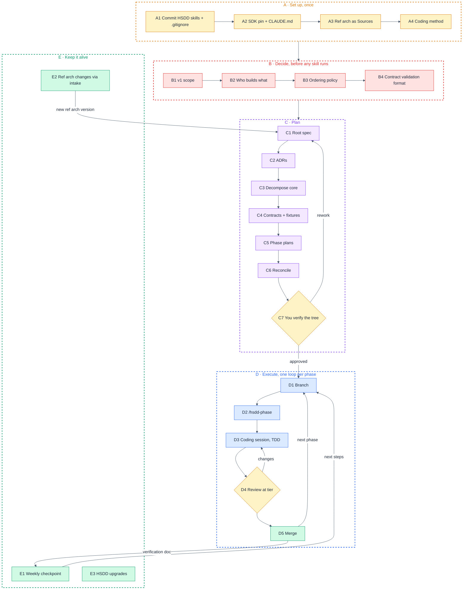
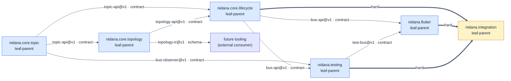

# nidana-bus-dart: Applying HSDD

- **Synced:** 2026-10-12
- **Method:** HSDD v0.10.0 (`mpurbo/hsdd` main, tag `v0.10.0`), vendored in this repo
- **Input:** Nidana Bus reference architecture v0.15.0 (`~/git/nidana-docs/arch/`): Specification (normative), Guide and Rationale (informative)
- **Target:** this repository, greenfield, one repo, one owner

This guide applies HSDD to this project. It does not re-explain HSDD. Every step names what you type, what you get, and how you know it is done. Stages A and B take about two hours. Stage C is the real planning work. Stage D repeats once per phase.

> This file lives in `tmp/`, which is git-ignored. Git keeps no copy of it. Move it to `docs/` if you want it versioned.

## The path at a glance



## Starting state

Synced on 2026-10-12. Each row changes something in the steps below.

| Item | State | Consequence |
|---|---|---|
| This repo | `LICENSE`, a project `.gitignore`, HSDD skills under `.agents/skills/` with links in `.claude/skills/`, HSDD commands in `.claude/commands/`, `skills-lock.json`. None of it committed yet. | A1 commits it |
| HSDD skills | All 11 skills at v0.10.0, installed at project level from `mpurbo/hsdd`; identical to `~/git/hsdd/skills` | No global HSDD install exists, so the project copy is the only one a session can load |
| Reference architecture | v0.15.0, three files in `nidana-docs/arch/`, pushed at `b50c301` | Only the Specification binds; the Guide and Rationale inform |
| OpenSpec | Not installed | Needed only if A4 picks it |
| Dart | Not on PATH; fvm has Flutter 3.29.3 (Dart 3.7.2) | Pin an SDK in the repo; every gate calls `fvm dart` or `fvm flutter` |
| Old Dart spec | `nidana-docs/loop/ai/spec/dart/`, built on ref arch v0.10.2 | Superseded. Do not pass it to any skill |

---

## Stage A: Set up

### A1. Commit the HSDD skills and the `.gitignore`

The skills are vendored: they live in this repo and are committed, not installed per machine.

| Path | In git | Why |
|---|---|---|
| `.agents/skills/`, `.claude/skills/` (links), `skills-lock.json` | Tracked | A git worktree contains only tracked files. HSDD plans in parallel worktrees and superpowers executes phases in them, so ignored skills would be missing from every worktree session. Fresh clones, cloud sessions and you after a long break get the HSDD version the tree was planned with, and an upgrade becomes a reviewed commit (E3). |
| `.claude/commands/` | Tracked | The `/hsdd-*` slash commands |
| `.claude/settings.local.json`, `CLAUDE.local.md` | Ignored | Personal settings |
| `pubspec.lock` at the workspace root | Tracked | Every gate resolves the same versions, so a dependency release cannot break a gate in the middle of an unrelated phase. This departs from Dart's advice for library packages; the weekly upgrade check in E1 keeps that advice's benefit. |
| `pubspec.lock` below the root | Ignored | In a pub workspace only the root lock is real |
| `.fvmrc` | Tracked | The SDK pin |
| `.fvm/` | Ignored | Per-machine SDK link |
| `hsdd/`, `hsdd-context/`, `openspec/`, `docs/superpowers/plans/` | Tracked | HSDD governance and execution records |
| `tmp/` | Ignored | Scratch, including this guide |

```bash
cd ~/git/nidana-bus-dart
ls .claude/skills | grep -c hsdd                                          # expect 11
diff -rq --exclude=.DS_Store ~/git/hsdd/skills .agents/skills && echo same   # with ~/git/hsdd on main
git add -A && git commit -m "chore: vendor HSDD v0.10.0 skills and commands, add .gitignore"
```

**Done when** `git ls-files .agents/skills | wc -l` prints 47 and `git status` is clean. Keep HSDD out of your global skills, so there is exactly one copy a session can load.

### A2. SDK pin and CLAUDE.md

```bash
fvm releases | tail -5     # pick the current stable
fvm use <version>          # writes .fvmrc; commit it
fvm dart --version
```

The installed 3.29.3 is enough for sealed classes, records and pub workspaces (Dart 3.6+), but it is 18 months old. Pin the current stable unless you have a reason not to. The version becomes an ADR in C2.

Add a short `CLAUDE.md` so every session, including phase sessions, starts with the same three facts:

```markdown
# nidana-bus-dart
Dart/Flutter implementation of Nidana Bus. The normative spec is
ref/nidana-docs/arch/nidana-bus-ref-arch-spec-v0_15_0.md.
Process: HSDD. Everything under hsdd/ changes only through the hsdd-* skills.
Toolchain: always `fvm dart` and `fvm flutter`, never a bare `dart`.
```

### A3. Make the reference architecture reachable as Sources

Planning skills read the node's Sources directly, so the files must resolve from this repo on any machine.

| Option | How | Trade-off |
|---|---|---|
| **Submodule (recommended)** | `ref/nidana-docs` pinned to a commit | One copy of the truth. The pin records which ref arch version the tree was built from, and bumping it is a deliberate act. Costs `--recurse-submodules` on clone and brings the whole docs repo along. |
| Vendored snapshot | Copy the three v0.15.0 files to `docs/ref-arch/` | Simplest. It is exactly how this repo ended up with stale docs it later deleted. |
| GitHub URLs | Sources point at permalinks | No copy, but `Samsara-Stream` repos are private, so an agent cannot fetch them, and nothing works offline. |

```bash
git submodule add git@github.com-personal:Samsara-Stream/nidana-docs.git ref/nidana-docs
git -C ref/nidana-docs log -1 --oneline   # expect b50c301 or later, holding the v0.15.0 files
git add .gitmodules ref/nidana-docs .fvmrc CLAUDE.md
git commit -m "chore: pin reference architecture v0.15.0 and the SDK"
```

### A4. Pick the coding method

| | `superpowers` (recommended) | `openspec` (HSDD default) |
|---|---|---|
| Installed | Yes | No: `npm install -g @fission-ai/openspec@latest`, then `openspec init` at the repo root |
| Per phase | `writing-plans` from the derivative, then `subagent-driven-development` | `opsx:new` → proposal, design, tasks, apply, archive |
| Accumulates | Plans under `docs/superpowers/plans/`, verification docs | Per-capability living specs under `openspec/specs/` |
| Fit here | The ref arch Spec already is the behavioral spec, and the contract fixtures (B4) restate it executably. A third behavioral spec in `openspec/specs/` adds little. | Better if you want a per-capability requirements history that survives ref arch versions. |

The choice lands in `hsdd/conventions.md` as `**Coding method:**`. You set it through the C1 prompt, not by hand. `/hsdd-phase {id} --method {other}` overrides it for one phase if you want to try both.

---

## Stage B: Decide before any skill runs

`hsdd-spec` stops on the axis question and reshapes the whole tree around these answers. Settle them now.

### B1. v1 scope

| Option | Contents | For | Against |
|---|---|---|---|
| Core only | Pure-Dart runtime + TestBus | Fastest route to proving Spec §2, §3, §6 and §7 in code | Nothing a Flutter app can use; module scope binding (§7.3) stays untested |
| **Core + Flutter (recommended)** | Runtime, TestBus, Flutter adapter | First usable release; exercises module scope against real routes | Adds a Flutter toolchain and a second gate |
| Guide App. B layout | Plus navigation, persistence, codegen, lints, devtools | Matches the Guide's package list | Ten packages. Persistence is still an open question (Guide §10.5). Lints duplicate what runtime first-claim already guarantees (Spec §3.11). |

If navigation is out, the acceptance scenario is Guide App. A without `nav-resolver` and the executor. Navigation is opt-in by design (Guide §3.7), so it can return later through `hsdd-intake` without reshaping the tree.

### B2. Who builds what

The mandatory axis question gets a one-line answer, for example: "Purbo alone with coding agents; one team; one repo." That gives `**Teams:** single-team` and lets `hsdd-spec` slice by capability. The pure-Dart and Flutter packages still split, because they are different deploy targets with different toolchains and gates.

### B3. Ordering policy

| `fp-progression` (recommended) | `interfaces-first` (default) |
|---|---|
| Types, then pure functions, then effects, then composition. Much of this runtime can be pure: ownership claims and releases, envelope lineage, cycle detection over the IR, scope compatibility, dedup. The policy forces those into small, easy-to-review phases before subjects and dispatchers appear. | Interfaces and types first, effects behind interfaces, composition last. Less rigid, fewer bands, and phases follow features more than purity. |

Cost of `fp-progression`: more small pure phases, which the sizing floor may then merge.

### B4. Contract validation format

A `stable` contract needs a schema or fixtures under `hsdd/contract/`. `hsdd-contract` writes them at the root, and the producing phase's gate replays them. Most of this tree's contracts are Dart APIs, which have no natural JSON schema.

| Option | What sits in `hsdd/contract/fixture/{slug}/` | For | Against |
|---|---|---|---|
| **Scenario fixtures (recommended)** | YAML scenarios: declared topics, publishes in order, expected observations per subscriber, expected envelope lineage, expected rejections; a JSON Schema for the scenario format | Data rather than code, so `hsdd-contract` can author it. Encodes Spec §3 directly. The same files can later drive Kotlin, Swift or TS ports, which answers Guide §10.1's cross-platform parity question. | Needs a replay runner, which the first producing phase builds |
| Dart conformance tests | `*_test.dart` files | No runner needed | Code written outside a phase; Dart-only |
| API surface snapshot | Generated API dump | Catches breaking signature changes | Says nothing about behavior |

`topology-ir@v1`, if it becomes a contract, has a real JSON shape (`TopologyDefinition` from Spec §6.5), so it gets an ordinary JSON Schema. The choice is cross-cutting and becomes an ADR in C2.

---

## Stage C: Plan

### C1. Root spec

Run from the repo root, in a fresh session:

```text
/hsdd-spec Write the high-level spec for nidana, the Dart/Flutter implementation of Nidana Bus.

Sources:
- ref/nidana-docs/arch/nidana-bus-ref-arch-spec-v0_15_0.md: accepted RFC, normative; every rule binds v1.
- ref/nidana-docs/arch/nidana-bus-ref-arch-guide-v0_15_0.md: informative; Dart mapping (§6.1, §6.3 to §6.5),
  TestBus questions (§10.1), package layout (App. B), acceptance scenario (App. A).
- ref/nidana-docs/arch/nidana-bus-ref-arch-rationale-v0_15_0.md: informative only, not decomposed;
  explains why, adds no rule.

v1 scope: <your B1 answer>. Out of scope for v1: <the rest>.
Who builds what: <your B2 answer>.
Seed conventions with: Coding method: <A4>; Ordering policy: <B3>; Teams: single-team.
Every gate runs through fvm (`fvm dart`, `fvm flutter`).
```

The Spec's header still says "Status: Draft". Listing it as an accepted RFC is your call that v0.15.0 is frozen for v1. If it is not frozen, say "draft" and expect more open questions.

**A likely shape**, to compare against what `hsdd-spec` proposes. It is a sketch, not the answer:



The three `nidana.core.*` nodes sit under an internal `nidana.core` (the pure-Dart package). With everything in one package, `nidana.core` gets one line saying `nidana.integration` covers its integration, instead of a separate `nidana.core.integration`.

| Node | Package | Spec sources | Guide sources |
|---|---|---|---|
| `nidana.core.topic` | core | §2.1, §2.4, §2.5, §3.1 to §3.6, §3.10 to §3.12, §4.2, §4.3, §8, §9 | §6.1, §6.5 (Dart rows) |
| `nidana.core.topology` | core | §2.2, §3.8, §3.9, §4.6, §6, §10 | §6.3 (Dart) |
| `nidana.core.lifecycle` | core | §2.3, §3.13, §5, §7, §11 | §8.1 |
| `nidana.testing` | test | §3.6, App. A.7 | §10.1 |
| `nidana.flutter` | flutter | §5.6, §7.3 (Flutter row) | §6.3, §6.4 (Flutter rows) |
| `nidana.integration` | tests only | §3 end to end | App. A, minus navigation if B1 deferred it |

**ADRs to expect** as proposals from C1, each materialized in C2:

- Reactive engine: RxDart with `sync: true` subjects (Guide §6.1, Spec §3.3), or `dart:async` only.
- Package and workspace layout: pub workspace with melos scripts; package names from Guide App. B (`nidana_dart_*`) or shorter.
- Contract validation format (B4).
- SDK floor and pinning through fvm.

**Open question to expect:** the TestBus API (Guide §10.1), minted at the root. It resolves when `test-bus@v1` is authored in C4.

**Done when:**

- [ ] `hsdd/conventions.md` carries your coding method, ordering policy and `single-team` lines.
- [ ] Root `## Sources` lists the three files with authority; the Rationale is marked "informative only, not decomposed" with a reason.
- [ ] Every child has its own `hsdd/spec/{id}.md` and a Sources line naming Spec sections, not whole files.
- [ ] Every edge is typed, and `hard` edges point only into `nidana.integration`.

Then look at it the visual way:

```text
/hsdd-summary Render the plan page.
```

Open `hsdd/summary/summary.html`.

### C2. ADRs

```text
/hsdd-adr Write ADR-001 for the reactive engine decision: <your choice and why>.
```

Repeat for each accepted proposal. Each ADR sets `Governed by` on the nodes it affects and regenerates the registry. A proposal you reject stays a `D{n}` inside the node that owns it.

### C3. Decompose `nidana.core`

```text
/hsdd-spec Break down @hsdd/spec/nidana.core.md into its subsystems.
```

If it offers `nidana.core` as one leaf-parent, count the phases it would need. Above about six, push back: add a level, do not widen. If it proposes a node that cannot be tested without a sibling's internals, for example observers split away from topic delivery, merge the two.

### C4. Contracts and fixtures

One prompt per contract id the tree names:

```text
/hsdd-contract Define topic-api@v1: nidana.core.topic produces it;
nidana.core.topology, nidana.core.lifecycle, nidana.testing and nidana.flutter consume it.
Validation per ADR-<n>: scenario fixtures.
```

**This is where the reference architecture reaches the code.** A phase session sees its phase block, the Interface and Guarantees of its contracts, and its ADRs, and nothing else. It never sees the Spec. Every Spec rule a phase must honor therefore has to sit either in a contract's Guarantees, cited by section (for example "per-topic ordering, Spec §3.3"), or in a phase's Scope or Verification line in C5. Write Guarantees as the Spec's rules restated with section numbers, and write one fixture scenario per rule.

**Done when:**

- [ ] Every contract is `status: draft` with `phase_ids: provisional`; reconcile flips them later.
- [ ] Every contract has fixtures, plus a JSON Schema where B4 says so.
- [ ] `node hsdd/scripts/gen-registry.mjs` runs clean, and `hsdd/contract/INDEX.md` lists every id the specs name.

### C5. Phase plans

One leaf-parent per prompt. Each plan reads only frozen governance, so independent leaf-parents can be planned in parallel worktrees and merged afterwards. Commit `hsdd/` before creating worktrees: a worktree sees only what is committed, which is also how it gets the skills (A1).

```text
/hsdd-phase-plan nidana.core.topic is a leaf-parent. Write its phase plan.
Default gate: `fvm dart analyze --fatal-infos && fvm dart test`.
```

For `nidana.flutter` the default gate is `fvm flutter analyze && fvm flutter test`. The first phase that produces a contract also builds the fixture replay command, and every later producer's gate calls it.

**Check each plan for:**

- [ ] A summary table first, no phase above 8 tasks or about 400 changed lines, and every kept-small pair has a one-line reason.
- [ ] Tiers by risk. In this project `full-review` belongs to ordering and reentrancy (Spec §3.3, §3.4), ownership and first-claim (§3.11), envelope lineage (§2.4, §3.5), the startup barrier (§3.13), and module reference counting with the grace timer (§7.3). Types and scaffolding are `gate-only`.
- [ ] Contract replay in every producing phase's Gate.
- [ ] A `## Governance updates (pending reconcile)` section at the end, and no edit anywhere under `hsdd/contract/`, `hsdd/adr/` or `hsdd/conventions.md`.

### C6. Reconcile

After every plan branch is merged to `main`:

```text
/hsdd-reconcile Drain the pending governance updates.
```

**Done when** every contract reads `phase_ids: final` and `status: stable`, no `request` is left unresolved, and both registries are regenerated.

### C7. Verify the tree yourself

This is the lead's gate, and you are the lead. Re-render the plan page and walk it from the root down. Then run one traceability pass that HSDD does not do for you, in a separate session, writing outside `hsdd/`:

```text
For every rule in ref/nidana-docs/arch/nidana-bus-ref-arch-spec-v0_15_0.md §2 to §11 phrased with
must, never, always, rejects or is guaranteed, list where it lands under hsdd/: a contract Guarantee
(file and line) or a phase's Scope or Verification line (phase id). Mark the rest "unassigned".
Write the table to tmp/spec-coverage.md. Do not edit anything under hsdd/.
```

Every "unassigned" row becomes a contract amendment through `hsdd-contract` or a phase-plan change, or you decide on purpose that the rule is out of v1 scope. Then commit:

```bash
git add hsdd && git commit -m "hsdd: tree, contracts and phase plans for v1"
```

---

## Stage D: Execute one phase

Repeat for every phase in dependency order. Start with `nidana.core.topic.1`, since everything else consumes `topic-api@v1`.

| Step | You do | Done when |
|---|---|---|
| D1 Branch | `git switch -c integration/nidana.core.topic main` the first time for a node, then `git switch -c nidana.core.topic.1` | You are on the phase branch |
| D2 Context | `/hsdd-phase nidana.core.topic.1` | `hsdd-context/nidana.core.topic.1.md` exists, plus the derivative for your method; the report has no stop and you have read every warning |
| D3 Code | **superpowers:** in a new session, `Use superpowers:writing-plans to plan hsdd-context/superpowers/nidana.core.topic.1.md`, run its Plan check, then execute with `subagent-driven-development`. **OpenSpec:** `opsx:new`, then the usual cycle. | The gate passes and `hsdd/verify/nidana.core.topic.1.verification.md` exists |
| D4 Review | At the tier the phase declares. `gate-only`: the gate passed. `spot-check`: skim the diff. `full-review`: read the diff, run the doc's commands, think through edge cases. | Sign-off filled in; every Outstanding item and every Learning carries a disposition |
| D5 Merge | Merge the phase branch into `integration/{node}`. When the node's last phase lands, merge that into `main`. Never squash. | The verification doc is on `main`, which is what "done" means |

**When a contract turns out wrong mid-phase**, the session stops at a task boundary and writes the gap under Outstanding. You record it in the node's plan, fix the contract at the root with `/hsdd-contract`, bring the change into the phase branch, re-run `/hsdd-phase`, and resume. Never let the session work around the contract.

**Never start a phase session without D2.** A session on the previous phase's context builds against the wrong contracts and the wrong gate, and nothing warns you.

---

## Stage E: Keep it alive

### E1. Weekly checkpoint

You came back to this project after six months with no memory of where it stood. The checkpoint exists to prevent exactly that.

Before it, check dependency drift on a throwaway branch. This is what the committed lock (A1) would otherwise hide:

```bash
git switch -c chore/deps main
fvm dart pub upgrade && fvm dart analyze --fatal-infos && fvm dart test
# green: commit pubspec.lock and merge. red: the failure becomes a step in the checkpoint's plan.
```

Then:

```text
/hsdd-checkpoint Full checkpoint. Repos: ~/git/nidana-bus-dart.
/hsdd-summary Render the checkpoint page.
```

You get a dated progress report, an execution plan with next week's steps and the prompts to paste, the atlas, and `hsdd/summary/checkpoint.html`. Run it at the end of each working week, and before any long break.

A milestone document is optional when you work alone. Generate it with `/hsdd-milestone` once every leaf-parent is phase-planned if you want a dated v1 window. That is also the first point where the total phase count is known.

### E2. When the Dart build finds a problem in the reference architecture

The Specification is upstream of this tree. A phase that finds a Spec rule wrong, ambiguous or unimplementable does not patch `hsdd/` around it.

1. The verification doc records it under Learnings with a disposition for whatever changed in `hsdd/`, or `dropped` with a reason.
2. Fix the reference architecture in `nidana-docs` and publish a new version.
3. Bump the pin: `git -C ref/nidana-docs pull && git add ref/nidana-docs`.
4. `/hsdd-intake Ref arch v0.16.0 changed Spec §<n>: <what>.` routes the change into the tree: an amended contract, an appended phase, or nothing.

### E3. Upgrading HSDD

An upgrade is its own commit on `main`, never part of a phase branch. Do it between phases.

```bash
git -C ~/git/hsdd pull                         # the commands come from the clone
npx --yes skills update -p                     # project skills from mpurbo/hsdd
cp ~/git/hsdd/commands/*.md .claude/commands/  # the skills CLI does not install commands
git diff --stat .agents .claude skills-lock.json
git add .agents .claude skills-lock.json && git commit -m "chore: HSDD v<x.y.z>"
```

Then read HSDD's CHANGELOG for the version. Its upgrade notes say what the first checkpoint after an upgrade does. Re-run `/hsdd-phase` before the next phase, since templates may have changed.

---

## Project-specific pitfalls

- **The v0.10.2 Dart spec** in `nidana-docs/loop/ai/spec/dart/` predates every v0.14 and v0.15 decision: single ownership, unscoped topics, the startup barrier, no lazy scope. Feeding it to any skill reintroduces all of them.
- **The Guide is informative.** App. C marks lints and codegen as "planned v1", but that plan covers every platform. Runtime first-claim is the guarantee for single ownership (Spec §3.11), so a v1 without lints is consistent with the Spec.
- **Thin contract Guarantees** mean a phase can pass its gate while violating the Spec, because the session never saw the rule. C4 and the C7 coverage pass are the defense.
- **A node growing past about six phases** means a missing level. Go back to `hsdd-spec`, not `hsdd-phase-plan`.
- **Editing `hsdd/contract/`, `hsdd/adr/` or `hsdd/conventions.md` by hand** while plans are open breaks the freeze that keeps parallel planning merge-clean. Route changes through `hsdd-contract`, `hsdd-adr` or `hsdd-reconcile`.
- **Ignoring `.agents/` or `.claude/` again** strips the skills from every worktree. Only `.claude/settings.local.json` and `CLAUDE.local.md` stay ignored.
- **Installing HSDD globally again** puts a second copy next to the vendored one. Upgrade through E3 instead.
- **Anything worth keeping in `tmp/`** has no git copy. This guide included.
