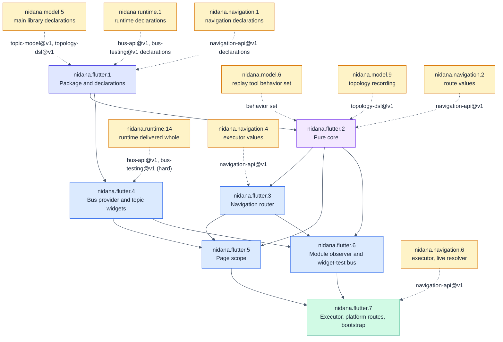

# nidana.flutter: Flutter Binding

- **Kind:** leaf-parent
- **Purpose:** the Flutter UI runtime adapter (Guide Appendix B layer 6, Spec Appendix A.8): bus reference acquisition, topic-driven widgets, page publishers, page and module scope binding, and the Flutter navigation executor
- **Owns:**
  - package `nidana_dart_runtime_flutter` (ADR-002)
  - `BusProvider`, an `InheritedWidget` at the app root, and `BuildContext` access to the bus; no global accessor (Spec §3.1, Guide §6.4)
  - topic-driven widgets: a state-topic builder that renders its first frame from `getCurrentValue` and later frames from `observe` (Spec §2.5), and a replay-topic counterpart over `getBufferedValues`; topology output drives the UI directly, with no interposed state holder (Rationale §5.1, §5.2)
  - page publishers whose `source` is derived from the route, `page:{route}` (Spec §2.4)
  - page-scope binding: a widget that activates its `PAGE` topologies on mount and deactivates them on unmount (Spec §7.1, §7.2)
  - module-scope binding: a route observer that matches route prefixes and acquires and releases the runtime's module scope references on push, pop and replace (Spec §7.3)
  - `FlutterNavigationRouter`, navigation-api@v1's `NavigationRouter` port over Flutter's own `Navigator`, and `FlutterNavigationExecutor`, which wires it to that contract's `NavigationExecutor` and turns platform routes into intents (Guide §3.4, §3.5; flutter-binding@v1 Refinements 1, 2 and 7)
  - bus shutdown when the coordination domain ends (Spec §11.2)
  - a widget-test library for apps, `WidgetTestBus` in the package's `testing.dart`: helpers that run a real bus under `testWidgets` with the production scheduler provider, so `tester.pump` drives time; they construct the bus inside the test body and shut it down when the tree unmounts, so no bus timer is pending when the body ends (ADR-003); the library imports neither `flutter_test` nor `test` (ADR-002 item 4)
- **Does not own:** reference counting arithmetic and the grace timer (nidana.runtime); intent vocabulary, guard and resolution (nidana.navigation); the app's routes, widgets and auth state
- **Consumes:** [topic-model@v1, topology-dsl@v1, topology-ir@v1, bus-api@v1, bus-testing@v1, navigation-api@v1]
- **Produces:** [flutter-binding@v1]
- **Governed by:** [ADR-001, ADR-002, ADR-003]
- **Sources:**
  - `ref/nidana-docs/arch/nidana-bus-ref-arch-spec-v0_15_0.md` §2.4, §2.5, §3.1, §5.2, §5.6, §7.1 to §7.4, §11.1, §11.2, Appendix A.8
  - `ref/nidana-docs/arch/nidana-bus-ref-arch-guide-v0_15_0.md` §3.4, §3.5, §6.4, §9.3, Appendix B.1
  - `ref/nidana-docs/arch/nidana-bus-ref-arch-rationale-v0_15_0.md` §5.1 to §5.4
- **Decomposes into:** phases (see hsdd-phase-plan)
- **Isolation strategy:** widget tests with `flutter_test` on the real runtime, time driven by `tester.pump` (ADR-003); navigation-api@v1's executor conformance suite is bound to `FlutterNavigationExecutor` and its router under `testWidgets`; nothing needs a device

## Overview

The adapter is thin by design: every decision about delivery, ownership, scope lifetime and grace lives in the runtime, and every decision about intents lives in navigation. This node binds those to Flutter's widget and route lifecycles. Flutter's UI runs on the same isolate as the rest of the Dart code, so no dispatcher hop is needed for UI-bound topics (Spec §11.1).

Two runtime facts shape the widgets (root D9; bus-api@v1 G17, which resolved OQ-R1): `getCurrentValue` is synchronous, while a new `observe` subscription receives its first value in the first provider-zone microtask after `listen`. A topic widget therefore takes its first frame from `getCurrentValue` and must not render the replayed first value a second time.

## Open questions

| ID | Question | Status | Waits on | Affects |
|----|----------|--------|----------|---------|
| OQ-F1 | Which router does the Flutter executor and the module binding target: Flutter's own `Navigator` and `Router` APIs, or `go_router` as Guide §3.4 shows, and does that router become a dependency of the adapter? | RESOLVED (2026-10-18): flutter-binding@v1 Refinement 1, G11 to G13, G18 | none | flutter-binding@v1, nidana.integration |

### OQ-F1: Router target

Spec §7.3 binds module scope through a `RouteObserver` and a route-prefix match; Guide §3.4's executor calls `GoRouter` (`go`, `push`, `pop`, `pushReplacement`). A `RouteObserver` sees `Route` objects whose names depend on how the app configures its router, and `BackTo` needs pop-until semantics the router may lack (Guide §3.2). Options: target the framework's `Navigator` and `Router` APIs with a small adapter interface the app implements for its router; or depend on `go_router` (18.1.0 on pub.dev, 2026-10-14) and support it first. The first keeps the adapter's dependency set to Flutter alone; the second matches the Guide's example and gives route paths for the prefix match without app glue.

Resolved (2026-10-18) by flutter-binding@v1 Refinement 1, G11 to G13 and G18: the first option. `FlutterNavigationRouter` and `ModuleScopeObserver` target Flutter's own `Navigator` through its imperative API (`push`, `pushReplacement`, `pop`, `popUntil`) and `NavigatorObserver`, hosted by the app's `WidgetsApp` or `MaterialApp`, and `nidana_dart_runtime_flutter` depends on no router package. `docs/auto-run/experiments/flutter-binding-fixtures/` settled the facts: Navigator calls reach observers before they return, while go_router 18.1.0 reaches the Navigator only after a frame, has no pop-until, navigates to the platform's initial route before a bus guard could see it, resets the stack by its route tree where navigation-api@v1 Refinement 7 has `GoTo` push, and brings `material_ui`, `cupertino_ui`, `flutter_localizations` and `intl`. The prefix match reads the entry's route path for a router route and the route's name for any other route, so no app glue is needed for either. An app on go_router, or on any `Router`-based setup, implements navigation-api@v1's `NavigationRouter` itself; integration with Flutter's `Router` widget is not in v1. nidana.flutter.1 lands the declarations, nidana.flutter.3 the router, nidana.flutter.6 the module observer and nidana.flutter.7 the executor.

## Decisions

### D1: The phase cut

The ordering policy is `fp-progression` (conventions), so the plan runs in four bands, cut into seven phases of one PE each:

1. **Types.** nidana.flutter.1 lands every declaration of both public libraries (D2), as ADR-001 item 10 requires of the first producing phase.
2. **Pure functions.** nidana.flutter.2 lands what decides without a widget tree or a bus: route paths and the prefix rule, the page route derivation, the platform route rule, the router's stack algebra (applying `RouterCall`s to a stack and planning the Navigator operations, validation included, so that a perform is checked whole before the Navigator is touched, G11), and the holder counts behind `PageScope`'s per-id rule (G8). `ModuleRoutes` is pure, so G9 is delivered there.
3. **Effects.** The router over the Navigator (nidana.flutter.3), the bus provider and the topic widgets (nidana.flutter.4), the page scope (nidana.flutter.5), the module observer with the widget-test bus (nidana.flutter.6).
4. **Composition.** The executor, platform route forwarding and the bootstrap (nidana.flutter.7): it composes the router, navigation-api@v1's `NavigationExecutor`, the bus provider and the module observer, and its gate replays the contract unrestricted.

Three facts of the fixtures shape the cut. The router touches no bus, and neither do G9's and G11 to G13's cases, so the router lane can run before nidana.runtime ships (D6). G7 and G10 each have a case that hosts a `FlutterNavigationRouter` (a page under a router route; `pathOf` of a router route), so the page scope and the module observer follow the router. G17's last case unmounts a `wrap` over a module observer to show a grace timer cancelled, so the widget-test bus lands with the module observer. The stand-in that passed both suites is 741 lines without doc comments or tests of its own (`docs/auto-run/experiments/flutter-binding-fixtures/`); the seven phases come to 320 to 450 lines each with both.

Alternatives considered: six phases with each effect phase writing its own pure helpers (one cycle fewer, but the stack algebra and the holder counts would be tested only through widget tests, against the policy's pure band); the widget-test bus with the bus provider (nidana.flutter.4 would exceed the PE and G17 would still replay only once the module observer exists); the page scope and the module observer as one phase (about 730 lines, two PEs); the bootstrap, G16, as its own phase (one case and no code beyond nidana.flutter.7's, below the sizing floor).

### D2: What nidana.flutter.1 lands

nidana.flutter.1 lands every declaration of `nidana_dart_runtime_flutter.dart` and `testing.dart`, transcribed from flutter-binding@v1's Interface with its doc comments, in the files of D3:

1. every class, typedef, constructor, static member and getter the Interface states, with its modifiers, a final field behind every getter that names a field, and the `show` export lists of both libraries, complete (G1, G2). The reject codes were confirmed against a stand-in built that way (`docs/auto-run/experiments/flutter-binding-fixtures/`);
2. complete from the start: the const constructors of `BusProvider`, `StateTopicBuilder` and `ReplayTopicBuilder` assign their fields, `ownsBus` is true for the unnamed constructor only, `PageScope` and `ModuleRoutes` copy their collection arguments into unmodifiable collections, and `WidgetTestBus.testSource` is `ServiceSource('test')`;
3. a body that throws `UnimplementedError` for everything else: the four widgets' `createState`, `BusProvider.of` and `maybeOf`, `PageScope.publisherOf`, `ModuleRoutes.matches`, `ModuleScopeObserver`'s constructor, `pathOf` and callbacks, every member of `FlutterNavigationRouter`, `FlutterNavigationExecutor`'s constructor and members, `WidgetTestBus`'s constructor and members. The argument checks of `PageScope` (G8) and `ModuleRoutes` (G9) land with the phase that delivers their guarantee.

With the package skeleton and D5's test it comes to about 450 lines. A consumer building on nidana.flutter.1 compiles against the real declarations; a call into a body before its delivering phase throws.

Alternatives considered: working `State`s or argument checks in nidana.flutter.1 (behavior in a gate-only phase whose gate replays no behavior); getters without fields (the confirmed reject codes would change, as nidana.model D3 found for `assignment_to_final`).

### D3: Source layout of `nidana_dart_runtime_flutter`

ADR-002 item 3 fixes the two public libraries, `lib/nidana_dart_runtime_flutter.dart` and `lib/testing.dart`. Below them, one library per area, so that phases that can run side by side edit disjoint files:

- `lib/src/core/route_path.dart`: segments, the prefix rule, an entry's settings name, the page route derivation, the platform route rule (nidana.flutter.2);
- `lib/src/core/stack_plan.dart`: the router's stack algebra and its sealed Navigator operations (nidana.flutter.2);
- `lib/src/core/holder_counts.dart`: immutable holder counts per key (nidana.flutter.2);
- `lib/src/module_routes.dart`: `ModuleRoutes` (nidana.flutter.1, .2);
- `lib/src/router.dart`: `NavigationRouteBuilder`, `FlutterNavigationRouter` and the registry of router routes (D9) (nidana.flutter.1, .3);
- `lib/src/bus_provider.dart`: `BusProvider` (nidana.flutter.1, .4);
- `lib/src/topic_builders.dart`: `StateTopicBuilder`, `ReplayTopicBuilder` (nidana.flutter.1, .4);
- `lib/src/page_scope.dart`: `PageScope` (nidana.flutter.1, .5);
- `lib/src/module_scope_observer.dart`: `ModuleScopeObserver` (nidana.flutter.1, .6);
- `lib/src/widget_test_bus.dart`: `WidgetTestBus` (nidana.flutter.1, .6);
- `lib/src/executor.dart`: `FlutterNavigationExecutor` (nidana.flutter.1, .7).

`lib/src/core/` imports no Flutter library and nothing of `nidana_dart_runtime`: its functions take and return `nidana_dart_navigation` values, strings and their own types. Each phase writes its own test files under `test/`. `README.md`, `CHANGELOG.md` and the copy of `LICENSE` (ADR-002 item 9) are written once, by nidana.flutter.1. Only nidana.flutter.1 edits the root `pubspec.yaml` and `pubspec.lock`, and no two phases of this plan edit one file, so none collides with another.

Alternatives considered: one library with part files (nidana.flutter.5 and .6 would serialize behind `Collides with`); `ModuleRoutes` and `ModuleScopeObserver` in one library (nidana.flutter.2 and .6 would edit one file, harmless only because .6 follows .2).

### D4: What every gate runs

- Every gate opens with the default gate, run from the workspace root: `fvm dart pub get --enforce-lockfile`, `fvm dart analyze --fatal-infos`, the `structure` set over every contract (`fvm dart run nidana_contract_check --all --set structure`), and the package's own tests, D5's included, as `fvm flutter test --no-pub packages/nidana_dart_runtime_flutter`. It opens as nidana.model's and nidana.navigation's gates do (nidana.model D5, nidana.navigation D3). `docs/auto-run/experiments/flutter-phase-facts/` (F1, F2) shows `fvm dart pub get --enforce-lockfile` passing with a Flutter member in the workspace and `fvm flutter test --no-pub packages/{member}` running the member's tests from the root, with the root as working directory.
- nidana.flutter.1 replays flutter-binding@v1 with `--set surface,reject`: it delivers no behavior guarantee.
- nidana.flutter.1 also runs the tests of the four pure members in its dependency closure, `fvm dart test packages/{member}` for `nidana_contract_check`, `nidana_dart_contracts`, `nidana_dart_runtime` and `nidana_dart_navigation` (conventions, Phase design). Its `pub get` adds the first Flutter member, which moves `test` from the newest release within `^1.31.1` to 1.31.1 for every pure member (ADR-002 item 4 and Consequences), so the gate checks that move where it happens. A pure member outside the closure may not exist yet, so the gate cannot name it: `nidana_dart_codegen`'s tests run again from nidana.tooling.codegen.8, which waits on nidana.flutter.1, while `nidana_dart_lint`'s run again only if a nidana.tooling.lint phase merges after this one, and otherwise rest on ADR-002 item 4's rule that no member's tests use a `test` API newer than 1.31.1.
- Every later gate replays flutter-binding@v1 with `surface` and `reject` in full and `behavior` restricted by `--guarantee` to the guarantees delivered within the phase's own dependency closure, cumulatively, so that no gate depends on whether nidana.flutter.2 and .3 or nidana.flutter.4 merged first, or nidana.flutter.5 or .6 (ADR-001 item 10).
- Before nidana.flutter.7, the restriction admits no case of `flutter_navigation_executor_test.dart`, whose suite is navigation-api@v1's, so that binding is not run and counts as passing (ADR-001 item 9; `docs/auto-run/experiments/empty-guarantee-selection/`).
- nidana.flutter.7, the last producing phase, replays flutter-binding@v1 unrestricted: every case of both bindings, navigation-api@v1's executor suite bound to `FlutterNavigationExecutor` among them. The replay tool runs both bindings under `flutter test --no-pub` from the workspace root (ADR-001 item 9).
- Tests run against the producers' real packages, from the phases D6 names; no stand-in binding (ADR-001 item 11) is needed.
- Every gate is written out in full in its phase, so the phase context carries the whole command.

**Corrected 2026-10-18.** As first written, the empty-selection bullet cited nidana.model D2 items 1 and 4, and nidana.flutter.1's gate ran only this package's tests. ADR-001 item 9, amended on 2026-10-18, now states that a binding the restriction admits no case of is not run and counts as passing, so the bullet cites it. ADR-002's amendment of the same day (item 4 and Consequences) records that nidana.flutter.1's `pub get` moves `test` to 1.31.1 for every pure member and that no member's tests may use a newer `test` API; the new second bullet adds the tests of the pure members in nidana.flutter.1's closure to its gate, so that move is checked in the phase that makes it. No phase, order or dependency changed.

### D5: G18 and G19 checked by a test

flutter-binding@v1 leaves G18 and G19 to this node's gates. nidana.flutter.1 writes `packages/nidana_dart_runtime_flutter/test/package_properties_test.dart`, which every gate runs through the default gate:

- G18 (ADR-002 items 3 and 4): the pubspec's `dependencies` are exactly `flutter` (SDK), `nidana_dart_contracts`, `nidana_dart_runtime`, `nidana_dart_navigation` and `meta`, and its `dev_dependencies` exactly `flutter_test` (SDK); no library under `lib/` imports `package:test`, `package:flutter_test`, a `package:flutter/` library other than `widgets.dart`, `foundation.dart` and `services.dart`, a `src/` library of another package, or a package outside that list and its own; only `lib/src/widget_test_bus.dart` imports `package:nidana_dart_runtime/testing.dart`.
- G19 (ADR-003 item 8): no library under `lib/` contains `DateTime.now(`, `Stopwatch(`, `Timer(`, `Timer.run(`, `Timer.periodic(`, `scheduleMicrotask(`, `Future(`, `Future.delayed(`, `Future.microtask(` or `Zone.`, and every `StreamController` it constructs passes `sync: true`.

It finds the package from the workspace root, the nearest ancestor of the working directory that holds `hsdd/contract/` (nidana.model D6's rule), never through the package URI: under `fvm flutter test`, `Isolate.resolvePackageUri` throws `UnsupportedError` (`docs/auto-run/experiments/flutter-phase-facts/`, F3), where nidana.runtime D9 and nidana.navigation D4 use it under `fvm dart test`. A text search misses an aliased import; review covers that.

Alternatives considered: the package URI (fails under `fvm flutter test`, F3); a search in the gate (not an `fvm` command, and outside the package's tests); a lint rule (none in v1, root D1).

### D6: Which producer phase each phase waits on

The root types runtime to flutter `hard` for bus-api@v1 and bus-testing@v1, because widget tests need real delivery and reference counting, and navigation to flutter `contract` (root Dependency DAG). Root D10 defines a `hard` edge by the consumer's tests needing the producer's behavior, so this plan reads the edges per phase:

- nidana.flutter.1 compiles against declarations and runs only the surface and reject sets: it waits on nidana.model.5 (topic-model@v1 and topology-dsl@v1 in their shared main library), nidana.runtime.1 (bus-api@v1 and bus-testing@v1) and nidana.navigation.1 (navigation-api@v1), as nidana.navigation.1 waits on nidana.runtime.1.
- nidana.flutter.2 and .3 construct no bus, in their code or in the cases they replay (G9, G11 to G13). nidana.flutter.2 waits on nidana.model.9 (`topology()`, which G9's cases and its own tests call), nidana.model.6 (the behavior set its gate first runs) and nidana.navigation.2 (route equality, which a `PopUntilRoute` target match uses); nidana.flutter.3 on nidana.navigation.4 (the value equality of `NavigationEntry` and `RouteConfirmation`, which G11 to G13's cases compare).
- nidana.flutter.4 to .7 run real buses in widget tests: they wait on nidana.runtime.14, the `hard` edges, whose closure holds the model phases that delivery, activation and the live graph need (nidana.model.8, .11, .12). nidana.flutter.7 also waits on nidana.navigation.6: it constructs `NavigationExecutor`, binds the executor suite, and G16 runs the nav-resolver live (navigation-api@v1 Delivery).

So the router lane runs beside nidana.runtime's later phases, and once nidana.runtime.14 has merged the node's remaining chain is nidana.flutter.4, then .5 and .6 side by side, then .7. nidana.flutter.1, which nidana.tooling.codegen's workspace scan replays wait on (root Development flow), merges once nidana.runtime.1 and nidana.navigation.1 have. Root Development flow item 3, which as first written started the node once the runtime shipped, now states this per-phase reading and cites this decision; no edge type changed.

Alternatives considered: every phase after nidana.runtime.14, the literal reading of root Development flow item 3 as first written (no work built on declarations that a runtime phase might renegotiate mid-phase, but nidana.flutter.1 to .3 and the tooling workspace lane would sit on the critical path). The signal that would favor it: an hsdd-contract renegotiation of bus-api@v1's or navigation-api@v1's declarations during nidana.runtime's or nidana.navigation's phases.

**Corrected 2026-10-18.** As first written, this decision said that root Development flow item 3 starts the node once the runtime ships and that this decision refines it. The root flow was restated on 2026-10-18 to start both nidana.navigation and nidana.flutter on nidana.runtime.1 and to bind the `hard` edges to nidana.flutter.4 to .7, citing this decision, so the decision now says the root flow states its reading, and the alternative names the flow's first wording. The decision and its edges did not change.

### D7: Topic widgets subscribe through a widened reference

bus-api@v1 G41 (amended on 2026-10-18) lets a widened reference put a value that is not of the topic's value type into a topic: a subscription's conversion of it fails into the provider zone's uncaught-error handler and that subscription skips the value, while `getCurrentValue` and `getBufferedValues` at the value type throw `TypeError` at the call. A topic widget reads at its `T` in every build (G5, G6), so an off-type current value makes the build throw; what its subscription does decides what follows. `docs/auto-run/experiments/flutter-phase-facts/` (F4a to F4c), on a runtime that meets G41 as amended:

- With the stand-in's typed subscription (observing at `T` and skipping its first values by count), an off-type current value at mount is skipped by the runtime, the count then swallows the next on-type value, and the widget keeps showing the build error after the topic holds an on-type value (F4a); an off-type value published after mount reaches the provider zone's handler, which fails a `testWidgets` body, and marks nothing (F4b); a replay widget that reads the buffer's length at `T` fails to mount and never recovers (F4c).
- With a subscription through a widened reference, `bus.observe<Object?>(topic)`, its first values counted as one for a state topic and as `getBufferedValues<Object?>(topic).length` for a replay topic, no conversion can fail: the off-type value marks the widget for rebuild like any other, the build's read at `T` throws its `TypeError` into Flutter's build error reporting, and the next on-type delivery renders again (F4a to F4c).

Topic widgets subscribe through the widened reference. The subscription carries no value into the build, so its type argument shows only for an off-type value; every build still reads at `T` and keeps no copy (Refinement 5). Consumers see what an off-type value does to a widget, so this plan emits it as an `amend flutter-binding@v1` on G5 and G6.

Alternatives considered: the typed subscription (above); catching the `TypeError` in the build and rendering the last good frame, which needs the copy Refinement 5 forbids; catching it and rendering nothing, which hides the error Flutter would report.

### D8: `stub` returns one writer per type argument

flutter-binding@v1 G17 says `stub(topic)` is "the same writer on every call for `topic`", which a call through a widened reference before a typed one cannot meet: the stand-in's cached writer, cast to the second type argument, throws `TypeError` (`docs/auto-run/experiments/flutter-phase-facts/`, F5), and a publisher per type argument would be a second claim, which bus-api@v1 G20 rejects. `stub(topic)` makes, on the first call for the topic at any type argument, one publisher of `WidgetTestBus.testSource` claiming the topic alone at `Scope.application`, and returns that publisher's `writer<T>(topic)`, the same handle on every call with the same type argument (bus-api@v1 G20, G41); F5 shows one claim and a stable writer per type argument. nidana.runtime D7 decided the same for `TestBus.stub` (bus-testing@v1 G18 as amended). This plan emits it as an `amend flutter-binding@v1` on G17.

Alternatives considered: one cached writer cast to each type argument (fails at run time, F5); a publisher per type argument (rejected by bus-api@v1 G20).

### D9: Router routes are known by identity

`pathOf` reads "the entry's route path for a router route", and G7 derives a page's route from "the enclosing `ModalRoute`'s entry when it is a router route"; a router route is a route a `FlutterNavigationRouter` built for one of its entries (Terms). The router keeps a package-private `Expando<NavigationEntry>` keyed by the routes it built, written when a built route passes G13's settings check; `pathOf` and `PageScope` read it through a package-internal lookup. The stand-in recognized a router route by `settings.arguments is NavigationEntry`, which misreads a foreign route that the app builds with an entry as its arguments. For every route a router builds the two readings agree, because G13 makes its settings carry the entry, so this stays node-local.

Alternatives considered: the arguments test (no state, but the misreading above); a marker type on the route (impossible, since the app's builder constructs the route).

### D10: A page scope keeps its binding when the provided bus changes

G8 says a `PageScope` "binds once, at mount, and a rebuild with other arguments keeps that binding", and is silent on a `BusProvider` above it that starts providing another bus (G3 rebuilds its dependents; G4 shuts an owned previous bus down). The scope keeps its binding: it stays bound to the bus it mounted under, its topologies and its publisher there, until it unmounts. G8's "binds once" reads that way; `ModuleScopeObserver` and `FlutterNavigationExecutor` likewise hold the bus they were constructed over; a rebind would run activation and claims inside `didChangeDependencies` with failure paths G8 does not state. An app that replaces its bus remounts its pages, for example by keying the subtree by the bus; Spec §11.2 recommends against replacing it. Consumers see it, so this plan emits it as an `amend flutter-binding@v1` on G8.

Alternatives considered: rebinding to the new bus with the mount-time arguments. The signal that would favor it: an adopter that recreates the bus under mounted pages, as a logout that rebuilds the bus does, and wants the pages to follow.

### D11: The root route's page source

G7 derives an unnamed `PageScope`'s route from the enclosing route's `settings.name` without its leading `/`. For a route named `/`, which is Flutter's default route name and the name `WidgetsApp` gives its home route, that is the empty string, and topic-model@v1 asserts a non-empty `PageSource` route, so G7 states no conforming outcome for the most common route of a named-route app. A route named `/` alone gives the route `/`; an empty or absent name still counts as none, and mounting throws `StateError`. A home page then mounts without an explicit `route:`, and its source names the root route as the platform names it. Consumers see the source in envelopes, so this plan emits it as an `amend flutter-binding@v1` on G7.

Alternatives considered: `/` counting as no route, so the home page must pass `route:` (the stand-in's reading). The two are close; the signal that would favor it: a convention in the Guide or the Specification that page sources name routes without a leading slash.

## Phase Plan

**Default gate:** `fvm dart pub get --enforce-lockfile && fvm dart analyze --fatal-infos && fvm dart run nidana_contract_check --all --set structure && fvm flutter test --no-pub packages/nidana_dart_runtime_flutter`

| Phase | Name | Tier | Size | Depends on |
|------:|------|------|------|------------|
| nidana.flutter.1 | Package and declarations | gate-only | ~450 loc, ≤7 tasks | nidana.model.5, nidana.runtime.1, nidana.navigation.1 |
| nidana.flutter.2 | Pure core: paths, stack plans, holder counts | spot-check | ~400 loc, ≤6 tasks | nidana.flutter.1; nidana.model.6, nidana.model.9, nidana.navigation.2 |
| nidana.flutter.3 | Flutter navigation router | full-review | ~400 loc, ≤7 tasks | nidana.flutter.2; nidana.navigation.4 |
| nidana.flutter.4 | Bus provider and topic widgets | full-review | ~380 loc, ≤6 tasks | nidana.flutter.1; nidana.runtime.14 |
| nidana.flutter.5 | Page scope | full-review | ~350 loc, ≤6 tasks | nidana.flutter.2, nidana.flutter.3, nidana.flutter.4 |
| nidana.flutter.6 | Module scope observer and widget-test bus | full-review | ~380 loc, ≤7 tasks | nidana.flutter.2, nidana.flutter.3, nidana.flutter.4 |
| nidana.flutter.7 | Flutter executor, platform routes and bootstrap | full-review | ~320 loc, ≤6 tasks | nidana.flutter.5, nidana.flutter.6; nidana.navigation.6 |

Ordering policy: `fp-progression` (conventions): nidana.flutter.1 is the type-level band, nidana.flutter.2 the pure band, nidana.flutter.3 to .6 the effect band, and nidana.flutter.7 the composition (D1). Every phase produces flutter-binding@v1, so every gate replays it (D4).

- Parallel lanes: nidana.flutter.2 and .3 need no bus and run beside nidana.flutter.4 once nidana.runtime.14 has merged, or before it (D6); nidana.flutter.5 and .6 run side by side. No two phases edit one file (D3), so none carries `Collides with`.
- Sizing floor: no adjacent pair is a merge candidate. nidana.flutter.1 and .2 differ in tier; every pair among nidana.flutter.3 to .7 would exceed one PE merged, and nidana.flutter.3 and .4 also wait on different producers.

### nidana.flutter.1: Package and declarations

- **Consumes:** [topic-model@v1, topology-dsl@v1, bus-api@v1, bus-testing@v1, navigation-api@v1]
- **Produces:** [flutter-binding@v1]
- **Governed by:** [ADR-001, ADR-002, ADR-003]
- **Scope:** create the workspace member `packages/nidana_dart_runtime_flutter` (ADR-002 items 3 to 5 and 9; flutter-binding@v1 G18): its pubspec with `version: 0.1.0`, `resolution: workspace`, `environment: sdk: ^3.13.0`, dependencies exactly `flutter` (SDK), `nidana_dart_contracts: ^0.1.0`, `nidana_dart_runtime: ^0.1.0`, `nidana_dart_navigation: ^0.1.0` and `meta: ^1.19.0`, the constraint ADR-002 item 4's table lists, and the dev dependency `flutter_test` (SDK); `README.md`, `CHANGELOG.md` and a copy of `LICENSE`. Insert `packages/nidana_dart_runtime_flutter` into the root `pubspec.yaml` `workspace:` list in path order, after `packages/nidana_dart_runtime`, resolve with `fvm dart pub get` at the root and commit `pubspec.lock` (conventions, Shared workspace files). Land every declaration of flutter-binding@v1's two libraries per D2, in the files of D3: the `show` export lists complete (G1), every class final (G2), a final field behind every getter that names one, the const constructors assigning their fields, `PageScope` and `ModuleRoutes` copying their collections into unmodifiable ones, `WidgetTestBus.testSource` complete, every other body throwing `UnimplementedError`. Write `test/package_properties_test.dart` per D5 (G18, G19), finding the workspace root by ancestor search, never through `Isolate.resolvePackageUri`, which throws under `fvm flutter test`.
- **Size estimate:** ~13 files (~450 lines), <= 7 plan tasks
- **Gate:** `fvm dart pub get --enforce-lockfile && fvm dart analyze --fatal-infos && fvm dart run nidana_contract_check --all --set structure && fvm flutter test --no-pub packages/nidana_dart_runtime_flutter && fvm dart test packages/nidana_contract_check && fvm dart test packages/nidana_dart_contracts && fvm dart test packages/nidana_dart_runtime && fvm dart test packages/nidana_dart_navigation && fvm dart run nidana_contract_check flutter-binding --set surface,reject`
- **Verification:** the surface set analyzes clean and the seven reject libraries report exactly their marked codes, the fixtures' first replay against a real package (a mismatch is a contract gap, renegotiated through hsdd-contract, ADR-001 Consequences); app code importing the main library sees exactly the nine names of G1 and `testing.dart` exactly `WidgetTestBus`; the root analyze stays clean with Flutter in the resolution; the committed lockfile holds `test` 1.31.1, and the four pure members of the phase's dependency closure pass their own tests on it (D4).
- **Review tier:** gate-only
- **Dependencies:** nidana.model.5 (the declarations of topic-model@v1 and topology-dsl@v1 in the main library they share with topology-ir@v1; the replay tool's surface and reject sets, from nidana.model.2, are in its closure); nidana.runtime.1 (the declarations of bus-api@v1 and bus-testing@v1); nidana.navigation.1 (the declarations of navigation-api@v1, `NavigationRouter` among them). No producer behavior (D6).

### nidana.flutter.2: Pure core: paths, stack plans, holder counts

- **Consumes:** [topology-dsl@v1, navigation-api@v1]
- **Produces:** [flutter-binding@v1]
- **Governed by:** [ADR-001, ADR-002]
- **Scope:** the pure band of D1, under `lib/src/core/`, importing no Flutter library and nothing of `nidana_dart_runtime` (D3):
  - `route_path.dart`: a path's segments, split at `/` with empty ones ignored; the prefix rule of G9; an entry's settings name, `/` plus its route path (G13); the page route of G7 from the given route, a router entry's path and a settings name, a name of `/` alone giving `/` and an empty or absent name giving none (D11); the platform route rule of G15, `/` giving no deep link and any other route `DeepLink(Uri.parse(route))`;
  - `stack_plan.dart`: the router's stack algebra. Given the stack, the count of foreign routes above the top entry's route and the `RouterCall`s of a perform, it returns either a rejection (`ArgumentError` for no calls; `StateError` for a call the stack does not admit, such as a pop of the root entry or a `PopUntilRoute` whose route has no entry; navigation-api@v1 G18) or the new stack with the sealed list of Navigator operations that realize it: a pop per foreign route first, then a push, a push-replacement, a pop or a pop to the topmost entry of a route, by entry index. nidana.flutter.3 validates a whole perform through it before touching the Navigator (G11);
  - `holder_counts.dart`: immutable holder counts per key, whose acquire tells whether the key was unheld and whose release whether it became unheld (G8's per-id rule);
  - `ModuleRoutes`: the `ArgumentError` for a prefix with no segment, and `matches` (G9);
  - unit tests for each, under `test/`.
- **Size estimate:** ~8 files (~400 lines), <= 6 plan tasks
- **Gate:** `fvm dart pub get --enforce-lockfile && fvm dart analyze --fatal-infos && fvm dart run nidana_contract_check --all --set structure && fvm flutter test --no-pub packages/nidana_dart_runtime_flutter && fvm dart run nidana_contract_check flutter-binding --guarantee G9`
- **Verification:** the stack algebra rejects every call list the stack does not admit without yielding an operation, and a pop to a route several entries hold stops at the topmost; `checkout` matches `checkout/cart` and `/checkout` but not `checkouts` or `shop/checkout`; the root route `/` gives the page route `/`.
- **Review tier:** spot-check
- **Dependencies:** nidana.flutter.1 (the declarations, `ModuleRoutes`' fields); nidana.navigation.2 (route equality, which a `PopUntilRoute` target match uses); nidana.model.9 (`topology()`, which G9's cases and this phase's `ModuleRoutes` tests call); nidana.model.6 (the replay tool's behavior set, which this gate runs first).

### nidana.flutter.3: Flutter navigation router

- **Consumes:** [navigation-api@v1]
- **Produces:** [flutter-binding@v1]
- **Governed by:** [ADR-001, ADR-002, ADR-003]
- **Scope:** `FlutterNavigationRouter` in `lib/src/router.dart` (flutter-binding@v1 Refinements 1 and 2; G11 to G13; navigation-api@v1 G18). The router keeps its stack itself, starting as `[NavigationEntry(initial)]`, and reports each confirmation on a broadcast `StreamController` with `sync: true`, before `perform` returns. `perform` plans through nidana.flutter.2's stack algebra and builds every route, `routeBuilder(entry, settings)` with settings named `/` plus the entry's path and carrying the entry (other settings throw `ArgumentError`), before it touches the Navigator; then, while hosted, it applies the operations with `pop`, `push`, `pushReplacement` and `popUntil`, and while not hosted it changes the stack alone (G12). `initialRoutes` returns one new router route per entry, bottom first, whatever the name, and makes the router hosted; the router notices its Navigator unmounting and keeps its stack; `generateRoute` returns null; `supportsPopUntil` is true. Its `observer` tells router routes from foreign routes through the registry of D9, changes and confirms nothing for a foreign route's push or pop, confirms a pop of the top entry's route that no perform made as `const Back()`, and treats a pop the route refuses (`PopScope` with `canPop` false) as no pop. The registry is an `Expando<NavigationEntry>` filled when a built route passes G13's check, with a package-internal lookup that nidana.flutter.5 and .6 read. Own tests for hosting, unmount and the registry.
- **Size estimate:** ~3 files (~400 lines), <= 7 plan tasks
- **Gate:** `fvm dart pub get --enforce-lockfile && fvm dart analyze --fatal-infos && fvm dart run nidana_contract_check --all --set structure && fvm flutter test --no-pub packages/nidana_dart_runtime_flutter && fvm dart run nidana_contract_check flutter-binding --guarantee G9,G11,G12,G13`
- **Verification:** on a `WidgetsApp` hosting the router, a perform of several calls leaves exactly the stack's routes on the Navigator, with one confirmation before `perform` returns; a dialog above the top entry is popped by the next perform, and its own pop confirms nothing; a perform made before any Navigator exists shows in the first frame's routes.
- **Review tier:** full-review
- **Dependencies:** nidana.flutter.2 (the stack algebra, an entry's settings name); nidana.navigation.4 (the value equality of `NavigationEntry` and `RouteConfirmation`, which G11 to G13's cases compare, with nidana.navigation.2's route and intent values in its closure). No bus (D6).

### nidana.flutter.4: Bus provider and topic widgets

- **Consumes:** [topic-model@v1, bus-api@v1]
- **Produces:** [flutter-binding@v1]
- **Governed by:** [ADR-001, ADR-002, ADR-003]
- **Scope:** `BusProvider` in `lib/src/bus_provider.dart` (G3, G4; Refinement 6): a private `InheritedWidget` that notifies only when the bus changes; `of` and `maybeOf` register a dependency and `of` throws `FlutterError` where there is none; an owning provider shuts its bus down in its `State.dispose`, which runs after every descendant's, and shuts the previous bus down when rebuilt with another one; `BusProvider.value` never shuts its bus down. `StateTopicBuilder` and `ReplayTopicBuilder` in `lib/src/topic_builders.dart` (G5, G6; Refinement 5): every build renders the builder over `getCurrentValue` or `getBufferedValues` at the widget's type and keeps no copy; the subscription is `bus.observe<Object?>(topic)` (D7), made at mount and again on a change of topic or of the provided bus, skipping its first values (one for a state topic, `getBufferedValues<Object?>(topic).length`, read when it listens, for a replay topic) and marking the widget for rebuild for each later value; unmount cancels it without awaiting the cancel future; an error on it ends the rebuilds and is not rethrown; an off-type value makes the next build throw its `TypeError` into Flutter's build error reporting, and the next on-type delivery renders again (D7; the amend of G5 and G6). Own tests for D7's off-type cases.
- **Size estimate:** ~4 files (~380 lines), <= 6 plan tasks
- **Gate:** `fvm dart pub get --enforce-lockfile && fvm dart analyze --fatal-infos && fvm dart run nidana_contract_check --all --set structure && fvm flutter test --no-pub packages/nidana_dart_runtime_flutter && fvm dart run nidana_contract_check flutter-binding --guarantee G3,G4,G5,G6`
- **Verification:** a page mounted before `start()` renders the initial value in its first frame and then what `start()` delivers, with no frame rendering the first value twice; several deliveries between two frames cause one rebuild; unmounting an owning provider shuts the bus down only after the widgets below it are disposed; a value published off-type through a widened reference shows Flutter's build error until an on-type value arrives.
- **Review tier:** full-review
- **Dependencies:** nidana.flutter.1 (the declarations); nidana.runtime.14 (bus-api@v1 delivered whole: delivery and first delivery, G17; forced removal, G9; shutdown, G36; the `hard` edge, D6).

### nidana.flutter.5: Page scope

- **Consumes:** [topic-model@v1, topology-dsl@v1, topology-ir@v1, bus-api@v1, navigation-api@v1]
- **Produces:** [flutter-binding@v1]
- **Governed by:** [ADR-001, ADR-002, ADR-003]
- **Scope:** `PageScope` in `lib/src/page_scope.dart` (G7, G8; Refinement 4; Spec §2.4, §7.1, §7.2). The constructor throws `ArgumentError` for a topology whose scope is not `Scope.page`. At mount, on the bus of the enclosing `BusProvider`: the route is the given one, else the enclosing `ModalRoute`'s entry path when D9's registry knows the route, else its settings name through nidana.flutter.2's derivation with D11's root route, else mounting throws `StateError`; the topologies are activated in order through holder counts kept per bus (an `Expando` keyed by the bus over nidana.flutter.2's counts), so a topology id is activated by the first scope that holds it and deactivated when the last releases it; then `bus.publisher(PageSource(route), writes: writes, scope: Scope.page)`; a mount whose activation or claim throws releases what it acquired, in reverse, and rethrows. `publisherOf` finds the publisher through a private `InheritedWidget` and throws `StateError` where there is none. Unmount disposes the publisher, then releases the topologies in reverse. The binding is made once and kept across rebuilds with other arguments and across a change of the provided bus (D10; the amend of G8).
- **Size estimate:** ~2 files (~350 lines), <= 6 plan tasks
- **Gate:** `fvm dart pub get --enforce-lockfile && fvm dart analyze --fatal-infos && fvm dart run nidana_contract_check --all --set structure && fvm flutter test --no-pub packages/nidana_dart_runtime_flutter && fvm dart run nidana_contract_check flutter-binding --guarantee G3,G4,G5,G6,G7,G8,G9,G11,G12,G13`
- **Verification:** a page under a router route publishes as `page:` plus its route path, its claims shown at page scope in `bus.toGraph()` and released at unmount; one route pushed twice keeps its page topology active until the second page unmounts; a page whose claim is rejected leaves no topology active.
- **Review tier:** full-review
- **Dependencies:** nidana.flutter.2 (the holder counts, the page route derivation); nidana.flutter.3 (the registry of router routes, and the router G7's first case hosts); nidana.flutter.4 (`BusProvider.of`); through nidana.flutter.4, nidana.runtime.14 (activation and deactivation, bus-api@v1 G22 to G25; claims, G20; the live graph, G37).

### nidana.flutter.6: Module scope observer and widget-test bus

- **Consumes:** [topic-model@v1, topology-dsl@v1, topology-ir@v1, bus-api@v1, bus-testing@v1, navigation-api@v1]
- **Produces:** [flutter-binding@v1]
- **Governed by:** [ADR-001, ADR-002, ADR-003]
- **Scope:** `ModuleScopeObserver` in `lib/src/module_scope_observer.dart` (G10; Refinement 3; Spec §7.3): the constructor declares each module with `bus.module` and rethrows what that throws; `pathOf` reads D9's registry, then `settings.name`; each route whose path matches a module by nidana.flutter.2's prefix rule holds one reference of each module it matches from `didPush`, the initial routes included, to `didPop` or `didRemove`; `didReplace` acquires the new route's references before releasing the old route's; an acquire that throws is reported through `FlutterError.reportError` and holds nothing, so the Navigator keeps working; `dispose` releases every reference and is idempotent; after it, or once the bus is shut down, nothing is acquired. `WidgetTestBus` in `lib/src/widget_test_bus.dart` (G17; ADR-003 item 7): `Bus(config)` on the production provider in the current zone, `ArgumentError` for a `VirtualSchedulerProvider`, an `EnvelopeRecorder` attached before the constructor returns, `input` made on first read, `stub` with one publisher per topic and its writer per type argument (D8; the amend of G17), and `wrap` returning an owning `BusProvider`.
- **Size estimate:** ~4 files (~380 lines), <= 7 plan tasks
- **Gate:** `fvm dart pub get --enforce-lockfile && fvm dart analyze --fatal-infos && fvm dart run nidana_contract_check --all --set structure && fvm flutter test --no-pub packages/nidana_dart_runtime_flutter && fvm dart run nidana_contract_check flutter-binding --guarantee G3,G4,G5,G6,G9,G10,G11,G12,G13,G17`
- **Verification:** walking a named-route app into `/checkout/cart` and back out keeps the module active through its grace period and deactivates it after; a replace within the subtree never drops the count to zero; a module the bus refuses to activate shows one Flutter error report and leaves navigation working; a widget test built on `WidgetTestBus` that unmounts during a grace period ends with no pending timer.
- **Review tier:** full-review
- **Dependencies:** nidana.flutter.2 (the prefix rule); nidana.flutter.3 (the registry of router routes, and the router G10's `pathOf` case hosts); nidana.flutter.4 (`BusProvider`, which `wrap` returns and G10's and G17's cases mount); through nidana.flutter.4, nidana.runtime.14 (module declaration and reference counting, bus-api@v1 G27, G28; the recorder on a production-provider bus, bus-testing@v1).

### nidana.flutter.7: Flutter executor, platform routes and bootstrap

- **Consumes:** [topic-model@v1, topology-dsl@v1, topology-ir@v1, bus-api@v1, bus-testing@v1, navigation-api@v1]
- **Produces:** [flutter-binding@v1]
- **Governed by:** [ADR-001, ADR-002, ADR-003]
- **Scope:** `FlutterNavigationExecutor` in `lib/src/executor.dart` (G14 to G16; Refinements 2 and 7; Guide §3.4, §3.5; Spec Appendix A.8). It constructs a `FlutterNavigationRouter` over `initial`, then `NavigationExecutor(bus, router, name: name)`, whose throw it rethrows having claimed, published and registered nothing. When `forwardPlatformRoutes` is true it then reads the platform's initial route from `WidgetsBinding.instance.platformDispatcher.defaultRouteName` (the app's bootstrap initializes the binding first, as the contract's example does; the executor never calls `ensureInitialized`) and, unless it is `/`, publishes `DeepLink(Uri.parse(route))` to `nav.intent` through a publisher of `ExecutorSource(name)` with no claims, queued before `start()`; and it registers a `WidgetsBindingObserver` that publishes each route the platform pushes the same way and answers it as handled with `SynchronousFuture<bool>(true)`, so no route is pushed on the Navigator by name and no microtask is created (D5). It registers `dispose` with `bus.onShutdown`; `dispose` is idempotent, disposes the `NavigationExecutor` and removes the observer. G16's bootstrap needs nothing beyond nidana.flutter.3's hosting rule and bus-api@v1 G22 and G34; this phase's replay confirms it. The gate replays flutter-binding@v1 unrestricted, which runs `hsdd/contract/fixture/flutter-binding/behavior/flutter_navigation_executor_test.dart`, navigation-api@v1's executor suite (its G18 to G24) bound to `FlutterNavigationExecutor` under `testWidgets` (ADR-001 item 4), with every case of both bindings.
- **Size estimate:** ~2 files (~320 lines), <= 6 plan tasks
- **Gate:** `fvm dart pub get --enforce-lockfile && fvm dart analyze --fatal-infos && fvm dart run nidana_contract_check --all --set structure && fvm flutter test --no-pub packages/nidana_dart_runtime_flutter && fvm dart run nidana_contract_check flutter-binding`
- **Verification:** an app bootstrapped in Guide §3.5's order, with a deep link as the platform's initial route, shows the linked route above the initial route in its first frame, with `nav.current-route` already there; a route the platform pushes later arrives on `nav.intent` as a deep link and passes the guard before it is performed, never pushed by name; navigation-api@v1's executor suite passes for the Flutter router as it does for `InMemoryRouter`.
- **Review tier:** full-review
- **Dependencies:** nidana.flutter.5 and nidana.flutter.6, with nidana.flutter.2 to .4 in their closure (every guarantee the unrestricted replay runs; G16's case mounts a `BusProvider` and a `ModuleScopeObserver` over the router); nidana.navigation.6 (`NavigationExecutor`, the executor suite, the nav-resolver live in G16); nidana.runtime.14 through nidana.flutter.4.

### Phase dependency graph

## Governance updates (pending reconcile)

> Reconciled 2026-10-18 by hsdd-reconcile. Drained entries are in git history.
