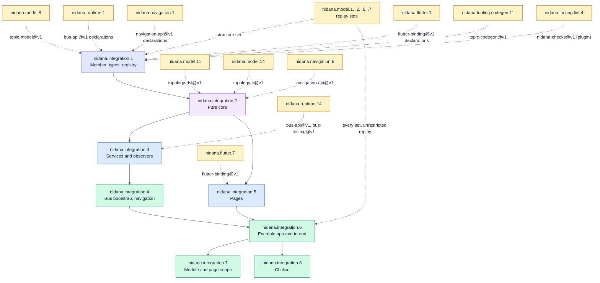

# nidana.integration: Integration

- **Kind:** leaf-parent
- **Purpose:** prove the children compose: replay contract fixtures against live components and run end-to-end slices of the primary flows in an example Flutter app
- **Owns:**
  - workspace member `nidana_integration`, not published, holding the example Flutter app and its tests (ADR-002)
  - live replays of every contract's fixtures against the composed packages (ADR-001)
  - end-to-end slices of the primary flows:
    - bootstrap: `APPLICATION` topologies activated in any order, service publishers claiming their state topics, observers registered, a deep-link intent published before `start()` and delivered after it (Spec §3.13, §11.2, Guide §3.5)
    - hydration: an example persistence service publishing a loaded value as an event, a reducer topology folding it into a state topic with an `Initializing` variant, the UI rendering the transition (Spec §2.5, §7.6)
    - single-writer ownership: a second claimant rejected at activation and at publisher construction (Spec §3.11)
    - module scope: in-subtree navigation that keeps the module's topologies alive through the grace period, exit that tears them down, re-entry that resumes retained state (Spec §7.2 to §7.4)
    - guarded navigation: an unauthenticated intent redirected to login, a resolved intent executed, `nav.current-route` and `nav.history` written together (Guide §3.4)
    - observation: a non-sensitive observer that never sees a sensitive topic and a sensitive-capable one that does, with redaction in the recorder (Spec §9)
    - CI: the codegen and the v1 checks run over the example, pass, and fail on seeded violations (Guide §5.2)
- **Does not own:** any package's behavior; fixes for what it finds, which go back to the owning node
- **Consumes:** [topic-model@v1, topology-dsl@v1, topology-ir@v1, bus-api@v1, bus-testing@v1, navigation-api@v1, flutter-binding@v1, topic-codegen@v1, nidana-checks@v1]
- **Produces:** none
- **Governed by:** [ADR-001, ADR-002, ADR-003]
- **Sources:**
  - `ref/nidana-docs/arch/nidana-bus-ref-arch-spec-v0_15_0.md` §2.5, §3.11, §3.13, §7.2 to §7.6, §9, §11.2
  - `ref/nidana-docs/arch/nidana-bus-ref-arch-guide-v0_15_0.md` §3.4, §3.5, §5.2, Appendix A
  - `ref/nidana-docs/arch/nidana-bus-ref-arch-rationale-v0_15_0.md` §3.1
- **Decomposes into:** phases (see hsdd-phase-plan)
- **Isolation strategy:** none by design: `hard` edges to every producing sibling, so the DAG schedules it after they ship; its phases default to full-review

## Overview

Every other node is tested against contracts; none of them exercises two live siblings together. This node does, using Guide Appendix A's full system diagram as the reference scenario for the example app. Its tests run as widget tests under `testWidgets` with the production scheduler provider (ADR-003), and as VM tests on `TestBus` where no widget is involved.

A failure found here is a finding against the owning node or contract, recorded in the phase's verification doc; this node never patches another node's package.

## Decisions

### D1: The phase cut

The ordering policy is `fp-progression` (conventions), so the plan runs in four bands over the example app, cut into eight phases of one PE each, with two lanes after the pure band and two at the end:

1. **Types.** nidana.integration.1 creates the member and lands the example's domain values, its generated topic registry and its routes. This node produces no contract, so the band carries no contract declarations and ADR-001 item 10's first-producing-phase rule does not apply.
2. **Pure functions.** nidana.integration.2 lands the reducers, the navigation configuration, the five topologies and the registration library, recorded and analyzed without a bus.
3. **Effects.** nidana.integration.3 lands the services and observers on a TestBus (the VM lane); nidana.integration.5 lands the pages on `WidgetTestBus` (the Flutter lane).
4. **Composition.** nidana.integration.4 composes the bus side (bootstrap, deep link, guarded navigation on a TestBus); nidana.integration.6 composes it with the pages into the example app and runs the Flutter slices; nidana.integration.7 (module and page scope) and nidana.integration.8 (the CI slice) run side by side over the finished app.

Every slice the Owns list names lands in at least one phase: bootstrap (.4, .6), hydration (.3 for the bus, .5 and .6 for the UI), single-writer ownership (.3), module scope (.7), guarded navigation (.4, .6), observation (.3), CI (.8), and the live replays of every contract's fixtures (.6 to .8, D3).

Tiers: integration phases default to full-review (conventions). Two phases take spot-check, each for a named reason: nidana.integration.1 holds declarations, data and a generated library that its own tests check byte for byte; nidana.integration.5 holds thin widgets over flutter-binding@v1, each with a widget test, whose composed behavior .6 and .7 review in full.

Size estimates count tests and the topics document, never the generated registry. No two adjacent phases are merge candidates under the sizing floor: .2 and .3, and .3 and .4, consume different contracts; .6 and .7 share a tier and their consumed contracts, but .8 depends on .6 without .7, and together they come to about 630 lines.

Alternatives considered: one phase per Owns slice (observation and single-writer ownership alone come to about 150 lines each, below the floor, and the bootstrap slice would compose effects no earlier phase had landed); the three Flutter slices in one phase (about 630 lines, two PEs); guarded navigation only through the Flutter executor (the VM half is where the envelope comparison across activation orders and the consecutive `nav.current-route` and `nav.history` publishes are deterministic, bus-testing@v1 G13); a phase of its own for the unrestricted replay (no code, below the floor; D3 puts the replay in the gates).

### D2: Which producer phase each phase waits on

The node's edges are `hard` (root D5), and the Delivery paragraph of each consumed contract names the producer phase nidana.integration's edge waits on: the contract's last producing phase. This plan reads that per phase, as nidana.flutter D6 reads its `hard` runtime edge and as bus-api@v1's Delivery has nidana.flutter.1 wait on nidana.runtime.1:

1. A phase that compiles against a contract's declarations and runs none of its behavior waits on the phase that lands them.
2. A phase whose tests run a contract's behavior waits on that contract's last producing phase.
3. A phase whose gate runs a replay set waits on the nidana.model phase that lands it (conventions, Phase design).

So nidana.integration.1 waits on nidana.model.1 (the workspace root and the `structure` set), nidana.model.8 (topic-model@v1), nidana.runtime.1, nidana.navigation.1 and nidana.flutter.1 (the declarations the member depends on and `AppRoutes` compiles against), nidana.tooling.codegen.11 (topic-codegen@v1: the builder and `generate`) and nidana.tooling.lint.4 (the plugin's rules report over every member from it on, so the example meets them from its first commit and no later phase finds a violation an earlier one wrote; nidana-checks@v1 Delivery). nidana.integration.2 waits on nidana.model.11, nidana.model.14 and nidana.navigation.6; nidana.integration.3 on nidana.runtime.14; nidana.integration.5 on nidana.flutter.7, whose closure holds nidana.runtime.14 and nidana.navigation.6. nidana.integration.6 is the first phase whose closure holds every contract's last producing phase, which its unrestricted replay needs (D3), and it adds nidana.model.2, .6 and .7, which land the sets that replay runs beyond `structure`.

The schedule this gives: nidana.integration.1 merges once the codegen and lint lanes and nidana.flutter.1 have; .2 to .4 run beside nidana.flutter.5 to .7 once nidana.runtime.14 and nidana.navigation.6 have merged; after nidana.flutter.7 the node's chain is .5, then .6, then .7 and .8 side by side.

Alternative considered: every phase after every producer's last producing phase, the literal node-level reading of root Development flow item 4. It keeps one start condition and builds nothing on a producer that may still renegotiate a declaration, but the chain after nidana.flutter.7 grows from three phases to six. The signal that would favor it: an hsdd-contract renegotiation of a consumed contract's declarations during a producer's remaining phases.

### D3: What every gate runs

- **The default gate**, from the workspace root: `fvm dart pub get --enforce-lockfile`, `fvm dart analyze --fatal-infos` (the root analyze, which runs the plugin's rules over the member, nidana-checks@v1 The plugin), `fvm dart run nidana_contract_check --all --set structure`, and the member's tests, `fvm flutter test --no-pub packages/nidana_integration` (conventions, Phase design). nidana.integration.1 to .5 run it.
- **The unrestricted replay.** From nidana.integration.6 on, `fvm dart run nidana_contract_check --all` replaces the structure-only replay. ADR-001 item 10 makes it the tree's one unrestricted replay, nidana-checks@v1's two shares together. nidana.integration.6 runs it first, as the first phase whose closure holds every contract's last producing phase (D2); nidana.integration.7 and .8 run it again, so a producer's fix that lands after .6 is replayed against the composed packages before the node closes. Before .6 an unrestricted replay would fail on guarantees not yet delivered.
- **The registry.** nidana.integration.1 and .8 also run build_runner in the member after the tests, then the registry test again (D7).
- **The CI sequence.** nidana.integration.8 also runs nidana-checks@v1 In CI's commands at the top level, the root analyze before `catalog` and `scan`, with every output under `.dart_tool/nidana_integration/`. The root analyze reads `build/`, the root's and a member's, and not `.dart_tool/` (`docs/auto-run/experiments/integration-plan-facts/`, I6), so a `topics.g.dart` that `generate` left under `build/` would be analyzed by every later gate of every node.
- No gate restricts a replay with `--guarantee`: this node produces no contract.
- Every gate is written out in full in its phase, so the phase context carries the whole command.

Alternatives considered: the unrestricted replay at nidana.integration.8 alone (one replay of several minutes instead of three, a cross-node failure found two phases later; the signal that would favor it: the replay making a gate outlast the review sitting); at every phase (impossible before the producers ship, whichever way D2 reads the edges).

### D4: Source layout of `nidana_integration`

ADR-002 item 3 fixes the member: `packages/nidana_integration`, a Flutter package, unpublished. Below its root, one directory per band, so that phases in parallel lanes edit disjoint files:

- `pubspec.yaml`, `lib/topics.yaml`, `lib/topics.g.dart`, `lib/src/domain/`, `lib/src/routes.dart`, `test/support/workspace_root.dart`, `test/support/toolchain.dart` (nidana.integration.1);
- `lib/src/core/`: the reducers, the navigation configuration, and the topologies with the one factory that the bootstrap and the registration both call; `tool/nidana_catalog.dart` (nidana.integration.2);
- `lib/src/services/`, `lib/src/observers/` (.3); `lib/src/app/bootstrap.dart` (.4); `lib/src/pages/` (.5); `lib/src/app/shell.dart`, `lib/src/app/example_app.dart`, `lib/main.dart` (.6); `test/support/seeded_package.dart` (.8); each phase's tests in files of its own.

Only nidana.integration.1 edits the member's pubspec, the topics document, the registry, the root `pubspec.yaml` and `pubspec.lock`. It declares every dependency of ADR-002 item 3's row at item 4's constraints and every topic of D5, so no later phase changes the resolution or the registry. The member has no `analysis_options.yaml` (ADR-002 item 2). No library under `lib/src/core/`, `lib/src/domain/`, `lib/src/routes.dart`, `lib/topics.g.dart` or `tool/` imports a Flutter library, so the registration's transitive imports never reach `dart:ui` and `catalog` records it with `dart run` (topic-codegen@v1 Registration point 3); Spec §5 puts topologies in the pure substrate anyway. No two phases of this plan edit one file, so none collides with another.

Alternatives considered: PAGE topologies beside the widgets that mount them (`catalog` would then record the registration under the Flutter tester, which nidana.tooling.codegen's own gates already start, its D4); each phase adding the dependencies it first needs (every such phase would edit the lockfile and meet other nodes' member-creating merges on it).

### D5: The example scenario

Guide Appendix A is the reference scenario (Overview), trimmed to what the slices need:

- **Topics**, in `lib/topics.yaml`, domains `auth`, `cart`, `payment` and `network`: `auth.state` (state, `AuthState`, initial `const AuthInitializing()`, sensitive), `auth.events` (event, `AuthEvent`), `cart.items` (state, `CartItems`, initial `CartItems.empty`), `cart.events` (event, `CartEvent`), `payment.request` (event, `PaymentRequest`, sensitive), `payment.authorized` (event, `PaymentAuthorization`, sensitive), `payment.result` (state, `PaymentResult`, initial `const PaymentIdle()`, sensitive), `payment.draft` (state, `PaymentDraft`, initial `PaymentDraft.empty`), `payment.summary` (state, `PaymentSummary`, initial `PaymentSummary.empty`), `network.connectivity` (state, `Connectivity`, initial `Connectivity.unknown`); navigation-api@v1's `NavigationTopics` besides.
- **Topologies:** `auth-core` (APPLICATION, owns `auth.state`), `payment-flow` (APPLICATION, writes `payment.authorized`), `nav-resolver` (APPLICATION, navigation-api@v1's template with a static policy), `checkout-flow` (MODULE `checkout`, owns `cart.items`), `payment-form` (PAGE, owns `payment.summary`, reads `payment.draft` and `cart.items`).
- **Shell:** the persistence service (claims nothing; publishes `AuthHydrated`), the payment service (owns `payment.result` by claim), the network monitor (owns `network.connectivity` by claim), the Flutter navigation executor (owns `nav.current-route`), the payment page (owns `payment.draft` by a PAGE claim); `LoggingObserver` with `observeAll` only, and bus-api@v1's `TelemetryObserver` with `observeAll` and `observeSensitive`.
- **Routes:** `home`, `splash`, `auth/login`, `account`, `checkout/cart`, `checkout/payment`, `checkout/confirmation`, `not-found`. The guard requires authentication for `account`, `checkout/payment` and `checkout/confirmation`. The checkout module's prefix is `checkout`.

Every state topic has one writer and an owner at least as long as its topology readers (Spec §3.11, §7.2); nidana.integration.2 checks it with the model's analyses before any bus runs.

Left out of Appendix A: `error.app` and the analytics service (no slice reads them), a separate auth service (pages publish auth events), and cart hydration. Appendix A has the persistence service publish `Hydrated` on `cart.events` at startup for the MODULE-scoped `checkout-flow`, but a MODULE topology observes only what is published after its activation and an event topic retains nothing (Spec §3.13, §7.4), so that event reaches no reducer while the user has not entered the checkout module. Marked for upstreaming: Guide Appendix A should hydrate a MODULE-owned state through a state or replay topic, or give the cart an APPLICATION owner.

Alternatives considered: the full Appendix A diagram (two services and a topic no slice exercises); no `payment-flow` (two APPLICATION topologies leave the bootstrap slice two activation orders to compare instead of six).

### D6: The CI slice drives the tools from the member's tests

`docs/auto-run/experiments/integration-plan-facts/` (`run.sh`, `output.txt`) settles, on the pinned SDK with stand-ins of the plugin and the scan, that a test of a Flutter member run from the workspace root under `fvm flutter test --no-pub`:

- sees `FLUTTER_ROOT`, from which the pinned `dart` is `$FLUTTER_ROOT/bin/cache/dart-sdk/bin/dart`; the root package configuration's `flutterRoot` names the same SDK (I1);
- runs a member's executable with it from the workspace root, `dart run nidana_dart_codegen:scan` in about 6 s (I2);
- analyzes a package in a temporary directory outside the workspace, whose synthesized package configuration lists the workspace's packages by absolute root plus itself and whose options enable the plugin by absolute path; the plugin reports all four rules, exit 2, in about 9 s (I3);
- scans the example and such a package together; the scan resolves the seeded package's imports of the example and reports a name collision and a writer conflict across the two (I4);
- starts a nested `flutter test` without contention (I5).

So the CI slice's assertions are tests of the member that spawn the real commands and check exit codes, report lines and documents, and every seeded violation lives in a temporary directory, never in the member's analyzed code (ADR-002 Consequences): a seeded companion package beside the example for the plugin rules, the claim checks and the name collision, and seeded graph documents for the topology checks. The failing half thus has two parts: nidana-checks@v1's seventeen recorded invocations, replayed by the unrestricted replay (its In CI's own reading of the root's success criterion), and the violations seeded beside the example.

Alternatives considered: the recorded invocations as the whole failing half, as nidana-checks@v1 In CI reads it (no test infrastructure, but the root's success criterion has the checks fail on violations seeded over the example, and the recorded cases run over small packages of their own, never against the example's claims or generated registry); seeded trees in an excluded directory of the repository (the only ones are `ref/`, `docs/` and `hsdd/`, none of which a phase writes code into); a CI driver script under the member's `tool/` (application code that the scan and the plugin read, with assertions no test runner reports).

### D7: The registry is generated, committed and checked against `generate`

The example commits `lib/topics.g.dart`, written by the builder in nidana.integration.1, so the member analyzes in a fresh checkout with no build step and the scan reads the registry like a hand-written one (nidana-checks@v1 G10). Staleness is checked as topic-codegen@v1's Validation leaves to this node for G11: a test runs `generate` on `lib/topics.yaml` into a temporary directory and compares its `topics.g.dart` with the committed file byte for byte. The gates of nidana.integration.1 and .8 run the member's tests, then `fvm dart run build_runner build` in the member (ADR-002 Consequences), then the registry test again: the first run catches a committed registry that no longer matches the document, the second a builder that writes other bytes than `generate`.

The order matters, and the flag is left out, for what build_runner 2.16.1 does (`docs/auto-run/experiments/integration-plan-facts/`, I7): in a fresh checkout it builds over the committed output without a conflict; `--delete-conflicting-outputs` has been removed and is ignored with a warning; and it rewrites a stale committed output silently, exit 0, so a check after it alone would never see the stale commit.

Alternatives considered: build_runner first, as an app's CI runs it (a stale committed registry rewritten in the working tree before any check sees it); no committed registry, generated in every gate (the default gate analyzes before any test, and a fresh checkout would not analyze).

### D8: The static graph and the running app's graph agree

topic-codegen@v1's `catalog` records the registration on the VM in JIT mode, and its document equals an app's `bus.toGraph()` only for what both hold and only when every transformer is public (topic-codegen@v1 The topology graph document; topology-ir@v1 G9). The example keeps the two comparable:

1. Every function a topology passes to a combinator, `principalOfAuth` included, is a public top-level function, so every transformer's `FunctionRef` is named and carries no library key; nidana.integration.2 tests it over every recorded edge.
2. The registration and the bootstrap construct the topologies through one factory (topic-codegen@v1 Registration point 2).
3. Every claim site resolves statically (nidana-checks@v1 Claim sites): sources are literal `ServiceSource` creations, write sets are set literals of registry fields, and the payment page passes its route to `PageScope` as the literal `'checkout/payment'`, so the static source equals the live `PageSource`; an omitted route would stand in as the site. Pages that claim nothing pass no route.
4. The comparison, in nidana.integration.8: the document's topology ids are exactly the registered ones and each definition equals the one the test records; its claims are exactly the four of D5; every topology and claim of `bus.toGraph()`, after the bootstrap and with the payment page mounted, is the document's. A live graph holds only what is active, so the whole graphs are not compared for equality.

Alternatives considered: comparing up to the private-name key, as topic-codegen@v1 allows a tool to do (a private transformer in the example would show adopters a form whose AOT graph differs from the static one); deriving the payment page's route (flutter-binding@v1 G7's derivation, which nidana.flutter's gates cover, at the cost of a stand-in source in the document).

### D9: How the member's tests run

- Every test runs under `fvm flutter test --no-pub packages/nidana_integration` and imports `package:flutter_test/flutter_test.dart`, never `package:test`, which ADR-002 item 3's row does not list.
- Tests without a widget run on a `TestBus` in `test` bodies, drive time with its scheduler, await `scheduler.settle()` only for work started outside the bus zone, such as a port the test completes, and shut the bus down in tear-down (bus-testing@v1 How a test uses it; ADR-003 item 6).
- Widget tests build the bus in the `testWidgets` body on the production provider, never a TestBus (ADR-003 item 7); complete the ports through `Completer`s, so no timer of the example is pending when the body ends; attach `EnvelopeRecorder.attach(bus)` and any `ActivationObserver` before `start()`; and leave shutdown to the app's owning `BusProvider` at unmount (flutter-binding@v1 G4). This is why `bootstrapBus` and `bootstrapApp` stop short of `start()`.
- A test that reads files or runs tools finds the workspace root as the nearest ancestor of the working directory holding `hsdd/contract/` (conventions; `Isolate.resolvePackageUri` throws under `fvm flutter test`) and the pinned `dart` from `FLUTTER_ROOT` (D6).

Alternative considered: `package:test` as a dev dependency for the VM tests (a dependency outside ADR-002 item 3's row, for nothing `flutter_test` lacks).

## Phase Plan

**Default gate:** `fvm dart pub get --enforce-lockfile && fvm dart analyze --fatal-infos && fvm dart run nidana_contract_check --all --set structure && fvm flutter test --no-pub packages/nidana_integration`

| Phase | Name | Tier | Size | Depends on |
|------:|------|------|------|------------|
| nidana.integration.1 | Example member, domain types and topic registry | spot-check | ~420 loc, ≤8 tasks | nidana.model.1, nidana.model.8, nidana.runtime.1, nidana.navigation.1, nidana.flutter.1, nidana.tooling.codegen.11, nidana.tooling.lint.4 |
| nidana.integration.2 | Pure core: reducers, navigation configuration, topologies, registration | full-review | ~420 loc, ≤8 tasks | nidana.integration.1; nidana.model.11, nidana.model.14, nidana.navigation.6 |
| nidana.integration.3 | Services and observers: hydration, single-writer, observation | full-review | ~400 loc, ≤7 tasks | nidana.integration.2; nidana.runtime.14 |
| nidana.integration.4 | Bus bootstrap and navigation on a TestBus | full-review | ~350 loc, ≤7 tasks | nidana.integration.3 |
| nidana.integration.5 | Pages and the route builder | spot-check | ~400 loc, ≤8 tasks | nidana.integration.2; nidana.flutter.7 |
| nidana.integration.6 | The example app end to end | full-review | ~380 loc, ≤7 tasks | nidana.integration.4, nidana.integration.5; nidana.model.2, nidana.model.6, nidana.model.7 |
| nidana.integration.7 | Module and page scope end to end | full-review | ~250 loc, ≤6 tasks | nidana.integration.6 |
| nidana.integration.8 | CI slice: codegen and v1 checks, passing and failing | full-review | ~380 loc, ≤8 tasks | nidana.integration.6 |

Ordering policy: `fp-progression` (conventions), in the four bands D1 names: types (.1), pure functions (.2), effects (.3 on the VM, .5 in Flutter), composition (.4, .6, then .7 and .8). Two lanes follow .2, the VM lane .3 and .4 and the Flutter lane .5, and meet at .6; .7 and .8 run side by side after it. Cross-node waits follow D2; the gates follow D3.

No two phases of this plan edit one file (D4), so no phase carries `Collides with`. nidana.integration.1 is the one phase that creates a workspace member: it edits the root `pubspec.yaml` workspace list and `pubspec.lock`, which every other node's member-creating phase also edits (conventions, Shared workspace files; the `note` entry below). No adjacent pair is a merge candidate under the sizing floor (D1).

### nidana.integration.1: Example member, domain types and topic registry

- **Consumes:** [topic-model@v1, navigation-api@v1, topic-codegen@v1, nidana-checks@v1]
- **Produces:** none
- **Governed by:** [ADR-001, ADR-002]
- **Scope:** Creates `packages/nidana_integration`, the unpublished Flutter member of ADR-002 item 3: a `pubspec.yaml` with `name: nidana_integration`, `publish_to: none`, no `version` (item 9), `environment: sdk: ^3.13.0`, `resolution: workspace`, dependencies `flutter` (SDK), `nidana_dart_contracts`, `nidana_dart_runtime`, `nidana_dart_navigation` and `nidana_dart_runtime_flutter`, each `^0.1.0`, dev dependencies `flutter_test` (SDK), `build_runner: ^2.16.1` and `nidana_dart_codegen: ^0.1.0` (item 4), and nothing else, so no later phase edits it; no `analysis_options.yaml` (item 2). Inserts `packages/nidana_integration` into the root `pubspec.yaml` workspace list in path order and commits the `pubspec.lock` that `fvm dart pub get` resolves at the root (conventions, Shared workspace files). Lands D5's type band: under `lib/src/domain/`, the immutable values with value equality (Spec §8, §3.12) `AuthState` (sealed: `AuthInitializing`, the pure initial value Spec §7.6 requires, `Unauthenticated`, `Authenticated` with its `User`, `AuthFailed`), `AuthEvent` (sealed: `AuthHydrated`, `LoggedIn`, `LoggedOut`, `AuthRejected`), `User` (id, name, roles), `CartItems` with `CartItems.empty`, `CartEvent` (sealed: `ItemAdded`, `ItemRemoved`, `CartCleared`), `PaymentRequest`, `PaymentAuthorization` (sealed: authorized with the user, refused with a reason), `PaymentResult` (sealed: `PaymentIdle`, `PaymentSucceeded`, `PaymentDeclined`), `PaymentDraft` and `PaymentSummary` with their `empty` values, and `Connectivity`; `lib/topics.yaml` declaring D5's ten topics, `auth.state`, `payment.request`, `payment.authorized` and `payment.result` flagged `sensitive` (Spec §9.2), the domain types imported by `package:` URI; `lib/topics.g.dart` written by `fvm dart run build_runner build` run in the member and committed (topic-codegen@v1 The builder, G11; D7); `lib/src/routes.dart` with `AppRoutes`, an `abstract final class` of `static const` `NavRoute` declarations for D5's routes, `splash` and `auth/login` typed `NavRoute<ResolvedNavIntent>` to carry the attempted intent (navigation-api@v1 Refinement 2). Test support: `test/support/workspace_root.dart`, the nearest ancestor of the working directory holding `hsdd/contract/`, and `test/support/toolchain.dart`, the pinned `dart` at `$FLUTTER_ROOT/bin/cache/dart-sdk/bin/dart` with a helper that runs it from the workspace root and returns exit code, stdout and stderr (D6, D9; `docs/auto-run/experiments/integration-plan-facts/` I1, I2). Tests, all importing `package:flutter_test` only: `test/package_properties_test.dart` (the pubspec exactly as above; no library under `lib/` imports `package:test`, `package:flutter_test` or another package's `src/`); `test/registry_test.dart` (runs `nidana_dart_codegen:generate` on `lib/topics.yaml` into a temporary directory and compares its `topics.g.dart` with the committed `lib/topics.g.dart` byte for byte, as topic-codegen@v1's Validation leaves G11 to this node; checks each registry topic's name with `isWellFormedTopicName`, its variant, its sensitivity and `createInitial()`, topic-model@v1 G9, G11); value equality of the domain types. The member's code is clean under the plugin's four rules and the root lint set from this phase on (nidana-checks@v1 The plugin; topic-codegen@v1 G10 for the registry).
- **Size estimate:** ~11 files (~420 lines, the topics document included, the generated registry excluded), <= 8 plan tasks
- **Gate:** `fvm dart pub get --enforce-lockfile && fvm dart analyze --fatal-infos && fvm dart run nidana_contract_check --all --set structure && fvm flutter test --no-pub packages/nidana_integration && (cd packages/nidana_integration && fvm dart run build_runner build) && fvm flutter test --no-pub packages/nidana_integration/test/registry_test.dart`
- **Verification:** The member resolves in the workspace with the committed lockfile; the committed registry is the builder's and `generate`'s output for `lib/topics.yaml`, and `git status` is clean after the gate; the root analyze reports nothing for the member with the plugin's rules active.
- **Review tier:** spot-check
- **Dependencies:** nidana.model.1 (the workspace root and the `structure` set); nidana.model.8 (topic-model@v1's last producing phase: the registry tests compare topics and check names); nidana.runtime.1, nidana.navigation.1 and nidana.flutter.1 (the declarations of bus-api@v1, navigation-api@v1 and flutter-binding@v1: the member's dependencies must exist and `AppRoutes` compiles against `NavRoute`); nidana.tooling.codegen.11 (topic-codegen@v1's last producing phase: the builder and `generate`); nidana.tooling.lint.4 (nidana-checks@v1's plugin share: its rules report over the member from this phase on)

### nidana.integration.2: Pure core: reducers, navigation configuration, topologies, registration

- **Consumes:** [topic-model@v1, topology-dsl@v1, topology-ir@v1, navigation-api@v1]
- **Produces:** none
- **Governed by:** [ADR-001, ADR-002]
- **Scope:** Under `lib/src/core/`, the pure functions of D5, each a public top-level function (D8): `reduceAuth` (Spec §2.5's persistence pattern: `AuthHydrated` resolves `AuthInitializing` and never overwrites an `Authenticated` that a `LoggedIn` reached before it), `reduceCart`, `authorizePayment` (a `PaymentRequest` with the latest `AuthState` to a `PaymentAuthorization`) and `summarizePayment` (a `PaymentDraft` with `CartItems` to a `PaymentSummary`); the navigation configuration of navigation-api@v1 Refinement 2: `appRouteRegistry` over `AppRoutes`, `principalOfAuth` (`AuthInitializing` to `PendingPrincipal`, `Unauthenticated` and `AuthFailed` to `AnonymousPrincipal`, `Authenticated` to `AuthenticatedPrincipal` with the user's roles), `resolveAppLink` (total: a known path to its route's `go()`, any other to `AppRoutes.notFound.go()`), `appAccessPolicy` (`AuthenticatedAccess` for `account`, `checkout/payment` and `checkout/confirmation`, `PublicAccess` otherwise) and `appRedirects` (unauthenticated to `AppRoutes.login.go(attempted)`, forbidden to `AppRoutes.home.go()`, pending to `AppRoutes.splash.go(attempted)`); and the five topologies, constructed by one factory module that the bootstrap and the registration both call (topic-codegen@v1 Registration point 2; D8), which exposes the APPLICATION set, the checkout module's set and the page set: `auth-core` (APPLICATION, `reduceInto` of `auth.state` from `auth.events` through `reduceAuth`), `payment-flow` (APPLICATION, `payment.request` with the latest `auth.state` through `authorizePayment`, written to `payment.authorized`), `nav-resolver` (navigation-api@v1's `navResolver` over `auth.state` with the functions above and the static policy), `checkout-flow` (MODULE, `reduceInto` of `cart.items` from `cart.events` through `reduceCart`), `payment-form` (PAGE, `payment.draft` combined with `cart.items` through `summarizePayment`, written to `payment.summary`). `tool/nidana_catalog.dart` declares `Iterable<Topology> catalogTopologies()`, returning all five through the factory, which it imports by `package:` URI (topic-codegen@v1 Registration point 1; a relative import of `lib/` reports `avoid_relative_lib_imports`, `docs/auto-run/experiments/codegen-plan-facts/` B7). Nothing under `lib/src/core/`, `lib/src/domain/`, `lib/src/routes.dart`, `lib/topics.g.dart` or `tool/` imports a Flutter library (D4). Tests by direct calls and by recording: each reducer's cases; the guard's decision for each principal, through `applyAuthGuard(resolveDeepLinks(intent, resolveAppLink), principalOfAuth(state), appAccessPolicy, appRedirects)`; each topology's recorded `TopologyDefinition` (id, scope, reads, writes, the edges' combinators); every edge's transformer is `FunctionRef.of` a public function, never anonymous and never starting with `_` (topology-ir@v1 G9; D8); `analyzeTopologyGraph` over the graph of the five definitions with the four `ShellClaim`s the example's code makes (`service:payment` on `payment.result`, `service:network` on `network.connectivity`, `executor:flutter-navigation` on `nav.current-route`, `page:checkout/payment` at `Scope.page` on `payment.draft`) has no finding (Spec §3.8, §3.11, §7.2); `catalogTopologies()` lists the factory's five; a text check that the libraries named above import no `package:flutter/`.
- **Size estimate:** ~7 files (~420 lines), <= 8 plan tasks
- **Gate:** `fvm dart pub get --enforce-lockfile && fvm dart analyze --fatal-infos && fvm dart run nidana_contract_check --all --set structure && fvm flutter test --no-pub packages/nidana_integration`
- **Verification:** The example's ownership and scope design holds before any bus runs: one writer per state topic, owners at least as long as their readers, no cycle; a reviewer finds the Specification's rules in each recorded definition and in the guard's decisions.
- **Review tier:** full-review
- **Dependencies:** nidana.integration.1 (domain types, registry, routes); nidana.model.11 (topology-dsl@v1's last producing phase: recording and `buildDefinition()`); nidana.model.14 (topology-ir@v1's last producing phase: `FunctionRef`, `ShellClaim`, `TopologyGraph`, `analyzeTopologyGraph`); nidana.navigation.6 (navigation-api@v1's last producing phase: route and intent equality, `RouteRegistry`, `resolveDeepLinks`, `applyAuthGuard`, `navResolver`)

### nidana.integration.3: Services and observers: hydration, single-writer, observation

- **Consumes:** [topic-model@v1, topology-dsl@v1, topology-ir@v1, bus-api@v1, bus-testing@v1]
- **Produces:** none
- **Governed by:** [ADR-001, ADR-002, ADR-003]
- **Scope:** Under `lib/src/services/` and `lib/src/observers/`, the upper-shell effects of D5: `PersistenceService` (a publisher of `ServiceSource('persistence')` with no claims; `Future<void> hydrate()` loads through an `AuthStore` port and publishes `AuthHydrated` to `auth.events` as its first act after the load, Spec §2.5); `PaymentService` (claims `payment.result` as `bus.publisher(const ServiceSource('payment'), writes: <StateTopic<Object?>>{PaymentTopics.result})`, observes `payment.authorized`, charges through a `PaymentGateway` port, writes the result through its writer, registers its disposal with `bus.onShutdown`); `NetworkMonitor` (claims `network.connectivity` for `ServiceSource('network')`, Spec §3.11's shell-owned state); the in-memory port implementations the example runs with; `LoggingObserver` (capabilities `{ObserverCapability.observeAll}` only; logs topic, id, correlation id, causation id and source through `ObserveContext.log`, never a payload, Spec §9.1); and the example's sensitive-capable observer, bus-api@v1's `TelemetryObserver` with `{observeAll, observeSensitive}`. Every claim site has a literal source and a set literal of registry fields (D8). Tests in `test` bodies, each on a fresh `TestBus` shut down in tear-down (D9): **hydration** (with `auth-core` active and a store the test completes, awaited through `scheduler.settle()`, ADR-003 item 6: `auth.state` goes from `AuthInitializing` to `Authenticated` or `Unauthenticated`, and the recorder shows the state publish caused by the `AuthHydrated` envelope; a `LoggedIn` delivered before a late `AuthHydrated` survives it); **single-writer ownership** (Spec §3.11: activating a test-only topology that writes `auth.state` throws `ActivationRejected` with a `WriterConflict` naming `topology:auth-core` and leaves nothing of it active or claimed; a second publisher claiming `payment.result` throws `ClaimRejected` naming `service:payment`; a topology writing `network.connectivity` is rejected at activation; once the payment service's publisher is disposed the same claim succeeds; bus-api@v1 G20, G21, G24); **observation** (Spec §9: with both observers registered, a login, a cart change and a payment reach `LoggingObserver` for the non-sensitive topics only, never for `auth.state` or a `payment.request`, `payment.authorized` or `payment.result` envelope, while `TelemetryObserver` opens a span for every envelope, with `nidana.sensitive: true` on the sensitive ones, bus-api@v1 G30, G33; the recorder's `envelopes` hold `RedactedPayload` for every sensitive envelope, `payloadsOf(AuthTopics.state)` throws `ArgumentError` and `payloadsOf(AuthTopics.state, unredacted: true)` returns the values, bus-testing@v1 G15).
- **Size estimate:** ~9 files (~400 lines), <= 7 plan tasks
- **Gate:** `fvm dart pub get --enforce-lockfile && fvm dart analyze --fatal-infos && fvm dart run nidana_contract_check --all --set structure && fvm flutter test --no-pub packages/nidana_integration`
- **Verification:** The hydration path, both rejection paths of Spec §3.11's runtime layer and the observer gating of Spec §9.2 hold on the real runtime with the example's own services; each failure names the owning node's guarantee in the verification doc.
- **Review tier:** full-review
- **Dependencies:** nidana.integration.2 (topologies, reducers); nidana.runtime.14 (bus-api@v1 and bus-testing@v1, their last producing phase)

### nidana.integration.4: Bus bootstrap and navigation on a TestBus

- **Consumes:** [topic-model@v1, topology-dsl@v1, topology-ir@v1, bus-api@v1, bus-testing@v1, navigation-api@v1]
- **Produces:** none
- **Governed by:** [ADR-001, ADR-002, ADR-003]
- **Scope:** `lib/src/app/bootstrap.dart`: `AppDependencies` (the store, the gateway, the observe context) and `bootstrapBus(Bus bus, AppDependencies deps, {List<Topology>? applicationOrder})`, Spec §11.2's bootstrap up to and excluding `start()`: it activates the factory's APPLICATION topologies in the given order, constructs the payment service, the network monitor and the persistence service, registers the two observers, and returns an `AppRuntime` holding them and a bootstrap publisher of `ServiceSource('bootstrap')` with no claims, through which a platform callback publishes a deep link before `start()` (Guide §3.5). The caller constructs the navigation executor and calls `start()`, so a test attaches its recorder first and the Flutter shell constructs its own executor (D9). Tests on a `TestBus` with navigation-api@v1's `NavigationExecutor` over `InMemoryRouter` (its `testing.dart`): **bootstrap** (Spec §3.13, §11.2; Rationale §3.1: for every permutation of the three APPLICATION topologies, one script, a deep link published before `start()` and a login after it, records equal envelope lists, bus-testing@v1 G13; a deep link published before `start()`, in one case before `bootstrapBus` activates anything, is resolved, guarded and performed once `start()` delivers it, navigation-api@v1 G24; the three claims and both observers are in place before `start()`; `analyzeTopologyGraph(bus.toGraph())` has no finding once the executor is constructed, navigation-api@v1 G15; `shutdown()` disposes the services and leaves `scheduler.pendingTimerCount` at 0, bus-api@v1 G36); **guarded navigation** (Guide §3.4: an anonymous user's `AppRoutes.account.go()` performs `AppRoutes.login` carrying the attempted intent; after `LoggedIn`, the attempted intent published again is performed as `account`; a cold-start deep link to `/account` while `auth.state` is still `AuthInitializing` is redirected to `AppRoutes.splash` carrying it, navigation-api@v1 Refinement 2, G12; each confirmed transition writes `nav.current-route` and then `nav.history`, consecutive in the recorder's envelopes with nothing between them, and each transition's `from` is the previous one's `to`, navigation-api@v1 G21).
- **Size estimate:** ~4 files (~350 lines), <= 7 plan tasks
- **Gate:** `fvm dart pub get --enforce-lockfile && fvm dart analyze --fatal-infos && fvm dart run nidana_contract_check --all --set structure && fvm flutter test --no-pub packages/nidana_integration`
- **Verification:** The activation order of the APPLICATION set changes nothing a test can observe, and Guide §3's chain of deep link, resolver, guard and executor runs on the real packages with deterministic envelopes.
- **Review tier:** full-review
- **Dependencies:** nidana.integration.3 (services, observers); through it and nidana.integration.2, nidana.runtime.14 and nidana.navigation.6 (the live resolver, `NavigationExecutor`, `InMemoryRouter`)

### nidana.integration.5: Pages and the route builder

- **Consumes:** [topic-model@v1, topology-dsl@v1, topology-ir@v1, bus-api@v1, bus-testing@v1, navigation-api@v1, flutter-binding@v1]
- **Produces:** none
- **Governed by:** [ADR-001, ADR-002, ADR-003]
- **Scope:** Under `lib/src/pages/`, the lower-shell pages of D5, each rendering topology output with flutter-binding@v1's topic widgets and no interposed state holder (Rationale §5.1), and publishing through the publisher of its own `PageScope` (`PageScope.publisherOf`): `HomePage` (a `StateTopicBuilder<AuthState>` rendering a skeleton for `AuthInitializing`, a greeting for `Authenticated` and a sign-in prompt otherwise, Spec §7.6; buttons publishing `AppRoutes.cart.go()` and `AppRoutes.account.go()` to `nav.intent`); `SplashPage` (holds the attempted intent its route carries and publishes it again once `auth.state` leaves `AuthInitializing`); `LoginPage` (publishes `LoggedIn` to `auth.events`, then the attempted intent its route carries); `AccountPage`; `CartPage` (a `StateTopicBuilder<CartItems>`; publishes `ItemAdded` and `ItemRemoved` to `cart.events`, and `AppRoutes.payment.go()`); `PaymentPage` (`PageScope(route: 'checkout/payment', topologies: [the payment-form topology], writes: {PaymentTopics.draft})`, the literal route by D8; edits the draft through its writer; renders `payment.summary`; publishes `payment.request`; on `PaymentSucceeded` publishes `AppRoutes.confirmation.replace()`); `ConfirmationPage`; `NotFoundPage`; and `appRouteBuilder`, the `NavigationRouteBuilder` that maps each entry's route to its page in a `MaterialPageRoute` carrying the given settings, a full-screen dialog for a modal entry (flutter-binding@v1 G13). Widget tests per page with `WidgetTestBus` built in the `testWidgets` body (ADR-003 item 7; D9): `stub` stands in for the owner of each state topic the page reads and `input` publishes its events; the first frame renders from `getCurrentValue` (flutter-binding@v1 G5); a stubbed change from `AuthInitializing` to `Authenticated` re-renders the home page as signed in (the UI half of the hydration slice); taps publish the intents and events above, read from `t.recorder`; `PaymentPage` activates `payment-form` and adds its `page:checkout/payment` claim to `bus.toGraph()` at mount and releases both at unmount (flutter-binding@v1 G7, G8).
- **Size estimate:** ~11 files (~400 lines), <= 8 plan tasks
- **Gate:** `fvm dart pub get --enforce-lockfile && fvm dart analyze --fatal-infos && fvm dart run nidana_contract_check --all --set structure && fvm flutter test --no-pub packages/nidana_integration`
- **Verification:** Each page renders the state it reads on its first frame and publishes only through its page publisher; the payment page's scope binding shows in `bus.toGraph()` while it is mounted and is gone after.
- **Review tier:** spot-check
- **Dependencies:** nidana.integration.2 (topologies, routes, navigation configuration); nidana.flutter.7 (flutter-binding@v1's last producing phase, whose closure holds nidana.runtime.14 and nidana.navigation.6)

### nidana.integration.6: The example app end to end

- **Consumes:** [topic-model@v1, topology-dsl@v1, topology-ir@v1, bus-api@v1, bus-testing@v1, navigation-api@v1, flutter-binding@v1, topic-codegen@v1, nidana-checks@v1]
- **Produces:** none
- **Governed by:** [ADR-001, ADR-002, ADR-003]
- **Scope:** `lib/src/app/shell.dart`: `AppShell bootstrapApp(Bus bus, AppDependencies deps)`, which runs `bootstrapBus`, then constructs `FlutterNavigationExecutor(bus, initial: RouteState(route: AppRoutes.home), routeBuilder: appRouteBuilder)` and `ModuleScopeObserver(bus, [ModuleRoutes(moduleId: 'checkout', prefix: 'checkout', topologies: the checkout module's set)])`, leaving `start()` to the caller (Guide §3.5's order: resolver, executor, `start()`, then the tree; flutter-binding@v1 G16); `lib/src/app/example_app.dart`: an owning `BusProvider` over a `MaterialApp` wired with the router's `navigatorKey`, `observer`, `initialRoutes` and `generateRoute` and with the module observer (flutter-binding@v1 How an app uses it); `lib/main.dart`: inside `runZonedGuarded` (ADR-003 Consequences), `WidgetsFlutterBinding.ensureInitialized()`, `Bus()`, `bootstrapApp` with the in-memory ports, `bus.start()`, `hydrate()`, `runApp`. Widget tests on the production provider (D9): **hydration end to end** (Spec §2.5, §7.6: the first frame shows the home skeleton; completing the store's load re-renders it as signed in, or as signed out for an empty store); **deep links** (flutter-binding@v1 G15, G16: with the platform initial route `/checkout/cart`, the cart is performed before any Navigator exists, the first frame shows it above home, and the checkout module is acquired; with `/account` while the store has not loaded, the first frame shows the splash, and completing the load as signed in shows the account page); **guarded navigation through the Flutter executor** (Guide §3.4: tapping Account while signed out shows the login page; signing in shows the account page; the recorder holds each `nav.current-route` publish immediately followed by its `nav.history` publish, navigation-api@v1 G21). Its gate replays every contract unrestricted for the first time (D3).
- **Size estimate:** ~6 files (~380 lines), <= 7 plan tasks
- **Gate:** `fvm dart pub get --enforce-lockfile && fvm dart analyze --fatal-infos && fvm dart run nidana_contract_check --all && fvm flutter test --no-pub packages/nidana_integration`
- **Verification:** The example boots in Guide §3.5's order and shows no signed-out frame before hydration resolves; a cold-start deep link lands on its page, or on the splash and then its page; the unrestricted replay passes, every contract's fixtures against the composed packages.
- **Review tier:** full-review
- **Dependencies:** nidana.integration.4 (`bootstrapBus`); nidana.integration.5 (pages, route builder); through them every contract's last producing phase (nidana.model.8, nidana.model.11, nidana.model.14, nidana.runtime.14, nidana.navigation.6, nidana.flutter.7, nidana.tooling.codegen.11, nidana.tooling.lint.4), which the unrestricted replay needs; nidana.model.2, nidana.model.6 and nidana.model.7, which land the `surface`, `reject`, `schema`, `behavior`, `file` and `cli` sets it runs

### nidana.integration.7: Module and page scope end to end

- **Consumes:** [topic-model@v1, topology-dsl@v1, topology-ir@v1, bus-api@v1, bus-testing@v1, navigation-api@v1, flutter-binding@v1, topic-codegen@v1, nidana-checks@v1]
- **Produces:** none
- **Governed by:** [ADR-001, ADR-002, ADR-003]
- **Scope:** Widget tests over the example app, `test/e2e/module_scope_test.dart`, on the production provider with an `ActivationObserver` registered before `start()` to count `onActivate` per topology id (D9); no library code is expected, and a failure is a finding against its owning node. **Module scope** (Spec §7.2 to §7.4; flutter-binding@v1 Refinement 3, G10; bus-api@v1 G28): navigating from home to `checkout/cart` acquires the checkout module and activates `checkout-flow` once; adding items updates `cart.items`; going from `checkout/cart` to `checkout/payment` keeps the reference count above zero and activates nothing again; leaving the subtree starts the grace period, so after `tester.pump` of less than 100 ms (`moduleScopeGracePeriod`, bus-api@v1 G3) `checkout-flow` is still in `bus.toGraph()` and after the rest of it it is gone; re-entering within the grace period activates nothing; re-entering after it activates `checkout-flow` again, the cart shows the retained items, and a new `ItemAdded` folds onto them (Spec §7.2 Retention across activations; topology-dsl@v1 G24). **Page scope** (Spec §7.1; flutter-binding@v1 G7, G8): pushing the payment page activates `payment-form` and adds the `page:checkout/payment` claim on `payment.draft` to `bus.toGraph()`; popping it removes both. Its gate replays every contract unrestricted again (D3).
- **Size estimate:** ~2 files (~250 lines), <= 6 plan tasks
- **Gate:** `fvm dart pub get --enforce-lockfile && fvm dart analyze --fatal-infos && fvm dart run nidana_contract_check --all && fvm flutter test --no-pub packages/nidana_integration`
- **Verification:** Module topologies live exactly as long as the user stays in the module's route subtree, plus the grace period, and their owned state survives an exit and re-entry; a page's topologies and claim follow the page's mount.
- **Review tier:** full-review
- **Dependencies:** nidana.integration.6 (the example app)

### nidana.integration.8: CI slice: codegen and v1 checks, passing and failing

- **Consumes:** [topic-model@v1, topology-dsl@v1, topology-ir@v1, bus-api@v1, bus-testing@v1, navigation-api@v1, flutter-binding@v1, topic-codegen@v1, nidana-checks@v1]
- **Produces:** none
- **Governed by:** [ADR-001, ADR-002, ADR-003]
- **Scope:** Tests under `test/ci/` that run the tools as an app's CI does (nidana-checks@v1 In CI), through `test/support/toolchain.dart` (D6), each with a timeout of minutes, and `test/support/seeded_package.dart`, which writes a package into a temporary directory with a synthesized package configuration, the workspace's packages by absolute root plus itself. **Passing half:** `nidana_dart_codegen:catalog packages/nidana_integration {tmp}` exits 0, and its `topology-graph.json` decodes with `decodeTopologyGraph`, lists exactly the topology ids `catalogTopologies()` registers, each definition equal to the `buildDefinition()` the test records, and exactly the four claims of nidana.integration.2's analysis (topic-codegen@v1 G20; nidana-checks@v1 G18); every topology and claim of `bus.toGraph()`, after `bootstrapApp` and `start()` and again with the payment page mounted, is the document's (Spec §6.5; D8); `nidana_dart_codegen:scan --graph {document} packages/nidana_integration` exits 0 with empty stdout (nidana-checks@v1 G15, G16); `nidana_dart_codegen:generate --graph {document} packages/nidana_integration/lib/topics.yaml {tmp}` exits 0, its `topics.g.dart` equals the committed registry, its `topics.md` lists the ten registry topics with their writers and readers and the `nav.*` topics under `## Topics outside topics.yaml`, and it writes `topology-graph.html` (topic-codegen@v1 G11, G13, G18). **Failing half** (D6), every seeded case in a temporary directory and none in the member's analyzed code (ADR-002 Consequences): a seeded companion package that imports the example and holds one violation per plugin rule (a raw-string topic name, a top-level `Bus?` variable, `publish` with explicit type arguments, an unflagged topic whose value type ends in `Token`), analyzed with its own options enabling the plugin by absolute path, so `dart analyze --format=machine .` exits 2 and reports exactly the four codes (nidana-checks@v1 G1, G4 to G7; experiment I3); the same package declares `payment.result` again, claims it for a second service and claims through a computed write set, so `scan packages/nidana_integration {seeded}` exits 1 with `topic_name_collision`, `writer_conflict` and an `unresolved_claim` warning (nidana-checks@v1 G12 to G14; experiment I4); seeded graph documents, the catalog document plus topologies the test records and encodes with `JsonRenderer` (one forming a cycle with `auth-core` through `auth.state` and `auth.events`, one reading and writing `cart.events` through no state-bearing edge, one writing `auth.state`, one MODULE topology reading `payment.draft`), so `scan --graph {seeded document} packages/nidana_integration` exits 1 with `topology_cycle`, `self_reference`, `writer_conflict` and `scope_violation` (nidana-checks@v1 G14). The gate also runs In CI's commands at the top level, the root analyze before `catalog` and `scan`, every output under `.dart_tool/nidana_integration/`, never `build/` (D3; experiment I6), and replays every contract unrestricted, nidana-checks@v1's seventeen recorded invocations among them.
- **Size estimate:** ~5 files (~380 lines), <= 8 plan tasks
- **Gate:** `fvm dart pub get --enforce-lockfile && fvm dart analyze --fatal-infos && fvm dart run nidana_contract_check --all && fvm flutter test --no-pub packages/nidana_integration && (cd packages/nidana_integration && fvm dart run build_runner build) && fvm flutter test --no-pub packages/nidana_integration/test/registry_test.dart && fvm dart run nidana_dart_codegen:catalog packages/nidana_integration .dart_tool/nidana_integration && fvm dart run nidana_dart_codegen:scan --graph .dart_tool/nidana_integration/topology-graph.json packages/nidana_integration && fvm dart run nidana_dart_codegen:generate --graph .dart_tool/nidana_integration/topology-graph.json packages/nidana_integration/lib/topics.yaml .dart_tool/nidana_integration`
- **Verification:** The example passes the codegen and the whole v1 check set as an adopting app's CI runs them, and each check family fails on a violation seeded beside the example with the codes and exit codes nidana-checks@v1 fixes; the static graph `catalog` writes agrees with the running app's.
- **Review tier:** full-review
- **Dependencies:** nidana.integration.6 (the complete example app: every claim site, the registration, the Flutter bootstrap)

### Phase dependency graph

Bands by color: types (indigo), pure (violet), effects (blue), composition (green); producer phases in amber, dashed edges labeled with what each provides.

## Governance updates (pending reconcile)

> Reconciled 2026-10-18 by hsdd-reconcile. Drained entries are in git history.
