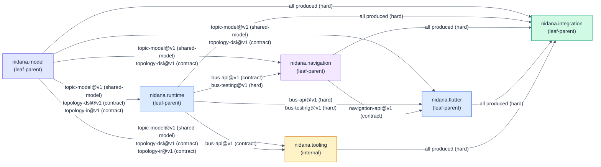

# nidana: Nidana Bus for Dart and Flutter

- **Kind:** internal
- **Purpose:** deliver a conforming Dart/Flutter implementation of the Nidana Bus reference architecture v0.15.0, at the v1 scope D1 fixes
- **Owns:** the v1 scope boundary (D1); the split into six children (D4); the contract ids on the edges between them; the workspace root (ADR-002); the open questions that span children
- **Does not own:** any package's internals; contract bodies (written by hsdd-contract); ADR files (written by hsdd-adr); the reference architecture itself (`ref/` is read-only; a change it would need is recorded as a decision marked for upstreaming)
- **Consumes:** none
- **Produces:** [topic-model@v1, topology-dsl@v1, topology-ir@v1, bus-api@v1, bus-testing@v1, navigation-api@v1, flutter-binding@v1, topic-codegen@v1, nidana-checks@v1]
- **Governed by:** [ADR-001, ADR-002]
- **Sources:**
  - `ref/nidana-docs/arch/nidana-bus-ref-arch-spec-v0_15_0.md` (all sections)
  - `ref/nidana-docs/arch/nidana-bus-ref-arch-guide-v0_15_0.md` (all sections)
  - `ref/nidana-docs/arch/nidana-bus-ref-arch-rationale-v0_15_0.md` (§2, §3, §4, §5, §7)
- **Decomposes into:** nidana.model, nidana.runtime, nidana.navigation, nidana.flutter, nidana.tooling, nidana.integration
- **Isolation strategy:** the root is never built as one unit; each child builds against the contracts it consumes, and nidana.integration composes the live children

## Overview

Nidana Bus is a typed, lifecycle-managed reactive substrate for application data flow: typed topics, pure topology declarations over them, one bus per coordination domain (Spec §1, §2). This tree builds the Dart/Flutter implementation as a set of pub packages in one workspace (ADR-002).

**Primary usage flows** an adopting app runs with v1:

1. Declare topics in a registry, written by hand or generated from `topics.yaml`, and topologies as pure declarations over them (Spec §2.1, §2.2, §4, §6).
2. Bootstrap one bus per coordination domain: activate the `APPLICATION` topologies, construct the services whose publishers claim the state topics they own, register observers, call `start()` (Spec §3.13, §11.2).
3. Bind the bus into the widget tree. Pages render from state topics and publish events; modules and pages activate and release their topologies with the route lifecycle (Spec §5.6, §7.1 to §7.3).
4. Navigate through intents that the nav-resolver topology guards and resolves and the Flutter executor performs (Guide §3).
5. Test topologies on a `TestBus` with virtual time and envelope recording (Spec §3.6, Appendix A.7).
6. In CI, generate registries and the topic catalog, and run the static checks that move single-writer, uniqueness, cycle and scope failures from first run to merge (Spec §3.8, §3.11, §4.3, §7.2).

**Hard constraints** (owner's facts, 2026-10-17):

- One builder, Purbo with coding agents: one team, one repository.
- The v0.15.0 Specification is accepted, normative and frozen for v1, although its header reads Draft. The Guide and the Rationale are informative.
- Toolchain through fvm only (`fvm dart`, `fvm flutter`). The SDK is pinned in `.fvmrc`: Flutter 3.47.7, which bundles Dart 3.13.5.
- Phases execute with superpowers. OpenSpec is not installed and is not to be installed. No global tooling; project-local dev dependencies only.
- `ref/` is read-only.

**Success criteria for v1:**

- Every normative rule of the Specification that applies to Dart/Flutter is implemented by a v1 package, enforced by a v1 check, or listed as deferred in D1.
- Every Bus Runtime Contract guarantee (Spec §3) is covered by a contract fixture (ADR-001) or a node test that a phase gate runs.
- The example app in nidana.integration exercises the primary flows end to end, and the v1 static checks pass over it and fail on seeded violations.

## Sources

- `ref/nidana-docs/arch/nidana-bus-ref-arch-spec-v0_15_0.md`: accepted specification, normative, frozen for v1 by the owner (its header still reads Draft). Governs every rule the tree implements: core concepts (§2), the bus runtime contract (§3), typed topics (§4), layers (§5), topology composition and the IR (§6), lifecycle (§7), data contract rules (§8), observation and sensitive data (§9), the error model (§10), runtime operations (§11), the glossary (Appendix A). Cited as "Spec §n".
- `ref/nidana-docs/arch/nidana-bus-ref-arch-guide-v0_15_0.md`: informative implementer's guide. Governs the Dart mappings (§6), navigation (§3), cross-cutting and error patterns (§2, §4), the verification pipeline (§5), operations (§8), the reference architecture's own open questions (§10), the package layers (Appendix B) and the v1 tooling plan (Appendix C). Cited as "Guide §n".
- `ref/nidana-docs/arch/nidana-bus-ref-arch-rationale-v0_15_0.md`: informative rationale. Supplies stated reasons the tree cites: resilience properties (§2), determinism and the virtual scheduler (§3), portability and purity pressure (§4), topology output straight to the UI with no interposed state holder (§5), non-goals (§7). Cited as "Rationale §n".
- Older versions under `ref/nidana-docs/arch/` and everything under `ref/nidana-docs/loop/`: superseded history, informative only, not decomposed, because the owner fixes v0.15.0 as the only input.

## Child nodes

| Node | Kind | Package (ADR-002) | Responsibility | Produces |
|------|------|-------------------|----------------|----------|
| nidana.model | leaf-parent | `nidana_dart_contracts` | pure core: topics, envelope and lineage rules, observer interfaces, topology DSL interface and recorder, IR, graphs, pure analyses | topic-model@v1, topology-dsl@v1, topology-ir@v1 |
| nidana.runtime | leaf-parent | `nidana_dart_runtime` | the bus on RxDart: subjects, publish path, ownership, activation, lifecycle, observers, scheduler provider, TestBus | bus-api@v1, bus-testing@v1 |
| nidana.navigation | leaf-parent | `nidana_dart_navigation` | intent vocabulary, typed routes, nav-resolver template, executor protocol | navigation-api@v1 |
| nidana.flutter | leaf-parent | `nidana_dart_runtime_flutter` | Flutter UI adapter: bus provider, topic widgets, page and module scope binding, Flutter navigation executor | flutter-binding@v1 |
| nidana.tooling | internal | `nidana_dart_codegen`, `nidana_dart_lint` | codegen, topic catalog, topology catalog and graph emission, v1 static checks | topic-codegen@v1, nidana-checks@v1 |
| nidana.integration | leaf-parent | `nidana_integration` (not published) | example app, live contract replays, end-to-end slices of the primary flows | none |

### nidana.model: Model

- **Kind:** leaf-parent
- **Purpose:** the pure, effect-free core every other package builds on: typed topics, the message envelope and its lineage rules, observer interfaces, the topology DSL interface with its recording builder, the TopologyDefinition IR, graphs and renderers, and the pure analyses over the IR
- **Owns:** package `nidana_dart_contracts`; the topic variants, `TopicRef`, `Dedup`, `Tracing`, the sensitive flag; `MessageEnvelope` and the lineage rules as pure functions; `Scope`; `BusObserver`, `ObserveContext`, `ObserverCapability`; sensitive-payload redaction; `Topology`, `TopologyBuilder` and the opaque stream handle with the Spec §6.3 combinators (D6); the recording builder and `buildDefinition()`; the IR and its JSON form; `TopologyGraph` with Mermaid, Graphviz and JSON renderers; cycle, self-reference, scope-compatibility and name-uniqueness analyses; the contract replay tool (ADR-001)
- **Does not own:** subjects, subscriptions, timers, zones or the live interpretation of the DSL (nidana.runtime); source scanning and catalog runs (nidana.tooling); navigation types (nidana.navigation)
- **Consumes:** none
- **Produces:** [topic-model@v1, topology-dsl@v1, topology-ir@v1]
- **Governed by:** [ADR-001, ADR-002, ADR-003]
- **Sources:** Spec §1, §2.1 to §2.5, §3.5, §3.8, §3.12, §4.1, §4.2, §4.4, §4.6, §6.1 to §6.5, §7.1, §7.2, §8, §9.2, Appendix A.1 to A.4; Guide §1.1, §1.4, §6.3, §8.1, Appendix B.1 to B.3; Rationale §3.1 to §3.3, §4.1
- **Decomposes into:** phases (see hsdd-phase-plan)
- **Isolation strategy:** depends on nothing beyond the SDK and `meta`; functions are tested by direct calls and property tests; topologies are tested by recording them and asserting on the IR; the node replays its contracts' surface, reject and schema fixtures

### nidana.runtime: Bus Runtime

- **Kind:** leaf-parent
- **Purpose:** the bus: turns topic declarations and topology definitions into live RxDart subjects and subscriptions and enforces the Bus Runtime Contract (Spec §3), lifecycle (Spec §7), observation (Spec §9), the error model (Spec §10) and runtime operations (Spec §11)
- **Owns:** package `nidana_dart_runtime`; `Bus` and `BusConfig`; the topic registry and subject lifecycle; the publish path (dedup, ordering, reentrancy normalization, observers, sensitive gating, startup barrier); publishers, writer handles and the ownership table; the live DSL with envelope threading; activation checks; scopes and module reference counting with grace; `bus.toGraph()`; shutdown and resource limits; dev-mode diagnostics (D8); the scheduler provider, virtual scheduler, `TestBus` and envelope recorder (ADR-003); the per-topic ordering regression test; an SDK-neutral telemetry observer (D1)
- **Does not own:** pure types, lineage rules, the IR and analyses (nidana.model); routes and widgets (nidana.flutter); navigation semantics (nidana.navigation); static checks (nidana.tooling)
- **Consumes:** [topic-model@v1, topology-dsl@v1, topology-ir@v1]
- **Produces:** [bus-api@v1, bus-testing@v1]
- **Governed by:** [ADR-001, ADR-002, ADR-003]
- **Sources:** Spec §1, §2.3 to §2.5, §3.1 to §3.13, §5.3, §5.5, §6.1, §6.3, §6.5, §7.1 to §7.5, §9, §10, §11, Appendix A.5, A.7; Guide §2, §4, §6.1, §6.5, §8.1, §8.2, §8.4, §8.5, §10.1; Rationale §2.1, §2.2, §3.2
- **Decomposes into:** phases (see hsdd-phase-plan)
- **Isolation strategy:** builds against the model's contracts only; runs on the Dart VM with `TestBus` and the virtual scheduler, no Flutter; replays bus-api@v1 and bus-testing@v1 fixtures and binds the behavior fixtures of topology-dsl@v1, whose live semantics it implements

### nidana.navigation: Navigation

- **Kind:** leaf-parent
- **Purpose:** navigation as a cross-cutting concern on the bus (Guide §3): the intent vocabulary, typed routes, the nav-resolver topology template with its pure guard and deep-link resolution, and the platform-neutral executor protocol
- **Owns:** package `nidana_dart_navigation` (pure Dart); `NavIntent`, `ResolvedNavIntent`, `Route`, `RouteRegistry`, `RouteState`, `RouteTransition`, `RouteAccessRequirement`, `RouteAccessPolicy`; `NavigationTopics`; the nav-resolver template; `applyAuthGuard` and `resolveDeepLinks`; the `NavigationExecutor` protocol and its conformance suite (D7)
- **Does not own:** platform router calls (nidana.flutter); the app's auth state type and route table (app code); bus mechanics (nidana.runtime)
- **Consumes:** [topic-model@v1, topology-dsl@v1, bus-api@v1, bus-testing@v1]
- **Produces:** [navigation-api@v1]
- **Governed by:** [ADR-001, ADR-002, ADR-003]
- **Sources:** Spec §2.4, §3.8, §3.11, §3.13, Appendix A.6; Guide §2, §3.1 to §3.7, Appendix A
- **Decomposes into:** phases (see hsdd-phase-plan)
- **Isolation strategy:** guard and resolution are pure functions tested directly; the resolver is tested through its recorded IR and live on `TestBus`; the executor protocol is exercised with an in-memory router

### nidana.flutter: Flutter Binding

- **Kind:** leaf-parent
- **Purpose:** the Flutter UI runtime adapter (Guide Appendix B layer 6, Spec Appendix A.8): bus reference acquisition, topic-driven widgets, page publishers, page and module scope binding, and the Flutter navigation executor
- **Owns:** package `nidana_dart_runtime_flutter`; `BusProvider` and its `BuildContext` access; topic widgets that render the first frame from `getCurrentValue`; page publishers with route-derived source; page-scope and module-scope binding (route observer, route prefix, release into the runtime's reference count); `FlutterNavigationExecutor`; shutdown at the end of the coordination domain; a widget-test library
- **Does not own:** reference counting arithmetic and grace timers (nidana.runtime); intent semantics (nidana.navigation); the app's routes
- **Consumes:** [topic-model@v1, topology-dsl@v1, bus-api@v1, bus-testing@v1, navigation-api@v1]
- **Produces:** [flutter-binding@v1]
- **Governed by:** [ADR-001, ADR-002, ADR-003]
- **Sources:** Spec §2.4, §2.5, §3.1, §5.2, §5.6, §7.1 to §7.4, §11.1, §11.2, Appendix A.8; Guide §3.4, §3.5, §6.4, §9.3, Appendix B.1; Rationale §5.1 to §5.4
- **Decomposes into:** phases (see hsdd-phase-plan)
- **Isolation strategy:** widget tests with `flutter_test` on the real runtime, time driven by `tester.pump` (ADR-003); the executor runs the navigation-api@v1 conformance suite against a test router; no device

### nidana.tooling: Build and CI Tooling

- **Kind:** internal
- **Purpose:** the static half of the architecture's enforcement and its build-time artifacts (Guide Appendix C, planned v1 for Dart): topic registry generation and catalog, the topology catalog scan and graph emission, and the CI checks
- **Owns:** packages `nidana_dart_codegen` and `nidana_dart_lint`; the `topics.yaml` format and generated registries through build_runner; the topic catalog; `Catalog.scanTopologies` for Dart and `topology-graph.json`; the build-time HTML graph; the v1 checks of D1, run as analysis server plugin rules and a workspace scan (ADR-002)
- **Does not own:** the analyses' algorithms (pure functions in nidana.model; tooling runs them over what it scans); runtime enforcement (nidana.runtime)
- **Consumes:** [topic-model@v1, topology-dsl@v1, topology-ir@v1, bus-api@v1]
- **Produces:** [topic-codegen@v1, nidana-checks@v1]
- **Governed by:** [ADR-001, ADR-002]
- **Sources:** Spec §3.8, §3.11, §4.3 to §4.6, §6.3, §6.4, §6.5, §7.2, §7.6, §9.2; Guide §5, Appendix C.1 to C.5
- **Decomposes into:** child nodes minted by a later hsdd-spec run on this node
- **Isolation strategy:** analyzer-based checks run over source fixtures and never execute a bus; codegen runs against golden input and expected trees; catalog and graph checks run over fixture topologies through the model's recorder

### nidana.integration: Integration

- **Kind:** leaf-parent
- **Purpose:** prove the children compose: replay contract fixtures against live components and run end-to-end slices of the primary flows in an example Flutter app
- **Owns:** workspace member `nidana_integration` (not published) holding the example app and its tests; the end-to-end slices listed in its spec
- **Does not own:** any package's behavior; fixes, which go back to the owning node
- **Consumes:** [topic-model@v1, topology-dsl@v1, topology-ir@v1, bus-api@v1, bus-testing@v1, navigation-api@v1, flutter-binding@v1, topic-codegen@v1, nidana-checks@v1]
- **Produces:** none
- **Governed by:** [ADR-001, ADR-002, ADR-003]
- **Sources:** Spec §2.5, §3.11, §3.13, §7.2 to §7.6, §9, §11.2; Guide §3.4, §3.5, §5.2, Appendix A; Rationale §3.1
- **Decomposes into:** phases (see hsdd-phase-plan)
- **Isolation strategy:** none by design: `hard` edges to every producer, so it runs after they ship, and its phases default to full-review

## Dependency DAG

| From | To | Contract | Type | Why this type |
|------|----|----------|------|---------------|
| nidana.model | nidana.runtime | topic-model@v1 | shared-model | value types the runtime carries |
| nidana.model | nidana.runtime | topology-dsl@v1 | contract | the runtime implements the live interpretation of the interface |
| nidana.model | nidana.runtime | topology-ir@v1 | contract | activation reads the IR and runs the analyses over it |
| nidana.model | nidana.navigation | topic-model@v1 | shared-model | navigation topics are topic-model values |
| nidana.model | nidana.navigation | topology-dsl@v1 | contract | the nav-resolver is a topology declaration |
| nidana.model | nidana.flutter | topic-model@v1 | shared-model | widgets take topics |
| nidana.model | nidana.flutter | topology-dsl@v1 | contract | module and page bindings activate topologies |
| nidana.model | nidana.tooling | topic-model@v1 | shared-model | generated registries declare topic-model values |
| nidana.model | nidana.tooling | topology-dsl@v1 | contract | the catalog calls `buildDefinition()` |
| nidana.model | nidana.tooling | topology-ir@v1 | contract | the checks run the model's analyses over scanned IR |
| nidana.runtime | nidana.navigation | bus-api@v1 | contract | the executor base compiles against the publisher and observe surface |
| nidana.runtime | nidana.navigation | bus-testing@v1 | hard | resolver wiring tests run on a real `TestBus` |
| nidana.runtime | nidana.flutter | bus-api@v1 | hard | widget tests need real delivery and real reference counting |
| nidana.runtime | nidana.flutter | bus-testing@v1 | hard | widget tests record envelopes on a real bus |
| nidana.runtime | nidana.tooling | bus-api@v1 | contract | the checks recognize `bus.publisher(...)` claims in source; nothing runs a bus |
| nidana.navigation | nidana.flutter | navigation-api@v1 | contract | the Flutter executor implements the protocol and replays its conformance suite |
| every other child | nidana.integration | every contract it produces | hard | integration composes live components |

D10 fixes what `contract` and `shared-model` mean between Dart packages.

## Development flow

1. **nidana.model first.** Every edge starts there. Its first phase lands the type-level skeleton of its three contracts (the ordering policy is `fp-progression`) and the contract replay tool every producing gate calls (ADR-001).
2. **Two lanes once the model's skeleton has merged.**
   - Lane A, the critical path: nidana.runtime, a leaf-parent phase-planned directly (nidana.runtime D1).
   - Lane B, parallel: nidana.tooling, decomposed by its own hsdd-spec step first. It needs only the model's contracts and the declared surface of bus-api@v1, never a running bus.
3. **After the runtime ships bus-api@v1 and bus-testing@v1:** nidana.navigation, then the executor part of nidana.flutter. The binding part of nidana.flutter needs only the runtime, so it can start as soon as the runtime ships and run in parallel with nidana.navigation; its executor phases wait for the skeleton of navigation-api@v1.
4. **nidana.integration last,** after every producer ships.

Critical path: nidana.model, nidana.runtime, nidana.flutter, nidana.integration. nidana.tooling is the one child left to decompose with its own hsdd-spec step.

## Contract matrix

Contract bodies, fixtures and schemas are written by later hsdd-contract steps in the format ADR-001 fixes. The kinds below are this decomposition's recommendation for those steps.

| Contract | Kind | Producer | Consumers in the tree | External consumers |
|----------|------|----------|-----------------------|--------------------|
| topic-model@v1 | shared-model | nidana.model | runtime, navigation, flutter, tooling, integration | app code declaring topics and observers |
| topology-dsl@v1 | api | nidana.model | runtime (implements it live), navigation, flutter, tooling, integration | app code declaring topologies |
| topology-ir@v1 | api, with a serialized form | nidana.model | runtime, tooling, integration | CI tools reading `topology-graph.json` |
| bus-api@v1 | api | nidana.runtime | navigation, flutter, tooling (surface only), integration | app bootstrap, services, pages |
| bus-testing@v1 | api | nidana.runtime | navigation, flutter, integration | app tests |
| navigation-api@v1 | api | nidana.navigation | flutter (implements the executor protocol), integration | app code publishing intents |
| flutter-binding@v1 | api | nidana.flutter | integration | Flutter app code |
| topic-codegen@v1 | file | nidana.tooling | integration | app builds (`topics.yaml` in, registries and catalog out) |
| nidana-checks@v1 | cli | nidana.tooling | integration | app CI (`dart analyze` diagnostics and the workspace scan) |

## Decisions

### D1: v1 scope

The v1 scope follows the Guide's own v1 plan for Dart/Flutter (Guide Appendix B layers, Appendix C items marked planned v1), narrowed where the Guide records a design as open, and widened only where the Specification requires a mechanism the Guide does not schedule.

**In v1:**

| Item | Reference | Node |
|------|-----------|------|
| Contracts layer: topic model, envelope and lineage rules, observer interfaces, DSL interface and recorder, IR, graph renderers, pure analyses | Guide B.1 layer 1; Spec §2, §3.5, §4, §6 | nidana.model |
| Core runtime and the RxDart adapter, as one package | Guide B.1 layers 2 and 3; Spec §3, §7, §9, §10, §11 | nidana.runtime |
| `TestBus`, `VirtualScheduler`, envelope recorder, per-topic ordering regression test | Spec §3.6, Appendix A.7; Guide §6.5, C.4 (TestBus envelope recorder, planned v1) | nidana.runtime |
| `Tracing.disabled` topic flag | Spec §3.5 (Cost); Guide §8.1 | nidana.model, nidana.runtime |
| SDK-neutral telemetry observer implementing the Guide §8.2 mapping onto `ObserveContext.span` | Guide §8.2, C.4 (OpenTelemetry exporter, planned v1) | nidana.runtime |
| Navigation: intents, routes, resolver template, executor protocol | Guide B.1 layer 4, §3; Spec Appendix A.6 | nidana.navigation |
| Flutter UI adapter, including `FlutterNavigationExecutor` | Guide B.1 layer 6; Spec Appendix A.8 | nidana.flutter |
| Codegen: topic registries from `topics.yaml`, topic catalog, topology graph emission, build_runner integration | Guide C.2 (planned v1), C.3; Spec §4.5 | nidana.tooling |
| v1 checks: topic name uniqueness, single-writer workspace scan, inter-topology cycles, intra-topology self-cycle, scope compatibility, raw-string topic use, global bus accessor, sensitive flag (warning) | Guide C.1, C.2, C.5; Spec §3.8, §3.11, §4.3, §4.4, §7.2, §9.2 | nidana.tooling |
| Build-time topology graph visualizer (static HTML) | Guide C.4 (planned v1) | nidana.tooling |

**Out of v1 (deferred):**

| Item | Reference | Why | Signal that would bring it in |
|------|-----------|-----|-------------------------------|
| Persistence layer (`nidana_dart_persistence`) | Guide B.1 layer 5, §10.5 | the Guide records its design as open ("in design"); the Specification only constrains persistence that exists (Spec §9.2 item 3) | an owner-named v1 app that needs topic persistence |
| Concrete OpenTelemetry SDK binding | Guide §8.2 | the Dart OpenTelemetry packages are pre-1.0 and one was deprecated and renamed in October 2026 (pub.dev API, 2026-10-17); the observer seam makes a binding an add-on | the owner picks a telemetry backend |
| Runtime devtools: live graph, envelope inspector, causation explorer, profiler | Guide C.4 (v2), §10.2 | v2 in the Guide's plan | none for v1 |
| Perf suite (`nidana_dart_perf_suite`) | Guide B.2, §8.1 | no Appendix C status and no Spec rule depends on it | a performance-critical adopter |
| v2 checks: sequencer anti-pattern, unreachable topics, orphan reads, transformer purity, sensitive flag as an error, Initializing-variant lint | Guide C.1, C.5; Spec §6.4, §7.6 | v2 in the Guide's plan | none for v1 |
| The stream-factory-plus-publish lint | Spec §6.3 (static completeness scope) | the Spec states it, but Appendix C has no row and no schedule for it; deferred and reported upstream | a service in the example that needs it |
| Binary-module manifests for the single-writer scan | Spec §3.11 | Guide C.5 lists them as v2 tooling | the first closed-source module |
| Dedicated audit topic (Approach B) | Spec §9.1 | the Spec recommends it only for development tooling, which is v2 | runtime devtools come in |
| Topology diff as a review tool | Spec §6.5 (practical implications) | not normative, no Appendix C row | none for v1 |
| Dynamic per-entity topics package | Guide §8.7 | the Guide says a future package "may provide" it | none for v1 |
| Kotlin, Swift and TypeScript ports; cross-platform test parity | Guide (About), C.2; Guide §10.1 | v1 is Dart/Flutter only | a second platform starts |
| Server-shipped topology code | Guide §10.4 | outside the architecture's target | none |
| Cross-tab and cross-process coordination | Guide §7.1, §8.4; Rationale §7.5 | not a bus-level concern | none |
| Publishing packages to pub.dev | none | needs credentials outside this repository | owner action |

### D2: Package consumers

1. Flutter application developers: GoTo Financial app teams first, any pub.dev adopter later. They depend on `nidana_dart_contracts`, `nidana_dart_runtime`, `nidana_dart_navigation` and `nidana_dart_runtime_flutter` at run time and on the runtime's `testing.dart` library in tests.
2. The same teams' builds and CI: they run the codegen through build_runner, enable the analyzer plugin in `analysis_options.yaml`, and run the workspace scan.
3. Pure Dart code with no Flutter: domain modules that declare topics and topologies depend on `nidana_dart_contracts` alone; services and VM tests add `nidana_dart_runtime`.
4. The tree's own packages, along the DAG above.

Not consumers in v1: ports to other platforms (they consume the Specification, not this tree) and server-side Dart (Rationale §7.6).

### D3: Decomposition axis

The owner's facts answer hsdd-spec's "who builds what?": one owner with coding agents, one team, one repository. No ownership boundary exists to split along, so no node needs a `Team` field and the axis is capability slices (HSDD §2.5: one owner holds the whole stack). The slices follow the published-package boundaries, which are this tree's deploy targets, and those coincide with the reference architecture's library layers wherever a layer is a real dependency boundary on Dart. Layers 2 and 3 of Guide B.1 are not a real boundary on Dart, because RxDart is the only engine (Guide §6.1), so they form one node.

### D4: Child set and kinds

Six children: nidana.model (leaf-parent), nidana.runtime (internal), nidana.navigation (leaf-parent), nidana.flutter (leaf-parent), nidana.tooling (internal), nidana.integration (leaf-parent).

- nidana.model holds the DSL interface, the recording builder and the IR analyses, not only data types: topology modules then depend on a pure package, and the activation-time checks (Spec §3.8, §7.2) and the CI checks run the same functions.
- `TestBus`, `VirtualScheduler` and the envelope recorder live in nidana.runtime, not in a separate test-utilities node. The Specification defines `TestBus` as a bus constructed with a virtual scheduler provider (Spec §3.6, Appendix A.7), and the runtime's own tests need the virtual scheduler, so the two could not be tested independently (hsdd-spec: merge when two nodes cannot be tested independently).
- nidana.runtime and nidana.tooling are internal: each spans several mechanisms (runtime: registry, publish path, activation, lifecycle, testing support; tooling: build_runner builders, an analyzer plugin, a workspace scan) and will not fit one phase plan. The leaf-parents each hold one coherent scope that one owner can keep in mind and that splits into review-window phases.

### D5: Integration node

The children exchange contracts, so nidana.integration exists as a leaf-parent with `hard` edges to every producing sibling. One team owns it, as it owns everything else.

### D6: The Dart topology DSL wraps every combinator

Topology bodies compose only through combinators that nidana.model defines on its opaque stream handle and builder, never through RxDart calls on read handles. Guide §6.3's Dart example and the "Combine" row of Guide B.3 call `Streams.combineLatest2` on the values `b.read()` returns; a recording builder cannot capture that call (Spec §6.5) and the bus cannot thread envelopes through it (Spec §3.5). Raw RxDart stays reachable through the Spec §3.5 escape hatch only. Marked for upstreaming: Guide §6.3 and B.3 should show the wrapped form. Lands in topology-dsl@v1.

### D7: Navigation types live in the navigation package

`NavIntent`, `RouteState` and the other navigation types, and `NavigationTopics`, live in `nidana_dart_navigation`, not in the contracts package where Guide B.1 lists them, so the contracts package carries nothing an app that skips navigation (Guide §3.7) does not use. `nidana_dart_runtime_flutter` depends on the navigation package, as Guide B.4 draws (layer 6 on layer 4) and as Spec Appendix A.8 implies by placing `FlutterNavigationExecutor` in the Flutter adapter: navigation is opt-in by use (an app that never activates the resolver or constructs the executor pays nothing at run time), not by dependency. Marked for upstreaming: Guide B.1 lists the navigation types in layer 1 while Guide §3.7 calls navigation optional.

### D8: Dev mode and dev-mode diagnostics

The Specification requires dev-mode behavior in several places (Spec §2.4, §3.4, §3.7, §3.13, §10.2) and is silent on what dev mode is on Dart. Dev mode is a `BusConfig` value that defaults to "assertions enabled", so debug and test runs are in dev mode and release builds are not. Dev-mode diagnostics are values of a sealed diagnostic type delivered to a sink in `BusConfig`, never thrown; the throws the Specification requires (Spec §3.8, §3.9, §3.11, §4.3) stay throws. Every nidana package with dev-mode behavior reads dev mode and the sink from the bus it holds. This is not an ADR: one producer owns the mechanism and every other node reaches it through bus-api@v1, where it lands.

### D9: Reactive engine and subject construction

The engine is RxDart (Spec §2.1, §3.3; Guide §6.1), resolved at 0.28.0 on the pinned SDK. How subjects are constructed, and the delivery timing that follows, is nidana.runtime's decision (OQ-R1), surfaced to consumers as guarantees of bus-api@v1. Not an ADR: no other node touches a subject. The root records what the experiment `docs/auto-run/experiments/rxdart-sync-subjects/` found, because Spec §3.3 says that for RxDart "No additional machinery is required beyond" `sync: true`:

- a `sync: true` `PublishSubject` delivers synchronously;
- a `sync: true` `BehaviorSubject` or `ReplaySubject` delivers its replay to a new subscriber in a microtask, buffering later events behind it in order, and delivers synchronously once that subscriber is established;
- a reentrant `add` to the same `sync: true` subject during its own delivery throws `StateError` ("Cannot fire new event. Controller is already firing an event");
- a reentrant `add` to another `sync: true` subject is delivered depth-first, before the remaining subscribers of the first subject;
- deferring the reentrant `add` with `scheduleMicrotask` restores per-topic order (Spec §3.4).

Marked for upstreaming: Spec §3.3's RxDart bullet should name the asynchronous first delivery and the same-subject reentrancy error.

### D10: Edge types between Dart packages

Dart code compiles only against real declarations, so between packages of this tree a `contract` or `shared-model` edge means the consumer starts once the producer's first phase, which lands the contract's types and signatures under `fp-progression`, has merged; it does not wait for the producer's node to finish. A `hard` edge means the consumer's tests need the producer's real behavior.

## Proposed ADRs

Each entry is a proposal until a later hsdd-adr step materializes and accepts it; from then on the binding text is the file under `hsdd/adr/`, and the entry here is a pointer to it. The affected nodes already carry `Governed by` links.

### ADR-001 (accepted): Executable validation for Dart API contracts

Accepted 2026-10-17 as `hsdd/adr/001-executable-contract-validation.md`, which holds the binding text; it resolves OQ8. The accepted decision sharpens the proposal: reject fixtures anchor each expected diagnostic to a line, conformance cases are values bound per implementation and per test runner, contract guarantees carry `G{n}` ids that fixtures cover, and the workspace root's analysis options exclude `hsdd/**`.

### ADR-002 (accepted): Package and workspace layout

Accepted 2026-10-17 as `hsdd/adr/002-package-workspace-layout.md`, which holds the binding text; it resolves OQ9 and, with D7, OQ12, and partially resolves nidana.tooling's OQ-T2. The package set and names are the proposal's. Four changes follow from `docs/auto-run/experiments/workspace-layout/`: `nidana_dart_lint` depends on no nidana package and pins its analyzer, because the analysis server resolves a plugin outside the workspace; the workspace scan and every check over the aggregated IR run as a command of `nidana_dart_codegen`; the plugin is enabled in the workspace root's analysis options, the only place the analyzer accepts it in a workspace; and a member's `example/` folder has no pubspec of its own. The accepted decision also fixes the root lint set and strict modes, the `hsdd/**` exclude, hosted constraints between members, and the replay tool's dependency set.

### ADR-003 (accepted): Time source and virtual scheduler on Dart

Accepted 2026-10-17 as `hsdd/adr/003-time-source-virtual-scheduler.md`, which holds the binding text; it resolves OQ7 and the clock-control part of OQ2. The accepted decision keeps the proposal's provider as a zone plus a clock, nidana's own virtual scheduler and RxDart's time operators. Five changes follow from `docs/auto-run/experiments/virtual-scheduler/` and `time-source-widget/`: the production provider captures the construction zone without forking it; `bus.observe` subscribes, and observers run, inside the provider zone, so a TestBus subscriber needs no real event-loop turn; no nidana code chains on a future from outside the zone, and the live `switchMap` does not wait for the previous inner's cancel, because RxDart 0.28's `switchMap` does and its continuation escapes the virtual scheduler, `fakeAsync` and `testWidgets` alike; bus-testing@v1 adds an asynchronous settle for work that starts outside the zone; widget tests construct the bus in the test body and shut it down before the body ends. The accepted decision also fixes the scheduler's drain order, bounds and fixed start instant, and governs nidana.model (time enters the contracts package only as an argument), navigation-api@v1 and flutter-binding@v1.

## Open questions

| ID | Question | Status | Waits on | Affects |
|----|----------|--------|----------|---------|
| OQ1 | Which Guide Appendix B layers and Appendix C planned-v1 tools ship in v1 for Dart/Flutter? | RESOLVED (2026-10-17): D1 | none | every child |
| OQ2 | What is the TestBus contract on Dart (Guide §10.1): clock control, assertion API, topology test isolation, cross-platform parity? | RESOLVED (2026-10-17): ADR-003, D1, bus-testing@v1 | none | nidana.runtime, nidana.flutter, nidana.integration |
| OQ3 | What devtools and observability ship (Guide §10.2)? | RESOLVED (2026-10-17): D1 | none | nidana.runtime, nidana.tooling |
| OQ4 | Does scaling to multiple feature teams (Guide §10.3) need tree work in v1? | RESOLVED (2026-10-17): D1 | none | nidana.tooling |
| OQ5 | Do server-driven topologies (Guide §10.4) need a v1 feature? | RESOLVED (2026-10-17): D1 | none | nidana.model |
| OQ6 | Do persistence and hydration (Guide §10.5) ship in v1? | RESOLVED (2026-10-17): D1 | none | nidana.runtime, nidana.integration |
| OQ7 | How do Spec §3.6's injected scheduler and virtual scheduler map onto Dart, where RxDart's time operators take no scheduler? | RESOLVED (2026-10-17): ADR-003 | none | nidana.runtime, nidana.navigation, nidana.flutter, nidana.integration |
| OQ8 | What does executable validation mean for contracts that are Dart API surfaces? | RESOLVED (2026-10-17): ADR-001 | none | every node and contract |
| OQ9 | Which static-analysis mechanism carries the v1 checks on the pinned SDK: custom_lint (Spec §3.11, Guide C.2) or the analysis server plugin API? | RESOLVED (2026-10-17): ADR-002 | none | nidana.tooling |
| OQ10 | What is dev mode on Dart, and where do dev-mode diagnostics go? | RESOLVED (2026-10-17): D8 | none | nidana.runtime, nidana.navigation, nidana.flutter |
| OQ11 | May Dart topology bodies compose raw RxDart on read handles, as Guide §6.3 shows? | RESOLVED (2026-10-17): D6 | none | nidana.model, nidana.runtime, nidana.tooling |
| OQ12 | Which packages exist, and where do the navigation types live, given Guide Appendix B's omissions and its layer 1 listing? | RESOLVED (2026-10-17): ADR-002, D7 | none | every child |

### OQ1: v1 scope

The Guide plans v1 per layer and per tool but leaves layer 5 open and lists no status for several items. Resolved by D1: layers 1, 2, 3, 4 and 6, testing support, the codegen, the v1 checks and the build-time graph are in; persistence, runtime devtools, the perf suite, v2 checks, the OpenTelemetry SDK binding and the other items D1 lists are out.

### OQ2: TestBus contract on Dart

Guide §10.1 leaves four questions open. Clock control and its interaction with Flutter's `WidgetTester` is resolved by ADR-003 (OQ7). Cross-platform test parity is out of v1 (D1). The assertion API of the envelope recorder and the way a test activates one topology without the `APPLICATION` set were owned by nidana.runtime as OQ-R2, which inherits this question.

Resolved (2026-10-17): clock control by ADR-003, parity by D1, and OQ-R2 by bus-testing@v1, whose recorder returns typed value lists that a test compares with `==` (G14 to G16) and whose TestBus activates nothing, with `input` and `stub` standing in for absent producers (G18).

### OQ3: Devtools and observability

Guide §10.2 lists interactive devtools as open. Resolved by D1: v1 ships the build-time graph visualizer and an SDK-neutral telemetry observer; the live graph, envelope inspector, causation explorer, profiler, Flutter DevTools integration and the link from a page's publishes to the navigation that opened it are deferred.

### OQ4: Scaling to multiple feature teams

Guide §10.3 calls these organizational patterns, not architectural decisions. Resolved by D1: the technical side ships in v1 (codegen from `topics.yaml`, uniqueness and single-writer checks); ownership workflows need no tree work.

### OQ5: Server-driven topologies

Guide §10.4 separates server-controlled rewiring, which a topology already expresses with `switchMap` over a configuration topic, from server-shipped topology code, which the architecture does not target. Resolved by D1: no dedicated v1 feature; the rewiring case is covered by topology-dsl@v1's `switchMap`.

### OQ6: Persistence and hydration

Guide §10.5 lists persistence as in design. Resolved by D1: deferred. v1 supports the hydration pattern of Spec §2.5 (a service publishes a loaded value as an event; a reducer folds it), which needs no persistence package; nidana.integration exercises it with an example service.

### OQ7: Time source on Dart

Spec §3.6 assumes an engine that takes an injected scheduler; RxDart's time operators create `Timer`s directly. Resolved by ADR-003: the scheduler provider is a zone plus a clock; the bus subscribes, serves `bus.observe`, invokes observers and creates its timers and microtasks inside the zone, and never chains on a future from outside it; the virtual scheduler is nidana's own, with synchronous Spec §3.6 operations and an asynchronous settle for work that starts outside the zone; widget tests run the production provider under `tester.pump`.

### OQ8: Executable validation for Dart API contracts

HSDD's validation artifacts (schema plus payloads) fit wire formats; most contracts here are Dart surfaces. Resolved by ADR-001: compile fixtures, reject fixtures and conformance libraries for `api` and `shared-model` contracts; JSON Schema for `schema` contracts; sample trees and recorded invocations for `file` and `cli`.

### OQ9: Static-analysis mechanism

Spec §3.11 and Guide C.2 name custom_lint. On the pinned SDK both custom_lint and the Dart 3.10 analysis server plugin API run a rule, but custom_lint pins the workspace's single resolution to analyzer 8.4.0, against 13.3.0 without it. Resolved by ADR-002 (items 7 and 8): per-library rules in an analysis server plugin, the aggregate checks as a command of the codegen package; marked for upstreaming.

### OQ10: Dev mode on Dart

The Specification requires dev-mode diagnostics without defining dev mode. Resolved by D8.

### OQ11: Raw RxDart in topology bodies

Guide §6.3's Dart example would defeat the recording builder and envelope threading. Resolved by D6; marked for upstreaming.

### OQ12: Package set and the home of navigation types

Guide B.2 lists no test-utilities or telemetry package for Dart although §6.5, §10.1 and C.4 refer to them; Guide B.1 puts the navigation types in layer 1 while §3.7 calls navigation optional. Resolved by ADR-002 (package set) and D7 (navigation types); marked for upstreaming.
