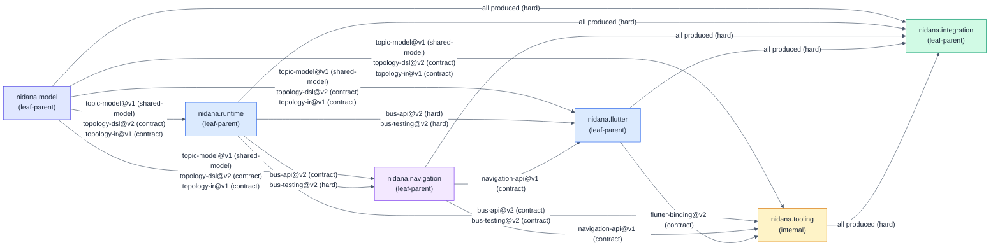

# nidana: Nidana Bus for Dart and Flutter

- **Kind:** internal
- **Purpose:** deliver a conforming Dart/Flutter implementation of the Nidana Bus reference architecture v0.15.1, at the v1 scope D1 fixes
- **Owns:** the v1 scope boundary (D1); the split into six children (D4); the contract ids on the edges between them; the workspace root (ADR-002); the open questions that span children
- **Does not own:** any package's internals; contract bodies (written by hsdd-contract); ADR files (written by hsdd-adr); the reference architecture itself (`ref/` is read-only; a change it would need is recorded as a decision marked for upstreaming)
- **Consumes:** none
- **Produces:** [topic-model@v1, topology-dsl@v2, topology-ir@v1, bus-api@v2, bus-testing@v2, navigation-api@v1, flutter-binding@v2, topic-codegen@v1, nidana-checks@v1]
- **Governed by:** [ADR-001, ADR-002]
- **Sources:**
  - `ref/nidana-docs/arch/nidana-bus-ref-arch-spec-v0_15_0.md` (all sections) (baseline, superseded by v0.15.1 on 2026-10-20; read only to see what changed)
  - `ref/nidana-docs/arch/nidana-bus-ref-arch-spec-v0_15_1.md` (all sections)
  - `ref/nidana-docs/arch/nidana-bus-ref-arch-guide-v0_15_0.md` (all sections) (baseline, superseded by v0.15.1 on 2026-10-20; read only to see what changed)
  - `ref/nidana-docs/arch/nidana-bus-ref-arch-guide-v0_15_1.md` (all sections)
  - `ref/nidana-docs/arch/nidana-bus-ref-arch-rationale-v0_15_0.md` (§2, §3, §4, §5, §7) (baseline, superseded by v0.15.1 on 2026-10-20; read only to see what changed)
  - `ref/nidana-docs/arch/nidana-bus-ref-arch-rationale-v0_15_1.md` (§2, §3, §4, §5, §7)
- **Decomposes into:** nidana.model, nidana.runtime, nidana.navigation, nidana.flutter, nidana.tooling, nidana.integration
- **Isolation strategy:** the root is never built as one unit; each child builds against the contracts it consumes, and nidana.integration composes the live children

## Overview

Nidana Bus is a typed, lifecycle-managed reactive substrate for application data flow: typed topics, pure topology declarations over them, one bus per coordination domain (Spec §1, §2). This tree builds the Dart/Flutter implementation as a set of pub packages in one workspace (ADR-002).

**Primary usage flows** an adopting app runs with v1:

1. Declare topics in a registry, written by hand or generated from `topics.yaml`, and topologies as pure declarations over them (Spec §2.1, §2.2, §4, §6).
2. Bootstrap one bus per coordination domain: activate the `APPLICATION` topologies in any order, construct the services whose publishers claim the state topics they own, register observers, then call `start()`. Nothing is connected or delivered before it; `start()` connects the topologies, a topology that writes a topic before every topology that reads it, then the subscriptions made during bootstrap, and then delivers the publishes queued before it (Spec §3.13, §11.2).
3. Mount the UI on a running bus: the app calls `start()` before its UI mounts, because a `MODULE` or `PAGE` activation before `start()` is rejected (Spec §7.2 "Scope timing"), then binds the bus into the widget tree. Pages render from state topics and publish events; pages activate and release their topologies as they mount and unmount, and a module holds its scope through a route observer's prefix match or a `NidanaModule` wrapper widget (Spec §5.6, §7.1 to §7.3).
4. Navigate through intents that the nav-resolver topology resolves and guards and the Flutter executor performs (Guide §3; navigation-api@v1 Refinement 3 resolves deep links before the guard, the reverse of Guide §3.4's order).
5. Test topologies on a `TestBus` with virtual time and envelope recording (Spec §3.6, Appendix A.7).
6. In CI, generate registries and the topic catalog, and run the static checks that move single-writer, uniqueness, cycle and scope-compatibility failures from first run to merge (Spec §3.8, §3.11, §4.3, §7.2 "Scope compatibility").

**Hard constraints** (owner's facts, 2026-10-17; the Specification's version, 2026-10-20):

- One builder, Purbo with coding agents: one team, one repository.
- The v0.15.1 Specification is accepted and normative for v1, although its header reads Draft. On 2026-10-20 the owner accepted it in place of v0.15.0, which the facts of 2026-10-17 had frozen for v1, and asked that every decision and artifact be brought in line with it (DEC-685). The Guide and the Rationale are informative.
- Toolchain through fvm only (`fvm dart`, `fvm flutter`). The SDK is pinned in `.fvmrc`: Flutter 3.47.7, which bundles Dart 3.13.5.
- Phases execute with superpowers. OpenSpec is not installed and is not to be installed. No global tooling; project-local dev dependencies only.
- `ref/` is read-only.

**Success criteria for v1:**

- Every normative rule of the Specification that applies to Dart/Flutter is implemented by a v1 package, enforced by a v1 check, or listed as deferred in D1.
- Every Bus Runtime Contract guarantee (Spec §3) is covered by a contract fixture (ADR-001) or a node test that a phase gate runs.
- The example app in nidana.integration exercises the primary flows end to end, and the v1 static checks pass over it and fail on seeded violations.

## Sources

- `ref/nidana-docs/arch/nidana-bus-ref-arch-spec-v0_15_1.md`: accepted specification, normative for v1 since the owner accepted it on 2026-10-20 in place of v0.15.0 (DEC-685; its header still reads Draft). Governs every rule the tree implements: core concepts (§2), the bus runtime contract (§3), typed topics (§4), layers (§5), topology composition and the IR (§6), lifecycle (§7), data contract rules (§8), observation and sensitive data (§9), the error model (§10), runtime operations (§11), the glossary (Appendix A). Cited as "Spec §n".
- `ref/nidana-docs/arch/nidana-bus-ref-arch-guide-v0_15_1.md`: informative implementer's guide. Governs the Dart mappings (§6), navigation (§3), cross-cutting and error patterns (§2, §4), the verification pipeline (§5), operations (§8), the reference architecture's own open questions (§10), the package layers (Appendix B) and the v1 tooling plan (Appendix C); the children also cite its data contract options (§1), coexistence with existing state management (§9.3) and the full system diagram the example app follows (Appendix A). Cited as "Guide §n".
- `ref/nidana-docs/arch/nidana-bus-ref-arch-rationale-v0_15_1.md`: informative rationale. Supplies stated reasons the tree cites: resilience properties (§2), determinism and the virtual scheduler (§3), portability and purity pressure (§4), topology output straight to the UI with no interposed state holder (§5), non-goals (§7). Cited as "Rationale §n".
- `ref/nidana-docs/arch/nidana-bus-ref-arch-spec-v0_15_0.md`, `ref/nidana-docs/arch/nidana-bus-ref-arch-guide-v0_15_0.md` and `ref/nidana-docs/arch/nidana-bus-ref-arch-rationale-v0_15_0.md`: the superseded baseline. The tree was planned against them from 2026-10-17 until the owner replaced them with v0.15.1 on 2026-10-20; every node keeps them in its Sources, marked as the baseline, and reads them only to see what changed. Section numbers did not move between the versions. Cited as "Spec v0.15.0 §n" where the baseline is meant. Not decomposed.
- Older versions under `ref/nidana-docs/arch/` and everything under `ref/nidana-docs/loop/`: superseded history, informative only, not decomposed, because the owner fixes v0.15.1 as the normative input.

The embedded child blocks below give each child's Sources in the short form, which cites v0.15.1; each child's own file lists the full paths, the v0.15.0 baseline entries included.

## Child nodes

| Node | Kind | Package (ADR-002) | Responsibility | Produces |
|------|------|-------------------|----------------|----------|
| nidana.model | leaf-parent | `nidana_dart_contracts` | pure core: topics, envelope and lineage rules, observer interfaces, topology DSL interface and recorder, IR, graphs, pure analyses | topic-model@v1, topology-dsl@v2, topology-ir@v1 |
| nidana.runtime | leaf-parent | `nidana_dart_runtime` | the bus: its own topic storage and fan-out, live pipelines on RxDart's operators, publish path and startup barrier, ownership, activation, lifecycle, observers, scheduler provider, TestBus | bus-api@v2, bus-testing@v2 |
| nidana.navigation | leaf-parent | `nidana_dart_navigation` | intent vocabulary, typed routes, nav-resolver template, the platform-neutral executor over a router port | navigation-api@v1 |
| nidana.flutter | leaf-parent | `nidana_dart_runtime_flutter` | Flutter UI adapter: bus provider, topic widgets, page scope binding, module scope binding by route observer or by the `NidanaModule` wrapper, Flutter navigation executor | flutter-binding@v2 |
| nidana.tooling | internal | `nidana_dart_codegen`, `nidana_dart_lint` | codegen, topic catalog, topology catalog and graph emission, v1 static checks, in two leaf-parent children, nidana.tooling.codegen and nidana.tooling.lint (nidana.tooling D1) | topic-codegen@v1, nidana-checks@v1 |
| nidana.integration | leaf-parent | `nidana_integration` (not published) | example app, live contract replays, end-to-end slices of the primary flows | none |

### nidana.model: Model

- **Kind:** leaf-parent
- **Purpose:** the pure, effect-free core every other package builds on: typed topics, the message envelope and its lineage rules, observer interfaces, the topology DSL interface with its recording builder, the TopologyDefinition IR, graphs and renderers, and the pure analyses over the IR
- **Owns:** package `nidana_dart_contracts`; the topic variants with the sealed `MultiWriterTopic` over event and replay topics, `TopicRef`, `Dedup`, `Tracing`, the sensitive flag; `MessageEnvelope` and the lineage rules as pure functions; `Scope`; `BusObserver`, `ObserveContext`, `ObserverCapability`; sensitive-payload redaction; `Topology`, `TopologyBuilder` and the opaque stream handle with the Spec §6.3 combinators (D6); the recording builder, the `TopologyPlan` with `planOf`, and `buildDefinition()`; the IR and its JSON form; `TopologyGraph` and `ShellClaim` with Mermaid, Graphviz and JSON renderers; cycle, self-reference, single-writer, scope-compatibility and name-uniqueness analyses, the first four of which the runtime also runs at activation and at publisher construction, while scope timing and the bus's own name check are bus-api@v2's (G42, G7); the contract replay tool (ADR-001)
- **Does not own:** subjects, subscriptions, timers, zones or the live interpretation of the DSL (nidana.runtime); source scanning and catalog runs (nidana.tooling); navigation types (nidana.navigation); any dependency beyond the SDK and `meta`
- **Consumes:** none
- **Produces:** [topic-model@v1, topology-dsl@v2, topology-ir@v1]
- **Governed by:** [ADR-001, ADR-002, ADR-003]
- **Sources:** Spec §1, §2.1 to §2.5, §3.5, §3.7, §3.8, §3.11, §3.12, §4.1 to §4.4, §4.6, §6.1 to §6.5, §7.1, §7.2, §8, §9.2, §10.2 principles 2 and 4 and the first bullet of principle 5, Appendix A.1 to A.4 with A.4 "Write chain"; Guide §1.1, §1.4, §6.3 with "Name every transformer", §8.1, Appendix B.1 to B.3; Rationale §3.1 to §3.3, §4.1
- **Decomposes into:** phases (see hsdd-phase-plan)
- **Isolation strategy:** depends on nothing beyond the SDK and `meta`; functions are tested by direct calls and property tests; topologies are tested by recording them and asserting on the IR; the node replays its three contracts, behavior through its own bindings, while topology-dsl@v2's live suite is bound and run by nidana.runtime

### nidana.runtime: Bus Runtime

- **Kind:** leaf-parent
- **Purpose:** the bus: turns topic declarations and topology definitions into the bus's own topic storage and subscriptions and into live pipelines on RxDart's operators (nidana.runtime D3), and enforces the Bus Runtime Contract (Spec §3), lifecycle (Spec §7), observation (Spec §9), the error model (Spec §10) and runtime operations (Spec §11)
- **Owns:** package `nidana_dart_runtime` with its two public libraries, the runtime and `testing.dart`; `Bus` and `BusConfig`; the topic registry with the runtime name check, each topic's storage and fan-out owned by the bus, and values held at `Object?` (nidana.runtime D3, D4); observed subscriptions, whose first values the bus emits and whose callbacks' errors go to the zone in which they listened (nidana.runtime D5); the publish path (dedup, ordering, reentrancy normalization, observers, sensitive gating); the startup barrier, which connects at `start()` what bootstrap activated and observed, writers before readers (nidana.runtime D3); publishers, writer handles and the ownership table; the live interpretation of topology-dsl@v2 with envelope threading, write chains, a live `switchMap` of its own and RxDart's time-dependent operators (ADR-003); activation checks, with re-activation comparing the plans' functions and seeds (bus-api@v2 G23) and scope timing (G42); scopes and module reference counting with grace; `bus.toGraph()`; start, shutdown and resource limits; dev-mode diagnostics (D8); the scheduler provider, virtual scheduler, `TestBus` and envelope recorder (ADR-003); the per-topic ordering regression test; an SDK-neutral telemetry observer (D1)
- **Does not own:** pure types, lineage rules, the IR and analyses (nidana.model); routes and widgets (nidana.flutter); navigation semantics (nidana.navigation); static checks (nidana.tooling); persistence (deferred, D1)
- **Consumes:** [topic-model@v1, topology-dsl@v2, topology-ir@v1]
- **Produces:** [bus-api@v2, bus-testing@v2]
- **Governed by:** [ADR-001, ADR-002, ADR-003]
- **Sources:** Spec §1, §2.1 "Replay timing", §2.3 to §2.5, §3.1 to §3.13, §4.3 (the runtime check), §5.3, §5.5, §6.1, §6.3, §6.5, §7.1 to §7.5 with §7.2 "Scope timing", §9, §10 with §10.2 principles 2, 4 and 5, §11, Appendix A.4 "Write chain", A.5, A.7; Guide §2, §4, §6.1 with "Dart: replay is asynchronous", §6.3 "Name every transformer", §6.5, §8.1, §8.2, §8.4, §8.5, §10.1; Rationale §2.1, §2.2, §3.2
- **Decomposes into:** phases (see hsdd-phase-plan)
- **Isolation strategy:** builds against the model's contracts only; runs on the Dart VM with `TestBus` and the virtual scheduler, no Flutter; replays bus-api@v2 and bus-testing@v2, behavior restricted to what its phases have delivered (ADR-001 item 10), and binds topology-dsl@v2's live suite, whose semantics it implements; a slice behind a package-internal seam is unit-tested against that seam (nidana.runtime D2)

### nidana.navigation: Navigation

- **Kind:** leaf-parent
- **Purpose:** navigation as a cross-cutting concern on the bus (Guide §3): the intent vocabulary, typed routes, the nav-resolver topology template with its pure guard and deep-link resolution, and the platform-neutral executor protocol
- **Owns:** package `nidana_dart_navigation` (pure Dart); `NavIntent`, `DeepLink`, `ResolvedNavIntent`, `NavRoute` (the Specification's `Route`, renamed by navigation-api@v1), `RouteRegistry`, `RouteState`, `RouteTransition`, `RouteAccessRequirement`, `RouteAccessPolicy`, `AccessPrincipal`; `NavigationTopics`; the nav-resolver template, which resolves deep links before it guards and names its stage functions, built once per `navResolver` call (navigation-api@v1 G13; bus-api@v2 G23); `resolveDeepLinks` and `applyAuthGuard`; `NavigationExecutor`, written once over the `NavigationRouter` port each platform implements, with the pure `planNavigation`; `InMemoryRouter` and the executor's conformance suite (D7); the deep-link bootstrap order, in which `start()` connects the resolver after the topologies that write its inputs, then the executor's subscription, and then delivers the queued deep link (bus-api@v2 G34)
- **Does not own:** platform router calls (nidana.flutter); the app's auth state type and route table (app code); bus mechanics (nidana.runtime)
- **Consumes:** [topic-model@v1, topology-dsl@v2, topology-ir@v1, bus-api@v2, bus-testing@v2]
- **Produces:** [navigation-api@v1]
- **Governed by:** [ADR-001, ADR-002, ADR-003]
- **Sources:** Spec §2.4, §3.8, §3.9, §3.11, §3.13, §7.2 "Scope timing", §10.2 the third bullet of principle 5, Appendix A.6; Guide §2, §3.1 to §3.7, §6.3 "Name every transformer", Appendix A
- **Decomposes into:** phases (see hsdd-phase-plan)
- **Isolation strategy:** guard, resolution and planning are pure functions tested directly; the resolver is tested through its recorded IR and live on `TestBus`; `NavigationExecutor` and its conformance suite are exercised with `InMemoryRouter`, so no Flutter is needed

### nidana.flutter: Flutter Binding

- **Kind:** leaf-parent
- **Purpose:** the Flutter UI runtime adapter (Guide Appendix B layer 6, Spec Appendix A.8): bus reference acquisition, topic-driven widgets, page publishers, page scope binding, module scope binding (a route observer with a route prefix match, or the `NidanaModule` wrapper widget), and the Flutter navigation executor
- **Owns:** package `nidana_dart_runtime_flutter`; `BusProvider` and its `BuildContext` access; topic widgets that render every frame from `getCurrentValue` and whose subscription only marks them for rebuild, its errors handled by the widget; page publishers with route-derived source; page-scope binding through `PageScope`, which scope timing admits only after `start()`; module-scope binding by route, `ModuleScopeObserver` with its route prefix match, and by mount, `NidanaModule`, which reads no route name and works under any router, each acquiring and releasing the runtime's module scope references; `FlutterNavigationRouter` over Flutter's own `Navigator` and `FlutterNavigationExecutor`, which wires it to navigation-api@v1's `NavigationExecutor`; shutdown at the end of the coordination domain; the widget-test library `WidgetTestBus`
- **Does not own:** reference counting arithmetic, grace timers, the startup barrier and scope timing (nidana.runtime); intent semantics (nidana.navigation); the app's routes
- **Consumes:** [topic-model@v1, topology-dsl@v2, topology-ir@v1, bus-api@v2, bus-testing@v2, navigation-api@v1]
- **Produces:** [flutter-binding@v2]
- **Governed by:** [ADR-001, ADR-002, ADR-003]
- **Sources:** Spec §2.1 "Replay timing", §2.4, §2.5, §3.1, §3.9, §3.13, §5.2, §5.6, §7.1 to §7.4 with §7.2 "Scope timing" and §7.3's Flutter row (the module wrapper `NidanaModule`), §10.2 the third bullet of principle 5, §11.1, §11.2, Appendix A.8; Guide §3.4, §3.5, §6.3 "Name every transformer", §6.4, §9.3, Appendix B.1, B.3; Rationale §5.1 to §5.4
- **Decomposes into:** phases (see hsdd-phase-plan)
- **Isolation strategy:** widget tests with `flutter_test` on the real runtime, time driven by `tester.pump` (ADR-003); navigation-api@v1's executor conformance suite is bound to `FlutterNavigationExecutor` under `testWidgets`; no device

### nidana.tooling: Build and CI Tooling

- **Kind:** internal
- **Purpose:** the static half of the architecture's enforcement and its build-time artifacts (Guide Appendix C, planned v1 for Dart): topic registry generation and catalog, the topology catalog scan and graph emission, and the CI checks that move runtime failures to merge time
- **Owns:** packages `nidana_dart_codegen` and `nidana_dart_lint`, one per child (nidana.tooling D1); the `topics.yaml` format and generated registries through build_runner; the topic catalog; `Catalog.scanTopologies` for Dart and `topology-graph.json`, with the registration library the catalog loads (nidana.tooling.codegen D1); the build-time HTML graph; the v1 checks of D1, explicit type arguments on a topic sink included, run as analysis server plugin rules and a workspace scan (ADR-002 items 7 and 8)
- **Does not own:** the analyses' algorithms (pure functions in nidana.model; tooling runs them over what it scans); runtime enforcement of the same rules (nidana.runtime); the checks D1 defers to v2
- **Consumes:** [topic-model@v1, topology-dsl@v2, topology-ir@v1, bus-api@v2, bus-testing@v2, navigation-api@v1, flutter-binding@v2]
- **Produces:** [topic-codegen@v1, nidana-checks@v1]
- **Governed by:** [ADR-001, ADR-002]
- **Sources:** Spec §3.1, §3.8, §3.11, §4.2 to §4.6, §6.3, §6.4, §6.5, §7.2, §7.6, §9.2; Guide §5.1, §5.2, Appendix C.1 to C.5 with C.1 "Platforms without runtime reflection" (the explicit list nidana.tooling.codegen D1 chose)
- **Decomposes into:** nidana.tooling.codegen, nidana.tooling.lint
- **Isolation strategy:** the two children share no code and exchange no contract (nidana.tooling D1), so each builds alone against the contracts it consumes; analyzer-based checks run over source fixtures and never execute a bus, recognizing nidana API by package and element name; codegen runs against golden input and expected trees; catalog and graph checks run over fixture topologies through the model's recorder; each child replays its share of nidana-checks@v1 (nidana.tooling D2)

### nidana.integration: Integration

- **Kind:** leaf-parent
- **Purpose:** prove the children compose: replay contract fixtures against live components and run end-to-end slices of the primary flows in an example Flutter app
- **Owns:** workspace member `nidana_integration` (not published) holding the example app and its tests; live replays of every contract's fixtures against the composed packages; the end-to-end slices its spec lists: bootstrap, with the `APPLICATION` topologies connected at `start()`, writers before readers, so no derived value depends on activation order; scope timing, `start()` called before the UI mounts and an earlier `MODULE` or `PAGE` activation rejected; hydration; single-writer ownership; module scope under each Flutter binding, `ModuleScopeObserver` and `NidanaModule`; guarded navigation; observation; CI
- **Does not own:** any package's behavior; fixes, which go back to the owning node
- **Consumes:** [topic-model@v1, topology-dsl@v2, topology-ir@v1, bus-api@v2, bus-testing@v2, navigation-api@v1, flutter-binding@v2, topic-codegen@v1, nidana-checks@v1]
- **Produces:** none
- **Governed by:** [ADR-001, ADR-002, ADR-003]
- **Sources:** Spec §2.5, §3.11, §3.13, §7.1's `APPLICATION` row, §7.2 to §7.6 with §7.2 "Scope timing" and §7.3's Flutter row (the module wrapper `NidanaModule`), §9, §11.2, Appendix A.8; Guide §3.4, §3.5, §5.2, §6.3 "Name every transformer", Appendix A, Appendix B.3; Rationale §3.1
- **Decomposes into:** phases (see hsdd-phase-plan)
- **Isolation strategy:** none by design: `hard` edges to every producer, so it runs after they ship, and its phases default to full-review

## Dependency DAG

| From | To | Contract | Type | Why this type |
|------|----|----------|------|---------------|
| nidana.model | nidana.runtime | topic-model@v1 | shared-model | value types the runtime carries |
| nidana.model | nidana.runtime | topology-dsl@v2 | contract | the runtime implements the live interpretation of the interface |
| nidana.model | nidana.runtime | topology-ir@v1 | contract | activation reads the IR and runs the analyses over it |
| nidana.model | nidana.navigation | topic-model@v1 | shared-model | navigation topics are topic-model values |
| nidana.model | nidana.navigation | topology-dsl@v2 | contract | the nav-resolver is a topology declaration |
| nidana.model | nidana.navigation | topology-ir@v1 | contract | the behavior suites compare recorded `TopologyDefinition`s, `ShellClaim`s and `analyzeTopologyGraph` results (navigation-api@v1 G13, G15, G16, G19, G24); the analyses they run already back nidana.runtime's activation, which this node waits on (D10) |
| nidana.model | nidana.flutter | topic-model@v1 | shared-model | widgets take topics |
| nidana.model | nidana.flutter | topology-dsl@v2 | contract | module and page bindings activate topologies |
| nidana.model | nidana.flutter | topology-ir@v1 | contract | the suite compares `bus.toGraph()` claims with `ShellClaim` values (flutter-binding@v2 G7, G14, G17), and the bound executor suite runs `analyzeTopologyGraph` (navigation-api@v1 G24); the analyses already back nidana.runtime's activation, which this node waits on (D10) |
| nidana.model | nidana.tooling | topic-model@v1 | shared-model | generated registries declare topic-model values |
| nidana.model | nidana.tooling | topology-dsl@v2 | contract | the catalog calls `buildDefinition()` |
| nidana.model | nidana.tooling | topology-ir@v1 | contract | the checks run the model's analyses over scanned IR |
| nidana.runtime | nidana.navigation | bus-api@v2 | contract | `NavigationExecutor` compiles against the publisher and observe surface |
| nidana.runtime | nidana.navigation | bus-testing@v2 | hard | resolver wiring tests run on a real `TestBus` |
| nidana.runtime | nidana.flutter | bus-api@v2 | hard | widget tests need real delivery and real reference counting |
| nidana.runtime | nidana.flutter | bus-testing@v2 | hard | widget tests record envelopes on a real bus |
| nidana.runtime | nidana.tooling | bus-api@v2 | contract | the checks recognize `bus.publisher(...)` claims in source; nothing runs a bus |
| nidana.runtime | nidana.tooling | bus-testing@v2 | contract | the plugin's `Bus` recognition covers `TestBus`, and its recorded invocations import `testing.dart` (nidana.tooling D3) |
| nidana.navigation | nidana.flutter | navigation-api@v1 | contract | the Flutter router implements the `NavigationRouter` port, and `FlutterNavigationExecutor` replays the executor's conformance suite |
| nidana.navigation | nidana.tooling | navigation-api@v1 | contract | the scan's recognizer matches `NavigationExecutor` claim sites, and its cases import the package (nidana.tooling D3) |
| nidana.flutter | nidana.tooling | flutter-binding@v2 | contract | the recognizer matches `PageScope` and `FlutterNavigationExecutor` claim sites, and the scan's cases import the package (nidana.tooling D3) |
| every other child | nidana.integration | every contract it produces | hard | integration composes live components |

D10 fixes what `contract` and `shared-model` mean between Dart packages. The three edges from nidana.runtime (bus-testing@v2), nidana.navigation and nidana.flutter into nidana.tooling were added on 2026-10-18 from nidana.tooling D3: tooling consumes those contracts by name, never by behavior, and within it only nidana.tooling.codegen's claim-site recognizer and workspace scan, from nidana.tooling.codegen.8 on, and nidana.tooling.lint's recorded invocations, at nidana.tooling.lint.4, wait on them. The two topology-ir@v1 edges into nidana.navigation and nidana.flutter were added on 2026-10-18 from the fixtures those nodes' gates run (D10).

## Development flow

1. **nidana.model first.** Every edge starts there. nidana.model.1 and .2 land the first sets of the contract replay tool every producing gate calls, nidana.model.3 to .5 the type-level skeleton of its three contracts, one contract per phase (the ordering policy is `fp-progression`), and nidana.model.6 and .7, beside the skeleton, the tool's remaining sets (ADR-001 item 9; nidana.model D1). A consumer's `contract` or `shared-model` edge waits on nidana.model.3 for topic-model@v1 alone and on nidana.model.5 for topology-dsl@v2 or topology-ir@v1, whose declarations complete the main library the three contracts share (D10; the contracts' Delivery paragraphs).
2. **Two lanes on nidana.model's early phases.**
   - Lane A, the critical path: nidana.runtime, a leaf-parent phase-planned directly (nidana.runtime D1). nidana.runtime.1 waits on nidana.model.2 and .5.
   - Lane B, parallel: nidana.tooling's two leaf-parent children, nidana.tooling.codegen and nidana.tooling.lint (nidana.tooling D1), each phase-planned directly and side by side. Neither runs a bus. nidana.tooling.lint.1 to .3 wait on no producer's phase, only on the replay tool's sets at nidana.model.1 and .7; nidana.tooling.lint.4 replays the recorded invocations, which resolve `nidana_dart_contracts`, `nidana_dart_runtime` and `testing.dart`, so it alone waits on nidana.model.5 and nidana.runtime.1 (nidana.tooling.lint D5). nidana.tooling.codegen's registry lane needs only the model: nidana.tooling.codegen.1 waits on nidana.model.5 and .7, and nidana.tooling.codegen.5, its graph phase, on nidana.model.13 and .14. Its claim-site recognizer and the replays of its workspace scan resolve `nidana_dart_runtime`, `nidana_dart_navigation` and `nidana_dart_runtime_flutter`, so nidana.tooling.codegen.8 waits on nidana.runtime.1, nidana.navigation.1 and nidana.flutter.1, which merge while the runtime's later phases run (nidana.tooling D3; item 3). The children's plans hold every phase-level wait.
3. **nidana.navigation and nidana.flutter on the runtime's declarations.** Both start once nidana.runtime.1, which lands bus-api@v2's and bus-testing@v2's declarations, has merged, and nidana.flutter.1 also waits on nidana.navigation.1. Their `hard` runtime edges bind the phases that run a real bus, nidana.navigation.6 and nidana.flutter.4 to .8, which wait on nidana.runtime.14, the runtime's last producing phase (D10; nidana.flutter D6); nidana.runtime.15 and .16, appended for Specification v0.15.1, run before it (nidana.runtime D10). So nidana.navigation.1 to .5 and nidana.flutter.1 to .3, which construct no bus, run beside the runtime's later phases. Once nidana.runtime.14 has merged, nidana.flutter.4 runs, then nidana.flutter.6 and .8, the module wrapper's phase, in turn, with nidana.flutter.5 beside them (nidana.flutter D12); nidana.navigation.6 runs beside that chain, and nidana.flutter.7, the executor phase, waits on nidana.flutter.5, .6 and .8 and on nidana.navigation.6 (navigation-api@v1 and flutter-binding@v2 Delivery).
4. **nidana.integration last.** Its `hard` edges bind per phase (nidana.integration D2). nidana.integration.1 waits on topic-model@v1's last producing phase, nidana.model.8, on the declaration phases nidana.runtime.1, nidana.navigation.1 and nidana.flutter.1, and on the tooling lanes' last phases, nidana.tooling.codegen.11 and nidana.tooling.lint.4; nidana.integration.2 to .4 follow nidana.navigation.6 and nidana.runtime.14, and nidana.integration.5 follows nidana.flutter.7. nidana.integration.6, the first phase whose closure holds every producer's last producing phase, runs the unrestricted `--all` replay.

Critical path: nidana.model, nidana.runtime, then nidana.flutter, with nidana.navigation beside it, then nidana.integration. Counted in phases over the plans' dependencies, it runs nidana.model.1 to .5, nidana.runtime.1, .2, .5 to .7, .15, .8 and .11 to .14, nidana.flutter.4, .6, .8 and .7, and nidana.integration.5, .6 and .7 or .8: twenty-three phases. Inside nidana.model and nidana.runtime, equal-length variants pass through nidana.model.8 or nidana.runtime.3. nidana.runtime's pipeline lane, nidana.runtime.9, .10 and .16, has two phases of slack before nidana.runtime.11. The route through nidana.navigation.6 and nidana.integration.2 to .4 has one phase of slack: it was as long as the route through nidana.flutter until Specification v0.15.1 added nidana.flutter.8 to that chain (nidana.flutter D12), while nidana.runtime.15 lengthened both. nidana.tooling is off the critical path. nidana.tooling.codegen ends on its registry lane, nidana.tooling.codegen.5, .6 and .11 after nidana.model.14, not on its workspace lane, and nidana.tooling.codegen.11, which nidana.integration.1 waits on, has three phases of slack before it would delay nidana.integration.2 and four before it would delay the critical path; nidana.tooling.lint.4 has more. No node is left to decompose: nidana.runtime is a leaf-parent (nidana.runtime D1) and nidana.tooling's children are leaf-parents (nidana.tooling D1).

## Contract matrix

All nine contracts exist under `hsdd/contract/`, written by hsdd-contract in the format ADR-001 fixes. Since hsdd-reconcile drained nidana.integration's plan on 2026-10-18, every one was `stable` with `phase_ids: final`, and any change that could break a consumer needs a new version and a migration note, through hsdd-contract. Specification v0.15.1 made such changes to four of them, which took a v2 in the same file (`hsdd/management/2026-10-20-intake-ref-arch-v0-15-1.md`): topology-dsl@v2, bus-api@v2, bus-testing@v2 and flutter-binding@v2 are `draft` with `phase_ids: provisional` until hsdd-reconcile confirms the phases their re-planned producers and consumers name, which that intake routes to its final reconcile. The other five, topic-model@v1, topology-ir@v1, navigation-api@v1, topic-codegen@v1 and nidana-checks@v1, stay `stable` with `phase_ids: final`. Every contract's `produced_by` and `consumers` name the phases of the plans as they stand, the two tooling children as producers (nidana.tooling D2), the tooling consumers of bus-testing@v2, navigation-api@v1 and flutter-binding@v2 (nidana.tooling D3), and nidana.navigation and nidana.flutter as consumers of topology-ir@v1 (D10) among them. The kinds below are the ones they carry; the table names nodes, and each contract's frontmatter names their phases.

| Contract | Kind | Producer | Consumers in the tree | External consumers |
|----------|------|----------|-----------------------|--------------------|
| topic-model@v1 | shared-model | nidana.model | runtime, navigation, flutter, tooling, integration | app code declaring topics and observers |
| topology-dsl@v2 | api | nidana.model | runtime (implements it live), navigation, flutter, tooling, integration | app code declaring topologies |
| topology-ir@v1 | api, with a serialized form | nidana.model | runtime, navigation, flutter, tooling, integration | CI tools reading `topology-graph.json` |
| bus-api@v2 | api | nidana.runtime | navigation, flutter, tooling (surface only), integration | app bootstrap, services, pages |
| bus-testing@v2 | api | nidana.runtime | navigation, flutter, tooling (surface only), integration | app tests |
| navigation-api@v1 | api | nidana.navigation | flutter (implements the `NavigationRouter` port and binds the executor suite), tooling (surface only), integration | app code publishing intents |
| flutter-binding@v2 | api | nidana.flutter | tooling (surface only), integration | Flutter app code |
| topic-codegen@v1 | file | nidana.tooling (nidana.tooling.codegen) | integration | app builds (`topics.yaml` in, registries and catalog out) |
| nidana-checks@v1 | cli | nidana.tooling (nidana.tooling.lint for the plugin, nidana.tooling.codegen for the scan; nidana.tooling D2) | integration | app CI (`dart analyze` diagnostics and the workspace scan) |

## Decisions

### D1: v1 scope

The v1 scope follows the Guide's own v1 plan for Dart/Flutter (Guide Appendix B layers, Appendix C items marked planned v1), narrowed where the Guide records a design as open, and widened only where the Specification requires a mechanism the Guide does not schedule.

**In v1:**

| Item | Reference | Node |
|------|-----------|------|
| Contracts layer: topic model, envelope and lineage rules, observer interfaces, DSL interface and recorder, IR, graph renderers, pure analyses | Guide B.1 layer 1; Spec §2, §3.5, §4, §6 | nidana.model |
| Core runtime and the RxDart adapter, as one package | Guide B.1 layers 2 and 3; Spec §3, §7, §9, §10, §11 | nidana.runtime |
| `TestBus`, `VirtualScheduler`, envelope recorder, per-topic ordering regression test | Spec §3.6, Appendix A.7; Guide §6.5, C.4 (TestBus envelope recorder, planned v1) | nidana.runtime |
| `Tracing.disabled` topic flag | Spec §3.5 (Cost); Guide §8.1 | nidana.model, nidana.runtime |
| SDK-neutral telemetry observer implementing the Guide §8.2 mapping onto `ObserveContext.span` | Guide §8.2, C.4 (OpenTelemetry exporter, planned v1) | nidana.runtime |
| Navigation: intents, routes, resolver template, executor protocol | Guide B.1 layer 4, §3; Spec Appendix A.6 | nidana.navigation |
| Flutter UI adapter, including `FlutterNavigationExecutor` and both module scope bindings, the route observer with a prefix match and the `NidanaModule` wrapper widget | Guide B.1 layer 6, B.3; Spec §7.3's Flutter row, Appendix A.8 | nidana.flutter |
| Codegen: topic registries from `topics.yaml`, topic catalog, topology graph emission, build_runner integration | Guide C.2 (planned v1), C.3; Spec §4.5 | nidana.tooling.codegen |
| v1 checks in the workspace scan: topic name uniqueness, single-writer, inter-topology cycles, intra-topology self-cycle, scope compatibility | Guide C.1, C.2, C.5; Spec §3.8, §3.11, §4.3, §7.2 | nidana.tooling.codegen |
| v1 checks as plugin rules: raw-string topic use, global bus accessor, explicit type arguments on a topic sink (`explicit_topic_type_arguments`), the sensitive flag on known-sensitive types (non-blocking) | Guide C.1, C.2, C.5; Spec §3.1, §4.2, §4.4, §9.2 | nidana.tooling.lint |
| Build-time topology graph visualizer (static HTML) | Guide C.4 (planned v1) | nidana.tooling.codegen |

The tooling rows name nidana.tooling's children (nidana.tooling D1); the hosts of the checks follow nidana-checks@v1 Refinement 1. `explicit_topic_type_arguments` joined this list on 2026-10-18. nidana-checks@v1 Refinement 4 added it on 2026-10-17 to enforce Spec §4.2 where Dart's covariant generics let explicit type arguments widen a topic's type (bus-api@v2 G40), a gap this table did not foresee. "Non-blocking" is nidana-checks@v1 Refinement 3's reading of Guide C.1's "v1 (warning)": the rule reports at INFO and fails the analysis only under `--fatal-infos`, while the other three plugin rules report at WARNING. `NidanaModule` joined the Flutter adapter row on 2026-10-21: Specification v0.15.1 names the wrapper in §7.3's Flutter row and Appendix A.8, flutter-binding@v2 declares it (its Refinement 8, G20), and nidana.flutter.8 delivers it (nidana.flutter D12). It adds no package and no dependency (ADR-002, its `## Amendments` entry of 2026-10-21).

**Out of v1 (deferred):**

| Item | Reference | Why | Signal that would bring it in |
|------|-----------|-----|-------------------------------|
| Persistence layer (`nidana_dart_persistence`) | Guide B.1 layer 5, §10.5 | the Guide records its design as open ("in design"); the Specification only constrains persistence that exists (Spec §9.2 item 3) | an owner-named v1 app that needs topic persistence |
| Concrete OpenTelemetry SDK binding | Guide §8.2 | the Dart OpenTelemetry packages are pre-1.0 and one was deprecated and renamed in October 2026 (pub.dev API, 2026-10-17); the observer seam makes a binding an add-on | the owner picks a telemetry backend |
| Runtime devtools: live graph, envelope inspector, causation explorer, profiler | Guide C.4 (v2), §10.2 | v2 in the Guide's plan | none for v1 |
| Perf suite (`nidana_dart_perf_suite`) | Guide B.2, §8.1 | no Appendix C status and no Spec rule depends on it | a performance-critical adopter |
| v2 checks: sequencer anti-pattern, unreachable topics, orphan reads, transformer purity, sensitive flag as an error, Initializing-variant lint | Guide C.1, C.5; Spec §6.4, §7.6 | v2 in the Guide's plan | none for v1 |
| The stream-factory-plus-publish lint | Spec §6.3 (static completeness scope) | the Spec states it, but Appendix C has no row and no schedule for it; deferred and reported upstream | a service in the example that needs it |
| Binary-module manifests for the single-writer scan | Spec §3.11 | Guide C.5 lists them as v2 tooling | the first closed-source module |
| Dedicated audit topic (Approach B) | Spec §9.1 | the Spec recommends it only for development tooling, which is v2 | runtime devtools come in |
| Topology diff as a review tool | Spec §6.5 (practical implications) | not normative, no Appendix C row | none for v1 |
| Dynamic per-entity topics package | Guide §8.7 | the Guide says a future package "may provide" it | none for v1 |
| Kotlin, Swift and TypeScript ports; cross-platform test parity | Guide (About), C.2; Guide §10.1 | v1 is Dart/Flutter only | a second platform starts |
| Server-shipped topology code | Guide §10.4 | outside the architecture's target | none |
| Cross-tab and cross-process coordination | Guide §7.1, §8.4; Rationale §7.5 | not a bus-level concern | none |
| Publishing packages to pub.dev | none | needs credentials outside this repository | owner action |

### D2: Package consumers

1. Flutter application developers: GoTo Financial app teams first, any pub.dev adopter later. They depend on `nidana_dart_contracts`, `nidana_dart_runtime`, `nidana_dart_navigation` and `nidana_dart_runtime_flutter` at run time, and in tests on the `testing.dart` libraries of the runtime (`TestBus`, bus-testing@v2), the navigation package (`InMemoryRouter`, navigation-api@v1) and the Flutter adapter (`WidgetTestBus`, flutter-binding@v2).
2. The same teams' builds and CI: they run the codegen through build_runner, enable the analyzer plugin in `analysis_options.yaml`, and run the workspace scan.
3. Pure Dart code with no Flutter: domain modules that declare topics and topologies depend on `nidana_dart_contracts` alone; services and VM tests add `nidana_dart_runtime`.
4. The tree's own packages, along the DAG above.

Not consumers in v1: ports to other platforms (they consume the Specification, not this tree) and server-side Dart (Rationale §7.6).

### D3: Decomposition axis

The owner's facts answer hsdd-spec's "who builds what?": one owner with coding agents, one team, one repository. No ownership boundary exists to split along, so no node needs a `Team` field and the axis is capability slices (HSDD §2.5: one owner holds the whole stack). The slices follow the published-package boundaries, which are this tree's deploy targets, and those coincide with the reference architecture's library layers wherever a layer is a real dependency boundary on Dart. Layers 2 and 3 of Guide B.1 are not a real boundary on Dart, because RxDart is the only engine (Guide §6.1), so they form one node.

### D4: Child set and kinds

Six children: nidana.model (leaf-parent), nidana.runtime (leaf-parent), nidana.navigation (leaf-parent), nidana.flutter (leaf-parent), nidana.tooling (internal, with two leaf-parent children), nidana.integration (leaf-parent).

- nidana.model holds the DSL interface, the recording builder and the IR analyses, not only data types: topology modules then depend on a pure package, and the activation-time checks (Spec §3.8, §3.11, §7.2 "Scope compatibility") and the CI checks run the same functions. Spec §7.2 "Scope timing" is no analysis: CI cannot see when an activation happens relative to `start()`, so bus-api@v2 rejects an early `MODULE` or `PAGE` activation itself (its G42; topology-ir@v1 Refinement 4).
- `TestBus`, `VirtualScheduler` and the envelope recorder live in nidana.runtime, not in a separate test-utilities node. The Specification defines `TestBus` as a bus constructed with a virtual scheduler provider (Spec §3.6, Appendix A.7), and the runtime's own tests need the virtual scheduler, so the two could not be tested independently (hsdd-spec: merge when two nodes cannot be tested independently).
- The leaf-parents each hold one coherent scope that one owner can keep in mind and that splits into review-window phases.
- **Kinds restated on 2026-10-18.** As first written on 2026-10-17, this decision marked nidana.runtime and nidana.tooling internal, because each spans several mechanisms (runtime: registry, publish path, activation, lifecycle, testing support; tooling: build_runner builders, an analyzer plugin, a workspace scan) and seemed too large for one phase plan. Each node's own decomposition, run on 2026-10-18 once its contracts were written, tested that reason against them:
  - nidana.runtime D1 made nidana.runtime a leaf-parent with no children. `TestBus` extends `Bus`, so the declarations of bus-api@v2 and bus-testing@v2 share one library and land in one first phase; every behavior replay of both runs on the virtual scheduler that node lands; and any child boundary inside the package would need an internal contract whose fixtures import `lib/src/`, which ADR-001 item 2 forbids, so that contract could never become `stable`. Its mechanisms are the slices of one phase plan (nidana.runtime D2), estimated at about twelve phases, planned as fourteen, and planned as sixteen since Specification v0.15.1 appended the observed streams and the write chains (nidana.runtime D10).
  - nidana.tooling D1 kept nidana.tooling internal and split it into nidana.tooling.codegen (`nidana_dart_codegen`) and nidana.tooling.lint (`nidana_dart_lint`), one leaf-parent per package. The two packages share no code (ADR-002 item 4), so no internal contract joins the children, and nidana-checks@v1 has a producer in each (nidana.tooling D2; ADR-001 item 10).
- Unchanged by the restatement: the six children, their packages (ADR-002 item 3), and every contract id on the root's edges. The child table, the embedded blocks, the DAG and the development flow above carry the restated kinds.

**Restated 2026-10-21** for Specification v0.15.1 (`hsdd/management/2026-10-20-intake-ref-arch-v0-15-1.md`). The first bullet limits the shared checks to Spec §7.2 "Scope compatibility" and says where "Scope timing", which v0.15.1 added to §7.2, is enforced; as first written it cited Spec §7.2 whole. The kinds bullet cites bus-api@v2 and bus-testing@v2 and gives nidana.runtime's sixteen phases. The children, their kinds and packages, and the contracts on the root's edges held, four of those contracts at a new version: the intake found no node, contract or ADR empty, wrong or missing (its Routing, "Class and shape").

### D5: Integration node

The children exchange contracts, so nidana.integration exists as a leaf-parent with `hard` edges to every producing sibling. One team owns it, as it owns everything else. No integration node exists below the root: nidana.runtime has no children (nidana.runtime D1), and nidana.tooling's two children exchange no contract (nidana.tooling D1), so nidana.integration's `--all` replay covers every contract of both.

### D6: The Dart topology DSL wraps every combinator

Topology bodies compose only through combinators that nidana.model defines on its opaque stream handle and builder, never through RxDart calls on read handles. Guide §6.3's Dart example and the "Combine" row of Guide B.3 call `Streams.combineLatest2` on the values `b.read()` returns; a recording builder cannot capture that call (Spec §6.5) and the bus cannot thread envelopes through it (Spec §3.5). Raw RxDart stays reachable through the Spec §3.5 escape hatch only. Marked for upstreaming: Guide §6.3 and B.3 should show the wrapped form. Lands in topology-dsl@v2.

### D7: Navigation types live in the navigation package

`NavIntent`, `RouteState` and the other navigation types, and `NavigationTopics`, live in `nidana_dart_navigation`, not in the contracts package where Guide B.1 lists them, so the contracts package carries nothing an app that skips navigation (Guide §3.7) does not use. `nidana_dart_runtime_flutter` depends on the navigation package, as Guide B.4 draws (layer 6 on layer 4) and as Spec Appendix A.8 implies by placing `FlutterNavigationExecutor` in the Flutter adapter: navigation is opt-in by use (an app that never activates the resolver or constructs the executor pays nothing at run time), not by dependency. Marked for upstreaming: Guide B.1 lists the navigation types in layer 1 while Guide §3.7 calls navigation optional.

### D8: Dev mode and dev-mode diagnostics

The Specification requires dev-mode behavior in several places (Spec §2.4, §3.4, §3.7, §3.13, §7.2, §10.2) and is silent on what dev mode is on Dart. Dev mode is a `BusConfig` value that defaults to "assertions enabled", so debug and test runs are in dev mode and release builds are not. Dev-mode diagnostics are values of a sealed diagnostic type delivered to a sink in `BusConfig`, never thrown; the throws the Specification requires (Spec §3.8, §3.9, §3.11, §4.3, §7.2 "Scope timing") stay throws. Every nidana package with dev-mode behavior reads dev mode and the sink from the bus it holds. This is not an ADR: one producer owns the mechanism and every other node reaches it through bus-api@v2, where it lands.

**Restated 2026-10-21** for Specification v0.15.1 (`hsdd/management/2026-10-20-intake-ref-arch-v0-15-1.md`). Spec §7.2 "Scope timing" adds one place of each kind: the dev-mode report that `EventTopic` events published before a late `APPLICATION` activation were not delivered to it, a diagnostic (bus-api@v2 G22), and the rejection of a `MODULE` or `PAGE` activation before `start()`, a throw (bus-api@v2 G42). As first written, the two lists did not name §7.2 and the decision cited bus-api@v1. The decision did not change.

### D9: Reactive engine and subject construction

The engine is RxDart (Spec §2.1, §3.3; Guide §6.1), resolved at 0.28.0 on the pinned SDK. How a topic is backed, and the delivery timing that follows, was nidana.runtime's question (OQ-R1), decided as guarantees of bus-api@v2 and built by nidana.runtime D3: the bus owns each topic's storage and fan-out and emits every first value itself, and RxDart serves the pipeline's operators. An observed subscription of a state or replay topic made after `start()` receives its first values in the first provider-zone microtask after `listen` (G17), and a topology activated after `start()` is connected before `activate` returns (G22). An activation or an observed subscription made during bootstrap is not connected and receives nothing until `start()`, which connects the activations first, a topology that writes a topic before every topology that reads it, then the subscriptions, and then delivers the queue (G34; Spec §3.13). Not an ADR: no other node touches topic storage. The root records what the experiment `docs/auto-run/experiments/rxdart-sync-subjects/` found, because nidana.runtime's design accounts for each finding (nidana.runtime, Inherited from the root), and because Spec §3.3 said, until v0.15.1 qualified it for replay timing, that for RxDart "No additional machinery is required beyond" `sync: true`:

- a `sync: true` `PublishSubject` delivers synchronously;
- a `sync: true` `BehaviorSubject` or `ReplaySubject` delivers its replay to a new subscriber in a microtask, buffering later events behind it in order, and delivers synchronously once that subscriber is established;
- a reentrant `add` to the same `sync: true` subject during its own delivery throws `StateError` ("Cannot fire new event. Controller is already firing an event");
- a reentrant `add` to another `sync: true` subject is delivered depth-first, before the remaining subscribers of the first subject;
- deferring the reentrant `add` with `scheduleMicrotask` restores per-topic order (Spec §3.4).

**Upstream mark adopted.** As first written, this decision marked Spec §3.3's RxDart bullet for upstreaming: it should name the asynchronous first delivery and the same-subject reentrancy error. Specification v0.15.1 names the first. Spec §2.1 "Replay timing" and §3.3's RxDart bullet say that even a `sync: true` subject replays to a new subscriber one microtask after `listen` returns and that the startup barrier needs machinery on Dart that the subject does not provide, such as a wrapper around each subject or topic storage owned by the bus; Guide §6.1 "Dart: replay is asynchronous" and §6.5's Dart/RxDart row say the same. v0.15.1 does not name the second, and the root no longer marks it: Spec §3.4 makes the deferral that avoids it mandatory, and the bus's own fan-out, which raises the same `StateError` for an add made while it delivers, is covered by the same deferral (nidana.runtime, Inherited from the root; bus-api@v2 G14).

**Restated 2026-10-21** for Specification v0.15.1 (`hsdd/management/2026-10-20-intake-ref-arch-v0-15-1.md`, landings L1 and L8). As first written, this decision cited bus-api@v1 and had an observed subscription keep "RxDart's first delivery" in the first provider-zone microtask after `listen` while topology reads took "a synchronous path of their own, so that a connection reaches the reads before `activate` returns"; no subject backs a topic under nidana.runtime D3 as restated, and bus-api@v2 G34 connects what bootstrap activated and observed only at `start()`. The engine did not change.

### D10: Edge types between Dart packages

Dart code compiles only against real declarations, so between packages of this tree a `contract` or `shared-model` edge means the consumer starts once the phase that the contract's Delivery paragraph names for a consumer's edge has merged: the contract's first producing phase, which lands its types and signatures under `fp-progression`, or a later type-level phase when contracts share one library, as topology-dsl@v2's consumers wait on nidana.model.5 (ADR-001 items 10 and 11; conventions, Phase design). It does not wait for the producer's node to finish; a consumer phase that calls into a body waits on the phase that the same paragraph names as delivering it (nidana.model D3). A `hard` edge means the consumer's tests need the producer's real behavior: a consumer phase that runs it waits on the contract's last producing phase, and one that only compiles against the declarations waits as a `contract` edge would (nidana.flutter D6; nidana.integration D2; the Delivery paragraphs).

- **2026-10-18: edges implied by fixtures.** A node consumes every contract whose public libraries are imported by the fixtures its phase gates run: the fixtures of the contracts it produces, the bindings ADR-001 item 4 places in its producing contract's fixture directory, and the conformance libraries those bindings import by relative path. Its gate cannot run before the phase that contract's Delivery paragraph names for a consumer's edge has merged. This is nidana.tooling D3's test, applied to the whole tree. A library that carries the declarations of several contracts, as `nidana_dart_contracts.dart` carries those of topic-model@v1, topology-dsl@v2 and topology-ir@v1 (topic-model@v1 Interface), counts for the contracts whose declarations the fixture names, by the consuming contract's Boundary table. A sweep of the nine fixture trees under `hsdd/contract/fixture/` found two missing edges, added here to the consumers' Consumes lines, the DAG, the edge table and the contract matrix:
  - topology-ir@v1 into nidana.navigation, whose suites name `TopologyDefinition`, `ShellClaim` and `analyzeTopologyGraph` from `topology_ir.dart` and the main library (navigation-api@v1 G13, G15, G16, G19, G24);
  - topology-ir@v1 into nidana.flutter, whose suite compares `bus.toGraph()` claims with `ShellClaim` values (flutter-binding@v2 G7, G14, G17) and whose binding of navigation-api@v1's executor suite runs `analyzeTopologyGraph` (navigation-api@v1 G24).

  Both edges are `contract`, not `hard`. The behavior these cases need from nidana.model, the analyses and definition equality, is what nidana.runtime's activation checks and live graph use (bus-api@v2 G24, G37), re-activation comparing the definitions under topology-ir@v1's equality as well as the plans' functions and seeds (bus-api@v2 G23), so nidana.runtime's unrestricted bus-api@v2 replay at its last producing phase needs it before the runtime ships. The consumer phases that run these cases wait on the nidana.model phases that deliver it, which topology-ir@v1's Delivery paragraph names: nidana.navigation.3, which replays G13 before the runtime ships, on nidana.model.10 and .11; nidana.navigation.6 on nidana.model.12, beside nidana.runtime.14; nidana.flutter.5 to .7 through nidana.runtime.14, whose closure holds nidana.model.10 to .12. nidana.runtime types its own use of the same analyses `contract` (nidana.runtime Contracts). Neither edge changes the development flow. Every other fixture import maps to a contract its node already consumes. nidana.tooling.lint's `analyze-*` cases import the main library but name no topology-ir@v1 declaration, so that child gains no edge. `package:nidana_contract_check/fixture.dart` belongs to the replay tool (ADR-001 item 9), not to a contract's library, so it implies no contract edge: it lands at nidana.model.2, and a phase whose tests import it depends on that phase beside its contract edges, an edge no contract carries (conventions, Phase design).

- **2026-10-18: restated for the reconciled plans.** As first written on 2026-10-17, this decision had a `contract` or `shared-model` consumer start once "the producer's first phase" merged; the bullet above said `fixture.dart` comes with nidana.model's first phase, which writes it, and gave as the reason for typing the two topology-ir@v1 edges `contract` that both nodes wait on the runtime shipping. nidana.model's plan lands the replay tool by set over nidana.model.1, .2, .6 and .7 and its contracts' declarations at nidana.model.3 to .5 (nidana.model D1; ADR-001 items 9 and 10), so its first phase lands neither a contract's declarations nor `fixture.dart`; and nidana.navigation.3 replays G13 before the runtime ships. The decision now names the Delivery paragraph's phase, which the conventions' reading rule already read for "the producer's first phase", and states the per-phase reading of `hard` edges that nidana.flutter D6 and nidana.integration D2 took and the contracts' Delivery paragraphs carry. No edge type and no edge changed.

- **2026-10-21: restated for Specification v0.15.1** (`hsdd/management/2026-10-20-intake-ref-arch-v0-15-1.md`). The decision's example of a later type-level phase and its rule for a library that carries several contracts cite topology-dsl@v2, and the topology-ir@v1 edge into nidana.flutter cites flutter-binding@v2. As first written, the paragraph on the two topology-ir@v1 edges cited bus-api@v1 G23 for definition equality; bus-api@v2 G23 compares the plans' functions and seeds as well, so the sentence now says re-activation compares both. The phases the two edges bind did not change: nidana.flutter.8, which v0.15.1 appended, runs no topology-ir@v1 case (topology-ir@v1 `consumers`). No edge type and no edge changed.

## Proposed ADRs

This decomposition proposed three ADRs. hsdd-adr materialized and accepted each on 2026-10-17, so the binding text is the file under `hsdd/adr/`, and each entry here is a pointer to it. Each file has since been amended in place, keeping its status, date and item numbers, with a dated `## Amendments` section that lists what changed; the entries below name those amendments. The affected nodes and contracts carry `Governed by` links.

### ADR-001 (accepted): Executable validation for Dart API contracts

Accepted 2026-10-17 as `hsdd/adr/001-executable-contract-validation.md`, which holds the binding text; it resolves OQ8. The accepted decision sharpens the proposal: reject fixtures anchor each expected diagnostic to a line, conformance cases are values bound per implementation and per test runner, contract guarantees carry `G{n}` ids that fixtures cover, and the workspace root's analysis options exclude `hsdd/**`. Amended in place three times and touched once, each an entry of its `## Amendments` section. On 2026-10-17, after the nine contracts were written, items 2, 3, 4, 6, 7, 9 and 10 gained what those contracts needed: coverage of schema, file and cli sets declared in `## Validation`, data directories, recorded invocations for `file` contracts, and `--guarantee` over file replays and recorded invocations. On 2026-10-18, after nidana.tooling D1, item 10 gained the rule for a contract with several producing leaf-parents (each producer's last phase replays its whole share; nidana.integration's `--all` is the one unrestricted replay), and `affects` gained nidana.tooling.codegen and nidana.tooling.lint. Later on 2026-10-18, in the consistency pass after planning completed, item 9 gained the replay tool's landing phases, nidana.model.1, .2, .6 and .7 (nidana.model D1), and the command-line semantics of nidana.model D2, and items 10 and 11 name a contract's first producing phase and the phase its Delivery paragraph names for a consumer's edge; no rule changed. On 2026-10-21, for Specification v0.15.1, a citation touch moved `affects` and the live citations to topology-dsl@v2, bus-api@v2, bus-testing@v2 and flutter-binding@v2, with no rule, fixture or gate command changed.

### ADR-002 (accepted): Package and workspace layout

Accepted 2026-10-17 as `hsdd/adr/002-package-workspace-layout.md`, which holds the binding text; it resolves OQ9 and, with D7, OQ12. Its item 8 fixed where nidana.tooling's OQ-T2 scan runs, and OQ-T2 is now resolved in nidana.tooling. The package set and names are the proposal's. Four changes follow from `docs/auto-run/experiments/workspace-layout/`: `nidana_dart_lint` depends on no nidana package and pins its analyzer, because the analysis server resolves a plugin outside the workspace; the workspace scan and every check over the aggregated IR run as a command of `nidana_dart_codegen`; the plugin is enabled in the workspace root's analysis options, the only place the analyzer accepts it in a workspace; and a member's `example/` folder has no pubspec of its own. The accepted decision also fixes the root lint set and strict modes, the `hsdd/**` exclude, hosted constraints between members, and the replay tool's dependency set. Its `## Amendments` section has four entries, three of 2026-10-18 and one of 2026-10-21. The first: a plugin diagnostic reports at the severity its code declares, INFO only when it declares none, which corrects the accepted claim that every plugin rule reports at INFO (`docs/auto-run/experiments/plugin-severity/`); item 3's Owner column and `affects` name nidana.tooling.codegen and nidana.tooling.lint; and what the workspace scan reads is nidana-checks@v1 Refinement 2's. The second, a citation swept by hsdd-reconcile: item 3's row for `nidana_dart_runtime_flutter` names no router package, because OQ-F1 is resolved. The third, after nidana.tooling.lint's reconcile: item 4 takes a third-party constraint from a table of the full planned resolution, because the version the lockfile resolves when nidana.model.1 adds a dependency gives constraints that no workspace with a Flutter member resolves (`docs/auto-run/experiments/lint-reconcile-amends/`, `constraint-lower-bounds/`); item 7's pins are that table's; and Context Q11c gives the plugin-failure exit codes 3 and 4 with the rule between them (`plugin-compile-exit/`). The fourth, a citation touch for Specification v0.15.1, moved `affects` and item 3's Flutter row to the current contract versions and checked the decision against v0.15.1 with no rule changed: the runtime's own topic storage and fan-out, which the startup barrier needs (Spec §3.3, §3.13; Guide §6.1), is not a second engine, so the runtime stays one package; `NidanaModule` adds no dependency; and Guide Appendix C.1 "Platforms without runtime reflection" describes the registration library nidana.tooling.codegen D1 chose for the catalog, whose output item 8's workspace scan reads.

### ADR-003 (accepted): Time source and virtual scheduler on Dart

Accepted 2026-10-17 as `hsdd/adr/003-time-source-virtual-scheduler.md`, which holds the binding text; it resolves OQ7 and the clock-control part of OQ2. The accepted decision keeps the proposal's provider as a zone plus a clock, nidana's own virtual scheduler and RxDart's time operators. Five changes follow from `docs/auto-run/experiments/virtual-scheduler/` and `time-source-widget/`: the production provider captures the construction zone without forking it; `bus.observe` subscribes, and observers run, inside the provider zone, so a TestBus subscriber needs no real event-loop turn; no nidana code chains on a future from outside the zone, and the live `switchMap` does not wait for the previous inner's cancel, because RxDart 0.28's `switchMap` does and its continuation escapes the virtual scheduler, `fakeAsync` and `testWidgets` alike; bus-testing@v2 adds an asynchronous settle for work that starts outside the zone; widget tests construct the bus in the test body and shut it down before the body ends. The accepted decision also fixes the scheduler's drain order, bounds and fixed start instant, and governs nidana.model (time enters the contracts package only as an argument), navigation-api@v1 and flutter-binding@v2. Its `## Amendments` section has three entries. The first, of 2026-10-17, amended its links in place with the Decision and Consequences unchanged: `affects` gained topology-dsl@v1, whose live `switchMap` and time-dependent combinators items 3 and 4 constrain, and that contract's header gained `Governed by: [ADR-003]`. The second, of 2026-10-20 for Specification v0.15.1, amended it in place, keeping its status, date and item numbers. Item 2 still runs a subscriber's callbacks in the provider zone, and now sends what they throw, and an error event they leave unhandled, to the uncaught-error handler of the zone in which `listen` was called (Spec §10.2 principle 5); item 6 states first delivery for the startup barrier: what is activated or subscribed during bootstrap is connected at `start()`, and a subscription made after it receives its replay in the first provider-zone microtask after `listen` (Spec §2.1 "Replay timing", §3.13). The third, a citation touch of 2026-10-21, moved `affects` and the live citations to topology-dsl@v2, bus-api@v2, bus-testing@v2 and flutter-binding@v2, and item 6 now cites bus-api@v2 G34 beside G17. ADR-003 is not superseded: neither item is replaced as a whole.

## Open questions

| ID | Question | Status | Waits on | Affects |
|----|----------|--------|----------|---------|
| OQ1 | Which Guide Appendix B layers and Appendix C planned-v1 tools ship in v1 for Dart/Flutter? | RESOLVED (2026-10-17): D1 | none | every child |
| OQ2 | What is the TestBus contract on Dart (Guide §10.1): clock control, assertion API, topology test isolation, cross-platform parity? | RESOLVED (2026-10-17): ADR-003, D1, bus-testing@v2 | none | nidana.runtime, nidana.flutter, nidana.integration |
| OQ3 | What devtools and observability ship (Guide §10.2)? | RESOLVED (2026-10-17): D1 | none | nidana.runtime, nidana.tooling |
| OQ4 | Does scaling to multiple feature teams (Guide §10.3) need tree work in v1? | RESOLVED (2026-10-17): D1 | none | nidana.tooling |
| OQ5 | Do server-driven topologies (Guide §10.4) need a v1 feature? | RESOLVED (2026-10-17): D1 | none | nidana.model |
| OQ6 | Do persistence and hydration (Guide §10.5) ship in v1? | RESOLVED (2026-10-17): D1 | none | nidana.runtime, nidana.integration |
| OQ7 | How do Spec §3.6's injected scheduler and virtual scheduler map onto Dart, where RxDart's time operators take no scheduler? | RESOLVED (2026-10-17): ADR-003 | none | nidana.runtime, nidana.navigation, nidana.flutter, nidana.integration |
| OQ8 | What does executable validation mean for contracts that are Dart API surfaces? | RESOLVED (2026-10-17): ADR-001 | none | every node and contract |
| OQ9 | Which static-analysis mechanism carries the v1 checks on the pinned SDK: custom_lint (Spec §3.11, Guide C.2) or the analysis server plugin API? | RESOLVED (2026-10-17): ADR-002 | none | nidana.tooling |
| OQ10 | What is dev mode on Dart, and where do dev-mode diagnostics go? | RESOLVED (2026-10-17): D8 | none | nidana.runtime, nidana.navigation, nidana.flutter |
| OQ11 | May Dart topology bodies compose raw RxDart on read handles, as Guide §6.3 shows? | RESOLVED (2026-10-17): D6 | none | nidana.model, nidana.runtime, nidana.tooling |
| OQ12 | Which packages exist, and where do the navigation types live, given Guide Appendix B's omissions and its layer 1 listing? | RESOLVED (2026-10-17): ADR-002, D7 | none | every child |

### OQ1: v1 scope

The Guide plans v1 per layer and per tool but leaves layer 5 open and lists no status for several items. Resolved by D1: layers 1, 2, 3, 4 and 6, testing support, the codegen, the v1 checks and the build-time graph are in; persistence, runtime devtools, the perf suite, v2 checks, the OpenTelemetry SDK binding and the other items D1 lists are out.

### OQ2: TestBus contract on Dart

Guide §10.1 leaves four questions open. Clock control and its interaction with Flutter's `WidgetTester` is resolved by ADR-003 (OQ7). Cross-platform test parity is out of v1 (D1). The assertion API of the envelope recorder and the way a test activates one topology without the `APPLICATION` set were owned by nidana.runtime as OQ-R2, which inherits this question.

Resolved (2026-10-17): clock control by ADR-003, parity by D1, and OQ-R2 by bus-testing@v2, whose recorder returns typed value lists that a test compares with `==` (G14 to G16) and whose TestBus activates nothing, with `input` and `stub` standing in for absent producers (G18).

Restated 2026-10-21 for Specification v0.15.1 (`hsdd/management/2026-10-20-intake-ref-arch-v0-15-1.md`). As first written, this resolution cited bus-testing@v1. The resolution holds under v2: G14 now also records what `start()` delivers, and a test activates its `MODULE` and `PAGE` topologies after `start()` (Spec §7.2 "Scope timing"; bus-testing@v2 "How a test uses it"; nidana.runtime OQ-R2).

### OQ3: Devtools and observability

Guide §10.2 lists interactive devtools as open. Resolved by D1: v1 ships the build-time graph visualizer and an SDK-neutral telemetry observer; the live graph, envelope inspector, causation explorer, profiler, Flutter DevTools integration and the link from a page's publishes to the navigation that opened it are deferred.

### OQ4: Scaling to multiple feature teams

Guide §10.3 calls these organizational patterns, not architectural decisions. Resolved by D1: the technical side ships in v1 (codegen from `topics.yaml`, uniqueness and single-writer checks); ownership workflows need no tree work.

### OQ5: Server-driven topologies

Guide §10.4 separates server-controlled rewiring, in which configuration arriving on a topic switches among pre-shipped pipelines, from server-shipped topology code, which the architecture does not target. Resolved by D1: no dedicated v1 feature. The Guide draws the rewiring as a meta-topology that uses `switchMap` to swap among pre-defined topologies; topology-dsl@v2 has no combinator that selects among pipelines (its Refinement 4). The rewiring case is a `combine` over the configuration topic for state-like pipelines, or a `withLatestFrom` gate per pipeline joined by `merge` for event pipelines, with every candidate pipeline staying subscribed; topology-dsl@v2's `switchMap` selects among shell-provided streams only. topology-dsl@v1's authoring step marked the difference from Guide §10.4 and Spec §6.1 and §7.1 for upstreaming.

### OQ6: Persistence and hydration

Guide §10.5 lists persistence as in design. Resolved by D1: deferred. v1 supports the hydration pattern of Spec §2.5 (a service publishes a loaded value as an event; a reducer folds it), which needs no persistence package; nidana.integration exercises it with an example service.

### OQ7: Time source on Dart

Spec §3.6 assumes an engine that takes an injected scheduler; RxDart's time operators create `Timer`s directly. Resolved by ADR-003: the scheduler provider is a zone plus a clock; the bus subscribes, serves `bus.observe`, invokes observers and creates its timers and microtasks inside the zone, and never chains on a future from outside it; the virtual scheduler is nidana's own, with synchronous Spec §3.6 operations and an asynchronous settle for work that starts outside the zone; widget tests run the production provider under `tester.pump`.

### OQ8: Executable validation for Dart API contracts

HSDD's validation artifacts (schema plus payloads) fit wire formats; most contracts here are Dart surfaces. Resolved by ADR-001: compile fixtures, reject fixtures and conformance libraries for `api` and `shared-model` contracts; JSON Schema for `schema` contracts; sample trees and recorded invocations for `file` and `cli`.

### OQ9: Static-analysis mechanism

Spec §3.11 and Guide C.2 name custom_lint. On the pinned SDK both custom_lint and the Dart 3.10 analysis server plugin API run a rule, but custom_lint pins the workspace's single resolution to analyzer 8.4.0, against 13.3.0 without it. Resolved by ADR-002 (items 7 and 8): per-library rules in an analysis server plugin, the aggregate checks as a command of the codegen package; marked for upstreaming.

### OQ10: Dev mode on Dart

The Specification requires dev-mode diagnostics without defining dev mode. Resolved by D8.

### OQ11: Raw RxDart in topology bodies

Guide §6.3's Dart example would defeat the recording builder and envelope threading. Resolved by D6; marked for upstreaming.

### OQ12: Package set and the home of navigation types

Guide B.2 lists no test-utilities or telemetry package for Dart although §6.5, §10.1 and C.4 refer to them; Guide B.1 puts the navigation types in layer 1 while §3.7 calls navigation optional. Resolved by ADR-002 (package set) and D7 (navigation types); marked for upstreaming.
