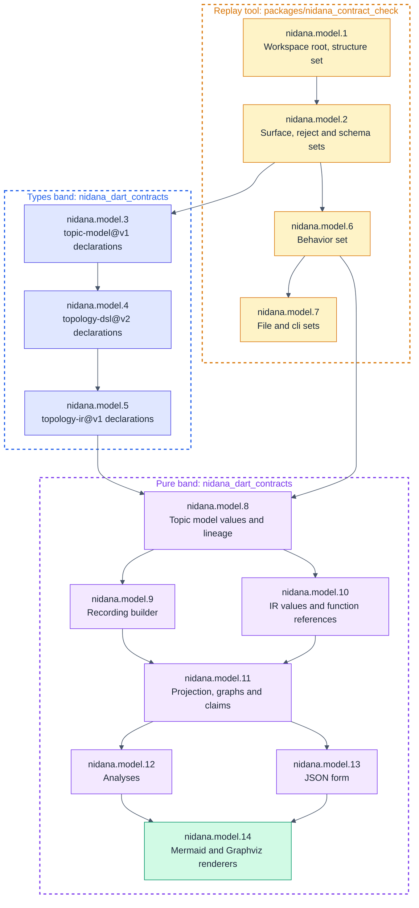

# nidana.model: Model

- **Kind:** leaf-parent
- **Purpose:** the pure, effect-free core every other package builds on: typed topics, the message envelope and its lineage rules, observer interfaces, the topology DSL interface with its recording builder, the TopologyDefinition IR, graphs and renderers, and the pure analyses over the IR
- **Owns:**
  - package `nidana_dart_contracts` (ADR-002)
  - `StateTopic`, `EventTopic`, `ReplayTopic`, the sealed `MultiWriterTopic` over event and replay topics that bus-api@v2's publish path takes (topic-model@v1 G27), `TopicRef`; topic identity as the pair of name and type (Spec §2.1); the `domain.entity` naming pattern (Spec §4.4); `Dedup` (Spec §3.12); `Tracing` (Guide §8.1); the sensitive flag (Spec §9.2); initial values as pure constants or pure factories (Spec §2.5)
  - `MessageEnvelope` (Spec §2.4) and the lineage rules as pure functions: single-input, multi-input with the trigger and correlation rules, time-shifting and accumulator operators (Spec §2.4, §3.5)
  - `Scope` (Spec §7.1) and the scope-compatibility rule over an ownership table (Spec §7.2)
  - `BusObserver`, `ObserveContext`, `ObserverCapability` as interfaces with no publish path (Spec §3.7)
  - sensitive-payload redaction: the payload type plus a truncated hash (Spec §9.2 item 2)
  - `Topology`, the `topology(id, scope, body)` form, `TopologyBuilder` and the opaque stream handle with the Spec §6.3 combinators, `reduceInto`, error operators and the raw-engine escape hatch (Spec §3.5, §6.1 to §6.3); every combinator is wrapped (root D6)
  - the recording builder, the `TopologyPlan` a declaration records and `planOf`, in the second public library `topology_plan.dart`, which live activation interprets and recording projects to the IR, and `buildDefinition()` (Spec §6.5; topology-dsl@v2 Refinements 1 to 3)
  - `TopologyDefinition`, `TransformEdge`, `CombinatorKind`, `FunctionRef`, and the IR's JSON form (Spec §6.5)
  - `TopologyGraph`, `ShellClaim`, `toGraph()`, and the Mermaid, Graphviz and JSON renderers (Spec §6.5; topology-ir@v1 Refinement 3)
  - pure analyses: inter-topology cycle detection by strongly connected components, the intra-topology self-reference check (Spec §3.8), single-writer conflicts among topology and shell owners (Spec §3.11), scope compatibility (Spec §7.2), topic name uniqueness over a set of declarations (Spec §4.3); the runtime runs the first four through `analyzeTopologyGraph` at activation and at publisher construction, and the workspace scan runs all five in CI (topology-ir@v1), while the bus's own name check at the first use of each declaration is its registry's (bus-api@v2 G7)
  - the contract replay tool, package `nidana_contract_check` (not published), which lands by set over nidana.model.1, nidana.model.2, nidana.model.6 and nidana.model.7, each set before the first gate that runs it (ADR-001 item 9; D1)
- **Does not own:** subjects, subscriptions, timers, zones and the live interpretation of the DSL (nidana.runtime); source scanning and catalog runs (nidana.tooling); navigation types (nidana.navigation); any dependency beyond the SDK and `meta` in `nidana_dart_contracts`
- **Consumes:** none
- **Produces:** [topic-model@v1, topology-dsl@v2, topology-ir@v1]
- **Governed by:** [ADR-001, ADR-002, ADR-003]
- **Sources:**
  - `ref/nidana-docs/arch/nidana-bus-ref-arch-spec-v0_15_0.md` §1, §2.1 to §2.5, §3.5, §3.7, §3.8, §3.11, §3.12, §4.1 to §4.4, §4.6, §6.1 to §6.5, §7.1, §7.2, §8, §9.2, Appendix A.1 to A.4 (baseline, superseded by v0.15.1 on 2026-10-20; read only to see what changed)
  - `ref/nidana-docs/arch/nidana-bus-ref-arch-spec-v0_15_1.md` §1, §2.1 to §2.5, §3.5, §3.7, §3.8, §3.11, §3.12, §4.1 to §4.4, §4.6, §6.1 to §6.5, §7.1, §7.2, §8, §9.2, §10.2 principles 2 and 4 and the first bullet of principle 5, Appendix A.1 to A.4 with A.4 "Write chain"
  - `ref/nidana-docs/arch/nidana-bus-ref-arch-guide-v0_15_0.md` §1.1, §1.4, §6.3, §8.1, Appendix B.1 to B.3 (baseline, superseded by v0.15.1 on 2026-10-20; read only to see what changed)
  - `ref/nidana-docs/arch/nidana-bus-ref-arch-guide-v0_15_1.md` §1.1, §1.4, §6.3 with "Name every transformer", §8.1, Appendix B.1 to B.3
  - `ref/nidana-docs/arch/nidana-bus-ref-arch-rationale-v0_15_0.md` §3.1 to §3.3, §4.1 (baseline, superseded by v0.15.1 on 2026-10-20; read only to see what changed)
  - `ref/nidana-docs/arch/nidana-bus-ref-arch-rationale-v0_15_1.md` §3.1 to §3.3, §4.1
- **Decomposes into:** phases (see hsdd-phase-plan)
- **Isolation strategy:** `nidana_dart_contracts` depends on nothing beyond the SDK and `meta`, so every function is tested by direct calls and property tests with generated inputs, and every topology by recording it and asserting on the IR; the node's gates replay its three contracts with its own replay tool, `surface/`, `reject/` and schema in full and `behavior/` through the bindings to its own declarations and recording builder, restricted to the guarantees delivered so far (ADR-001 item 10); topology-dsl@v2's live suite, which needs a bus, is bound and run by nidana.runtime, which implements the live side

## Overview

This node is the pure core of the tree: everything in it is a value or a total function, so it can be reasoned about and tested without a bus, a zone or a widget. Topology modules in adopting apps depend on this package alone; the runtime (live activation) and the tooling (static catalog and checks) both consume the same recorder and the same analyses, so the activation-time checks of Spec §3.8, §3.11 and §7.2 "Scope compatibility" and the CI checks cannot drift apart (root D4). Spec §7.2 "Scope timing" is no analysis here: CI cannot see when an activation happens relative to `start()`, so bus-api@v2 rejects a `MODULE` or `PAGE` activation before `start()` itself (its G42; topology-ir@v1 Refinement 4).

The package name follows Guide B.2's layer 1 name for traceability; its content differs from Guide B.1 in two ways the root decided: navigation types are not here (root D7), and the DSL interface, recorder and analyses are (root D4).

## Inherited from the root

- Ordering policy `fp-progression` (conventions): the plan opens with the replay tool's first sets at nidana.model.1 and nidana.model.2, gate infrastructure that ADR-001 item 9 places first; then the type-level band lands one contract per phase, nidana.model.3 to nidana.model.5, each that contract's first producing phase (ADR-001 item 10); the tool's remaining sets land beside the band at nidana.model.6 and nidana.model.7 (D1). Every other node's edges start there (root Development flow item 1): a consumer's `contract` or `shared-model` edge waits on nidana.model.3 for topic-model@v1 alone and on nidana.model.5 for topology-dsl@v2 or topology-ir@v1 (root D10; the contracts' Delivery paragraphs), and a phase whose gate runs a replay set, or whose tests import `package:nidana_contract_check/fixture.dart`, waits on the phase that lands it (conventions, Phase design).
- Every combinator is a method on this node's handle or builder; topology bodies never call RxDart on read handles (root D6).
- Diagnostics and dev mode, the report of a write chain that an error ended included (Spec §10.2; bus-api@v2 G26), are runtime concerns reached through bus-api@v2 (root D8); nothing here logs.

## Open questions

| ID | Question | Status | Waits on | Affects |
|----|----------|--------|----------|---------|
| OQ-M1 | How does the recorder name a transformer (`FunctionRef`) in Dart? | RESOLVED (2026-10-18): topology-ir@v1 G9 | none | topology-dsl@v2, topology-ir@v1, nidana.tooling |
| OQ-M2 | How does live activation obtain the transformers a pure-data IR names? | RESOLVED (2026-10-18): topology-dsl@v2 G18 and Refinement 3, with topology-ir@v1 G4 | none | topology-dsl@v2, topology-ir@v1, nidana.runtime |
| OQ-M3 | Does the Dart topic model carry Spec §3.6's per-topic dispatcher hint at all? | RESOLVED (2026-10-18): topic-model@v1 G5 | none | topic-model@v1, nidana.runtime |

### OQ-M1: Naming transformers

Spec §6.5's `FunctionRef` is a serializable reference to a named transformer, and Spec §6.2 says transformers should be named standalone functions. Dart has no reflection in Flutter builds. The experiment `docs/auto-run/experiments/function-ref-names/` shows a tear-off's `toString()` carries the function name in both JIT and AOT builds without obfuscation (`Closure: (int, int) => int from Function 'buildTotal': static.`), omits the class of a static method, carries no name for an inline closure, and loses the name under `--obfuscate`. Options: derive names from `toString()`; require an explicit name on each combinator; accept an optional name and fall back to derivation, then to a positional placeholder; or leave naming to the static catalog in nidana.tooling. The build-time catalog runs on the VM without obfuscation, which favors derivation with an explicit override; the decision is the interface author's.

Resolved (2026-10-18) by topology-ir@v1 G9 and its Function references section: `FunctionRef.of(f)` takes the text between `from Function '` and the next `'` of `f.toString()`, and is anonymous when that text is absent or empty; it never calls `f`. No combinator takes an explicit name. topology-dsl@v2's Versioning lists one as a candidate for a later version and weighed Guide §6.3 "Name every transformer", which advises one where `FunctionRef` labels must be stable across compilation modes or under `--obfuscate`: no consumer compares labels that way. The table in topology-ir@v1's Function references section, from `docs/auto-run/experiments/function-ref-derivation/`, states what each function form yields on the VM, under `--obfuscate` and on the web. nidana.model.10 implements it.

### OQ-M2: Executable transformers behind a pure-data IR

Spec §6.5 says the bus "interprets the same IR for live activation", while `TransformEdge` holds a serializable `FunctionRef`, not a function. Options: an edge carries an opaque executable beside its `FunctionRef`, excluded from equality and from the JSON form; or activation records the IR for checks and then runs `declare()` a second time against a live builder. The first matches the Specification's wording; the second keeps the IR pure data but relies on `declare()` being deterministic, which Spec §6.1 already demands.

Resolved (2026-10-18) by topology-dsl@v2 Refinement 3 and G18, with topology-ir@v1 G4: neither option as stated. A declaration runs once per `planOf` call and records a `TopologyPlan`, whose stages hold the functions it passed; the IR is projected from that plan and holds no function; live activation calls `planOf` once, checks the plan's `definition`, and interprets the same plan, so `declare()` runs once per activation. nidana.model.4 and nidana.model.9 land the plan, nidana.model.11 the projection; the live interpretation is nidana.runtime's.

### OQ-M3: Dispatcher hint on one isolate

Spec §3.6 lets a topic declare a preferred dispatcher and says the runtime uses the hint "where supported". On Dart every topic of a bus shares the isolate's event loop (Spec §3.6 table), so the hint has no effect. Options: omit the field from the Dart topic model, or accept it and ignore it so that a declaration translated from another platform compiles.

Resolved (2026-10-18) by topic-model@v1 G5: no topic declaration takes a dispatcher hint, because every topic of a bus shares the bus's provider zone (ADR-003 item 9); the reject fixture `no_dispatcher_hint.dart` checks it. A hint stays a candidate for a later version (topic-model@v1 Versioning). nidana.model.3 lands the declarations without one.

## Decisions

### D1: The replay tool first, then one type-level phase per contract

When this plan was written, ADR-001 item 9 put the replay tool in this node's first phase, and the conventions' `fp-progression` line and root Development flow item 1 put the type-level skeleton of all three contracts there too. Together they do not fit one PE: the tool's four groups of sets come to about 1,600 lines with their tests (the prototypes in `docs/auto-run/experiments/file-invocations/` and `docs/auto-run/experiments/topology-ir-fixtures/packages/nidana_contract_check/` state its text-level rules alone in about 470), and the declarations of the three Interfaces to about 1,300 lines. The sizing rule splits the pair, and the gate rule orders it: a producing phase's gate replays its contract, so every set a gate runs lands before that gate.

1. The tool's sets land by first use: `structure` with the workspace root (nidana.model.1); `surface`, `reject`, `schema`, `package:nidana_contract_check/fixture.dart` and PENDING detection (nidana.model.2) before the first type-level phase; `behavior` (nidana.model.6) before the first phase that delivers a behavior guarantee (nidana.model.8); `file` and `cli` (nidana.model.7) for nidana.tooling's producing gates. nidana.model.6 and nidana.model.7 run beside the type-level phases.
2. One type-level phase per contract, its first producing phase, by whose merge every declaration of its Interface has landed, as ADR-001 item 10 requires: topic-model@v1 at nidana.model.3, topology-dsl@v2 at nidana.model.4, topology-ir@v1 at nidana.model.5. A declaration that another contract's declarations name lands with that contract, because a Dart declaration cannot name an undeclared type: topology-dsl@v2's `buildDefinition()` and `TopologyPlan.definition` return `TopologyDefinition`, whose factory and `transforms` getter name `TransformEdge`, which names `EdgeInput`, `CombinatorKind` and `FunctionRef`, so nidana.model.4 lands the declarations of topology-ir@v1's sections The IR and Function references, those topology-ir@v1 places in the main library (`TopicInput` and `StageInput` with them), and nidana.model.5 those of `topology_ir.dart`. The split follows the two public libraries: the main library is complete after nidana.model.4, and nidana.model.5 creates `topology_ir.dart` and edits no file nidana.model.4 wrote. nidana.model.4 is no producing phase of topology-ir@v1, so its gate does not replay that contract (D5); a replay of topology-ir@v1's surface and reject sets fails there on the three fixtures that import `topology_ir.dart` and passes the two that use the main library alone (`docs/auto-run/experiments/model-main-library-closure/`, Q3). The order follows the surface sets: topology-dsl@v2's names `TopologyDefinition`; topology-ir@v1's names `topology()`, `TopologyBuilder` and `buildDefinition()`.
3. A consumer's edge waits on the phase each contract's Delivery paragraph names for it (root D10): for this node, nidana.model.3 for a consumer of topic-model@v1 alone and nidana.model.5 for a consumer of topology-dsl@v2 or topology-ir@v1, the end of the types band, after which every declaration of the three contracts resolves. A consumer of topology-dsl@v2 alone would find its declarations complete after nidana.model.4; it waits on nidana.model.5 all the same, so that one edge serves both contracts, as root D10 and every consumer plan state it. `fixture.dart` lands at nidana.model.2 and implies no contract edge: a phase whose tests import it depends on nidana.model.2 (root D10; conventions, Phase design).

ADR-001 item 9, the conventions' Phase design and root Development flow item 1 now state these landing phases.

Alternatives considered: one first phase with the tool and the three skeletons (about 2,900 lines, seven PEs in one review); the skeletons before the tool, gated by analyzing fixtures by path (no ADR-001 replay, and the reject comparison done by hand); the whole tool before the first type-level phase (nidana.model.6 and nidana.model.7 would sit on every consumer's path for sets no type-level gate runs). The signal that would fold nidana.model.2 into nidana.model.1: the structure set landing well under its estimate.

**Corrected 2026-10-18.** As first written, the opening said in the present tense that ADR-001 item 9 writes the replay tool in this node's first phase, and item 3 read root D10's "the producer's first phase" and had root D10 put `fixture.dart` in this node's first phase. ADR-001's amendment of 2026-10-18 adopted this decision's landing phases into item 9, the conventions' replay-tool bullet and root Development flow item 1 state them, and root D10, restated the same day, names the phase each contract's Delivery paragraph gives and has `fixture.dart` land at nidana.model.2 with no contract edge. The opening now reads as the premise it was, and item 3 reads root D10 as it stands. The phases and their order did not change.

**Restated 2026-10-26**, from a finding at nidana.model.4's phase context switch, before any of its code. As first written, item 2 read "Each contract's declarations land in one phase, its first producing phase, as ADR-001 item 10 requires: topic-model@v1 at nidana.model.3, topology-dsl@v2 at nidana.model.4, topology-ir@v1 at nidana.model.5. The order follows the surface sets: topology-dsl@v2's names `TopologyDefinition`, which nidana.model.4 therefore declares; topology-ir@v1's names `topology()`, `TopologyBuilder` and `buildDefinition()`", and item 3 gave the main library the two contracts share as the reason a consumer of topology-dsl@v2 waits on nidana.model.5. nidana.model.4 then landed `TopologyDefinition` alone of topology-ir@v1, with its factory and five getters, while `TransformEdge`, which the factory and the `transforms` getter name, waited for nidana.model.5, so nidana.model.4's package could not analyze: the declaration as the Interface states it, with no IR file beside it, reports `non_type_as_type_argument` twice (`docs/auto-run/experiments/model-main-library-closure/`, Q5). With the closure of `TopologyDefinition`'s signatures at nidana.model.4, a stand-in package analyzes clean, nidana.model.4's gate replay passes against it, and nidana.model.5's passes once `topology_ir.dart` is added (Q1, Q2, Q6). The phases, their order, their tiers, their gates, the dependency graph and every consumer's edge are unchanged; about 150 lines of declarations move from nidana.model.5 to nidana.model.4, and both estimates are re-derived from nidana.model.3's measured diff (Sizes, under the summary table).

### D2: Replay tool semantics the gates rely on

ADR-001 item 9 fixes the tool's command, sets, restriction and runners. This plan settled what the item then left open, and ADR-001's amendment of 2026-10-18 adopted items 1 to 4 below into item 9, so they now restate it; every node's gates see the results only as pass or fail.

1. Exit codes: 0 when every fixture passes; 1 when any fixture fails or is PENDING; 2 on an environment error (a `pub get --enforce-lockfile` that fails before the `file` or `cli` set, no `flutter` beside the running `dart` for a Flutter binding); 64 on a usage error (an unknown slug or set, a malformed id, a bare `G{n}` with more than one slug).
2. PENDING marks every fixture that names a package absent from the workspace's package configuration: a `surface`, `reject` or `behavior` library that imports it, a file replay or recorded invocation whose command runs it. ADR-001 item 9 states this for every one of these fixture kinds, and its Consequences say a replay of a contract whose producing package is absent reports every fixture that names the package as PENDING and exits 1; without it a surface fixture of an absent package fails with `uri_does_not_exist`, which reads as a defect.
3. `structure` always runs first. `--set` selects among the slug's other sets and never adds one: with `--all`, a slug that has none of the named sets runs `structure` alone.
4. With `--guarantee`, a binding runs only the cases whose names begin with an id of the slug whose conformance library it imports, and a file replay or recorded invocation runs only when every id it covers is in the restriction; a binding, file replay or recorded invocation the restriction admits no case of is not run and passes, so no test runner gets a filter that admits nothing. A bare `G{n}` belongs to the one slug named, and a `{slug}/G{n}` may name a slug the command does not replay, which is how a bus-api replay restricts `bus_activation_test.dart` by `topology-dsl/G{n}` ids.
5. Inside the tool, readers, checks, comparisons and run plans are pure functions over an in-memory snapshot of contract texts and fixture trees; a thin shell reads files and runs processes. The tool's tests write seeded trees into temporary directories, because a seeded violation never sits in a member's analyzed code (ADR-002 Consequences).

Alternatives considered: PENDING for bindings only (the surface and reject sets of an absent package fail as if defective); a bare id applying to every slug named (one id would name different guarantees in one command). These were not an ADR change when this plan was written; ADR-001's amendment of 2026-10-18 wrote items 1 to 4 into item 9, so the ADR, not this decision, binds them.

**Corrected 2026-10-18.** As first written, this decision said that ADR-001 item 9 left its items open and stated PENDING for bindings alone, and called them a candidate clarification at the ADR's next touch; item 4 had a slug with no id in the restriction run none of its behavior cases. ADR-001's amendment of 2026-10-18 adopted items 1 to 4 and added two rules found in planning nidana.runtime: a binding's restriction is keyed by the slug whose suite it imports, so a bus-api replay restricted by `topology-dsl/G{n}` ids alone still runs those cases of `bus_activation_test.dart`, which nidana.runtime.12 and .13 rely on; and a binding, file replay or recorded invocation with no admitted case is not run and passes, because `dart test` exits 79 on a filter that admits nothing (`docs/auto-run/experiments/empty-guarantee-selection/`, E2 and E3). Item 4 now states both, and the opening, item 2 and the closing say what the ADR now states. Exit codes, PENDING, the `--set` rule and the bare-id rule did not change.

### D3: What a type-level phase lands

A type-level phase (nidana.model.3 to nidana.model.5) lands the declarations its contract's Interface states, and those of another contract that they name (D1 item 2): class, member and function signatures with their modifiers (`sealed`, `final`, `base`, `abstract interface`) and annotations (`@immutable`, `@nonVirtual`), enums, typedefs, constructors with their defaults, `const` and the asserts a reject fixture expects (`ReplayTopic`'s buffer of at least one value, the non-empty source fields), the final field behind every getter, and the public libraries' export lists. The reject codes were confirmed against stand-ins whose getters are final fields (`docs/auto-run/experiments/topic-model-fixtures/`, `docs/auto-run/experiments/topology-ir-fixtures/`); a getter without a field reports `assignment_to_final_no_setter` instead of `assignment_to_final`. Every body that computes throws `UnimplementedError`, and `==` and `hashCode` stay `Object`'s until the phase that delivers value equality (nidana.model.8, nidana.model.10, nidana.model.11). A consumer building on nidana.model.5 compiles against the real declarations; a call into a body before its delivering phase throws, and each contract's Delivery paragraph tells consumer plans which phase to wait on.

Alternatives considered: value equality in the type-level phases (about 150 more lines in nidana.model.3, and topic-model@v1's equality guarantees split across two phases); getters with stub bodies (the reject codes of topic-model@v1 G4 and topology-ir@v1 G3 would differ from the confirmed ones).

**Corrected 2026-10-18.** As first written, the delivery schedule lived in this plan's governance entries. hsdd-reconcile drained them on 2026-10-18 into the Delivery paragraphs of topic-model@v1, topology-dsl@v1 and topology-ir@v1, which consumer plans read, so the last sentence of the decision names those paragraphs. The decision did not change.

**Restated 2026-10-26** (D1, Restated 2026-10-26). As first written, the first sentence said a type-level phase lands "the declarations its contract's Interface states"; nidana.model.4 also lands topology-ir@v1's main-library declarations, which `TopologyDefinition` names. What a declaration is did not change.

### D4: Source layout of `nidana_dart_contracts`

ADR-002 item 3 fixes the public libraries: `lib/nidana_dart_contracts.dart`, `lib/topology_plan.dart` and `lib/topology_ir.dart`, whose export lists are complete after nidana.model.4 for the first two and after nidana.model.5 for the third. Below them, one directory per area, so that the phases that run side by side edit disjoint files:

- `lib/src/topic/`: topic-model@v1 (nidana.model.3, nidana.model.8);
- `lib/src/topology/`: the DSL, one library with part files, because the subclasses of the sealed `TopicStream` and `PlanSink` must share its library (nidana.model.4, nidana.model.9; nidana.model.11 changes the body of `TopologyPlan.definition`);
- `lib/src/ir/`: the IR values, `FunctionRef`, the canonical orders and the projection (nidana.model.4, nidana.model.10, nidana.model.11);
- `lib/src/graph/`: `ShellClaim` and `TopologyGraph` (nidana.model.5, nidana.model.11);
- `lib/src/analysis/`: the findings and declarations in one library, the analyses in another (nidana.model.5, nidana.model.10, nidana.model.12);
- `lib/src/json/`: the codec and `JsonRenderer` (nidana.model.5, nidana.model.13);
- `lib/src/render/`: the Mermaid and Graphviz renderers (nidana.model.5, nidana.model.14).

`README.md`, `CHANGELOG.md` and the copy of `LICENSE` (ADR-002 item 9) are written once, by nidana.model.3; no phase edits `CHANGELOG.md`, which the version bump at release writes.

**Restated 2026-10-26** (D1, Restated 2026-10-26). As first written, the three export lists were complete after nidana.model.5, and `lib/src/ir/` named nidana.model.5 among its phases. nidana.model.4 now lands every declaration of the main library, `lib/src/ir/` included, and nidana.model.5 writes `topology_ir.dart` and the files under `lib/src/graph/`, `analysis/`, `json/` and `render/` alone. The directories did not change.

### D5: What every gate replays

- Every gate opens with the default gate: `fvm dart pub get --enforce-lockfile` (a committed lockfile that lacks a dependency fails with exit 65, `docs/auto-run/experiments/model-gate-commands/` G7, so a phase that changes a dependency commits the lockfile it resolved), `fvm dart analyze --fatal-infos` at the root, and the `structure` set over all nine contracts, so a tool change or a fixture change at the root that breaks structure fails the next phase.
- Package tests run from the root as `fvm dart test packages/{member}` (same experiment, G1 and G2); the working directory is then the root, so a test that reads files locates the workspace root first.
- A phase that edits `nidana_dart_contracts` replays every contract of this node whose first producing phase lies in its dependency closure: `surface`, `reject` and `schema` in full, `behavior` restricted to the guarantees that closure has delivered, and unrestricted once the contract's last producing phase is in it. The three contracts share one package and one main library, so a phase that produces one can break another's surface. Phases that run side by side (nidana.model.9 and nidana.model.10; nidana.model.12 and nidana.model.13) restrict to their own closure, so no gate depends on merge order.
- Every gate is written out in full in its phase, so the phase context carries the whole command.

### D6: G25 and G26 checked by a test

topic-model@v1 leaves G25 (no clock, timer, microtask, id generation or I/O) and G26 (no dependency beyond the SDK and `meta`) to this node's gates. nidana.model.3 writes `packages/nidana_dart_contracts/test/purity_test.dart`, which every later gate runs: the package's `dependencies` are exactly `meta` and its `dev_dependencies` exactly `test` (G26; ADR-002 item 3); no library under `lib/` imports `dart:io`, `dart:isolate`, `dart:ffi`, `dart:html` or a package other than `meta` and its own, and none contains `DateTime.now(`, `Stopwatch(`, `Timer(`, `Timer.periodic(`, `scheduleMicrotask(`, `Future.delayed(`, `Future.microtask(`, `Random(` or `Zone.` (G25; ADR-003 item 8 and Consequences). It finds the package from the workspace root, the nearest ancestor of the working directory that holds `hsdd/contract/`. A text search misses an aliased import; review covers that, and topology-dsl@v2 G10 and topology-ir@v1 G22 check at run time that recording, rendering, encoding, decoding and the analyses schedule nothing.

Alternatives considered: a shell search in the gate (not an `fvm` command, and outside `fvm dart test`); a lint rule (none in v1, root D1).

## Phase Plan

**Default gate:** `fvm dart pub get --enforce-lockfile && fvm dart analyze --fatal-infos && fvm dart run nidana_contract_check --all --set structure`

| Phase | Name | Tier | Size | Depends on | Collides with |
|------:|------|------|------|------------|---------------|
| nidana.model.1 | Workspace root and replay tool core | full-review | ~450 loc, ≤8 tasks | none | nidana.model.2, nidana.model.3, nidana.model.6, nidana.model.7 |
| nidana.model.2 | Replay tool: surface, reject and schema sets | full-review | ~420 loc, ≤7 tasks | nidana.model.1 | nidana.model.1, nidana.model.6, nidana.model.7 |
| nidana.model.3 | topic-model@v1 declarations | gate-only | ~430 loc, ≤5 tasks | nidana.model.2 | nidana.model.1, nidana.model.4, nidana.model.5, nidana.model.8 |
| nidana.model.4 | topology-dsl@v2 declarations | gate-only | ~700 loc, ≤6 tasks | nidana.model.3 | nidana.model.3, nidana.model.9, nidana.model.10, nidana.model.11 |
| nidana.model.5 | topology-ir@v1 declarations | gate-only | ~260 loc, ≤4 tasks | nidana.model.4 | nidana.model.10, nidana.model.11, nidana.model.12, nidana.model.13, nidana.model.14 |
| nidana.model.6 | Replay tool: behavior set | full-review | ~300 loc, ≤6 tasks | nidana.model.2 | nidana.model.1, nidana.model.2, nidana.model.7 |
| nidana.model.7 | Replay tool: file and cli sets | full-review | ~450 loc, ≤8 tasks | nidana.model.6 | nidana.model.1, nidana.model.2, nidana.model.6 |
| nidana.model.8 | Topic model values and lineage | spot-check | ~420 loc, ≤7 tasks | nidana.model.5, nidana.model.6 | nidana.model.3 |
| nidana.model.9 | Recording builder | spot-check | ~400 loc, ≤7 tasks | nidana.model.8 | nidana.model.4, nidana.model.11 |
| nidana.model.10 | IR values and function references | spot-check | ~400 loc, ≤7 tasks | nidana.model.8 | nidana.model.4, nidana.model.5 |
| nidana.model.11 | Projection, graphs and claims | spot-check | ~400 loc, ≤7 tasks | nidana.model.9, nidana.model.10 | nidana.model.4, nidana.model.5, nidana.model.9 |
| nidana.model.12 | Analyses | full-review | ~380 loc, ≤6 tasks | nidana.model.11 | nidana.model.5 |
| nidana.model.13 | JSON form | spot-check | ~420 loc, ≤6 tasks | nidana.model.11 | nidana.model.5 |
| nidana.model.14 | Mermaid and Graphviz renderers | spot-check | ~260 loc, ≤5 tasks | nidana.model.12, nidana.model.13 | nidana.model.5 |

Ordering policy: `fp-progression`, as the conventions' `**Ordering policy:**` line names it.

- **Types band:** nidana.model.3 to nidana.model.5 land every declaration of the three produced contracts, one type-level phase per contract, topology-ir@v1's main-library declarations landing with topology-dsl@v2's at nidana.model.4 because `TopologyDefinition` names them (D1 item 2, D3). Restated 2026-10-26: as first written, "one contract per phase (D1, D3)".
- **Pure band:** nidana.model.8 to nidana.model.14 implement every body. Everything in `nidana_dart_contracts` is a value or a total function (topic-model@v1 G25), so the package has no effect band, and its composition is the export lists the types band lands.
- **The replay tool** (nidana.model.1, nidana.model.2, nidana.model.6, nidana.model.7) is gate infrastructure outside the bands: ADR-001 item 9 puts it first, and every producing gate needs it. Inside it the policy holds: pure readers and checks, then the process shell (D2).
- **Lanes:** once nidana.model.2 merges, the tool lane (nidana.model.6, then nidana.model.7) runs beside the types band; nidana.model.9 and nidana.model.10 run side by side, and so do nidana.model.12 and nidana.model.13. When those two cannot run side by side, nidana.model.12 goes first, because nidana.runtime's activation checks call the analyses.
- **Critical path:** nidana.model.1, nidana.model.2, nidana.model.3, nidana.model.4, nidana.model.5, nidana.model.8, nidana.model.9, nidana.model.11, nidana.model.12, nidana.model.14.
- **Where consumers start** (root D10, D1): a consumer of topic-model@v1 alone after nidana.model.3; of topology-dsl@v2 or topology-ir@v1 after nidana.model.5. A consumer whose gate runs a behavior binding also needs nidana.model.6, and nidana.tooling's `file` and `cli` replays need nidana.model.7.
- **Sizing floor:** every adjacent same-tier pair was checked. None is a merge candidate: each merged pair exceeds one PE (condition iv), and nidana.model.6 with nidana.model.7 also fails condition iii, since nidana.model.8 depends on nidana.model.6 alone.
- **Sizes** count non-generated lines with their tests. About half of each type-level phase's lines are dartdoc carried from its contract's Interface, and the surface and reject sets check the rest. Restated 2026-10-26: that half was the plan's assumption, and nidana.model.4's and nidana.model.5's estimates are re-derived from nidana.model.3's measured diff (`hsdd/verify/nidana.model.3.verification.md`, Learnings and Metrics): a library of 384 lines, 72 of them dartdoc, for 286 lines of Dart in topic-model@v1's Interface, about 1.3 lines per line, and 118 lines of declaration tests beside the purity test, against an estimate of about 430. By that measure nidana.model.4, with 377 lines of Interface Dart (topology-dsl@v2's 286, topology-ir@v1's The IR and Function references 91), comes to about 700 lines, above the PE's line guideline; it is kept whole because its content is fixed (ADR-001 item 10 and what `TopologyDefinition` names, D1 item 2), it is a gate-only transcription that the surface and reject sets check, and a phase split from it would be a merge candidate under the floor (same tier, same consumed contract, no phase depending on one part alone). nidana.model.5, with 132 such lines (Graphs, Renderers, The JSON form and Analyses), comes to about 260.
- **First replays:** the fixtures are forward references, so the first replay against the real package is their first verification (ADR-001 Consequences). A fixture that fails against a declaration matching the Interface is a contract gap: the phase pauses and the gap goes to hsdd-contract at the root; no phase writes under `hsdd/contract/` (ADR-001 item 8).

### Phase dependency graph

No edge is dashed: the node consumes no contract.

### nidana.model.1: Workspace root and replay tool core

- **Consumes:** none
- **Produces:** none
- **Governed by:** [ADR-001, ADR-002]
- **Scope:** (1) the workspace root of ADR-002 items 1 and 2: the root `pubspec.yaml` (`name: nidana_workspace`, `publish_to: none`, `environment: sdk: ^3.13.0`, `dev_dependencies: lints: ^6.1.0` and nothing else, a `workspace:` list naming `packages/nidana_contract_check`), the root `analysis_options.yaml` exactly as ADR-002 item 2 states it, with no `plugins:` section, and the committed root `pubspec.lock`; (2) `packages/nidana_contract_check` with `publish_to: none`, no version and `resolution: workspace`, declaring ADR-002 item 3's whole dependency row now, each at the constraint ADR-002 item 4's table lists, whatever the lockfile holds then (`args: ^2.7.0`, `json_schema: ^5.2.2`, `matcher: ^0.12.20`, `package_config: ^2.2.0`, `path: ^1.9.1`, and `test: ^1.31.1` as dev dependency; until nidana.flutter.1 the lockfile holds a newer `test` within that caret, and no test uses a `test` API newer than 1.31.1), so the later tool phases leave the root files alone; (3) the pure core: the request parsed from `{slug}... [--set ...] [--guarantee ...]` or `--all` (`{slug}/G{n}`, which may name a slug the command does not replay, and a bare `G{n}`, which belongs to the one slug named and is a usage error when the command replays more than one slug; ADR-001 item 9); the contract reader (frontmatter `id` and `kind`, the `G{n}` ids of `## Guarantees / invariants`, and the `## Validation` forms of ADR-001 items 3 and 9: binding bullets, data-directory bullets, `covers {ids}.` endings, the `Case` and `Covers` table, whole and partial not-executable lines); the fixture reader (`// covers:` headers, `// expect-diagnostic:` markers, imports, and behavior case names read as the `name` field of the `ConformanceCase` record literals in the exported list, never by matching `name:` text, since conformance libraries also pass `name:` to topic constructors); (4) the `structure` set of ADR-001 item 9: marker and header syntax, item 3's coverage, the bindings listed in `## Validation` against the files present, the layout check with data directories, and the ban on `src/` imports; (5) the shell: slug discovery under `hsdd/contract/fixture/`, one line per fixture, and D2's exit codes. Tests write seeded contract texts and fixture trees into temporary directories (D2).
- **Size estimate:** ~10 files (~450 lines, tests included), ≤ 8 plan tasks
- **Gate:** `fvm dart pub get --enforce-lockfile && fvm dart analyze --fatal-infos && fvm dart run nidana_contract_check --all --set structure && fvm dart test packages/nidana_contract_check`
- **Verification:** the structure set accepts the nine contracts as committed and, for each seeded defect (an unlisted directory, a reject file without a `covers` header, an uncovered guarantee, a listed binding that is absent, a `src/` import), names the fixture and the rule. A defect it finds in a committed fixture is a contract gap for hsdd-contract, not an edit by this phase. The root files match ADR-002 items 1 and 2.
- **Review tier:** full-review
- **Collides with:** [nidana.model.2, nidana.model.3, nidana.model.6, nidana.model.7]. nidana.model.3 edits the root `pubspec.yaml` and `pubspec.lock` this phase creates, and the tool phases share the set dispatch and the report.
- **Dependencies:** none

### nidana.model.2: Replay tool: surface, reject and schema sets

- **Consumes:** none
- **Produces:** none
- **Governed by:** [ADR-001, ADR-002]
- **Scope:** (1) `lib/fixture.dart`, which fixtures import as `package:nidana_contract_check/fixture.dart`: the `ConformanceCase<H>` record typedef of ADR-001 item 4, and `void expectMatchesSchema(Object? instance, String schemaPath)` as topology-ir@v1's Validation states it (draft 2020-12 through `package:json_schema`, the path relative to the workspace root, which is the nearest ancestor of the working directory that holds `hsdd/contract/`, failing as `expect` does and listing every validation error); (2) the `surface` set (no diagnostic at any severity under `--fatal-infos`) and the `reject` set (the reported (line, code) pairs, at every severity, equal the pairs the markers name, with at least one marker), both from `dart analyze --format=json` of the `dart` running the tool, under `hsdd/contract/fixture/analysis_options.yaml`; (3) the `schema` set of ADR-001 item 5 over `valid/` and `invalid/`, never analyzing an input or expected tree or a data directory (topic-codegen@v1's `expected/`, topology-ir@v1's `render/`); (4) PENDING for a fixture that imports a package absent from `.dart_tool/package_config.json` (D2). Tests run the sets over synthetic fixtures and a stand-in package in a temporary workspace resolved offline from the pub cache the root resolution filled.
- **Size estimate:** ~8 files (~420 lines, tests included), ≤ 7 plan tasks
- **Gate:** `fvm dart pub get --enforce-lockfile && fvm dart analyze --fatal-infos && fvm dart run nidana_contract_check --all --set structure && fvm dart test packages/nidana_contract_check && fvm dart run nidana_contract_check --all --set structure,schema`
- **Verification:** a marker on the wrong line, a wrong code and an extra warning each fail a reject fixture; topology-ir@v1's and topic-codegen@v1's schema sets pass as committed; replaying a contract whose producer is absent prints PENDING per fixture and exits 1.
- **Review tier:** full-review
- **Collides with:** [nidana.model.1, nidana.model.6, nidana.model.7]. The tool phases share the set dispatch and the report.
- **Dependencies:** nidana.model.1 (the request, the readers, the `structure` set and the workspace root)

### nidana.model.3: topic-model@v1 declarations

- **Consumes:** none
- **Produces:** [topic-model@v1]
- **Governed by:** [ADR-001, ADR-002, ADR-003]
- **Scope:** creates `packages/nidana_dart_contracts` (version `0.1.0`, `resolution: workspace`, `dependencies: meta`, `dev_dependencies: test`, with `README.md`, `CHANGELOG.md` and a copy of `LICENSE`; ADR-002 items 3, 4 and 9) and adds it to the root `workspace:` list and the lockfile; lands every declaration of topic-model@v1's Interface under `lib/src/topic/`, exported from `lib/nidana_dart_contracts.dart`, as D3 defines a declaration: the closed topic family with `MultiWriterTopic`, `TopicVariant`, `Dedup`, `Tracing`, `TopicRef`, `isWellFormedTopicName`, the closed `MessageSource` family, `MessageEnvelope`, `Lineage`, `Scope`, `ObserverCapability`, `LogLevel`, `SpanHandle`, `ObserveContext`, `BusObserver` and `RedactedPayload`, with no dispatcher hint on any topic (G5, which decides OQ-M3); bodies that compute throw `UnimplementedError`; and `test/purity_test.dart` for G25 and G26 (D6).
- **Size estimate:** ~8 files (~430 lines, about half dartdoc from the Interface), ≤ 5 plan tasks
- **Gate:** `fvm dart pub get --enforce-lockfile && fvm dart analyze --fatal-infos && fvm dart run nidana_contract_check --all --set structure && fvm dart test packages/nidana_dart_contracts && fvm dart run nidana_contract_check topic-model --set structure,surface,reject`
- **Verification:** the first replay against the real package confirms the reject codes checked against the stand-in; a code that differs is a contract gap, not a fixture edit. Code outside the package reaches no declaration except through the main library.
- **Review tier:** gate-only
- **Collides with:** [nidana.model.1, nidana.model.4, nidana.model.5, nidana.model.8]. It edits nidana.model.1's root `pubspec.yaml` and `pubspec.lock`, the main library's export list with nidana.model.4 and nidana.model.5, and `lib/src/topic/` with nidana.model.8.
- **Dependencies:** nidana.model.2 (the `surface` and `reject` sets its gate replays)

### nidana.model.4: topology-dsl@v2 declarations

- **Consumes:** [topic-model@v1]
- **Produces:** [topology-dsl@v2]
- **Governed by:** [ADR-001, ADR-002, ADR-003]
- **Scope:** every declaration of topology-dsl@v2's Interface, as D3 defines one: in the main library `Topology` (an `@immutable abstract base class` whose `buildDefinition()` is `@nonVirtual`), `topology()`, `TopologyRef`, `TopologyBuilder` (final, no public constructor) and `TopicStream` (sealed, no public constructor) with every combinator, `PipelineValue`, `RetryPolicy` and `RawOperator`; in the new public library `lib/topology_plan.dart`, whose names the main library does not export, `planOf`, `TopologyPlan`, the eighteen stage classes, `PlanSink`, `WriteSink`, `ReduceIntoSink`, `StageVisitor`, `SinkVisitor`, `visitStage` and `visitSink` (G2); the DSL as one library with part files under `lib/src/topology/` (D4); and, under `lib/src/ir/` and exported from the main library, every declaration topology-ir@v1 places there, those of its sections The IR and Function references (`hsdd/contract/topology-ir.md`): `CombinatorKind` (the eighteen values in the Interface's order), the sealed `EdgeInput` with `TopicInput` and `StageInput`, `TransformEdge` (three factories, no public unnamed constructor), `TopologyDefinition` (its factory and five getters) and `FunctionRef` (`named`, `anonymous`, `of`), the getters `ir_values_are_immutable.dart` assigns to being final fields. `buildDefinition()` and `TopologyPlan.definition` return `TopologyDefinition`, which both topology-dsl@v2 surface libraries name, and whose factory and `transforms` getter name `TransformEdge`, which names `EdgeInput`, `CombinatorKind` and `FunctionRef` (D1 item 2); with `TopicInput` and `StageInput` the main library's export list is complete after this phase. No stage, sink, builder or plan overrides `==` or `hashCode` (topology-dsl@v2 G30). Bodies that compute throw `UnimplementedError`. topology-ir@v1 is neither consumed nor produced here: its first producing phase stays nidana.model.5, so this gate does not replay it (ADR-001 item 10; D5), and the declarations above are transcribed from those two sections of its Interface. Restated 2026-10-26 (D1, Restated 2026-10-26): as first written, the last clause read "and topology-ir@v1's `TopologyDefinition` (its factory and five getters) under `lib/src/ir/`, which `buildDefinition()` and `TopologyPlan.definition` return and both topology-dsl@v2 surface libraries name", and nidana.model.5 landed the rest of the main library's IR. topology-dsl@v2's declarations, the gate and the tier are unchanged.
- **Size estimate:** ~12 files (~700 lines with tests, mostly declarations and dartdoc carried from the two Interfaces), ≤ 6 plan tasks
- **Gate:** `fvm dart pub get --enforce-lockfile && fvm dart analyze --fatal-infos && fvm dart run nidana_contract_check --all --set structure && fvm dart test packages/nidana_dart_contracts && fvm dart run nidana_contract_check topic-model topology-dsl --set structure,surface,reject`
- **Verification:** code that imports the main library alone cannot name a stage or obtain a plan; `Topology` can be extended and not implemented, and a mutable field in a subclass is reported; the main library exports exactly the declarations topic-model@v1, topology-dsl@v2 and topology-ir@v1 place in it. A replay of topology-ir@v1's surface and reject sets, run outside the gate, passes `surface/definitions.dart` and `reject/ir_holds_no_function.dart`, the two fixtures that use the main library alone, and fails only the three that import `topology_ir.dart`, which nidana.model.5 lands, on `uri_does_not_exist` and the undefined names that follow from it (`docs/auto-run/experiments/model-main-library-closure/`, Q3).
- **Review tier:** gate-only
- **Collides with:** [nidana.model.3, nidana.model.9, nidana.model.10, nidana.model.11]. It edits the main library's export list with nidana.model.3, the DSL library with nidana.model.9 and nidana.model.11, and `lib/src/ir/` with nidana.model.10 and nidana.model.11. Restated 2026-10-26: as first written, the list also named nidana.model.5, for the main library's export list and `lib/src/ir/`, which nidana.model.5 no longer edits.
- **Dependencies:** nidana.model.3 (topic-model@v1's declarations, which the signatures of the DSL and the IR name)

### nidana.model.5: topology-ir@v1 declarations

- **Consumes:** [topic-model@v1, topology-dsl@v2]
- **Produces:** [topology-ir@v1]
- **Governed by:** [ADR-001, ADR-002]
- **Scope:** the rest of topology-ir@v1's Interface, its sections Graphs, Renderers, The JSON form and Analyses, as D3 defines a declaration, in the new public library `lib/topology_ir.dart`, which does not re-export the main library: `ShellClaim`, `TopologyGraph`, the `TopologyDefinitionGraph` extension, `GraphRenderer` with `MermaidRenderer`, `GraphvizRenderer` and `JsonRenderer`, the four codec functions, the sealed `TopologyFinding` with its four variants, the four `find` functions over graphs and definitions, `analyzeTopologyGraph`, `TopicDeclaration`, `TopicNameCollision` and `findTopicNameCollisions`, under `lib/src/graph/`, `analysis/`, `json/` and `render/` (D4); the getters `ir_values_are_immutable.dart` assigns to are final fields. The main library, `topology_plan.dart` and `lib/src/ir/` are complete from nidana.model.4, and this phase edits none of them. Bodies that compute throw `UnimplementedError`. As topology-ir@v1's first producing phase, its gate is the first replay of topology-ir@v1's surface and reject sets, which check nidana.model.4's main-library declarations and this phase's together. With this phase merged every declaration of the three contracts resolves, which is what every consumer's first phase compiles against (root D10, D1). Restated 2026-10-26 (D1, Restated 2026-10-26): as first written, this phase also landed, in the main library beside nidana.model.4's `TopologyDefinition`, `CombinatorKind`, `EdgeInput` with `TopicInput` and `StageInput`, `TransformEdge` and `FunctionRef` under `lib/src/ir/`; nidana.model.4 lands them now. The gate and the tier are unchanged.
- **Size estimate:** ~8 files (~260 lines with tests, mostly declarations and dartdoc carried from the Interface), ≤ 4 plan tasks
- **Gate:** `fvm dart pub get --enforce-lockfile && fvm dart analyze --fatal-infos && fvm dart run nidana_contract_check --all --set structure && fvm dart test packages/nidana_dart_contracts && fvm dart run nidana_contract_check topic-model topology-dsl topology-ir --set structure,surface,reject,schema`
- **Verification:** `topology_ir.dart` exports exactly the declarations of topology-ir@v1's Graphs, Renderers, The JSON form and Analyses, and the main library none of them; no IR value, graph, claim or finding can be assigned to, and a `FunctionRef` cannot be called.
- **Review tier:** gate-only
- **Collides with:** [nidana.model.10, nidana.model.11, nidana.model.12, nidana.model.13, nidana.model.14]. It creates `lib/topology_ir.dart` and the files under `lib/src/graph/`, `analysis/`, `json/` and `render/` that the later phases fill. Restated 2026-10-26: as first written, the list also named nidana.model.3 and nidana.model.4, for the main library's export list and `lib/src/ir/`, which this phase no longer edits; nidana.model.3's row, a shipped phase's, keeps nidana.model.5 as written.
- **Dependencies:** nidana.model.4 (topology-dsl@v2's declarations and topology-ir@v1's main-library declarations, which `topology_ir.dart`'s declarations and topology-ir@v1's surface name), and through it nidana.model.2's `schema` set

### nidana.model.6: Replay tool: behavior set

- **Consumes:** none
- **Produces:** none
- **Governed by:** [ADR-001, ADR-002]
- **Scope:** the `behavior` set of ADR-001 items 4 and 9: each `behavior/{implementation}_test.dart` of a slug is a binding, and the conformance library it imports by relative path names the suite it runs; a binding that imports `package:flutter_test` runs under `flutter test --no-pub` with the `flutter` of the Flutter SDK that holds the running `dart`, any other under `dart test`, both from the workspace root; a binding that imports a package absent from the package configuration reports PENDING, which is why bindings import the implementing package directly; under `--guarantee`, each binding is restricted by the ids of the slug whose conformance library it imports, read from that import's path, a bare id being the replayed slug's own and a `{slug}/G{n}` the named slug's, so a bare bus-api id never reaches `bus_activation_test.dart`, which runs only the cases that `topology-dsl/G{n}` ids name; those ids become a test-name filter anchored at the start of the name (for G2 and G5, `^(G2|G5) `); a binding none of whose case names, as nidana.model.1's fixture reader reads them, begins with one of its admitted ids is not run and counts as passing, so no runner is started with a filter that admits nothing, under which `dart test` exits 79 (ADR-001 item 9; `docs/auto-run/experiments/empty-guarantee-selection/`, E2 and E3); one line per binding with its counts and the names of failing cases. Tests bind synthetic suites in a temporary workspace under both runners, a binding of another slug's suite and a binding the restriction admits no case of among them.
- **Size estimate:** ~5 files (~300 lines, tests included), ≤ 6 plan tasks
- **Gate:** `fvm dart pub get --enforce-lockfile && fvm dart analyze --fatal-infos && fvm dart run nidana_contract_check --all --set structure && fvm dart test packages/nidana_contract_check`
- **Verification:** restricting to one id runs exactly the cases whose names begin with it, under `dart test` and under `flutter test --no-pub`; a binding of another slug's suite runs exactly the cases its `{slug}/G{n}` ids name, and none for a restriction of bare ids alone, even where a bare id equals one of its case ids; a binding the restriction admits no case of is reported as passing with no case run, and the replay exits 0; a binding of an absent package prints PENDING, never a test failure; once nidana.model.5 has merged, topic-model@v1's binding loads and its cases fail on `UnimplementedError`, not on loading.
- **Review tier:** full-review
- **Collides with:** [nidana.model.1, nidana.model.2, nidana.model.7]. The tool phases share the set dispatch and the report.
- **Dependencies:** nidana.model.2 (PENDING detection, and `fixture.dart`, which every conformance library imports)

### nidana.model.7: Replay tool: file and cli sets

- **Consumes:** none
- **Produces:** none
- **Governed by:** [ADR-001, ADR-002]
- **Scope:** (1) the `file` set of ADR-001 item 6: the generator command is the backticked span of the contract's `- file:` bullet that holds `{output}`; the tool substitutes `{input}` and `{output}` (a fresh empty directory), runs it from the workspace root, a leading `fvm dart` or `dart` running as the `dart` that runs the tool, formats the Dart in `{output}` with `dart format`, and compares the tree with `expected/` byte for byte, the file set included, never analyzing `input/` or `expected/`; (2) the `cli` set of item 7: `args` (the command on the first line, one argument per line), `files/` as the working directory when present, `{output}` inside a fresh temporary directory, `exit_code`, and `stdout` and `stderr` when recorded, compared after the absolute paths of `{output}`, `files/` and the workspace root, each as given and symlink-resolved, become `{output}`, `{files}` and `{root}`, in that order; `expected/` compared as the file set compares, and nothing at `{output}` without it; (3) `--guarantee` over both by the ids `## Validation` declares, a case running only when every id it covers is in the restriction, and a file replay or recorded invocation that is not admitted not run and counted as passing (ADR-001 item 9); (4) before either set, one `dart pub get --enforce-lockfile` at the workspace root, whose failure is an environment error (exit 2), because `dart run` from a `files/` directory re-resolves a stale workspace and fails with exit 255 (`docs/auto-run/experiments/topic-codegen-invocations/output.txt`), which would read as the case's exit code; (5) PENDING for a command whose package is absent (D2). Tests replay a stand-in generator's cases in a temporary workspace, with seeded defects.
- **Size estimate:** ~7 files (~450 lines, tests included), ≤ 8 plan tasks
- **Gate:** `fvm dart pub get --enforce-lockfile && fvm dart analyze --fatal-infos && fvm dart run nidana_contract_check --all --set structure && fvm dart test packages/nidana_contract_check`
- **Verification:** a file replay fails on one changed byte and on an extra or a missing file; a recorded invocation fails on a wrong exit code and on output left at `{output}`; topic-codegen@v1 and nidana-checks@v1 replay as PENDING until nidana.tooling's packages exist, while their structure and schema sets pass.
- **Review tier:** full-review
- **Collides with:** [nidana.model.1, nidana.model.2, nidana.model.6]. The tool phases share the set dispatch and the report.
- **Dependencies:** nidana.model.6 (the process runner, PENDING for commands, and the restriction semantics it introduces)

### nidana.model.8: Topic model values and lineage

- **Consumes:** none
- **Produces:** [topic-model@v1]
- **Governed by:** [ADR-001, ADR-002, ADR-003]
- **Scope:** every topic-model@v1 body under `lib/src/topic/`: value equality and hash codes of topics (variant, name and value type, G7), topic references (G8), sources (G17), envelopes (all eight fields, parents element by element, G13), lineages and redacted payloads (G24); unmodifiable copies of every list (G4); `ref` and `createInitial` (G8, G9); `isWellFormedTopicName` (G11); the source renderings and `MessageSource.tryParse`, splitting at the first colon and null for anything else (G17); `MessageEnvelope.publishedTo`, `redacted()` and the redacting `toString()` (G14, G15); `Lineage.root`, `causedBy`, `combine` and `withLatestFrom` by Spec §2.4's table (G18 to G20); `Scope.isAtLeastAsLongAs` (G21); `ObserverCapability.permits` (G23); `RedactedPayload.of` (G24); property tests over generated lineages for `combine` and `withLatestFrom` (exactly one `freshCorrelationId()` call when the correlated inputs differ and none otherwise, parents in input order, causation from the trigger). The last phase that produces topic-model@v1, so its gate replays the contract unrestricted.
- **Size estimate:** ~6 files (~420 lines, tests included), ≤ 7 plan tasks
- **Gate:** `fvm dart pub get --enforce-lockfile && fvm dart analyze --fatal-infos && fvm dart run nidana_contract_check --all --set structure && fvm dart test packages/nidana_dart_contracts && fvm dart run nidana_contract_check topic-model && fvm dart run nidana_contract_check topology-dsl topology-ir --set structure,surface,reject,schema`
- **Verification:** Spec §2.4's two worked examples reproduce as written (the same-correlation combine keeps `sess-42` with cause `e-02`; the cross-correlation combine takes one fresh id with parents `pref-update-5` and `market-feed-9`); a sensitive envelope never renders its payload.
- **Review tier:** spot-check
- **Collides with:** [nidana.model.3]. Both edit `lib/src/topic/`.
- **Dependencies:** nidana.model.5 (the end of the types band), nidana.model.6 (the `behavior` set its gate replays)

### nidana.model.9: Recording builder

- **Consumes:** [topic-model@v1]
- **Produces:** [topology-dsl@v2]
- **Governed by:** [ADR-001, ADR-002, ADR-003]
- **Scope:** the builder, handle and `planOf` bodies under `lib/src/topology/`: each builder or handle call adds one stage of the class the combinator table names, holding the handles, functions, durations and initial values it was given, identical to them, and each `write` and `reduceInto` adds one sink, in call order, in unmodifiable lists (G11); `planOf` runs `declare` once against a fresh builder and closes it, and the `topology()` form runs its body on each `planOf` call (G9's cases other than its projection case, which waits for nidana.model.11); the misuse checks of G13 to G15 (a dedup argument on an event or replay read, a handle another builder made, a second sink on one `StateTopic`, a negative duration, an empty input list, use after `declare` returned, an empty topology id, a stage that reaches no sink); `visitStage` and `visitSink`, binding each stage's type arguments (G16); `CombineStage.apply` and `WithLatestFromStage.apply` in input order (G11); `TopologyRef` equality (G17); `planOf` calls none of the declared functions and creates no timer or microtask (G10 for `planOf`). `TopologyPlan.definition` keeps throwing until nidana.model.11, and `buildDefinition()` with it: it is `planOf(this).definition` (topology-dsl@v2 Refinement 2), so it throws whatever `planOf` throws (G15's `StateError` for an empty id among them) and `UnimplementedError` for every declaration `planOf` accepts. Neither G9 nor G10 is in the Gate's restriction, which selects cases by guarantee id (ADR-001 item 9): G9's projection case and both of G10's recording cases call `buildDefinition()`, and nidana.model.11's Gate, which replays topology-dsl@v2 unrestricted, is the first to run them; this phase checks G9 and G10 for `planOf` with its own package tests, which the Gate runs. G30, which holds from nidana.model.4 (D3), joins the restriction here, because its case records a declaration with `planOf` (topology-dsl@v2 Delivery). Restated 2026-10-27, from a finding at nidana.model.9's planning, before any of its code: as first written, the G10 clause read "recording calls none of the declared functions and creates no timer or microtask (G10)", the sentence after it read "`TopologyPlan.definition` and `buildDefinition()` keep throwing until nidana.model.11.", and the Gate restricted the topology-dsl@v2 replay to G10, G11, G13 to G17 and G30. Both G10 cases of `hsdd/contract/fixture/topology-dsl/behavior/recording_conformance.dart` call `buildDefinition()`, which throws here, so that Gate failed exactly those two whatever this phase built: against a dry run of this phase it passed 17 of the 19 cases it ran, and with G10 left out it exits 0 (`docs/auto-run/experiments/recording-builder-plan/`, T4.4 and G). The work, the size, the tier and the dependencies are unchanged.
- **Size estimate:** ~5 files (~400 lines, tests included), ≤ 7 plan tasks
- **Gate:** `fvm dart pub get --enforce-lockfile && fvm dart analyze --fatal-infos && fvm dart run nidana_contract_check --all --set structure && fvm dart test packages/nidana_dart_contracts && fvm dart run nidana_contract_check topic-model && fvm dart run nidana_contract_check topology-dsl --guarantee G11,G13,G14,G15,G16,G17,G30 && fvm dart run nidana_contract_check topology-ir --set structure,surface,reject,schema`
- **Verification:** recording a declaration calls none of its functions and schedules nothing; each misuse G14 and G15 name throws the named error at the call that commits it, not later. The package's tests check the first for `planOf`, since the Gate's replay leaves out G10, whose recording cases call `buildDefinition()` (Scope). Restated 2026-10-27 (Scope, Restated 2026-10-27): as first written, the line ended at "not later".
- **Review tier:** spot-check
- **Collides with:** [nidana.model.4, nidana.model.11]. All three edit the DSL library.
- **Dependencies:** nidana.model.8 (topic equality, which the one-sink-per-`StateTopic` check uses)

### nidana.model.10: IR values and function references

- **Consumes:** [topic-model@v1]
- **Produces:** [topology-ir@v1]
- **Governed by:** [ADR-001, ADR-002]
- **Scope:** under `lib/src/ir/`: `TransformEdge`'s three factories with the stage-edge table, `reduceInto` rejected by `stage` and accepted by its own factory only on a state topic, a zero duration accepted and a negative one rejected (G5); `TopologyDefinition`'s well-formedness rules and its `reads` and `writes` derived in canonical order (G6); the Interface's four canonical orders as shared comparators; `isStateBearing` (G10); `FunctionRef.of`, `named` and `anonymous` (G9, which decides OQ-M1); `CombinatorKind`'s order (G2); value equality, hash codes and unmodifiable copies of every IR value; and under `lib/src/analysis/` the value semantics of `TopologyCycle`, `SelfReference`, `WriterConflict`, `ScopeViolation`, `TopicDeclaration` and `TopicNameCollision`, whose constructors normalize their lists to the orders the Interface names (topology-ir@v1 G23). G3 and G7 join the restriction at nidana.model.11, because their cases also cover graphs and claims, and G23 at nidana.model.12, because its case also runs the analyses over a sample graph that `buildDefinition()` records.
- **Size estimate:** ~6 files (~400 lines, tests included), ≤ 7 plan tasks
- **Gate:** `fvm dart pub get --enforce-lockfile && fvm dart analyze --fatal-infos && fvm dart run nidana_contract_check --all --set structure && fvm dart test packages/nidana_dart_contracts && fvm dart run nidana_contract_check topic-model && fvm dart run nidana_contract_check topology-dsl --set structure,surface,reject && fvm dart run nidana_contract_check topology-ir --guarantee G2,G5,G6,G9,G10`
- **Verification:** `FunctionRef.of` gives on the VM the names topology-ir@v1's derivation table lists; an edge or a definition that breaks a rule throws at construction, so no ill-formed IR value exists.
- **Review tier:** spot-check
- **Collides with:** [nidana.model.4, nidana.model.5]. It fills `lib/src/ir/` and the value types of `lib/src/analysis/` that those phases declared.
- **Dependencies:** nidana.model.8 (topic reference equality and source rendering, which IR equality and the canonical orders use)

### nidana.model.11: Projection, graphs and claims

- **Consumes:** [topic-model@v1]
- **Produces:** [topology-dsl@v2, topology-ir@v1]
- **Governed by:** [ADR-001, ADR-002, ADR-003]
- **Scope:** the projection of a plan by topology-ir@v1's five From a plan rules, a stage and sink visitor under `lib/src/ir/`, behind `TopologyPlan.definition` and `buildDefinition()`, calling none of the plan's functions and scheduling nothing (topology-dsl@v2 G9, G10 and G12; topology-ir@v1 G8); under `lib/src/graph/`, `ShellClaim`'s rules (G12), `TopologyGraph` with its canonical orders, equal definitions counted once, two unequal ones with one id rejected, and `topics` (G11), graph equality that ignores the order of the arguments (G7), unmodifiable copies (G3), `toGraph()`, and `render(r)` passing the graph to `r`. The last phase that produces topology-dsl@v2, so its gate replays that contract unrestricted, which runs the recording suite only: the live suite is bound in bus-api@v2's fixture directory and replayed by nidana.runtime. Restated 2026-10-27 (nidana.model.9, Scope, Restated 2026-10-27): as first written, the projection's parenthetical named topology-dsl@v2 G9 and G12; G10's two recording cases call `buildDefinition()`, and this phase's unrestricted replay is the first to run them. The gate is unchanged.
- **Size estimate:** ~6 files (~400 lines, tests included), ≤ 7 plan tasks
- **Gate:** `fvm dart pub get --enforce-lockfile && fvm dart analyze --fatal-infos && fvm dart run nidana_contract_check --all --set structure && fvm dart test packages/nidana_dart_contracts && fvm dart run nidana_contract_check topic-model topology-dsl && fvm dart run nidana_contract_check topology-ir --guarantee G2,G3,G5,G6,G7,G8,G9,G10,G11,G12`
- **Verification:** `buildDefinition()` of the contracts' example topologies gives the edges the From a plan rules describe; two recordings of one declaration, inline closures included, project equal definitions.
- **Review tier:** spot-check
- **Collides with:** [nidana.model.4, nidana.model.5, nidana.model.9]. It changes the DSL library's `definition` body with nidana.model.4 and nidana.model.9, and fills `lib/src/graph/`, which nidana.model.5 declared.
- **Dependencies:** nidana.model.9 (recorded plans), nidana.model.10 (IR values and `FunctionRef.of`)

### nidana.model.12: Analyses

- **Consumes:** [topic-model@v1, topology-dsl@v2]
- **Produces:** [topology-ir@v1]
- **Governed by:** [ADR-001, ADR-002]
- **Scope:** under `lib/src/analysis/`, the single implementation of the checks of Spec §3.8, §3.11 and §7.2 "Scope compatibility", which activation and publisher construction (bus-api@v2) and the workspace scan (nidana-checks@v1, ADR-002 item 8) both run through `analyzeTopologyGraph` (root D4; topology-ir@v1 Refinement 4), and of Spec §4.3's name uniqueness over a set of declarations, which the workspace scan alone calls, the bus's own name check being its registry's (bus-api@v2 G7): `findTopologyCycles` (strongly connected components of two or more topologies over write-then-read arcs between distinct topologies, G13), `findSelfReferences` (paths of edges that bear no state from a topic input to a write of the same topic, G14), `findWriterConflicts` (G15), `findScopeViolations` (G16), the order of `analyzeTopologyGraph` (G17) and `findTopicNameCollisions` (G18); property tests over generated graphs: the cycles against a brute-force reachability check, G17's removal property, and findings that do not depend on the order in which topologies and claims were given. topology-ir@v1 G23, delivered by nidana.model.10, joins the restriction here: its case also calls `analyzeTopologyGraph` and `findTopicNameCollisions` over the `findings` sample, whose definitions `buildDefinition()` records. Spec §7.2 "Scope timing" is no analysis: bus-api@v2 rejects a `MODULE` or `PAGE` activation before `start()` itself (its G42). Restated 2026-10-21 for Specification v0.15.1 (`hsdd/management/2026-10-20-intake-ref-arch-v0-15-1.md`): as first written, the first sentence named Spec §4.3 and all of §7.2 among the checks that activation and the workspace scan both call. The functions this phase implements, its tests and its gate are unchanged.
- **Size estimate:** ~4 files (~380 lines, tests included), ≤ 6 plan tasks
- **Gate:** `fvm dart pub get --enforce-lockfile && fvm dart analyze --fatal-infos && fvm dart run nidana_contract_check --all --set structure && fvm dart test packages/nidana_dart_contracts && fvm dart run nidana_contract_check topic-model topology-dsl && fvm dart run nidana_contract_check topology-ir --guarantee G2,G3,G5,G6,G7,G8,G9,G10,G11,G12,G13,G14,G15,G16,G17,G18,G23`
- **Verification:** the `findings` sample reports its cycle, self-references, writer conflicts and scope violations in the documented order; a self-read through `scan`, `reduceInto` or a positive time stage is no self-reference, while a cycle across topologies is reported whatever its stages.
- **Review tier:** full-review
- **Collides with:** [nidana.model.5]. It fills the analyses library nidana.model.5 declared.
- **Dependencies:** nidana.model.11 (graphs, claims and recorded definitions)

### nidana.model.13: JSON form

- **Consumes:** [topic-model@v1, topology-dsl@v2]
- **Produces:** [topology-ir@v1]
- **Governed by:** [ADR-001, ADR-002]
- **Scope:** under `lib/src/json/`: `encodeTopologyGraph` and `encodeTopologyDefinition` (keys in the schema's order, lists in canonical order, `durationMicros`, an input's `dedup` only when the read gave one, G19); `decodeTopologyGraph` and `decodeTopologyDefinition`, which throw `FormatException` and no other error for any value that is not a graph document of this version or breaks a decoder rule (the definition rules, `reads` and `writes` equal to the topics the edges read and write, distinct topology ids), and accept lists in any order (G20, G21); `JsonRenderer` as `JsonEncoder.withIndent('  ')` of the encoding plus a newline; property tests: generated graphs round-trip, and generated JSON values either decode or throw `FormatException`. G4, every projected definition round-tripping, joins the restriction here.
- **Size estimate:** ~4 files (~420 lines, tests included), ≤ 6 plan tasks
- **Gate:** `fvm dart pub get --enforce-lockfile && fvm dart analyze --fatal-infos && fvm dart run nidana_contract_check --all --set structure && fvm dart test packages/nidana_dart_contracts && fvm dart run nidana_contract_check topic-model topology-dsl && fvm dart run nidana_contract_check topology-ir --guarantee G2,G3,G4,G5,G6,G7,G8,G9,G10,G11,G12,G19,G20,G21`
- **Verification:** every `invalid/` document fails the decoder with a `FormatException` and nothing else; each sample's encoding matches the schema and equals its `valid/` file.
- **Review tier:** spot-check
- **Collides with:** [nidana.model.5]. It fills the codec library nidana.model.5 declared.
- **Dependencies:** nidana.model.11 (graphs and the canonical orders the encoder lists)

### nidana.model.14: Mermaid and Graphviz renderers

- **Consumes:** [topic-model@v1, topology-dsl@v2]
- **Produces:** [topology-ir@v1]
- **Governed by:** [ADR-001, ADR-002]
- **Scope:** under `lib/src/render/`, `MermaidRenderer` and `GraphvizRenderer` by topology-ir@v1's rendering rules: node ids, label lines, durations in whole seconds, milliseconds or microseconds, each renderer's escaping and line break, the order of parts and arrows, two-space indentation and a newline after every line (G22). The last phase that produces topology-ir@v1, so its gate replays all three contracts unrestricted.
- **Size estimate:** ~3 files (~260 lines, tests included), ≤ 5 plan tasks
- **Gate:** `fvm dart pub get --enforce-lockfile && fvm dart analyze --fatal-infos && fvm dart run nidana_contract_check --all --set structure && fvm dart test packages/nidana_dart_contracts && fvm dart run nidana_contract_check topic-model topology-dsl topology-ir`
- **Verification:** the seven samples render to their `render/` goldens byte for byte, the `escaping` sample showing each renderer's escapes; rendering, encoding, decoding and the analyses schedule nothing.
- **Review tier:** spot-check
- **Collides with:** [nidana.model.5]. It fills the renderer library nidana.model.5 declared.
- **Dependencies:** nidana.model.12, nidana.model.13 (`JsonRenderer`, which G22's JSON case compares, and every other topology-ir@v1 guarantee, which this phase's unrestricted replay runs)

## Governance updates (pending reconcile)

> Reconciled 2026-10-27 by hsdd-reconcile. Drained entries are in git history.

> Emitted by hsdd-phase-plan on 2026-10-27, amending nidana.model.9's Gate
> in place (nidana.model.9, Scope, Restated 2026-10-27). Drained by
> hsdd-reconcile; do not apply by hand.

- confirm `topology-dsl@v2` produced_by: [nidana.model.4, nidana.model.9, nidana.model.11]
  - Unchanged. nidana.model.9's Gate now restricts the topology-dsl@v2 replay to G11, G13 to G17 and G30; nidana.model.11, the last producing phase, replays it unrestricted and is the first to run the recording cases of G9 and G10 that call `buildDefinition()`. G30 still holds from nidana.model.4. No phase of this node is a consumer in the frontmatter's sense, so no consumers entry is emitted.
- amend `topology-dsl@v2`: in the Delivery paragraph, "nidana.model.9 delivers recording, `planOf`, the stages, sinks and visitors (G10, G11, G13 to G17, and G9 but for `buildDefinition()`); nidana.model.11 delivers `buildDefinition()` and `TopologyPlan.definition` (G9, G12)." reads "nidana.model.9 delivers recording, `planOf`, the stages, sinks and visitors (G11, G13 to G17, and G9 and G10 but for `buildDefinition()`); nidana.model.11 delivers `buildDefinition()` and `TopologyPlan.definition` (G9, G10, G12)."
  - Compatible: which phase delivers the `buildDefinition()` half of G10, and nothing else. No declaration, guarantee, case or fixture changes; `produced_by` and every consumer's edge are unchanged. G10 names `planOf` and `buildDefinition()`, and the paragraph already gave `buildDefinition()` to nidana.model.11, before which it throws, so no consumer can have relied on its inertness at nidana.model.9; the amend removes that contradiction.
  - Why: both G10 cases of `behavior/recording_conformance.dart` call `buildDefinition()`, and `TopologyPlan.definition` throws `UnimplementedError` until nidana.model.11 (`TopologyDefinition`'s factory until nidana.model.10), so a replay restricted to G10 fails them at nidana.model.9 whatever it builds: against a dry run of nidana.model.9 the old restriction passed 17 of 19 cases and failed those two, and the Gate with G10 left out exits 0 (`docs/auto-run/experiments/recording-builder-plan/`, T4.4 and G). A restriction selects cases by guarantee id (ADR-001 item 9), which is why G9 was already left out; nidana.model.9's package tests check G9 and G10 for `planOf`.
  - From nidana.model.9 on, `buildDefinition()` is `planOf(this).definition` (Refinement 2): it throws whatever `planOf` throws, so G15's empty-id case, which expects `StateError` from `buildDefinition()`, passes at nidana.model.9, and `UnimplementedError` for every declaration `planOf` accepts until nidana.model.11. The Delivery wording "but for `buildDefinition()`" covers this: `buildDefinition()` delivers its definition, and with it G9's and G10's cases, at nidana.model.11.
