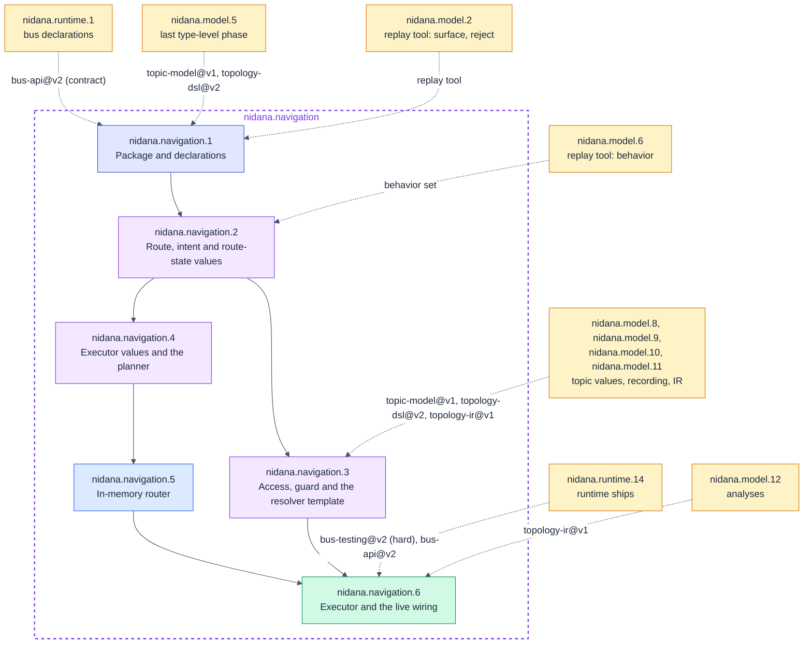

# nidana.navigation: Navigation

- **Kind:** leaf-parent
- **Purpose:** navigation as a cross-cutting concern on the bus (Guide §3): the intent vocabulary, typed routes, the nav-resolver topology template with its pure guard and deep-link resolution, and the platform-neutral executor protocol
- **Owns:**
  - package `nidana_dart_navigation`, pure Dart with no Flutter dependency (ADR-002)
  - `NavIntent`, `DeepLink` and the sealed `ResolvedNavIntent`, in which a deep link is impossible by construction (Guide §3.2, Spec Appendix A.6; navigation-api@v1 Refinement 4)
  - `NavRoute` and `RouteRegistry`, routes typed by their argument type; the Specification's and the Guide's `Route` is `NavRoute` here, because Flutter's widgets library exports a `Route` (Guide §3.2; navigation-api@v1 Refinements 1 and 5)
  - `RouteState` and `RouteTransition` (Guide §3.2)
  - `RouteAccessRequirement` and `RouteAccessPolicy`, static or reactive, and the `AccessPrincipal` the guard decides over, projected from the app's auth state (Guide §3.2, §3.4; navigation-api@v1 Refinement 2)
  - `NavigationTopics`: `nav.intent`, `nav.resolved-intent`, `nav.current-route`, `nav.history`, `nav.access-policy` (Guide §3.3)
  - the nav-resolver topology template at `APPLICATION` scope, with `resolveDeepLinks` and `applyAuthGuard` as pure functions, resolving before guarding; the two-topology split that keeps the read/write graph acyclic (Guide §3.4, Spec §3.8; navigation-api@v1 Refinement 3); its stage functions named in the recorded IR and built once per `navResolver` call, so activating the topology one call returns while it is active gives back its handle, and the topology of another call conflicts with it (Spec §3.9; Guide §6.3 "Name every transformer"; navigation-api@v1 G13; bus-api@v2 G23)
  - `NavigationExecutor`, written once for every platform, over the `NavigationRouter` port each platform implements: it observes resolved intents, plans them into router calls with the pure `planNavigation`, `BackTo` synthesis included for routers without a native pop-until (Guide §3.2), claims `nav.current-route` as its shell owner (Spec §3.11), and writes `currentRoute` and `history` together on each confirmed transition with the intent taken from the router's confirmation (Guide §3.4; navigation-api@v1 Refinement 6)
  - `InMemoryRouter`, a `NavigationRouter` in the package's `testing.dart`, and the executor's conformance suite, delivered as the `behavior/` fixtures of navigation-api@v1 that every platform router binds (ADR-001)
  - the deep-link bootstrap order: the resolver activated and the executor constructed before `start()`, which scope timing admits because the resolver is `APPLICATION`-scoped and the executor claims through a publisher; neither is connected before `start()`, which connects the resolver after the topologies that write its inputs, then the executor's subscription, and then delivers the queued deep link, with nothing run between the activation and `start()` (Guide §3.5, Spec §3.13, §7.2 "Scope timing"; bus-api@v2 G34, G42; navigation-api@v1 Refinement 8, G24)
  - result handling through typed result topics, matched on payload, never on envelope metadata (Guide §3.6)
- **Does not own:** platform router calls and route observation (nidana.flutter); the app's auth state type, roles and route table (app code); bus mechanics (nidana.runtime)
- **Consumes:** [topic-model@v1, topology-dsl@v2, topology-ir@v1, bus-api@v2, bus-testing@v2]
- **Produces:** [navigation-api@v1]
- **Governed by:** [ADR-001, ADR-002, ADR-003]
- **Sources:**
  - `ref/nidana-docs/arch/nidana-bus-ref-arch-spec-v0_15_0.md` §2.4, §3.8, §3.11, §3.13, Appendix A.6 (baseline, superseded by v0.15.1 on 2026-10-20; read only to see what changed)
  - `ref/nidana-docs/arch/nidana-bus-ref-arch-spec-v0_15_1.md` §2.4, §3.8, §3.9, §3.11, §3.13, §7.2 "Scope timing", §10.2 the third bullet of principle 5 ("Shell subscriber"), Appendix A.6
  - `ref/nidana-docs/arch/nidana-bus-ref-arch-guide-v0_15_0.md` §2, §3.1 to §3.7, Appendix A (baseline, superseded by v0.15.1 on 2026-10-20; read only to see what changed)
  - `ref/nidana-docs/arch/nidana-bus-ref-arch-guide-v0_15_1.md` §2, §3.1 to §3.7, §6.3 "Name every transformer", Appendix A
- **Decomposes into:** phases (see hsdd-phase-plan)
- **Isolation strategy:** `applyAuthGuard`, `resolveDeepLinks` and `planNavigation` are pure functions tested directly; the resolver topology is tested structurally through its recorded IR and its plans (model only) and live on `TestBus`; `NavigationExecutor` and its conformance suite are exercised with `InMemoryRouter`, so no Flutter is needed

## Overview

Pages publish intents; the resolver topology resolves them and then guards them; an executor at the shell performs the platform call and reports the confirmed route. This node owns everything in that chain except the platform call. The package is opt-in by use: an app that never activates the resolver or constructs an executor pays nothing at run time, although the Flutter adapter depends on the package (root D7).

Route transition timestamps go through the bus's scheduler provider clock, never `DateTime.now()` (ADR-003).

## Open questions

| ID | Question | Status | Waits on | Affects |
|----|----------|--------|----------|---------|
| OQ-N1 | How does the library's resolver template bind to an app's own auth state type, which Guide §3.4's resolver reads directly? | RESOLVED (2026-10-18): navigation-api@v1 Refinement 2, G13 | none | navigation-api@v1, nidana.flutter, nidana.integration |
| OQ-N2 | Do routes carry typed arguments (`Route<Args>`) or untyped maps? | RESOLVED (2026-10-18): navigation-api@v1 Refinement 1, G2 | none | navigation-api@v1, nidana.flutter |

### OQ-N1: Auth binding of the resolver template

Guide §3.4's `nav-resolver` reads `AuthTopics.state` and tests `AuthState.Authenticated` and a user role, both app types. A library template cannot name them. Options: the template takes the app's auth topic and a pure projection from its state to an access principal (authenticated or not, roles); or the template takes a guard function and the topics it reads, leaving `applyAuthGuard` as a default for apps that adopt a library-provided principal type.

Resolved (2026-10-18) by navigation-api@v1 Refinement 2 and G13: the first option. `navResolver<S>` takes the app's `StateTopic<S>` and a pure projection `AccessPrincipal Function(S)`, and `applyAuthGuard` decides over the library's `AccessPrincipal`, whose pending variant sends a cold-start deep link to the app's `pending` redirect while the auth state is still initializing (Spec §7.6). The second option stays reachable without a template parameter: an app whose guard needs more than a principal declares its own resolver topology from the public pure functions. nidana.navigation.1 lands the declarations, nidana.navigation.3 the guard and the template, and nidana.navigation.6 runs the template live.

### OQ-N2: Typed route arguments

Guide §3.2 leaves typed route arguments to each platform: compile-time safety against registry complexity. The answer shapes `NavIntent.GoTo`, `RouteState.args`, and how the Flutter executor passes arguments to its router (OQ-F1).

Resolved (2026-10-18) by navigation-api@v1 Refinement 1 and G2: routes are `NavRoute<A>`, typed by their argument type, and an intent that carries arguments is built by its route, so an argument of another type does not compile. Untyped maps are rejected because Dart maps have no value equality, which `RouteState` equality and `nav.current-route`'s default dedup need, and because Guide §3.6 passes a typed request as `args`. Path and query parameters stay `Map<String, String>`. nidana.navigation.1 lands the types and nidana.navigation.2 their behavior.

## Decisions

### D1: What nidana.navigation.1 lands

ADR-001 item 10 runs navigation-api@v1's `surface` and `reject` sets in full from the first producing phase, and the conventions' `fp-progression` line puts every declaration of a produced contract in that phase. nidana.navigation.1 therefore lands every declaration of both public libraries, about 430 lines transcribed from the Interface with their doc comments, about 500 with the package and its properties test (D4). It lands:

1. every class, enum, typedef, function and getter the Interface states, with its modifiers (`sealed`, `final`, `abstract interface`) and `@immutable`, and a final field behind every getter that names a field: the reject codes (`assignment_to_final`, `invalid_use_of_type_outside_library`, `could_not_infer` among them) were confirmed against a stand-in built that way (`docs/auto-run/experiments/navigation-api-fixtures/`);
2. the const values whole: `NavRoute.none`, `RouteState.initial`, `RouteAccessPolicy.empty`, the five `NavigationTopics`, and `NavRoute`'s assert of a non-empty path, which its const constructor carries in its declaration;
3. constructors that assign their fields and copy every collection argument into an unmodifiable collection (G4), so that G4's behavior case replays as soon as `RouteRegistry`'s constructor computes, at nidana.navigation.2;
4. a body that throws `UnimplementedError` for everything else that computes: `RouteRegistry`'s constructor, `targetRoute`, the intent builders, `argsOf`, `requirementFor`, the pure functions, `navResolver`, `resultsFor`, `NavigationExecutor`'s constructor and `InMemoryRouter`'s members. The argument checks of `RoleAccess` and `RouteConfirmation` land with the phase that delivers their guarantee, and `==` and `hashCode` stay `Object`'s until nidana.navigation.2, .3 and .4.

A consumer building on nidana.navigation.1 compiles against the real declarations; a call into a body before its delivering phase throws, and a value compares by identity. The schedule reached navigation-api@v1's Delivery paragraph through this plan's `confirm` entry, which hsdd-reconcile drained on 2026-10-18.

Alternatives considered: value equality in nidana.navigation.1 (about 250 more lines in a phase already over the PE target, and G5 to G8 split across two phases); constructors that throw until their value phase (G4 would wait for nidana.navigation.4, and `RouteState`, which nidana.navigation.3's tests construct, would be unusable there).

**Corrected 2026-10-18.** As first written, the schedule reached the Delivery paragraph through a `confirm` entry still pending in this plan. hsdd-reconcile drained it and wrote the paragraph, so the sentence is in the past tense. The decision did not change.

### D2: Source layout of `nidana_dart_navigation`

ADR-002 item 3 fixes the two public libraries, `lib/nidana_dart_navigation.dart` and `lib/testing.dart`, whose `show` export lists nidana.navigation.1 writes complete. Below them, one library per area, so that the phases that run side by side edit disjoint files:

- `lib/src/route.dart`: `NavRoute`, `RouteRegistry`, the `NavIntent` family, `RouteState`, `RouteTransition` (nidana.navigation.1, .2). One library, because `GoTo`, `Replace` and `ShowModal` have no public constructor and `NavRoute` builds them (G2), and a sealed family's variants share its base's library;
- `lib/src/access.dart`: the requirements, the policy, the principals, the redirects (nidana.navigation.1, .3);
- `lib/src/guard.dart`: `DeepLinkResolver`, `resolveDeepLinks`, `applyAuthGuard` (nidana.navigation.1, .3);
- `lib/src/topics.dart`: `NavigationTopics` (nidana.navigation.1);
- `lib/src/resolver.dart`: `navResolver`, its stage classes (D5), `resultsFor` (nidana.navigation.1, .3);
- `lib/src/plan.dart`: `NavigationEntry`, the `RouterCall` family, `RouteConfirmation`, `NavigationRefusal`, the `NavigationPlan` family, `planNavigation`, `NavigationRouter` (nidana.navigation.1, .4);
- `lib/src/diagnostics.dart`: `NavigationRefused`, `LateExecutorConstruction` (nidana.navigation.1, .4);
- `lib/src/in_memory_router.dart`: `InMemoryRouter` (nidana.navigation.1, .5);
- `lib/src/executor.dart`: `NavigationExecutor` (nidana.navigation.1, .6).

Each phase writes its own test files under `test/`. `README.md`, `CHANGELOG.md` and the copy of `LICENSE` (ADR-002 item 9) are written once, by nidana.navigation.1; no phase edits `CHANGELOG.md`, which the version bump at release writes. No two phases of this plan edit one file, so none collides with another; the root `pubspec.yaml` and `pubspec.lock` are edited by nidana.navigation.1 alone.

Alternatives considered: one library with part files, as the stand-in was, where nidana.navigation.3 and .4 would edit one library and serialize behind `Collides with`; one library under `lib/src/` per public library, which serializes them the same way.

### D3: What every gate runs

- Every gate opens with the default gate: `fvm dart pub get --enforce-lockfile` (a phase that changes a dependency commits the lockfile it resolved; here only nidana.navigation.1 does), `fvm dart analyze --fatal-infos` at the root, the `structure` set over all nine contracts, and the package's tests, which include D4's properties test. It opens as nidana.model's gates do (nidana.model D5), so a structure break at the root fails the next gate of any node.
- nidana.navigation.1 replays navigation-api@v1 with `--set surface,reject`: it delivers no behavior guarantee. Every later gate runs `surface` and `reject` in full and `behavior` restricted by `--guarantee` to the guarantees delivered within the phase's own dependency closure, so that no gate depends on whether nidana.navigation.3 or .4 merged first. nidana.navigation.6, the last producing phase, replays unrestricted (ADR-001 item 10).
- At nidana.navigation.2 to .5 the restriction admits no case of `in_memory_router_test.dart`, whose suite covers G18 to G24, all delivered at nidana.navigation.6. That binding then passes with no case run: a binding the restriction admits no case of is not run and counts as passing, so the tool never hands `dart test` a filter that admits nothing, under which it exits 79 (ADR-001 item 9; `docs/auto-run/experiments/empty-guarantee-selection/`, E2). nidana.runtime's gates read bus-api@v2's `bus_activation_test.dart` the same way.
- G16's two cases replay together at nidana.navigation.6, because `--guarantee` selects by guarantee id and one of them runs on a `TestBus`; nidana.navigation.3 checks `resultsFor`'s recorded shape with its own tests.
- Every gate is written out in full in its phase, so the phase context carries the whole command (hsdd-config substitutes only a Gate that reads exactly `node default`).
- No phase binds another contract's suite. flutter-binding@v2's binding of the executor suite runs in nidana.flutter's gates, not here.
- Tests run against the producers' real packages: the model's recording builder from nidana.model.11 on, a real `TestBus` from nidana.runtime.14 on. No stand-in binding (ADR-001 item 11) is needed.

**Corrected 2026-10-18.** As first written, the third bullet read the empty selection out of nidana.model D2 items 1 and 4. ADR-001 item 9, amended on 2026-10-18, now states the rule itself: a binding the restriction admits no case of is not run and counts as passing. The bullet cites it. The decision and every gate did not change.

**Checked 2026-10-21** for Specification v0.15.1 (`hsdd/management/2026-10-20-intake-ref-arch-v0-15-1.md`). The third and sixth bullets cite bus-api@v2 and flutter-binding@v2, the versions that intake gave those contracts; each sentence holds of the current text, because bus-api@v2's `bus_activation_test.dart` still binds topology-dsl@v2's live suite under ADR-001 item 9, and flutter-binding@v2's binding of the executor suite still lives in that contract's fixture directory. Every gate stands as written: the navigation suite now holds 42 cases, the new one a G13 case that nidana.navigation.3's restriction already selects and that needs no bus, and the executor suite still holds 26 cases, registered twice by `in_memory_router_test.dart`, 52 in all. The `--guarantee` list of each of nidana.navigation.2 to .5 selects at least one case of the navigation suite for each id it names and no case of the executor suite; nidana.navigation.6 replays unrestricted.

### D4: G26 and G27 checked by a test

navigation-api@v1 leaves G26 and G27 to this node's gates. nidana.navigation.1 writes `packages/nidana_dart_navigation/test/package_properties_test.dart`, which every gate runs:

- G26 (ADR-002 items 3 and 4): the pubspec's `dependencies` are exactly `nidana_dart_contracts`, `nidana_dart_runtime` and `meta`, its `dev_dependencies` exactly `test`, with no `flutter` SDK dependency; no library under `lib/` imports `package:test`, `package:flutter_test`, `package:flutter`, a `src/` library of another package, or a package other than those three and its own.
- G27 (ADR-003 item 8): no library under `lib/` contains `DateTime.now(`, `Stopwatch(`, `Timer(`, `Timer.run(`, `Timer.periodic(`, `scheduleMicrotask(`, `Future(`, `Future.delayed(`, `Future.microtask(` or `Zone.`, and every `StreamController` it constructs passes `sync: true`, because an asynchronous controller schedules a microtask per event.

It finds the package through its package URI, because `fvm dart test packages/nidana_dart_navigation` runs with the workspace root as the working directory. A text search misses an aliased import; review covers that, and G25's cases check at run time that the in-memory router confirms before `perform` returns.

Alternatives considered: a search in the gate (not an `fvm` command, and outside the package's tests); a lint rule (none in v1, root D1).

### D5: The nav-resolver names its stage functions and builds them once per call

navigation-api@v1 G13 fixes the resolver's edges, their order and the names they record, and that `navResolver` builds the functions its stages hold once per call. topology-ir@v1 G9 names a method tear-off and leaves a closure anonymous. The two stage functions close over the app's deep-link resolver, its redirects and, in the static form, its policy, so written as closures they record `FunctionRef.anonymous()`, and every graph of the resolver, `bus.toGraph()`'s and the build-time catalog's alike, renders two of its three transforms as `(anonymous)`. Spec §6.2 asks for named transformers, Spec §6.5 treats a topology as self-documenting data, and Guide §3.4 draws the stages as `::resolveDeepLinks` and `::applyAuthGuard`.

`navResolver` therefore passes method tear-offs of private stage classes, each forwarding to the public pure function of the same name: `resolveDeepLinks` of a class holding the deep-link resolver for the intent map, and `applyAuthGuard` of a reactive guard class (holding the redirects) or a static one (holding the policy and the redirects) for the `withLatestFrom`. The auth map passes `principalOf` itself, so it records the app's own reference.

`navResolver` constructs those stage objects once per call, in its own body before it calls `topology(...)`, and the declaration body only tears their methods off. The declaration body runs on every `planOf` call (topology-dsl@v2 Interface, `topology(...)`), so on every activation (topology-dsl@v2 G18), and bus-api@v2 G23 compares a re-activation's plan with the active one stage by stage with `==`, under which a method tear-off equals only one on an identical receiver. Built once per call, the stage objects are the receivers in every plan of the returned topology: activating that value again while it is active returns its handle, and the topology of another call holds tear-offs on other receivers and throws `TopologyConflict` whatever its configuration, the two halves of G13's last sentence, as Spec §3.9 and Guide §6.3 "Name every transformer" read re-activation. Two resolvers of one configuration still record equal definitions, because a recorded name does not depend on its receiver.

Evidence: `docs/auto-run/experiments/navigation-api-v0151/` (`run.sh`, `output.txt`), on a bus-api@v2 stand-in runtime and four navigation stand-ins that differ only in `navResolver`. With the stage objects built once per call the navigation suite passes 42 of 42, the new G13 case and the naming case among them, and the executor suite 52 of 52 on `InMemoryRouter` (T4); the value one call returns, activated again, returns the active handle, and another call of one configuration throws `TopologyConflict`, in both forms, during bootstrap and after `start()` (P5). With closures the naming case and the new G13 case fail (T4).

Consumers see the names in recorded definitions and rendered graphs, so this plan emitted the naming as an `amend` on navigation-api@v1 G13, which hsdd-reconcile drained on 2026-10-18. The once-per-call clause is G13's own, written by the contract's touch for Specification v0.15.1, so this plan emits nothing for it.

Alternatives considered: closures (no extra code; two unnamed edges in every graph of the resolver, each unequal to its own next evaluation); top-level functions taking the configuration as a further argument (they still need a closure to bind it, which records as anonymous); stage objects constructed inside the declaration body (named, but new receivers on every evaluation, so the resolver conflicts with its own second activation, P5, and fails the new G13 case, T4); stage objects canonicalized per configuration in a static cache (another call of one configuration then re-activates to the active handle, which G13 rules out, so it fails the same case, T4, and the cache holds the app's functions for the life of the isolate).

**Restated 2026-10-21** for Specification v0.15.1 (`hsdd/management/2026-10-20-intake-ref-arch-v0-15-1.md`, landing L6). As first written, D5 constructed the stage objects inside the declaration body and cited `docs/auto-run/experiments/navigation-stage-names/` (S1a, S1b, S2a, S2b), whose stand-in does so. Re-activation then compared recorded definitions only, so receivers made per evaluation were harmless. bus-api@v2 G23 compares the plan's functions as well, and navigation-api@v1 G13 now states the once-per-call build, which that stand-in fails (`navigation-api-v0151/`, T4, the in-declaration stand-in). The names, the stage classes and the reasons for them are unchanged; where the stage objects are constructed, the evidence and the last two alternatives are new.

### D6: The executor adds no error handling of its own

navigation-api@v1 G18 rules out a perform that throws for a plan made against the router's current stack, and gives the confirmation stream no error events, so a router that does either has a defect. `NavigationExecutor` catches neither. A perform that throws propagates out of the executor's handler of that resolved intent, a callback of the subscription to `nav.resolved-intent` that the executor's constructor listened to, and bus-api@v2 G18 sends it to the uncaught-error handler of the zone in which that subscription listened, the zone the constructor ran in, while the executor goes on handling later intents. An error event on `router.confirmations`, which the constructor listens to with no `onError`, writes nothing and reaches the uncaught-error handler of the same zone, where Dart sends an error event a subscription leaves unhandled, while the subscription keeps receiving confirmations. Both error paths therefore reach one zone (Spec §10.2, the third bullet of principle 5; ADR-003 item 2 as amended on 2026-10-20). No diagnostic is reported for either.

Evidence: `docs/auto-run/experiments/navigation-api-v0151/` (`output.txt`, T9, probe P6). On the bus-api@v2 stand-in runtime, a router whose first perform throws and whose confirmations then carry an error event sends both errors to the zone the executor was constructed in, and the executor performs and writes the next intent: the router's stack ends at the second route and `nav.current-route` holds it.

This stays node-local: no conforming router produces either event, so no consumer relies on it, and a router's author finds both errors where Dart puts any unhandled callback or stream error of a subscription made in the zone that constructed the executor.

Alternatives considered: catching a perform's error and reporting a new `ShellDiagnostic` (compatible under navigation-api@v1 Versioning, but a declaration for a path no conforming router reaches); `cancelOnError` on the confirmations (one router defect would stop the executor for good).

**Restated 2026-10-21** for Specification v0.15.1 (`hsdd/management/2026-10-20-intake-ref-arch-v0-15-1.md`, landing L4). As first written, a perform's error went to the provider zone's uncaught-error handler, where the bus contract of that time sent a subscriber's error, while a confirmation's error event went to the zone the constructor ran in, so the two paths could reach two zones (P6, on the experiment's v1 stand-in runtime). bus-api@v2 G18 sends a subscriber's error to the zone in which it listened, so both now reach the constructor's zone. The decision is unchanged; its evidence moves from `docs/auto-run/experiments/navigation-stage-names/` (S3), which showed the confirmation path alone, to P6, which shows both.

## Phase Plan

**Default gate:** `fvm dart pub get --enforce-lockfile && fvm dart analyze --fatal-infos && fvm dart run nidana_contract_check --all --set structure && fvm dart test packages/nidana_dart_navigation`

| Phase | Name | Tier | Size | Depends on |
|------:|------|------|------|------------|
| nidana.navigation.1 | Package and declarations | gate-only | ~500 loc, ≤6 tasks | nidana.model.2, nidana.model.5, nidana.runtime.1 |
| nidana.navigation.2 | Route, intent and route-state values | spot-check | ~340 loc, ≤6 tasks | nidana.navigation.1, nidana.model.6 |
| nidana.navigation.3 | Access, guard and the resolver template | full-review | ~400 loc, ≤7 tasks | nidana.navigation.2, nidana.model.8, nidana.model.9, nidana.model.10, nidana.model.11 |
| nidana.navigation.4 | Executor values and the planner | spot-check | ~330 loc, ≤6 tasks | nidana.navigation.2 |
| nidana.navigation.5 | In-memory router | spot-check | ~170 loc, ≤4 tasks | nidana.navigation.4 |
| nidana.navigation.6 | Executor and the live wiring | full-review | ~375 loc, ≤7 tasks | nidana.navigation.3, nidana.navigation.5, nidana.runtime.14, nidana.model.12 |

Ordering policy: `fp-progression` (conventions). nidana.navigation.1 is the type-level band and lands every declaration of navigation-api@v1 (D1). nidana.navigation.2, .3 and .4 are the pure core: values, the guard and the recorded resolver template, the planner. nidana.navigation.5 is the first effect, the in-memory implementation of the router port; nidana.navigation.6 is the imperative shell, the executor on the bus, composing the resolver, the executor and the deep-link bootstrap, and the last producing phase.

Two lanes open after nidana.navigation.2: nidana.navigation.3 beside nidana.navigation.4 and .5, on disjoint files (D2). nidana.navigation.1 to .5 wait on nothing later than nidana.runtime.1 and nidana.model.11, so they can merge while the runtime's later phases run; nidana.navigation.6 is the one phase that waits on nidana.runtime.14, the `hard` edge, and nidana.flutter's binding of the executor suite waits on it in turn.

Sizing notes:

- nidana.navigation.1 is over the ~400-line target at about 500, most of it declarations transcribed from the Interface. It cannot split: ADR-001 item 10 runs the `surface` and `reject` sets in full from the first producing phase, which needs every declaration. Its review is gate-only.
- nidana.navigation.4 and .5 are the one adjacent pair with the same tier and the same consumed contracts and no third phase that depends on one without the other. Kept separate: merged they come to about 500 lines, over the review window, and they straddle the pure band and the effect band of the ordering policy.
- Every other adjacent pair differs in tier. nidana.navigation.3 is full-review because it decides access: an error in the guard's table or in the template's stage order opens a protected route, the bypass navigation-api@v1 Refinement 3 exists to close.

No phase collides with another (D2), so the table has no *Collides with* column.

### nidana.navigation.1: Package and declarations

- **Consumes:** [topic-model@v1, topology-dsl@v2, bus-api@v2]
- **Produces:** [navigation-api@v1]
- **Governed by:** [ADR-001, ADR-002, ADR-003]
- **Scope:** Creates the workspace member `packages/nidana_dart_navigation` (ADR-002 items 3, 4 and 9): a `pubspec.yaml` with `version: 0.1.0`, `resolution: workspace`, `environment: sdk: ^3.13.0`, dependencies `nidana_dart_contracts: ^0.1.0`, `nidana_dart_runtime: ^0.1.0` and `meta: ^1.19.0`, and dev dependency `test: ^1.31.1`, each third-party constraint the one ADR-002 item 4's table lists, which the other members declare too; a `README.md` carrying the Interface's "How an app uses it" with Guide §3.5's bootstrap order (activate the nav-resolver, construct the executor, then `start()`), a `CHANGELOG.md` and a copy of the repository's `LICENSE`; no `analysis_options.yaml`. Inserts `packages/nidana_dart_navigation` into the root `pubspec.yaml` `workspace:` list in path order and commits the root `pubspec.lock` that `fvm dart pub get` then resolves. Lands every declaration of navigation-api@v1 in the libraries of D2: the main library exports with `show` exactly the Interface's declarations other than `InMemoryRouter`, and `testing.dart` exactly `InMemoryRouter`; modifiers, `@immutable` and the final field behind every getter that names a field; the const values whole (`NavRoute.none`, `RouteState.initial`, `RouteAccessPolicy.empty`, the five `NavigationTopics` with Guide §3.3's names, variants, initial values and buffer), with `NavRoute`'s non-empty path assert; constructors that assign their fields and copy every collection argument into an unmodifiable collection; every other body that computes throws `UnimplementedError`, `RouteRegistry`'s constructor included, and `==` and `hashCode` stay `Object`'s (D1). Writes `test/package_properties_test.dart` (D4): the pubspec's dependencies and imports for G26, the forbidden clock, timer and microtask calls and the `sync: true` controllers for G27, the package found through its package URI because the working directory is the workspace root.
- **Size estimate:** ~14 files (~500 lines: about 430 of declarations with their doc comments, the export lists, the properties test), <= 6 plan tasks
- **Gate:** `fvm dart pub get --enforce-lockfile && fvm dart analyze --fatal-infos && fvm dart run nidana_contract_check --all --set structure && fvm dart test packages/nidana_dart_navigation && fvm dart run nidana_contract_check navigation-api --set surface,reject`
- **Verification:** The surface and reject sets pass in full against the real declarations, which confirms every reject code the fixtures name against this package rather than the stand-in; no body computes beyond field assignment and collection copies, and the root workspace list gained exactly one line.
- **Review tier:** gate-only
- **Dependencies:** nidana.model.5 (topic-model@v1 and topology-dsl@v2 declarations: the phase topology-dsl@v2's Delivery paragraph names for a consumer's edge, nidana.model's last type-level phase, where `topology_ir.dart` completes the declarations of the package's three contracts after nidana.model.4 completed the main library); nidana.runtime.1 (bus-api@v2 declarations: `Bus`, `Publisher`, `StateWriter`, `ShellDiagnostic` and the publish signature the G1 reject lines rest on; bus-testing@v2's, which the conformance libraries import, land with them); nidana.model.2 (the replay tool through its `surface` and `reject` sets and PENDING detection). Restated 2026-10-27 by the end-of-nidana.model governance sweep (S156), from nidana.model's re-plan of nidana.model.4 and nidana.model.5 (nidana.model D1, Restated 2026-10-26): as first written, the reason for nidana.model.5 read "the main library of `nidana_dart_contracts` complete", and the phase dependency graph labeled it "contracts main library complete"; nidana.model.4 lands topology-ir@v1's main-library declarations with topology-dsl@v2's, so the main library is complete there. The edges are unchanged.

### nidana.navigation.2: Route, intent and route-state values

- **Consumes:** none
- **Produces:** [navigation-api@v1]
- **Governed by:** [ADR-001]
- **Scope:** In `lib/src/route.dart` (D2): `NavRoute` equality and hash code by path and argument type, `argsType`, `toString()` as `route:{path}`, the builders `go`, `replace`, `showModal` and `backTo`, and `argsOf` typed by the route (G5, G6); the intents' value equality, `DeepLink` by its URI, every `Back` equal to every other and likewise `DismissModal`, and `targetRoute` (G6); `RouteRegistry` listing its routes once each in first-given order, throwing `ArgumentError` for one path under two argument types and for `NavRoute.none`, with `lookup`, `+` under the same rules and equality by route list (G7); `RouteState` equality with both parameter maps compared by entries, and `RouteTransition` equality (G8). Delivers the behavior cases of G1, G4 (on the copies nidana.navigation.1 landed), G5, G6, G7 and G8, with unit tests in `test/route_test.dart`.
- **Size estimate:** ~3 files (~340 lines: about 160 of library code, 180 of tests), <= 6 plan tasks
- **Gate:** `fvm dart pub get --enforce-lockfile && fvm dart analyze --fatal-infos && fvm dart run nidana_contract_check --all --set structure && fvm dart test packages/nidana_dart_navigation && fvm dart run nidana_contract_check navigation-api --guarantee G1,G4,G5,G6,G7,G8`
- **Verification:** Routes and intents compare as values (two `order.go(OrderArgs(7))` are equal), a registry rejects one path under two argument types, and `RouteState` equality ignores the parameter maps' insertion order; the executor suite's binding admits no case at this gate and passes with none run (D3).
- **Review tier:** spot-check
- **Dependencies:** nidana.navigation.1 (the declarations and the copying constructors); nidana.model.6 (the replay tool's `behavior` set).

### nidana.navigation.3: Access, guard and the resolver template

- **Consumes:** [topic-model@v1, topology-dsl@v2, topology-ir@v1]
- **Produces:** [navigation-api@v1]
- **Governed by:** [ADR-001]
- **Scope:** per hsdd/management/2026-10-20-intake-ref-arch-v0-15-1.md (landing L6). In `lib/src/access.dart`: value equality of the four requirements (`RoleAccess` by its set, with `ArgumentError` for an empty one; `CustomAccess` by its function), of the three principals and of `AccessRedirects`; `RouteAccessPolicy.requirementFor` with its `PublicAccess` fallback and equality whatever the listing order; `AccessRedirects.pending` defaulting to `unauthenticated` (G10). In `lib/src/guard.dart`: `resolveDeepLinks`, calling the resolver once for a `DeepLink` and returning a resolved intent itself (G11), and `applyAuthGuard` with G12's table: an intent with no target route or a satisfied requirement passes, and a refused one goes to `pending`, `unauthenticated` or `forbidden` by principal, called with the attempted intent, its result not guarded again. In `lib/src/resolver.dart`: `navResolver<S>` recording, in order, a `map` of the `nav.intent` read through `resolveDeepLinks`, a `map` of the auth read through `principalOf`, one `withLatestFrom` (`withLatestFrom2` with the `nav.access-policy` read in the reactive form) combining through `applyAuthGuard`, and the write to `nav.resolved-intent`, so the template resolves before it guards (navigation-api@v1 Refinement 3; G13), with both stage functions passed as method tear-offs of private stage classes that forward to the public functions, so the recorded IR names them `resolveDeepLinks` and `applyAuthGuard` (D5); the stage objects constructed once per `navResolver` call, in its body before it calls `topology(...)`, never inside the declaration body, which runs on every `planOf` call, so every plan of the topology one call returns holds `==` stage functions and the topology of another call holds its own resolution and guard functions, whatever its configuration (G13's last sentence; bus-api@v2 G23; D5); `resultsFor` recording a `withLatestFrom` of the results on the requests, a `filter` and a `map`, whose G16 cases replay at nidana.navigation.6 because one runs live (D3). Delivers G9 (the topic declarations of nidana.navigation.1, replayed now that topic-model@v1's values exist), G10, G11, G12 and G13, G13's case on the stage functions of one call's plans and of another call's included, which compares plans and needs no bus, with unit tests over G12's table for every requirement and principal, both resolver forms recorded, including their transformer names, and `resultsFor`'s recorded shape. The once-per-call construction moves the stage objects' construction rather than adding code, and G13's fixture case checks it, so the size stands.
- **Size estimate:** ~6 files (~400 lines: about 200 of library code, 200 of tests), <= 7 plan tasks
- **Gate:** `fvm dart pub get --enforce-lockfile && fvm dart analyze --fatal-infos && fvm dart run nidana_contract_check --all --set structure && fvm dart test packages/nidana_dart_navigation && fvm dart run nidana_contract_check navigation-api --guarantee G1,G4,G5,G6,G7,G8,G9,G10,G11,G12,G13`
- **Verification:** A deep link to a protected route under an anonymous principal resolves to its target and then redirects to the unauthenticated target carrying that intent, and a pending principal goes to `pending`, not to the signed-out redirect; both recorded resolvers read as `map resolveDeepLinks`, `map` of the app's projection, `withLatestFrom applyAuthGuard`, `write nav.resolved-intent`, in that order; two `planOf` calls of one resolver value hold equal stage functions, and a second `navResolver` call of one configuration holds other resolution and guard functions while recording an equal definition.
- **Review tier:** full-review
- **Dependencies:** nidana.navigation.2 (`targetRoute`, route equality for policy keys, intents built by their routes); nidana.model.8 (topic-model@v1 values: `TopicRef` equality, `Topic.ref`, `isWellFormedTopicName`, `createInitial`, which G9 and G13 compare); nidana.model.9 (the recording builder and `planOf`); nidana.model.10 (IR values and `FunctionRef.of`); nidana.model.11 (`buildDefinition()`).

### nidana.navigation.4: Executor values and the planner

- **Consumes:** none
- **Produces:** [navigation-api@v1]
- **Governed by:** [ADR-001]
- **Scope:** In `lib/src/plan.dart` (D2): value equality of `NavigationEntry`, the four `RouterCall` variants, `RouteConfirmation` (with `ArgumentError` for an empty stack), `PerformCalls` and `RefuseIntent`; `planNavigation` as G17 states over navigation-api@v1 Refinement 7's stack meanings: `GoTo` one `PushRoute` of a non-modal entry of its route and arguments, `ShowModal` one of a modal entry, `Replace` one `ReplaceRoute`; `Back` one `PopRoute`, refused `backAtRoot` on a stack of one entry; `DismissModal` one `PopRoute` over a modal top, refused `noModalToDismiss` over a non-modal one and `backAtRoot` when the modal top is the only entry; `BackTo(route)` targeting the topmost entry of its route, no call when it is the top, one `PopUntilRoute` when `supportsPopUntil`, else one `PopRoute` per entry above it, refused `targetNotOnStack` when no entry has the route; `ArgumentError` for an empty stack, and the stack it is given left unchanged. The planner switches exhaustively over `ResolvedNavIntent` with no default branch. In `lib/src/diagnostics.dart`: value equality of `NavigationRefused` and `LateExecutorConstruction`. Delivers G17, with table-driven unit tests over a stack of one entry, a modal top and a route that appears twice.
- **Size estimate:** ~4 files (~330 lines: about 130 of library code, 200 of tests), <= 6 plan tasks
- **Gate:** `fvm dart pub get --enforce-lockfile && fvm dart analyze --fatal-infos && fvm dart run nidana_contract_check --all --set structure && fvm dart test packages/nidana_dart_navigation && fvm dart run nidana_contract_check navigation-api --guarantee G1,G4,G5,G6,G7,G8,G17`
- **Verification:** For every intent and stack shape the planner's answer matches G17, with `BackTo` synthesized as one pop per entry above its target when `supportsPopUntil` is false, so it stays one perform either way.
- **Review tier:** spot-check
- **Dependencies:** nidana.navigation.2 (`RouteState` equality inside entries; route equality for `BackTo` targets).

### nidana.navigation.5: In-memory router

- **Consumes:** none
- **Produces:** [navigation-api@v1]
- **Governed by:** [ADR-001, ADR-003]
- **Scope:** `InMemoryRouter` in `lib/src/in_memory_router.dart`, exported by `testing.dart` (G25): a stack that starts as `NavigationEntry(initial)`, not modal, read through `stack` as an unmodifiable snapshot; `perform` applying its calls to a copy and committing only when every call is admitted, so a call that would empty the stack, a `PopUntilRoute` to a route not on it, or any `PopUntilRoute` on a router built with `supportsPopUntil: false` throws `StateError` and changes, records and confirms nothing, and a perform with no calls throws `ArgumentError` (G18); `confirmations` a broadcast stream from `StreamController.broadcast(sync: true)`, so each perform is confirmed once, before `perform` returns, with the stack it left and the given intent, and no timer or microtask is created (G27); `performed` listing the calls of every perform carried out, unmodifiable; `platformBack` popping the top entry and confirming with `const Back()`, and doing nothing at the root. Delivers G25; its G18 cases replay through the executor suite at nidana.navigation.6, whose harness constructs an executor over it. Unit tests over admitted and refused performs.
- **Size estimate:** ~2 files (~170 lines: about 60 of library code, 110 of tests), <= 4 plan tasks
- **Gate:** `fvm dart pub get --enforce-lockfile && fvm dart analyze --fatal-infos && fvm dart run nidana_contract_check --all --set structure && fvm dart test packages/nidana_dart_navigation && fvm dart run nidana_contract_check navigation-api --guarantee G1,G4,G5,G6,G7,G8,G17,G25`
- **Verification:** A refused perform leaves the stack, `performed` and the confirmations untouched; a confirmation reaches a listener before `perform` returns.
- **Review tier:** spot-check
- **Dependencies:** nidana.navigation.4 (the `RouterCall`, `NavigationEntry` and `RouteConfirmation` values that G25's cases compare).

### nidana.navigation.6: Executor and the live wiring

- **Consumes:** [topic-model@v1, topology-dsl@v2, topology-ir@v1, bus-api@v2, bus-testing@v2]
- **Produces:** [navigation-api@v1]
- **Governed by:** [ADR-001, ADR-003]
- **Scope:** per hsdd/management/2026-10-20-intake-ref-arch-v0-15-1.md (landings L1, L2 and L4). `NavigationExecutor` in `lib/src/executor.dart` (navigation-api@v1 Refinement 6). Construction (G19): `bus.publisher(ExecutorSource(name), writes: {NavigationTopics.currentRoute})`, which works during bootstrap because a publisher of any scope does (bus-api@v2 G42), then, when `bus.lifecycle` is `running`, `LateExecutorConstruction` with origin `executor:{name}` through `bus.reportDiagnostic`; under bus-api@v2 G34 the bus is `running` from the moment `start()` begins its steps, so an executor constructed from work that `start()` runs, such as a subscriber's callback that one of its steps calls, is one constructed after `start()` and is reported, as bus-api@v2 counts an activation or a subscription made there; the router's top state written through the claim's writer, a shell publish that bootstrap queues until `start()` delivers it (bus-api@v2 G34); `bus.observe(NavigationTopics.resolvedIntent)` and `router.confirmations` listened, in the zone the constructor runs in; `dispose` registered with `bus.onShutdown`; a construction that throws after the claim disposes the publisher, so it claims nothing; neither the publisher nor the writer is exposed. Executing (G20): each resolved intent planned with `planNavigation(router.stack, intent, supportsPopUntil: router.supportsPopUntil)`, a plan with calls performed by one `router.perform` with the intent, a plan with none doing nothing, a refusal reported as `NavigationRefused` with its reason, `BackTo`'s route or null, and origin `executor:{name}`. Writing (G21, G22): a pure function from the state written last and a confirmation to the next state and its `RouteTransition`, stamped with `bus.clock.now()` read when the confirmation is handled, and the two publishes, `nav.current-route` through the writer and then `nav.history` through the publisher, made one after the other. Disposal (G23): idempotent, cancels both subscriptions without awaiting their cancel futures (ADR-003 item 3), then disposes the publisher. No error handling of its own (D6): a perform that throws and an error event on the confirmations both reach the uncaught-error handler of the zone the constructor ran in (bus-api@v2 G18). No import of `package:clock`: the clock is read through `bus.clock` (G26, G27). Delivers G14, G15 and G16 (the nav-resolver and `resultsFor` live on a `TestBus`, the graph acyclic with an executor constructed; G16's live case activates its `PAGE` picker after `start()`, because bus-api@v2 G42 rejects a `PAGE` activation before it, and every topology this phase's own tests activate before `start()` is `APPLICATION`-scoped), G18 to G23 (the executor suite on `InMemoryRouter`, with and without native pop-until) and G24 (the deep-link bootstrap), and replays navigation-api@v1 unrestricted as the last producing phase. Tests: the pure function directly; a bootstrap test that publishes a `DeepLink` to `nav.intent` before the resolver is activated and the executor constructed, then calls `start()` and checks the router's stack, `nav.current-route` and `nav.history`, which holds under bus-api@v2 G34 because `start()` connects the resolver after the topologies that write its inputs, then the executor's subscription, and then delivers the queued deep link (navigation-api@v1 Refinement 8, G14, G24); and a test that constructs an executor from a bootstrap subscription's callback during `start()` and sees `LateExecutorConstruction` reported and the executor perform later intents (on stand-ins, from a callback of step 2 and of step 3: `docs/auto-run/experiments/navigation-executor-during-start/`). A test that asserts on `TestBus.recorder`, attached at the TestBus's construction and so before `start()`, expects what `start()` delivers in its order: first the publishes that the connections of bootstrap activations cause, in the connection order, then the queued publishes, the executor's first write of `nav.current-route` among them (bus-testing@v2 G14).
- **Size estimate:** ~5 files (~375 lines: about 100 of library code, 275 of tests), <= 7 plan tasks
- **Gate:** `fvm dart pub get --enforce-lockfile && fvm dart analyze --fatal-infos && fvm dart run nidana_contract_check --all --set structure && fvm dart test packages/nidana_dart_navigation && fvm dart run nidana_contract_check navigation-api`
- **Verification:** With the resolver activated and the executor constructed before `start()`, a deep link queued earlier, even before the activation, reaches the router once `start()` delivers it, guarded after it is resolved; each confirmed transition writes `nav.current-route` and then `nav.history`, the history ends at the current route and its timestamps follow the virtual clock; `bus.shutdown()` disposes the executor and releases its claim, and an executor constructed during `start()` is reported late.
- **Review tier:** full-review
- **Dependencies:** nidana.navigation.3 (the resolver template and the guard, which G14, G15 and G24 run live); nidana.navigation.5 (`InMemoryRouter`, on which the executor suite's binding runs, and through nidana.navigation.4 the planner and the diagnostics' values); nidana.runtime.14 (bus-testing@v2, the `hard` edge: `TestBus`, the virtual scheduler and its `settle`, `stub`, `input`, the recorder; and bus-api@v2's publishers, claims, `observe`, activation with its scope timing (G42), `start()` with its connection order and startup barrier (G34), `shutdown()`, `onShutdown`, `reportDiagnostic` and `toGraph()`, every guarantee delivered); nidana.model.12 (`analyzeTopologyGraph`, which G15 and G24 run).

### Phase dependency graph

Solid edges are this node's phase dependencies; dashed edges are the producer phases a phase waits on, labeled with the contract or the replay-tool set. The type-level phase is indigo, the pure core purple, the effect blue, the imperative shell green, other nodes' phases amber.

## Governance updates (pending reconcile)

> Reconciled 2026-10-21 by hsdd-reconcile. Drained entries are in git history.
