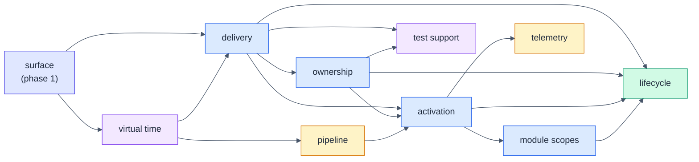

# nidana.runtime: Bus Runtime

- **Kind:** leaf-parent
- **Purpose:** the bus: turns topic declarations and topology definitions into live RxDart subjects and subscriptions and enforces the Bus Runtime Contract (Spec §3), lifecycle (Spec §7), observation (Spec §9), the error model (Spec §10) and runtime operations (Spec §11)
- **Owns:**
  - package `nidana_dart_runtime`, with its public libraries: the runtime and `testing.dart` (ADR-002)
  - `Bus` construction by explicit reference, never a global accessor (Spec §3.1); `BusConfig` with resource limits, grace period, scheduler provider, dev mode and the diagnostics sink (Spec §11.3, root D8)
  - the per-bus topic registry: lazy subject creation on first runtime access, the runtime name-and-type collision check, `removeTopic` with its atomicity and `force` rules (Spec §3.2, §4.3, §7.5, §3.10), values held at `Object?` and converted per access (D4, D5)
  - the publish path: StateTopic dedup (Spec §3.12), per-topic ordering (Spec §3.3), reentrancy normalization and dev-mode recursion detection (Spec §3.4), observers in registration order before subscribers with sensitive gating and exception swallowing (Spec §3.7, §9), the startup barrier and its dev-mode window (Spec §3.13), the publisher-less path for event and replay topics only (Spec §2.4)
  - publishers, `StateWriter` handles and the per-bus ownership table: first-claim at activation and at publisher construction, release on deactivation or disposal (Spec §2.4, §3.11 layer 1)
  - the live interpretation of topology-dsl@v1 with envelope threading through every combinator, applying the model's lineage functions (Spec §3.5, §6.3); time-dependent combinators on RxDart inside the provider zone, and a live `switchMap` of its own that does not wait on the previous inner's cancel future (ADR-003); topology reads on a synchronous path of their own (D3)
  - activation: idempotency on `topologyId` (Spec §3.9), cycle rejection (Spec §3.8), scope compatibility (Spec §7.2), `TopologyHandle` deactivation, retention across activations with `reduceInto` seeding (Spec §7.2)
  - scopes and module reference counting with the grace timer, as an adapter-facing API that UI adapters bind to route events (Spec §7.1 to §7.3)
  - `bus.toGraph()` over the active topologies (Spec §6.5)
  - dev-mode logging of terminated pipelines (Spec §10.2)
  - `start()`, `shutdown()` and rejection after shutdown (Spec §11.2)
  - dev-mode diagnostics as typed values to the configured sink (root D8)
  - the scheduler provider, `VirtualScheduler`, `VirtualSchedulerProvider`, `TestBus` and the envelope recorder with redaction of sensitive payloads (Spec §3.6, §9.2, Appendix A.7; ADR-003)
  - the per-topic ordering regression test (Guide §6.5)
  - an SDK-neutral telemetry observer implementing the Guide §8.2 mapping onto `ObserveContext.span` (root D1)
- **Does not own:** pure types, lineage rules, the IR and the analyses (nidana.model); route observation and widgets (nidana.flutter); navigation semantics (nidana.navigation); static checks (nidana.tooling); persistence (deferred, root D1)
- **Consumes:** [topic-model@v1, topology-dsl@v1, topology-ir@v1]
- **Produces:** [bus-api@v1, bus-testing@v1]
- **Governed by:** [ADR-001, ADR-002, ADR-003]
- **Sources:**
  - `ref/nidana-docs/arch/nidana-bus-ref-arch-spec-v0_15_0.md` §1, §2.3 to §2.5, §3.1 to §3.13, §5.3, §5.5, §6.1, §6.3, §6.5, §7.1 to §7.5, §9, §10, §11, Appendix A.5, A.7
  - `ref/nidana-docs/arch/nidana-bus-ref-arch-guide-v0_15_0.md` §2, §4, §6.1, §6.5, §8.1, §8.2, §8.4, §8.5, §10.1
  - `ref/nidana-docs/arch/nidana-bus-ref-arch-rationale-v0_15_0.md` §2.1, §2.2, §3.2
- **Decomposes into:** phases (see hsdd-phase-plan)
- **Isolation strategy:** builds against the model's contracts only, from nidana.model's first phase on (root D10); runs on the Dart VM with `TestBus` and the virtual scheduler, no Flutter; every producing phase replays bus-api@v1 and bus-testing@v1, structure, surface and reject in full and behavior restricted by `--guarantee` to what the phases have delivered so far (ADR-001 item 10); the phases that deliver activation also bind the `behavior/` fixtures of topology-dsl@v1, whose live semantics this node implements, through bus-api@v1's `bus_activation_test.dart`; a slice behind a package-internal seam is unit-tested against that seam before the slice that composes it lands (D2)

## Overview

The runtime is the imperative shell around the model's pure core: it holds the mutable per-bus state (subjects, the ownership table, the active topology set, observers, reference counts, the startup queue) and the effects (subscriptions, timers, microtasks), and it decides nothing the model's pure functions can decide. Dart runs one isolate per bus, so the thread-safety rules of Spec §3.10 reduce to atomicity of each operation within one event-loop turn; a bus is never shared across isolates.

The root marked this node internal (root D4) before its contracts existed. Its decomposition step, run once bus-api@v1 and bus-testing@v1 were written, found no boundary inside `nidana_dart_runtime` that can carry a node boundary, and made the node a leaf-parent (D1). The mechanisms the Owns list names are slices of one package, each behind a package-internal library seam (D2); the phase plan cuts its phases along those slices. No child node, no internal contract and no `nidana.runtime.integration` exist; nidana.integration replays both produced contracts with `--all` (root D5).

## Inherited from the root

- RxDart is the engine (root D9), resolved at 0.28.0 on the pinned SDK. Observed subscriptions keep RxDart's microtask-delayed first delivery for state and replay topics (bus-api@v1 G17, which decides OQ-R1); topology reads take a synchronous path of their own (D3).
- Time goes through the scheduler provider, a zone and a clock (ADR-003): the bus's subscriptions, `bus.observe` subscriptions, observer calls, timers and microtasks are all in the provider zone; no code chains on a future from outside it; no `DateTime.now()` and no `Timer` outside it.
- Dev mode defaults to "assertions enabled"; diagnostics are typed values sent to a sink in `BusConfig` (root D8).
- `TestBus` and the recorder live here, in `testing.dart`, with no dependency on `package:test` (root D4, ADR-002).
- Findings from `docs/auto-run/experiments/rxdart-sync-subjects/` that this node's design has to account for (root D9): synchronous delivery of `sync: true` publish subjects; first delivery of `sync: true` behavior and replay subjects in a microtask; `StateError` on a reentrant add to the same subject; depth-first delivery on a reentrant add to another subject; order restored by deferring the reentrant add with `scheduleMicrotask`.

## Contracts

| Contract | Direction | Counterpart | Edge type (root DAG) | What this node does with it |
|----------|-----------|-------------|----------------------|-----------------------------|
| topic-model@v1 | consumes | nidana.model | shared-model | carries topics, envelopes and sources; applies the lineage functions; calls observers; redacts through `MessageEnvelope.redacted()` |
| topology-dsl@v1 | consumes | nidana.model | contract | calls `planOf` once per activation and implements the Live interpretation through `StageVisitor` and `SinkVisitor` |
| topology-ir@v1 | consumes | nidana.model | contract | builds `TopologyGraph` and `ShellClaim` values and rejects activations and claims on `analyzeTopologyGraph` findings |
| bus-api@v1 | produces | nidana.navigation (contract), nidana.flutter (hard), nidana.tooling (contract), nidana.integration (hard) | as listed | the main library |
| bus-testing@v1 | produces | nidana.navigation (hard), nidana.flutter (hard), nidana.integration (hard) | as listed | `testing.dart` |

Every edge out of this node waits on its first phase, which lands the declarations of both produced contracts (root D10); the `hard` edges wait for the node to ship.

## Slices

The slices D2 fixes, what each holds, the guarantees each delivers, and which slices its code calls or its tests need. They are the unit the phase plan cuts and orders; a phase may deliver one slice, part of one, or two small ones.

| Slice | Holds | Delivers | Needs |
|-------|-------|----------|-------|
| surface | both public libraries; the library under `lib/src/` that declares `Bus`, `BusConfig`, `BusLifecycle`, the provider family and `TestBus` (bus-api@v1 Refinement 1); the declarations of every other slice; the diagnostic and error families as complete values | every declaration of both contracts; bus-api@v1 G2, G40 and the type-level halves of G1, G3, G4, G5, G8, G11, G19 and G20; bus-testing@v1 G1, G2 | none |
| virtual time | `VirtualScheduler`, `VirtualSchedulerProvider`, and the `TestBus` constructor with its choice of provider and its recorder, which both bus-api@v1 bindings need (ADR-003 items 5 and 6) | bus-testing@v1 G5 to G12 | surface |
| delivery | the registry and its cells, both read paths (D3), the publish path with reentrancy and recursion detection, per-read dedup, observed streams, observer calls and gating, the recorder seam, the provider zone and clock; the RxDart engine seam of ADR-002 item 3 sits in its cells | bus-api@v1 G1, G3 to G9, G11 to G18, G29 to G31, G41 and the subject and observer limits of G10; bus-testing@v1 G4, G14, G17 | surface, virtual time |
| ownership | publishers, writers per type argument (D4), claims checked over the live graph, `toGraph()` | bus-api@v1 G19 to G21, G37 | delivery |
| pipeline | the interpreter of a `TopologyPlan`, the live `switchMap` of ADR-003 item 3 and the time-dependent stages of ADR-003 item 4, over a port of its own (D2) | topology-dsl@v1 G18 to G29, replayed through `Bus.activate` once activation composes it | virtual time |
| activation | `Bus.activate`, which checks the candidate, implements the pipeline's port on the delivery slice and wires the plan; idempotency, deactivation, terminated-pipeline reports, activation observers | bus-api@v1 G22 to G26, G32 and the activation limits of G10; the binding of topology-dsl@v1's live suite | delivery, ownership, pipeline |
| module scopes | `ModuleScope`, `ModuleReference`, reference counting and the grace timer | bus-api@v1 G27, G28 | activation |
| lifecycle | the startup barrier and its window, `onShutdown`, `shutdown` | bus-api@v1 G34 to G36 | delivery, ownership, activation, module scopes |
| test support | deterministic ids, `input` and `stub` (D7), the recorder's records, redaction and queries (D6), `OrderingProbe` | bus-testing@v1 G3, G13, G15, G16, G18, G19 | delivery, ownership |
| telemetry | `TelemetryObserver` | bus-api@v1 G33 | activation (its cases observe activations; its unit tests need only the surface) |

bus-api@v1 G38 and G39 and bus-testing@v1 G20 are properties of the package's sources and pubspec, checked by every phase's gate (their contracts' Validation sections).

## Development flow

The node starts once nidana.model's first phase has merged (root D10). Inside it, these constraints follow from the contracts and ADRs; everything else about the cut and order is the phase plan's:

- The surface slice is phase 1. It lands every declaration of both contracts, with bodies that throw `UnimplementedError` where behavior belongs to a later slice, so the surface and reject sets of both pass at every producing phase (ADR-001 item 10; conventions, `fp-progression`).
- Virtual time comes next: both bus-api@v1 bindings run every case on fresh `TestBus` instances and read `TestBus.recorder.envelopes` (bus-api@v1 Validation), so no behavior replay runs before the scheduler and the `TestBus` constructor work.
- Each slice's pure part, such as the declaration comparison of G7, the pending-delivery queue with its reentrancy chains, per-read dedup, the module reference-count transitions, the telemetry attribute mapping and the recorder's queries over records, belongs to the pure band, before the effects that use it (conventions, `fp-progression`).
- Two lanes open after virtual time: the pipeline, which reaches nothing of the bus but its own port, and delivery followed by ownership. Activation joins them. Test support can run once ownership lands and telemetry once activation does, beside module scopes.
- Lifecycle closes the plan, because G34 and G36 involve every other slice; the last producing phase replays both contracts unrestricted (ADR-001 item 10).

## Decisions

### D1: A leaf-parent, not decomposed into child nodes

The root marked this node internal because it spans several mechanisms (root D4). With both produced contracts written, no split into child nodes passes HSDD's own rules and this tree's accepted ADRs, so the node is a leaf-parent and its phase plan divides the mechanisms (D2).

1. **One leaf-parent produces both contracts.** `TestBus` extends the final `Bus` and `VirtualSchedulerProvider` extends the sealed `SchedulerProvider`, so `testing.dart`'s declarations share the library that declares `Bus` (bus-api@v1 Refinement 1; bus-testing@v1 G2). ADR-001 item 10 runs the surface and reject sets of each contract in full at every producing phase, and phase 1 of a leaf-parent lands every declaration of the contracts it produces (conventions, `fp-progression`). The declarations of both contracts therefore land in one phase of one node.
2. **The test substrate is part of that surface.** Every behavior replay of bus-api@v1, and of topology-dsl@v1's live suite, runs on a `TestBus` over the `VirtualScheduler` (bus-api@v1 Validation), and the live pipeline's time-dependent stages can be tested only on a virtual scheduler, since no nidana package depends on `fake_async` (ADR-003 items 4 and 5). A sibling that implements the scheduler would build on declarations the producing node lands in its phase 1, while every behavior replay of that node needs the sibling's scheduler. A sibling that implements the live pipeline would need the producing node's scheduler for its tests, while that node's `Bus.activate` composes the pipeline. Either way the two edges form a cycle, which a dependency DAG cannot hold, unless the sibling's tests carry a second virtual scheduler, a hand-rolled stand-in where HSDD wants the contract's own fixtures.
3. **Any other split needs an internal contract that can never be `stable`.** A sibling joined to the producing node by anything other than the public contracts reaches declarations under `lib/src/`. ADR-001 item 2 forbids fixtures that import `src/` and its replay tool's structure set enforces it (item 9); ADR-002 item 3 gives this package exactly two public libraries. Such a contract carries no executable validation, so hsdd-reconcile can never flip it to `stable` (HSDD §3.4; ADR-001 item 12).
4. **The seam a split would freeze is the one that moved most.** Each of the nine stand-in runtimes the experiments built is one library with three parts. Between them, the interpreter's read stage and the registry's cells were patched together three times: for the connection before `activate` returns (`docs/auto-run/experiments/navigation-api-fixtures/`), for the synchronous read path of bus-api@v1 G22 and G34 (`docs/auto-run/experiments/bus-api-amendment/`) and for widened references, G41 (`docs/auto-run/experiments/bus-api-widened/`, the read stage's patch notes in `packages/nidana_dart_runtime/lib/src/interpreter.dart`). hsdd-spec asks a node boundary for stable input and output contracts.
5. **The leaf-parent rule holds.** One owner holds the scope (root, hard constraints), which the two contracts now bound: 61 guarantees and the live suite's 43 cases. It splits into phases of one review window each: the slices of D2 come to about twelve phases, from a stand-in of about 1,900 lines that passed every suite. hsdd-spec sends a request to break up a node that is already a leaf-parent to hsdd-phase-plan.

Alternatives considered:

- **Two children:** `nidana.runtime.bus` (both public libraries, virtual time, delivery, ownership, test support) and `nidana.runtime.topology` (pipeline, activation, module scopes, and the barrier and shutdown, whose cases involve topologies), joined by an internal contract over the delivery slice's API, about six phases each. It is acyclic, because `Bus` reaches the topology child's mechanism through delegation the skeleton writes, and the topology child's tests need only the bus child's behavior. It needs ADR-001 item 2 amended so that an internal contract's fixtures may import `lib/src/`, a second producer of bus-api@v1 whose phase 1 lands nothing of it, and a contract over the seam of point 4. The signal that would favor it: the owner prefers two plans of about six phases to one of about twelve, enough to amend ADR-001 for internal contracts.
- **A pure-core child under an imperative-shell child:** the pending-delivery queue, reference counting, dedup and the declaration comparison as pure state machines. It fits the owner's functional-first practice, but needs the same ADR-001 amendment and leaves the shell at about ten phases. The pure core stays a band of the phase plan instead (Development flow).
- **A live-pipeline child, or a virtual-scheduler child:** each forms the cycle of point 2.

Consequences: no child spec files, no internal contract, no proposed ADR and no OQ prefix below `R`. No `nidana.runtime.integration`: no children exchange contracts; nidana.integration replays both produced contracts with `--all`. bus-api@v1's Interface line "the child of nidana.runtime that owns the main library lands every declaration below in its first phase" now means this node's first phase, a wording for hsdd-reconcile's sweep. Root D4's clause that calls this node internal is the root's to update.

### D2: Slices behind package-internal library seams

Each slice of the Slices table is one or more libraries under `lib/src/`, written by the phases that deliver it. A slice reaches another only through the declarations the other's library exposes, never through a `part` file.

- The two public libraries export, with `show`, exactly the declarations their contracts list (bus-testing@v1 G1), so a package-internal name never reaches application code; the root lint set's `implementation_imports` reports an application that imports `lib/src/` (ADR-002 items 2 and 4).
- The library that declares `Bus` also declares `TestBus`, the provider family and `BusConfig` (bus-api@v1 Refinement 1). It is the composition root: a `Bus` holds the state of each slice and forwards to it.
- The pipeline declares the port it reads and publishes through: a topic's connection values and its later deliveries, synchronously, at the read's type argument; a publish with a lineage; a fresh correlation id; the report of a terminated sink. Activation implements the port on the delivery slice. Neither the pipeline nor the delivery slice imports the other, so the pipeline is unit-tested against a port of the test's own and the delivery slice without any pipeline, and the public suites check the composition once activation lands.
- RxDart is imported by the delivery slice's cells and the pipeline's time-dependent stages only: the internal library seam ADR-002 item 3 asks for, behind which a second engine would be a new package.

Alternatives considered: one library with `part` files, as every stand-in was, where parts share private members, so every phase would edit one library and serialize behind `Collides with`, and no slice could be tested apart from the others; one library per public contract, which the shared `Bus` of bus-api@v1 Refinement 1 rules out.

### D3: Two read paths per topic

A topic's cell serves observed subscriptions from its RxDart subject (`BehaviorSubject` or `ReplaySubject` with `sync: true`, `PublishSubject` with `sync: true` for an event topic), whose replay gives the first delivery of bus-api@v1 G17 in the first provider-zone microtask after `listen`. Topology reads take a second path of the same cell: a synchronous broadcast controller with no replay. Activation emits a read's connection from the cell's current value or buffer before `activate` returns, the publishes the connection causes wait for a provider-zone microtask, and every later delivery reaches the read during that delivery (bus-api@v1 G22, G34). The cell adds each delivery to both paths, after the recorders and the observers (bus-api@v1 delivery rule).

Evidence: `docs/auto-run/experiments/bus-api-amendment/` (`output.txt`; bus-api@v1 Validation). A read whose connection arrives one microtask after `activate` fails the G22 connection case and the G34 deep-link case; a read connected synchronously but listening on the RxDart subject, whose replay to a new listener holds back every delivery made before its first microtask, still fails the G34 case; the stand-in with a synchronous controller per cell passes every suite.

Alternatives considered: topology reads on the subject, which fails G22 and G34; a synchronous subject of the node's own for both paths, which would give observed subscriptions a synchronous first value against G17 and rebuild what the Specification expects the engine to provide (Spec §2.3).

### D4: The registry holds values at `Object?`

A cell is keyed by the topic's name and registers the topic value of the access that creates it. It holds the current value, the buffer, the subject's elements and the envelopes at `Object?`, because topic-model@v1 gives generic code no way to instantiate anything at a topic's value type from a widened reference (bus-api@v1 G41). Each access converts at its own type argument: `getCurrentValue` casts, `getBufferedValues` copies into an unmodifiable `List<R>`, each observed subscription and each topology read converts each payload, and a `reduceInto` seed converts the current value. Envelopes stay `MessageEnvelope<Object?>` inside the bus and are never cast to `MessageEnvelope<T>`, because a publish through a widened reference builds a `MessageEnvelope<R>`. The collision check of bus-api@v1 G7 compares the declarations' fields, `valueType` among them, never an access's type argument (G41). A publisher keeps its writers per topic and type argument (bus-api@v1 G20).

Evidence: `docs/auto-run/experiments/bus-api-widened/` (`output.txt`), where a stand-in built this way passes every suite that runs on `nidana_dart_runtime`, and the six G41 cases fail on typed cells.

Alternative considered: typed cells through a type-capturing member on topic-model@v1's topic family, a compatible topic-model@v1 addition that would also give typed envelopes and a publish-time value check. Not requested; the signal that would favor it is an adopter who needs typed envelopes from publishes made through widened references.

### D5: Off-type values reached through a widened reference

A value that is not of the topic's value type can reach a cell through a widened reference; bus-api@v1 G41 leaves it outside its guarantee, and neither the publish nor the delivery checks it. Each conversion of D4 runs in the delivery callback of the one subscription or read it serves, so the conversion's `TypeError` goes to the provider zone's uncaught-error handler, as a throwing subscriber callback's error does (bus-api@v1 G18). That subscription or read skips the value and keeps receiving later deliveries; the recorders, the observers and every other subscription and read receive the delivery (G13). A conversion made at a call (`getCurrentValue`, `getBufferedValues`, or a `reduceInto` seed during `activate`) throws the `TypeError` to the caller, and an `activate` that throws activates nothing. The cell's current value and buffer hold the value.

Evidence: `docs/auto-run/experiments/off-type-delivery/` (`bin/main.dart`, `output.txt`). In cases 1 and 3 to 6, a cast in one listener's `onData` on a synchronous controller or subject held at `Object?` reaches the zone's handler, the listeners before and after it receive the value, the publisher's `add` returns normally, and the failing listener receives the next value; in case 2 the same cast inside `map` becomes an error event on that one subscription instead.

Alternatives considered: an error event on the subscription, and an error at a topology's read stage, which would end an observed subscription that sets `cancelOnError` and end every sink downstream of the read (bus-api@v1 G26) for a value the topology cannot control; a publish-time check, which needs D4's alternative. A consumer could rely on this behavior, so the phase plan may emit it as a compatible `amend bus-api@v1` to G41's exclusion.

### D6: Recorder queries over envelopes published through a widened reference

bus-testing@v1 G16 says `envelopesOf` returns envelopes typed by the topic and identical to the delivered ones; for an envelope a widened reference published, a `MessageEnvelope<Object?>` (D4), the two cannot both hold, and the stand-in threw a `TypeError` (`docs/auto-run/experiments/bus-api-widened/`, probe P2). `envelopesOf<T>(topic)` returns, for each record of the topic, the delivered envelope itself when it is a `MessageEnvelope<T>`, and otherwise an equal `MessageEnvelope<T>` built from its eight fields with the payload converted at `T` (topic-model@v1 G12, G13). `payloadsOf<T>(topic)` returns the payloads converted at `T`. A payload that is not a `T`, possible only for an off-type value (D5), throws `TypeError` from the query. Comparisons with `==`, the assertion API bus-testing@v1 states, hold in both cases; only `identical` tells them apart.

This node's phase plan emits it as `amend bus-testing@v1` on G16. Compatible: identity holds wherever G16 could hold it before.

Alternatives considered: skipping such records, which silently drops deliveries a test asserts on; throwing for any such record, so a test of generic shell code could never read its topic; typed envelopes at publish, which needs D4's alternative.

### D7: `stub` returns one writer per type argument

bus-testing@v1 G18 says `stub(topic)` returns the same writer on every later call, which a call through a widened reference before a typed one cannot meet (`docs/auto-run/experiments/bus-api-widened/`, T7). `TestBus.stub(topic)` creates, on the first call for the topic at any type argument, one publisher of `TestBus.testSource` claiming the topic alone at `Scope.application`, and returns that publisher's `writer<T>(topic)`, which is the same handle on every call with the same type argument (bus-api@v1 G20, G41). This node's phase plan emits it as `amend bus-testing@v1` on G18: "the same writer on every later call with the same type argument".

Alternatives considered: one cached writer cast to each type argument, which fails at run time; a publisher per type argument, whose claim would be a second writer of the topic, which bus-api@v1 G20 rejects with `ClaimRejected`.

## Open questions

| ID | Question | Status | Waits on | Affects |
|----|----------|--------|----------|---------|
| OQ-R1 | Do the bus's subjects keep RxDart's microtask-delayed first delivery for state and replay topics, or wrap subjects so a new subscriber receives the current value synchronously? | RESOLVED (2026-10-17): bus-api@v1 G17 | none | bus-api@v1, nidana.flutter |
| OQ-R2 | [inherits OQ2] What are the envelope recorder's assertion API and the way a test activates only the topologies under test? | RESOLVED (2026-10-17): bus-testing@v1 G14 to G16 (assertions), G18 (isolation) | none | bus-testing@v1, nidana.flutter, nidana.integration |
| OQ-R3 | Where does StateTopic dedup sit, given the per-read opt-out of Spec §3.12, and does an observer see a publish that dedup suppressed? | RESOLVED (2026-10-17): bus-api@v1 G16 | none | bus-api@v1, topology-dsl@v1 |

### OQ-R1: First delivery of state and replay topics

Spec §2.1 and §7.4 say a state topic "replays immediately to new subscribers", and Spec §3.10 requires a subscription to receive the current value and every later emission or nothing. With `sync: true`, RxDart 0.28 delivers a behavior or replay subject's replay in the first microtask after `listen`, then any events published in between, in order (`docs/auto-run/experiments/rxdart-sync-subjects/output.txt` cases 1, 3, 8 and `output-replay-detail.txt` case a). The atomicity rule holds; "immediately" does not hold synchronously. A `Stream.multi` wrapper does not help: its listener also receives the first value after `listen` returns, and a reentrant `addSync` reorders subscribers (`output-replay-detail.txt` cases c and d). Options: keep RxDart's timing and state it as a bus-api@v1 guarantee, so a UI adapter takes the first frame from `getCurrentValue`; or build subjects on synchronous broadcast controllers that emit the current value during `listen`, at the cost of owning subject code the Specification expects the engine to provide (Spec §2.3).

Resolved (2026-10-17) by bus-api@v1 G17: an observed subscription of a state or replay topic receives its first values in the first provider-zone microtask after `listen` returns, then every later delivery, none missed or repeated; the synchronous first value is `getCurrentValue` or `getBufferedValues`. Topology reads, which bus-api@v1 G22 needs synchronously, take a separate path (D3).

### OQ-R2: Recorder assertions and topology test isolation

Guide §10.1 leaves the assertion API (equality, pattern matching, predicates) and single-topology isolation open; root OQ2 delegates both here. A fresh `TestBus` activates nothing, so isolation is mostly a question of stubbing the inputs a topology reads whose producers are absent from the test.

Resolved (2026-10-17) by bus-testing@v1. Assertions (G14 to G16): the recorder returns typed, unmodifiable lists of envelopes and payloads, compared with `==`, destructured with Dart patterns or filtered with `Iterable.where`, and asserted with the runner's own `expect`; no matchers. Isolation (G18): a TestBus activates nothing on its own; a test activates the topologies under test, publishes their event and replay inputs through `TestBus.input` and stands in for the absent owner of each state topic they read through `TestBus.stub` (D7).

### OQ-R3: Dedup placement

Spec §3.12 makes a publish of an equal value a no-op for subscribers and downstream operators, yet lets one read opt out with `Dedup.none`, which means the subject itself must still see every publish. Options: dedup per read (each default read applies `distinctUntilChanged`), with the subject and observers seeing every publish; or dedup at publish with a side channel for opted-out reads. The choice decides what observers and the envelope recorder record.

Resolved (2026-10-17) by bus-api@v1 G16, with topology-dsl@v1 G19 for topology reads: dedup applies per read; every publish to a state topic is delivered, becomes its current value and reaches its observers and recorders, an equal one included; a read whose effective policy is `Dedup.equality` skips a value equal to the last one it received, and a `Dedup.none` read receives every publish.
