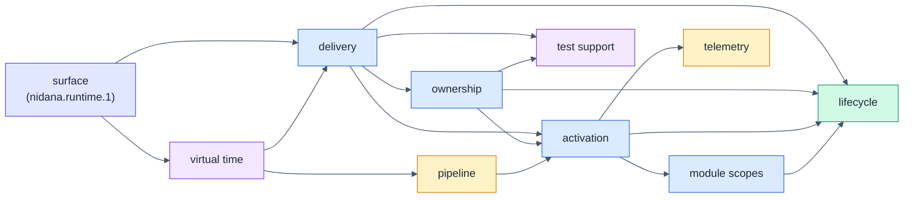
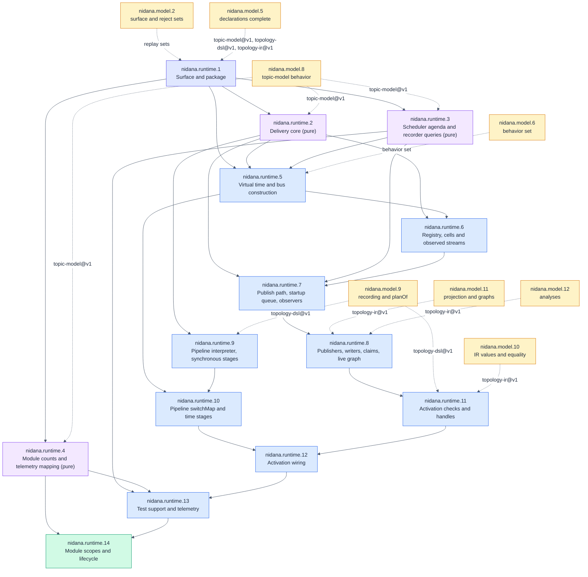

# nidana.runtime: Bus Runtime

- **Kind:** leaf-parent
- **Purpose:** the bus: turns topic declarations and topology definitions into the bus's own topic storage and subscriptions and into live pipelines on RxDart's operators (D3), and enforces the Bus Runtime Contract (Spec §3), lifecycle (Spec §7), observation (Spec §9), the error model (Spec §10) and runtime operations (Spec §11)
- **Owns:**
  - package `nidana_dart_runtime`, with its public libraries: the runtime and `testing.dart` (ADR-002)
  - `Bus` construction by explicit reference, never a global accessor (Spec §3.1); `BusConfig` with resource limits, grace period, scheduler provider, dev mode and the diagnostics sink (Spec §11.3, root D8)
  - the per-bus topic registry: a topic's cell, the subject of bus-api@v2 G6, created on first runtime access and holding the topic's storage and fan-out (D3); the runtime name check, which compares every use of a name, the first use of each declaration included, with the declaration registered under it, over variant, value type, sensitive flag, tracing, dedup policy and buffer size (Spec §4.3; bus-api@v2 G7); `removeTopic` with its atomicity and `force` rules, which frees the name (Spec §3.2, §7.5, §3.10); values held at `Object?` and converted per access (D4, D5)
  - the publish path: StateTopic dedup (Spec §3.12), per-topic ordering (Spec §3.3), reentrancy normalization and dev-mode recursion detection (Spec §3.4), observers in registration order before subscribers with sensitive gating and exception swallowing (Spec §3.7, §9), the publisher-less path for event and replay topics only (Spec §2.4)
  - observed subscriptions: made and run in the provider zone, their first values emitted by the bus (D3), what a subscriber's callbacks throw sent to the uncaught-error handler of the zone in which it listened, and a value a subscription cannot convert delivered to it as an error event (Spec §10.2 principle 5, §3.10; ADR-003 item 2; D5)
  - the startup barrier (Spec §3.13): the startup queue, the connection at `start()` of the activations and subscriptions made during bootstrap, writers before readers (D3), and the dev-mode window
  - publishers, `StateWriter` handles and the per-bus ownership table: first-claim at activation and at publisher construction, release on deactivation or disposal (Spec §2.4, §3.11 layer 1)
  - the live interpretation of topology-dsl@v2 with envelope threading through every combinator, applying the model's lineage functions (Spec §3.5, §6.3); write chains, each ended by the first error that reaches its sink unrecovered, with what feeds no other live chain cancelled (Spec §10.2, Appendix A.4); time-dependent combinators on RxDart inside the provider zone, and a live `switchMap` of its own that does not wait on the previous inner's cancel future (ADR-003); topology reads connected from the bus's own topic storage and converting at their own type argument (D3, D5)
  - activation: idempotency on `topologyId`, comparing the plan's functions and seeds as well as the definitions (Spec §3.9; Guide §6.3; bus-api@v2 G23), cycle rejection (Spec §3.8), scope compatibility and scope timing (Spec §7.2), `TopologyHandle` deactivation, retention across activations with `reduceInto` seeding (Spec §7.2)
  - scopes and module reference counting with the grace timer, as an adapter-facing API that UI adapters bind to route events (Spec §7.1 to §7.3)
  - `bus.toGraph()` over the active topologies (Spec §6.5)
  - dev-mode reports of ended write chains (Spec §10.2; bus-api@v2 G26)
  - `start()`, `shutdown()` and rejection after shutdown (Spec §11.2)
  - dev-mode diagnostics as typed values to the configured sink (root D8)
  - the scheduler provider, `VirtualScheduler`, `VirtualSchedulerProvider`, `TestBus` and the envelope recorder with redaction of sensitive payloads (Spec §3.6, §9.2, Appendix A.7; ADR-003)
  - the per-topic ordering regression test (Guide §6.5)
  - an SDK-neutral telemetry observer implementing the Guide §8.2 mapping onto `ObserveContext.span` (root D1)
- **Does not own:** pure types, lineage rules, the IR and the analyses (nidana.model); route observation and widgets (nidana.flutter); navigation semantics (nidana.navigation); static checks (nidana.tooling); persistence (deferred, root D1)
- **Consumes:** [topic-model@v1, topology-dsl@v2, topology-ir@v1]
- **Produces:** [bus-api@v2, bus-testing@v2]
- **Governed by:** [ADR-001, ADR-002, ADR-003]
- **Sources:**
  - `ref/nidana-docs/arch/nidana-bus-ref-arch-spec-v0_15_0.md` §1, §2.3 to §2.5, §3.1 to §3.13, §5.3, §5.5, §6.1, §6.3, §6.5, §7.1 to §7.5, §9, §10, §11, Appendix A.5, A.7 (baseline, superseded by v0.15.1 on 2026-10-20; read only to see what changed)
  - `ref/nidana-docs/arch/nidana-bus-ref-arch-spec-v0_15_1.md` §1, §2.1 "Replay timing", §2.3 to §2.5, §3.1 to §3.13, §4.3 (the runtime check), §5.3, §5.5, §6.1, §6.3, §6.5, §7.1 to §7.5 with §7.2 "Scope timing", §9, §10 with §10.2 principles 2, 4 and 5, §11, Appendix A.4 "Write chain", A.5, A.7
  - `ref/nidana-docs/arch/nidana-bus-ref-arch-guide-v0_15_0.md` §2, §4, §6.1, §6.5, §8.1, §8.2, §8.4, §8.5, §10.1 (baseline, superseded by v0.15.1 on 2026-10-20; read only to see what changed)
  - `ref/nidana-docs/arch/nidana-bus-ref-arch-guide-v0_15_1.md` §2, §4, §6.1 with "Dart: replay is asynchronous", §6.3 "Name every transformer", §6.5, §8.1, §8.2, §8.4, §8.5, §10.1
  - `ref/nidana-docs/arch/nidana-bus-ref-arch-rationale-v0_15_0.md` §2.1, §2.2, §3.2 (baseline, superseded by v0.15.1 on 2026-10-20; read only to see what changed)
  - `ref/nidana-docs/arch/nidana-bus-ref-arch-rationale-v0_15_1.md` §2.1, §2.2, §3.2
- **Decomposes into:** phases (see hsdd-phase-plan)
- **Isolation strategy:** builds against the model's contracts only, from nidana.model.5 on, where the declarations of the three consumed contracts complete the library they share, and a phase that calls into a model body waits on the nidana.model phase that the contract's Delivery paragraph names as delivering it (root D10; topic-model@v1, topology-dsl@v2 and topology-ir@v1 Delivery); runs on the Dart VM with `TestBus` and the virtual scheduler, no Flutter; every producing phase replays bus-api@v2 and bus-testing@v2, structure, surface and reject in full and behavior restricted by `--guarantee` to what the phases have delivered so far (ADR-001 item 10), so nidana.runtime.1 also waits on nidana.model.2 for the replay tool's structure, surface and reject sets, and nidana.runtime.5, the first behavior replay, on nidana.model.6 for its behavior set (conventions, Phase design); from nidana.runtime.12, which wires activation, the gates also replay topology-dsl@v2's live suite, whose semantics this node implements, through bus-api@v2's `bus_activation_test.dart` (topology-dsl@v2 Delivery); a slice behind a package-internal seam is unit-tested against that seam before the slice that composes it lands (D2)

## Overview

The runtime is the imperative shell around the model's pure core: it holds the mutable per-bus state (topic storage, the ownership table, the active topology set, the activations and subscriptions that wait for `start()`, observers, reference counts, the startup queue) and the effects (subscriptions, timers, microtasks), and it decides nothing the model's pure functions can decide. Dart runs one isolate per bus, so the thread-safety rules of Spec §3.10 reduce to atomicity of each operation within one event-loop turn; a bus is never shared across isolates.

The root marked this node internal (root D4) before its contracts existed. Its decomposition step, run once bus-api@v1 and bus-testing@v1 were written, found no boundary inside `nidana_dart_runtime` that can carry a node boundary, and made the node a leaf-parent (D1). The mechanisms the Owns list names are slices of one package, each behind a package-internal library seam (D2); the phase plan cuts its phases along those slices. No child node, no internal contract and no `nidana.runtime.integration` exist; nidana.integration replays both produced contracts with `--all` (root D5).

## Inherited from the root

- RxDart is the engine (root D9), resolved at 0.28.0 on the pinned SDK. Root D9 left how a topic is backed, and the first-delivery timing that follows, to this node (OQ-R1): the bus owns its topic storage and fan-out, and RxDart serves the pipeline's time-dependent stages (D3). An observed subscription made after `start()` receives its first values in the first provider-zone microtask after `listen` (bus-api@v2 G17, which decides OQ-R1); one made during bootstrap, like every activation made then, is connected within `start()` (G34); an activation made after `start()` is connected before `activate` returns (G22). Spec §2.1 "Replay timing" and §3.3's RxDart bullet now state the replay microtask that root D9 recorded and marked for upstreaming.
- Time goes through the scheduler provider, a zone and a clock (ADR-003): the bus's subscriptions, `bus.observe` subscriptions and their callbacks, observer calls, timers and microtasks are all in the provider zone, while what a subscriber's callbacks throw, and an error event it leaves without `onError`, go to the uncaught-error handler of the zone in which it called `listen` (ADR-003 item 2 as amended on 2026-10-20; bus-api@v2 G5, G18; D5); no code chains on a future from outside the provider zone; no `DateTime.now()` and no `Timer` outside it.
- Dev mode defaults to "assertions enabled"; diagnostics are typed values sent to a sink in `BusConfig` (root D8).
- `TestBus` and the recorder live here, in `testing.dart`, with no dependency on `package:test` (root D4, ADR-002).
- Findings from `docs/auto-run/experiments/rxdart-sync-subjects/` that this node's design has to account for (root D9): synchronous delivery of `sync: true` publish subjects; first delivery of `sync: true` behavior and replay subjects in a microtask; `StateError` on a reentrant add to the same subject; depth-first delivery on a reentrant add to another subject; order restored by deferring the reentrant add with `scheduleMicrotask`. D3 accounts for the second by emitting every first value itself. Its own fan-out, a synchronous broadcast controller, throws the same `StateError` for an add made while it delivers (`docs/auto-run/experiments/runtime-topic-storage/`, probe P5), so the bus defers every reentrant publish (bus-api@v2 G14).

## Contracts

| Contract | Direction | Counterpart | Edge type (root DAG) | What this node does with it |
|----------|-----------|-------------|----------------------|-----------------------------|
| topic-model@v1 | consumes | nidana.model | shared-model | carries topics, envelopes and sources; applies the lineage functions; calls observers; redacts through `MessageEnvelope.redacted()` |
| topology-dsl@v2 | consumes | nidana.model | contract | calls `planOf` once per activation and implements the Live interpretation, write chains included, through `StageVisitor` and `SinkVisitor` |
| topology-ir@v1 | consumes | nidana.model | contract | builds `TopologyGraph` and `ShellClaim` values and rejects activations and claims on `analyzeTopologyGraph` findings; orders the connection of the bootstrap activations over their definitions' reads and writes (D3) |
| bus-api@v2 | produces | nidana.navigation (contract), nidana.flutter (hard), nidana.tooling (contract), nidana.integration (hard) | as listed | the main library |
| bus-testing@v2 | produces | nidana.navigation (hard), nidana.flutter (hard), nidana.tooling (contract), nidana.integration (hard) | as listed | `testing.dart` |

A `contract` edge out of this node waits on nidana.runtime.1, which lands the declarations of both produced contracts (root D10; bus-api@v2 and bus-testing@v2 Delivery). A `hard` edge binds per phase: a consumer phase that runs the contract's behavior waits on nidana.runtime.14, the last producing phase of both contracts, and one that only compiles against the declarations waits on nidana.runtime.1, as nidana.flutter.1 does (root D10; the Delivery paragraphs name the consumer phases).

## Slices

The slices D2 fixes, what each holds, the guarantees each delivers, and which slices its code calls or its tests need. They are the unit the phase plan cuts and orders; a phase may deliver one slice, part of one, or two small ones.

| Slice | Holds | Delivers | Needs |
|-------|-------|----------|-------|
| surface | both public libraries; the library under `lib/src/` that declares `Bus`, `BusConfig`, `BusLifecycle`, the provider family and `TestBus` (bus-api@v2 Refinement 1); the declarations of every other slice; the diagnostic and error families as complete values | every declaration of both contracts; bus-api@v2 G2, G40 and the type-level halves of G1, G3, G4, G5, G8, G11, G19 and G20; bus-testing@v2 G1, G2 | none |
| virtual time | `VirtualScheduler`, `VirtualSchedulerProvider`, and the `TestBus` constructor with its choice of provider and its recorder, which both bus-api@v2 bindings need (ADR-003 items 5 and 6) | bus-testing@v2 G5 to G12, G11's sentence on a subscriber's exception together with the delivery slice (D5) | surface |
| delivery | the registry and its cells, which hold each topic's storage and its one fan-out (D3); the publish path with reentrancy and recursion detection; per-read dedup; observed streams with their first values (D3), their conversion and the forwarding of a subscriber's errors (D5); observer calls and gating; the recorder seam; the provider zone and clock | bus-api@v2 G1, G3 to G9, G11 to G18, G29 to G31, G41 but for a topology read's conversion, and the subject and observer limits of G10; bus-testing@v2 G4, G14, G17 | surface, virtual time |
| ownership | publishers, writers per type argument (D4), claims checked over the live graph, `toGraph()` | bus-api@v2 G19 to G21, G37 | delivery |
| pipeline | the interpreter of a `TopologyPlan` with its write chains and their ending, the read stage with its conversion (D5), the live `switchMap` of ADR-003 item 3 and the time-dependent stages of ADR-003 item 4, over a port of its own (D2) | topology-dsl@v2 G18 to G29, replayed through `Bus.activate` once activation composes it; the read-stage halves of bus-api@v2 G9 and G41 | virtual time |
| activation | `Bus.activate`, which checks the candidate, scope timing and a re-activation's plan included, implements the pipeline's port on the delivery slice, and wires and connects the plan when D3 says; idempotency, deactivation, ended-chain reports, activation observers | bus-api@v2 G22 to G26, G32, G42 for `activate`, and the activation limits of G10; the binding of topology-dsl@v2's live suite | delivery, ownership, pipeline |
| module scopes | `ModuleScope`, `ModuleReference`, reference counting and the grace timer | bus-api@v2 G27, G28, G42 for `acquire` | activation |
| lifecycle | the startup barrier: `start()`'s three steps, the bootstrap activations wired and connected in the connection order, then the bootstrap subscriptions, then the queue (D3); its window; `onShutdown`; `shutdown` | bus-api@v2 G34 to G36 | delivery, ownership, activation, module scopes |
| test support | deterministic ids, `input` and `stub` (D7), the recorder's records, redaction and queries (D6), `OrderingProbe` | bus-testing@v2 G3, G13, G15, G16, G18, G19 | delivery, ownership |
| telemetry | `TelemetryObserver` | bus-api@v2 G33 | activation (its cases observe activations; its unit tests need only the surface) |

bus-api@v2 G38 and G39 and bus-testing@v2 G20 are properties of the package's sources and pubspec, checked by every phase's gate (their contracts' Validation sections). The bootstrap cases of bus-testing@v2 G14 and G19 replay only once `start()` connects what bootstrap activated and observed (bus-testing@v2 Delivery), so the phase that first replays them follows the one that lands that part of the lifecycle slice (D8).

## Development flow

The node starts once nidana.model.2 and nidana.model.5 have merged: nidana.model.5 completes the declarations of the three consumed contracts, which share one library, and nidana.model.2 lands the replay tool's surface and reject sets that nidana.runtime.1's gate runs (root D10; root Development flow item 2; conventions, Phase design). A later phase also waits on the nidana.model phase that delivers a body it calls or a replay set its gate runs (Phase Plan, Depends on). Inside the node, these constraints follow from the contracts and ADRs; everything else about the cut and order is the phase plan's:

- The surface slice is nidana.runtime.1, the type band. It lands every declaration of both contracts, with bodies that throw `UnimplementedError` where behavior belongs to a later slice, so the surface and reject sets of both pass at every producing phase (ADR-001 item 10; conventions, `fp-progression`).
- Each slice's pure part, such as the declaration comparison of G7, the pending-delivery queue with its reentrancy chains, the connection order over the bootstrap activations' definitions (D3), per-read dedup, the virtual scheduler's agenda, the module reference-count transitions, the telemetry attribute mapping and the recorder's queries over records, belongs to the pure band, nidana.runtime.2 to .4, before the effects that use it (conventions, `fp-progression`). The pure band runs no behavior replay.
- Virtual time is the first effect phase, nidana.runtime.5, after the pure band: both bus-api@v2 bindings run every case on fresh `TestBus` instances and read `TestBus.recorder.envelopes` (bus-api@v2 Validation), so no behavior replay runs before the scheduler and the `TestBus` constructor work.
- Two lanes follow. The pipeline lane, nidana.runtime.9 and .10, reaches nothing of the bus but its own port, so nidana.runtime.9 needs only nidana.runtime.2 and its nidana.model edge, and nidana.runtime.10 waits on virtual time. The bus lane runs after virtual time: delivery (nidana.runtime.6, .7), ownership (nidana.runtime.8) and the activation checks (nidana.runtime.11). Activation wiring, nidana.runtime.12, joins the lanes. Test support and telemetry, nidana.runtime.13, follow it, because some of the cases they replay activate topologies (bus-testing@v2 G18, bus-api@v2 G33).
- Module scopes and the lifecycle close the plan in nidana.runtime.14, because G36 orders the shutdown of every other slice. `start()` lands before that, step by step with the slices its steps reach (bus-api@v2 G34; D3): the queue and the bootstrap subscriptions with the publish path and the cells, the connection of the bootstrap activations with activation wiring; each effect phase adds its own slice's part of `shutdown()` (D8). nidana.runtime.14, the last producing phase of both contracts, replays them unrestricted (ADR-001 item 10).

## Decisions

### D1: A leaf-parent, not decomposed into child nodes

The root marked this node internal because it spans several mechanisms (root D4). With both produced contracts written, no split into child nodes passes HSDD's own rules and this tree's accepted ADRs, so the node is a leaf-parent and its phase plan divides the mechanisms (D2).

1. **One leaf-parent produces both contracts.** `TestBus` extends the final `Bus` and `VirtualSchedulerProvider` extends the sealed `SchedulerProvider`, so `testing.dart`'s declarations share the library that declares `Bus` (bus-api@v2 Refinement 1; bus-testing@v2 G2). ADR-001 item 10 runs the surface and reject sets of each contract in full at every producing phase, so a contract's first producing phase lands every declaration those sets use, a declaration of another contract included (conventions, `fp-progression`). The declarations of both contracts therefore land in one node, and in one phase of it, nidana.runtime.1 (bus-testing@v2 Interface).
2. **The test substrate is part of that surface.** Every behavior replay of bus-api@v2, and of topology-dsl@v2's live suite, runs on a `TestBus` over the `VirtualScheduler` (bus-api@v2 Validation), and the live pipeline's time-dependent stages can be tested only on a virtual scheduler, since no nidana package depends on `fake_async` (ADR-003 items 4 and 5). A sibling that implements the scheduler would build on declarations the producing node lands in its phase 1, while every behavior replay of that node needs the sibling's scheduler. A sibling that implements the live pipeline would need the producing node's scheduler for its tests, while that node's `Bus.activate` composes the pipeline. Either way the two edges form a cycle, which a dependency DAG cannot hold, unless the sibling's tests carry a second virtual scheduler, a hand-rolled stand-in where HSDD wants the contract's own fixtures.
3. **Any other split needs an internal contract that can never be `stable`.** A sibling joined to the producing node by anything other than the public contracts reaches declarations under `lib/src/`. ADR-001 item 2 forbids fixtures that import `src/` and its replay tool's structure set enforces it (item 9); ADR-002 item 3 gives this package exactly two public libraries. Such a contract carries no executable validation, so hsdd-reconcile can never flip it to `stable` (HSDD §3.4; ADR-001 item 12).
4. **The seam a split would freeze is the one that moved most.** Each of the nine stand-in runtimes the experiments built is one library with three parts. Between them, the interpreter's read stage and the registry's cells were patched together three times: for the connection before `activate` returns (`docs/auto-run/experiments/navigation-api-fixtures/`), for the synchronous read path of bus-api@v1 G22 and G34 (`docs/auto-run/experiments/bus-api-amendment/`) and for widened references, G41 (`docs/auto-run/experiments/bus-api-widened/`, the read stage's patch notes in `packages/nidana_dart_runtime/lib/src/interpreter.dart`). hsdd-spec asks a node boundary for stable input and output contracts.
5. **The leaf-parent rule holds.** One owner holds the scope (root, hard constraints), which the two contracts now bound: 61 guarantees and the live suite's 43 cases. It splits into phases of one review window each: the slices of D2 come to about twelve phases, from a stand-in of about 1,900 lines that passed every suite. hsdd-spec sends a request to break up a node that is already a leaf-parent to hsdd-phase-plan.

Alternatives considered:

- **Two children:** `nidana.runtime.bus` (both public libraries, virtual time, delivery, ownership, test support) and `nidana.runtime.topology` (pipeline, activation, module scopes, and the barrier and shutdown, whose cases involve topologies), joined by an internal contract over the delivery slice's API, about six phases each. It is acyclic, because `Bus` reaches the topology child's mechanism through delegation the skeleton writes, and the topology child's tests need only the bus child's behavior. It needs ADR-001 item 2 amended so that an internal contract's fixtures may import `lib/src/`, a second producer of bus-api@v2 whose phase 1 lands nothing of it, and a contract over the seam of point 4. The signal that would favor it: the owner prefers two plans of about six phases to one of about twelve, enough to amend ADR-001 for internal contracts.
- **A pure-core child under an imperative-shell child:** the pending-delivery queue, reference counting, dedup and the declaration comparison as pure state machines. It fits the owner's functional-first practice, but needs the same ADR-001 amendment and leaves the shell at about ten phases. The pure core stays a band of the phase plan instead (Development flow).
- **A live-pipeline child, or a virtual-scheduler child:** each forms the cycle of point 2.

Consequences: no child spec files, no internal contract, no proposed ADR and no OQ prefix below `R`. No `nidana.runtime.integration`: no children exchange contracts; nidana.integration replays both produced contracts with `--all`. bus-api@v2's Interface names nidana.runtime as the code owner that lands every declaration in nidana.runtime.1, and bus-testing@v2's names the same phase; root D4 records this node as a leaf-parent.

**Corrected 2026-10-18.** As first written, these Consequences left bus-api@v1's Interface line "the child of nidana.runtime that owns the main library lands every declaration below in its first phase" to hsdd-reconcile's sweep, and root D4's clause that called this node internal to the root. Both are done: hsdd-reconcile reworded the Interface line when it drained this node's plan, and root D4 restated the kinds. Point 1 cited a conventions line, "Phase 1 of a leaf-parent is the type-level skeleton, which lands the declarations of every contract the node produces", which the conventions have since replaced with each contract's first producing phase (ADR-001 item 10); point 1 now reads that rule, which puts both contracts' declarations in nidana.runtime.1, as before. The phase plan cut fourteen phases where point 5 estimated about twelve (Phase Plan). The decision did not change.

**Checked 2026-10-21** for Specification v0.15.1 (`hsdd/management/2026-10-20-intake-ref-arch-v0-15-1.md`, landings L1 to L6 and L8). The produced contracts are now bus-api@v2 and bus-testing@v2, 62 guarantees between them, and topology-dsl@v2's live suite has 49 cases; points 1 to 3 and 5 read the same under them, and the citations above name the current versions where they give a reason that still holds. Point 4's seam moved twice more. The v2 runtime of `docs/auto-run/experiments/bus-api-v2/` changed the read stage for G41's read-stage error and for G9's removal before a connection, and moved a bootstrap activation's wiring and connection to `start()`; D3 as restated replaces the cells' RxDart subjects with the bus's own storage (`docs/auto-run/experiments/runtime-topic-storage/`). D3 and D5 as restated add no seam that could carry a child: the connection order, the first-delivery rule and the forwarding of a subscriber's errors are delivery and activation state, and with RxDart confined to the pipeline's time-dependent stages the pipeline still needs the virtual scheduler for its tests (point 2). The decision did not change.

### D2: Slices behind package-internal library seams

Each slice of the Slices table is one or more libraries under `lib/src/`, written by the phases that deliver it. A slice reaches another only through the declarations the other's library exposes, never through a `part` file.

- The two public libraries export, with `show`, exactly the declarations their contracts list (bus-testing@v2 G1), so a package-internal name never reaches application code; the root lint set's `implementation_imports` reports an application that imports `lib/src/` (ADR-002 items 2 and 4).
- The library that declares `Bus` also declares `TestBus`, the provider family and `BusConfig` (bus-api@v2 Refinement 1). It is the composition root: a `Bus` holds the state of each slice and forwards to it.
- The pipeline declares the port it reads and publishes through: a read's first values when its activation connects and each later delivery of its topic, synchronously, each value as the cell holds it, at `Object?` with the envelope that delivered it, for the read stage to convert at its own type argument (D5); the `TopicRemoved` of a forced removal, at the read stage (bus-api@v2 G9); a publish with a lineage; a fresh correlation id; the report of an ended write chain (bus-api@v2 G26). Activation implements the port on the delivery slice and decides when the plan is wired and connected (D3); the pipeline subscribes every stage and sink before a read emits (topology-dsl@v2 Live interpretation item 3). Neither the pipeline nor the delivery slice imports the other, so the pipeline is unit-tested against a port of the test's own and the delivery slice without any pipeline, and the public suites check the composition once activation lands.
- RxDart is imported by the pipeline's time-dependent stages only: the internal library seam ADR-002 item 3 asks for, behind which a second engine would be a new package. The cells hold no subject (D3).

Alternatives considered: one library with `part` files, as every stand-in was, where parts share private members, so every phase would edit one library and serialize behind `Collides with`, and no slice could be tested apart from the others; one library per public contract, which the shared `Bus` of bus-api@v2 Refinement 1 rules out.

**Checked 2026-10-21** against D3 and D5 as restated for Specification v0.15.1 (`hsdd/management/2026-10-20-intake-ref-arch-v0-15-1.md`): the slices and their seams stand, and two bullets changed. As first written, the port carried "a topic's connection values and its later deliveries, synchronously, at the read's type argument" and "the report of a terminated sink", and RxDart was imported "by the delivery slice's cells and the pipeline's time-dependent stages". A read now converts in its own read stage, which gives a value it cannot convert the lineage bus-api@v2 G41 asks for; the port carries a forced removal, which G9 makes a read-stage error; the report concerns a write chain (G26); the connection's moment is activation's to choose; and the cells no longer use RxDart. The pipeline still reaches nothing of the bus but its port, and the delivery slice nothing of the pipeline.

### D3: Topic storage and fan-out owned by the bus

A topic's cell is the bus's own: it holds the topic's current value or buffer, each value with the envelope that delivered it, none for a state topic's declared initial value, at `Object?` (D4), and one fan-out, a synchronous broadcast controller with no replay, to which every connected topology read and observed subscription listens. No RxDart subject backs a topic; RxDart serves the pipeline's time-dependent stages (D2). A delivery sets a state topic's current value or appends to a replay topic's buffer and then adds the envelope to the fan-out, after the recorders and the observers (bus-api@v2 delivery rule), so every read and subscription connected at that moment receives it during the delivery, in the one order of G13.

The bus emits every first value itself, from the cell as it stands when the read or subscription connects, as Spec §2.1 "Replay timing" asks wherever a rule depends on when a subscriber receives its first value:

- **An activation made after `start()`** is wired and connected by `activate`: each read listens to its cell's fan-out and receives the cell's current value or buffer at once, before `activate` returns, and the publishes the connection causes are made from a provider-zone microtask queued during `activate` (bus-api@v2 G22).
- **An activation made during bootstrap** is checked and claimed by `activate`, which creates the cells it reads and writes (G6) and keeps the plan it checked; it is neither wired nor connected until `start()`. Step 1 of `start()` wires and connects these activations in the connection order, each read receiving its cell's current value or buffer as they stand when its activation connects, and delivers what each connection causes, and what those deliveries cause, before the next activation connects (G34). Wiring waits for the connection because a stage subscribed earlier would start work before its inputs connect: `Stream.timeout` starts its timer at `listen` (ADR-003 Context, from `docs/auto-run/experiments/virtual-scheduler/` Q2), so a `timeout` stage wired at `activate` would count silence from the activation rather than from the connection (topology-dsl@v2 G23), and so would any operator, a raw one included, that starts a timer at `listen`. An activation deactivated before `start()` then also has nothing to cancel (G25).
- **The connection order** is bus-api@v2's delivery rule: repeatedly, the earliest activated of the bootstrap activations not yet connected that reads no topic another of them writes. The bus computes it with a pure function over the reads and writes of the `TopologyDefinition` values it already checked; it asks topology-ir@v1 for no new analysis.
- **A subscription made during bootstrap** is connected by step 2 of `start()`, after every activation, in the order the subscriptions listened: each receives its cell's current value or buffer at once and then listens to the fan-out. Step 3 delivers the queue (G34).
- **A subscription made after `start()`** receives the cell's current value or buffer as they stood when it listened in a provider-zone microtask the bus queues during `listen`, through the provider library (D9), then the deliveries made in between, in order, and from then on each delivery during it (G17). One of an event topic receives each delivery from `listen` on. A Dart stream delivers nothing during `listen` (Spec §2.1; Guide §6.1), so no rule here could give a subscription a synchronous first value: first values the bus adds during `listen` still arrive after it returns (`docs/auto-run/experiments/runtime-topic-storage/`, T7's check).

Evidence: `docs/auto-run/experiments/runtime-topic-storage/` (`run.sh`, `output.txt`) rebuilds the v2 runtime of `docs/auto-run/experiments/bus-api-v2/` this way, with no RxDart name left in its cell or its observed streams. On the repository's fixtures as they stand, it passes bus-api@v2's suite 109 of 109, topology-dsl@v2's live suite 49 of 49, bus-testing@v2's suite 50 of 50, navigation-api@v1's two suites 42 of 42 and 52 of 52 and flutter-binding@v2's two bindings 69 of 69 and 26 of 26, as the v2 runtime does; its probe gives both runtimes the same first values (P1 to P3), and one delivery to three subscriptions and a topology read costs about 700 to 760 ns on it against about 860 to 880 ns on the v2 runtime (P4, three runs each). Seeded defects in its first delivery each fail cases that pin what they break (T7): the deliveries made before the microtask dropped, or the first values read when the microtask runs rather than at `listen`, fail a G17 case and a bus-testing@v2 G19 case; an event topic's subscription held for the microtask fails 16 bus-api@v2 cases and 5 bus-testing@v2 cases; a bootstrap subscription's first values skipped fail a G34 case and a bus-testing@v2 G19 case. The connection order, its ties, the settling of each connection before the next and the order of the three steps are pinned by the seeded defects of `docs/auto-run/experiments/bus-api-v2/` (T10), where a barrier that connects at `start()` without settling the writers first fails the settled-writer case (T6).

Alternatives considered:

- **A wrapped subject**, the v2 runtime of `docs/auto-run/experiments/bus-api-v2/`: each cell keeps a `sync: true` RxDart subject, whose replay gives a subscription made after `start()` its first values, beside a synchronous fan-out for the topology reads and the subscriptions `start()` connects, whose first values the bus reads from the subject's value. It passes the same suites and keeps the primitives that Spec §2.1's and Guide §6.1's tables name. It holds each value twice, in the subject and in the cell `getCurrentValue` reads; it keeps two fan-outs per topic, whose order within one delivery is a convention of the cell; it leaves G17's timing to RxDart's replay rather than to a rule of the bus; and it costs about 20 percent more per delivery on the stand-in (P4). The signal that would favor it: a bus-api guarantee that only an RxDart subject can meet, such as an observed stream that is a `ValueStream`; none exists.
- **Subjects as topic storage, with every read and subscription listening on them.** A subject replays to a new listener one microtask after `listen`, so a topology connected at `start()` would first see its input's initial value and only later the settled one (Guide §6.1), and a read listening on the subject holds back every delivery made before its first microtask (`docs/auto-run/experiments/bus-api-amendment/`).
- **Wiring a bootstrap activation at `activate`**, connecting it at `start()`: it subscribes the stages before their inputs connect, so a `timeout`, or an operator that starts a timer at `listen`, counts from the activation. A `reduceInto` would seed from the same value either way, because nothing reaches its topic during bootstrap (topology-dsl@v2 Versioning).
- **The connection order as a topology-ir@v1 analysis**, which that contract's Versioning would take compatibly: a request and a nidana.model phase for an ordering that only activation uses and that checks nothing, where the IR's analyses are the checks that activation and the CI share (root D4).

**Restated 2026-10-21** for Specification v0.15.1 (`hsdd/management/2026-10-20-intake-ref-arch-v0-15-1.md`, landings L1 and L8). bus-api@v2 G34 connects what bootstrap activated and observed only at `start()`, writers before readers, and Guide §6.1 has a Dart bus that implements the barrier keep its own topic storage and fan-out, or wrap each subject; this text makes that choice. Activation after `start()` keeps the first text's rule (G22). The first text, "Two read paths per topic", kept as written:

> A topic's cell serves observed subscriptions from its RxDart subject (`BehaviorSubject` or `ReplaySubject` with `sync: true`, `PublishSubject` with `sync: true` for an event topic), whose replay gives the first delivery of bus-api@v1 G17 in the first provider-zone microtask after `listen`. Topology reads take a second path of the same cell: a synchronous broadcast controller with no replay. Activation emits a read's connection from the cell's current value or buffer before `activate` returns, the publishes the connection causes wait for a provider-zone microtask, and every later delivery reaches the read during that delivery (bus-api@v1 G22, G34). The cell adds each delivery to both paths, after the recorders and the observers (bus-api@v1 delivery rule).
>
> Evidence: `docs/auto-run/experiments/bus-api-amendment/` (`output.txt`; bus-api@v1 Validation). A read whose connection arrives one microtask after `activate` fails the G22 connection case and the G34 deep-link case; a read connected synchronously but listening on the RxDart subject, whose replay to a new listener holds back every delivery made before its first microtask, still fails the G34 case; the stand-in with a synchronous controller per cell passes every suite.
>
> Alternatives considered: topology reads on the subject, which fails G22 and G34; a synchronous subject of the node's own for both paths, which would give observed subscriptions a synchronous first value against G17 and rebuild what the Specification expects the engine to provide (Spec §2.3).

### D4: The registry holds values at `Object?`

A cell is keyed by the topic's name and registers the topic value of the access that creates it. It holds the current value, the buffer and their envelopes at `Object?` (D3), because topic-model@v1 gives generic code no way to instantiate anything at a topic's value type from a widened reference (bus-api@v2 G41). Each access converts at its own type argument: `getCurrentValue` casts, `getBufferedValues` copies into an unmodifiable `List<R>`, each observed subscription and each topology read converts each payload, and a `reduceInto` seed converts the current value. Envelopes stay `MessageEnvelope<Object?>` inside the bus and are never cast to `MessageEnvelope<T>`, because a publish through a widened reference builds a `MessageEnvelope<R>`. The collision check of bus-api@v2 G7 compares the declarations' fields, `valueType` among them, never an access's type argument (G41). A publisher keeps its writers per topic and type argument (bus-api@v2 G20).

Evidence: `docs/auto-run/experiments/bus-api-widened/` (`output.txt`), where a stand-in built this way passes every suite that runs on `nidana_dart_runtime`, and the six G41 cases fail on typed cells.

Alternative considered: typed cells through a type-capturing member on topic-model@v1's topic family, a compatible topic-model@v1 addition that would also give typed envelopes and a publish-time value check. Not requested; the signal that would favor it is an adopter who needs typed envelopes from publishes made through widened references.

### D5: Where a subscriber's error and a failed conversion go

Spec §10.2 principle 5 decides what an exception during delivery stops, and where it goes, by where it is raised; bus-api@v2 states each case (G13, G18, G26, G31, G41). This node builds them so:

- **A subscriber's callbacks.** `observe`'s `listen` subscribes inside the provider zone and returns a subscription of the bus's own around the provider-zone one. Every handler, passed to `listen` or set later through the subscription, runs in the provider zone inside a guard that sends what it throws to the uncaught-error handler of the zone in which `listen` was called, and an error event the subscriber leaves without `onError` goes to the same handler (ADR-003 item 2 as amended on 2026-10-20; bus-api@v2 G5, G18). The reference shape is `_ForwardingSubscription` in `docs/auto-run/experiments/subscriber-error-zone/lib/observe.dart`, whose guard adds about 8 ns per delivery per subscriber (C14 there).
- **A subscription's conversion.** Each payload is converted at the stream's type argument in that subscription's own path, its first values included, before its handlers. A value that is not a `T` becomes a `TypeError` error event in its place, as Dart's `Stream.cast` delivers one, so it reaches the subscriber's `onError` or, without one, the listen zone's handler through the guard above, and the subscription keeps receiving unless it listened with `cancelOnError` (G41).
- **A read's conversion.** The port hands a read each value as the cell holds it, with the envelope that delivered it (D2), and the read stage converts it at its own type argument. A value that is not of that type raises a `TypeError` at the read stage, carrying the lineage the value would have had, `Lineage.causedBy` its envelope, or `Lineage.root()` for an initial value or an untraced topic, at the connection as at a later delivery; a `catchError` on its path recovers it, and otherwise it ends every write chain it reaches (G41; topology-dsl@v2 Errors and lineage, Write chains, G25, G26). The read stage already computes that lineage for every value it emits, which is why the conversion sits there and not in the port.
- **A conversion at a call.** `getCurrentValue`, `getBufferedValues`, and a `reduceInto` seed when `activate` connects an activation after `start()`, convert at the call and throw the `TypeError` to the caller; an `activate` that throws activates nothing. An activation that `start()` connects seeds from its topic's declared initial value, which no conversion can fail (G41).
- **Nothing else in a delivery is caught.** A delivery guards only the code the bus runs on others' behalf: an observer's call (swallowed and reported, G31), a subscriber's handlers and conversion (above) and a pipeline stage's function or a read's conversion (a pipeline error, G26, G41). The registry, the queue, the fan-out and the delivery loop run unguarded, so an exception their own code raises propagates as a defect and is not swallowed (G13; Spec §10.2 principle 5, closing paragraph).

Evidence: `docs/auto-run/experiments/subscriber-error-zone/` (`output.txt`, C3 to C14 and T2; ADR-003 Context); `docs/auto-run/experiments/bus-api-v2/` (`output.txt`), whose v2 runtime builds these rules and passes bus-api@v2's suite, while seeded defects that send a subscriber's error to the provider zone, throw a subscription's failed conversion there, or make a read skip what it cannot convert each fail the cases of what they break (T10); `docs/auto-run/experiments/off-type-delivery/` case 2, where a cast inside `map` becomes an error event on that one subscription. `docs/auto-run/experiments/runtime-topic-storage/` keeps these rules unchanged on the bus-owned cells of D3.

Alternatives considered:

- **The first text** (below): each failed conversion skipped by its subscription or read and sent to the provider zone's handler, as a throwing subscriber's error then was. Spec §10.2 principle 5 sends what a subscriber's callback raises to the zone in which it listened, and bus-api@v2 G41 makes a failed conversion that subscription's own error event and a read-stage error.
- **A fork of the provider zone per subscription**, whose uncaught-error handler forwards to the listen zone, in place of the wrapping subscription. It routes the errors without a wrapper, but a subscriber's callbacks would run in a zone other than the provider zone, against bus-api@v2 G5 ("a subscriber's callbacks run there"), and every `listen` would fork a zone. Not measured; the signal that would favor it: a measured cost of the wrapper that matters.
- **Binding the callbacks to the listen zone:** ADR-003 rejects it (Alternatives considered), because a timer a callback creates would leave virtual time.
- **Converting in the port**, on activation's side, and handing the read stage typed values or an error: the port would repeat the read's lineage rule (topology-dsl@v2 G25) to give the error the lineage the value would have had.
- **A guard around each whole delivery** that reports and goes on: it would swallow the bus's own defects, which Spec §10.2 principle 5 forbids (G13).

**Restated 2026-10-21** for Specification v0.15.1 (`hsdd/management/2026-10-20-intake-ref-arch-v0-15-1.md`, landing L4). bus-api@v2 G18 and G41 reverse the rule of the first text, which hsdd-reconcile had made bus-api@v1 G41's amendment (g) (bus-api@v2 Versioning, migration note); a call's conversion and an `activate` that throws keep the first text's rule. The first text, "Off-type values reached through a widened reference", kept as written, with its correction:

> A value that is not of the topic's value type can reach a cell through a widened reference, and neither the publish nor the delivery checks it. Each conversion of D4 runs in the delivery callback of the one subscription or read it serves, so the conversion's `TypeError` goes to the provider zone's uncaught-error handler, as a throwing subscriber callback's error does (bus-api@v1 G18). That subscription or read skips the value and keeps receiving later deliveries; the recorders, the observers and every other subscription and read receive the delivery (G13). A conversion made at a call (`getCurrentValue`, `getBufferedValues`, or a `reduceInto` seed during `activate`) throws the `TypeError` to the caller, and an `activate` that throws activates nothing. The cell's current value and buffer hold the value.
>
> Evidence: `docs/auto-run/experiments/off-type-delivery/` (`bin/main.dart`, `output.txt`). In cases 1 and 3 to 6, a cast in one listener's `onData` on a synchronous controller or subject held at `Object?` reaches the zone's handler, the listeners before and after it receive the value, the publisher's `add` returns normally, and the failing listener receives the next value; in case 2 the same cast inside `map` becomes an error event on that one subscription instead.
>
> Alternatives considered: an error event on the subscription, and an error at a topology's read stage, which would end an observed subscription that sets `cancelOnError` and end every sink downstream of the read (bus-api@v1 G26) for a value the topology cannot control; a publish-time check, which needs D4's alternative. A consumer could rely on this behavior, so the phase plan emitted it as a compatible `amend bus-api@v1` to G41's exclusion.
>
> **Corrected 2026-10-18.** As first written, this decision said that bus-api@v1 G41 left an off-type value outside its guarantee and that the phase plan may emit the amend. hsdd-reconcile applied the amend when it drained this node's plan, so G41 now states the behavior above, and G8 names its `TypeError`. The decision did not change.

### D6: Recorder queries over envelopes published through a widened reference

bus-testing@v1 G16, as first written, said `envelopesOf` returns envelopes typed by the topic and identical to the delivered ones; for an envelope a widened reference published, a `MessageEnvelope<Object?>` (D4), the two cannot both hold, and the stand-in threw a `TypeError` (`docs/auto-run/experiments/bus-api-widened/`, probe P2). `envelopesOf<T>(topic)` returns, for each record of the topic, the delivered envelope itself when it is a `MessageEnvelope<T>`, and otherwise an equal `MessageEnvelope<T>` built from its eight fields with the payload converted at `T` (topic-model@v1 G12, G13). `payloadsOf<T>(topic)` returns the payloads converted at `T`. A payload that is not a `T`, possible only for an off-type value (D5), throws `TypeError` from the query. Comparisons with `==`, the assertion API bus-testing@v2 states, hold in both cases; only `identical` tells them apart.

This node's phase plan emitted it as `amend bus-testing@v1` on G16. Compatible: identity holds wherever G16 could hold it before.

Alternatives considered: skipping such records, which silently drops deliveries a test asserts on; throwing for any such record, so a test of generic shell code could never read its topic; typed envelopes at publish, which needs D4's alternative.

**Corrected 2026-10-18.** As first written, this decision stated G16's original wording in the present tense and said the phase plan emits the amend. hsdd-reconcile applied the amend when it drained this node's plan, so G16 now states the rule above. The decision did not change.

### D7: `stub` returns one writer per type argument

bus-testing@v1 G18, as first written, said `stub(topic)` returns the same writer on every later call, which a call through a widened reference before a typed one cannot meet (`docs/auto-run/experiments/bus-api-widened/`, T7). `TestBus.stub(topic)` creates, on the first call for the topic at any type argument, one publisher of `TestBus.testSource` claiming the topic alone at `Scope.application`, and returns that publisher's `writer<T>(topic)`, which is the same handle on every call with the same type argument (bus-api@v2 G20, G41). This node's phase plan emitted it as `amend bus-testing@v1` on G18: "the same writer on every later call with the same type argument".

Alternatives considered: one cached writer cast to each type argument, which fails at run time; a publisher per type argument, whose claim would be a second writer of the topic, which bus-api@v2 G20 rejects with `ClaimRejected`.

**Corrected 2026-10-18.** As first written, this decision stated G18's original wording in the present tense and said the phase plan emits the amend. hsdd-reconcile applied the amend, with the matching `TestBus.stub` comment, when it drained this node's plan, so G18 now reads as quoted above. The decision did not change.

### D8: Where `start()` and `shutdown()` land

The phase plan cuts the slices of D2 along the four bands of `fp-progression` and moves two mechanisms of the lifecycle slice into earlier phases.

- `start()`, with the startup queue it delivers, lands with the publish path. 66 of bus-api@v1's 95 cases and 23 of bus-testing@v1's 45 call `start()` before they publish (`docs/auto-run/experiments/runtime-replay-schedule/`, `output.txt`), so without it no delivery guarantee could replay before the last phase.
- `shutdown()` lands with bus construction as the idempotent transition to `BusLifecycle.shutDown`, and each later effect phase adds its own slice's part: what that slice ends, cancels, discards or disposes at shutdown, and which of its operations throw `StateError` afterward. Cases outside G36 call `shutdown()` in bus-api@v1 G8 and G18 and in bus-testing@v1 G5, G9, G14, G17 and G18.
- The lifecycle slice keeps the startup window (bus-api@v1 G35), `onShutdown`, and the order G36 states across every slice. It closes the plan together with module scopes.

Alternatives considered: the lifecycle slice whole in the last phase, which leaves every guarantee whose cases call `start()` or `shutdown()` without a replay until then, and every earlier slice untested at shutdown by the suites; a `start()` that only changes the lifecycle until the last phase, which delivers publishes made before it at once, so every G34 case fails until then. The signal that would favor the first: a reviewer who wants all of shutdown in one diff.

### D9: One provider library for timers and microtasks

Every timer and microtask `nidana_dart_runtime` creates in a provider zone goes through one package-internal library, which creates it through the bus's provider zone whatever zone the call arrives in (ADR-003 item 2). The pipeline reaches it through its port (D2). The settle operation's real turn is the one timer created outside it (bus-testing@v1 G12).

A test in the package, `test/package_properties_test.dart`, checks bus-api@v1 G38 and G39 and bus-testing@v1 G20 from the sources and the pubspec: the dependencies are exactly `nidana_dart_contracts`, `rxdart`, `clock` and `meta`; nothing under `lib/` imports `package:test` or `package:flutter_test`, calls `DateTime.now(` or constructs `Stopwatch(`; and `Timer(`, `Timer.periodic(`, the global `scheduleMicrotask(`, `Future.delayed(` and `Future.microtask(` appear only in that library and in the settle operation. Every phase's gate runs it through `fvm dart test`, so the gates stay `fvm` commands, and the contracts' "checked by nidana.runtime's gates" lines for those three guarantees name this test.

Evidence: ADR-003 Consequences ("A phase gate can search the sources for `DateTime.now(`, `Stopwatch(` and timers created outside the provider implementation"); `docs/auto-run/experiments/model-gate-commands/` (`output.txt`, G1), where `fvm dart test packages/{member}` runs from the workspace root with the root as the current directory, which is why the test finds the package through its package URI rather than a relative path.

Alternatives considered: a `grep` in each gate, which is not an `fvm` command and does not run with the package's own tests; `zone.run` at each call site, checked by review only, which a source check cannot tell apart from a timer created outside the zone.

## Open questions

| ID | Question | Status | Waits on | Affects |
|----|----------|--------|----------|---------|
| OQ-R1 | Do the bus's subjects keep RxDart's microtask-delayed first delivery for state and replay topics, or wrap subjects so a new subscriber receives the current value synchronously? | RESOLVED (2026-10-17): bus-api@v2 G17 | none | bus-api@v2, nidana.flutter |
| OQ-R2 | [inherits OQ2] What are the envelope recorder's assertion API and the way a test activates only the topologies under test? | RESOLVED (2026-10-17): bus-testing@v2 G14 to G16 (assertions), G18 (isolation) | none | bus-testing@v2, nidana.flutter, nidana.integration |
| OQ-R3 | Where does StateTopic dedup sit, given the per-read opt-out of Spec §3.12, and does an observer see a publish that dedup suppressed? | RESOLVED (2026-10-17): bus-api@v2 G16 | none | bus-api@v2, topology-dsl@v2 |

### OQ-R1: First delivery of state and replay topics

Spec §2.1 and §7.4 say a state topic "replays immediately to new subscribers", and Spec §3.10 requires a subscription to receive the current value and every later emission or nothing. With `sync: true`, RxDart 0.28 delivers a behavior or replay subject's replay in the first microtask after `listen`, then any events published in between, in order (`docs/auto-run/experiments/rxdart-sync-subjects/output.txt` cases 1, 3, 8 and `output-replay-detail.txt` case a). The atomicity rule holds; "immediately" does not hold synchronously. A `Stream.multi` wrapper does not help: its listener also receives the first value after `listen` returns, and a reentrant `addSync` reorders subscribers (`output-replay-detail.txt` cases c and d). Options: keep RxDart's timing and state it as a bus-api@v1 guarantee, so a UI adapter takes the first frame from `getCurrentValue`; or build subjects on synchronous broadcast controllers that emit the current value during `listen`, at the cost of owning subject code the Specification expects the engine to provide (Spec §2.3).

Resolved (2026-10-17) by bus-api@v2 G17: an observed subscription made after `start()` of a state or replay topic receives its first values in the first provider-zone microtask after `listen` returns, then every later delivery, none missed or repeated; the synchronous first value is `getCurrentValue` or `getBufferedValues`. A subscription made during bootstrap receives its first values within `start()` (G34). The bus emits both from its own topic storage, and gives a topology read its connection synchronously when its activation connects (D3). Spec §2.1 "Replay timing" now states that on Dart a replay reaches a new subscriber one scheduling boundary after it subscribes.

Restated 2026-10-21 for Specification v0.15.1 (`hsdd/management/2026-10-20-intake-ref-arch-v0-15-1.md`, landings L1 and L8). As first written, this resolution cited bus-api@v1 G17, which stated no bootstrap case, and had topology reads, "which bus-api@v1 G22 needs synchronously, take a separate path (D3)", the second path of D3's first text.

### OQ-R2: Recorder assertions and topology test isolation

Guide §10.1 leaves the assertion API (equality, pattern matching, predicates) and single-topology isolation open; root OQ2 delegates both here. A fresh `TestBus` activates nothing, so isolation is mostly a question of stubbing the inputs a topology reads whose producers are absent from the test.

Resolved (2026-10-17) by bus-testing@v2. Assertions (G14 to G16): the recorder returns typed, unmodifiable lists of envelopes and payloads, compared with `==`, destructured with Dart patterns or filtered with `Iterable.where`, and asserted with the runner's own `expect`; no matchers. Isolation (G18): a TestBus activates nothing on its own; a test activates the topologies under test, its `APPLICATION` ones before `start()` and its `MODULE` and `PAGE` ones after it (bus-api@v2 G42; bus-testing@v2 "How a test uses it"), publishes their event and replay inputs through `TestBus.input` and stands in for the absent owner of each state topic they read through `TestBus.stub` (D7).

Restated 2026-10-21 for Specification v0.15.1 (`hsdd/management/2026-10-20-intake-ref-arch-v0-15-1.md`, landing L2). As first written, this resolution cited bus-testing@v1 and set no time for a test's activations; Spec §7.2 "Scope timing" now rejects a `MODULE` or `PAGE` activation before `start()`.

### OQ-R3: Dedup placement

Spec §3.12 makes a publish of an equal value a no-op for subscribers and downstream operators, yet lets one read opt out with `Dedup.none`, which means the subject itself must still see every publish. Options: dedup per read (each default read applies `distinctUntilChanged`), with the subject and observers seeing every publish; or dedup at publish with a side channel for opted-out reads. The choice decides what observers and the envelope recorder record.

Resolved (2026-10-17) by bus-api@v2 G16, with topology-dsl@v2 G19 for topology reads: dedup applies per read; every publish to a state topic is delivered, becomes its current value and reaches its observers and recorders, an equal one included; a read whose effective policy is `Dedup.equality` skips a value equal to the last one it received, its first value being the one current when it connected, and a `Dedup.none` read receives every publish.

## Phase Plan

**Default gate:** `fvm dart pub get --enforce-lockfile && fvm dart analyze --fatal-infos && fvm dart test packages/nidana_dart_runtime && fvm dart run nidana_contract_check bus-api bus-testing --set structure,surface,reject`

| Phase | Name | Tier | Size | Depends on | Collides with |
|------:|------|------|------|------------|---------------|
| nidana.runtime.1 | Surface and package | gate-only | ~420 loc, <= 6 tasks | nidana.model.2, nidana.model.5 | 5, 6, 7, 8, 11, 12, 13, 14 |
| nidana.runtime.2 | Delivery core (pure) | spot-check | ~380 loc, <= 6 tasks | 1, nidana.model.8 | none |
| nidana.runtime.3 | Scheduler agenda and recorder queries (pure) | spot-check | ~380 loc, <= 6 tasks | 1, nidana.model.8 | none |
| nidana.runtime.4 | Module reference counts and telemetry mapping (pure) | spot-check | ~320 loc, <= 5 tasks | 1, nidana.model.8 | none |
| nidana.runtime.5 | Virtual time and bus construction | full-review | ~400 loc, <= 7 tasks | 1, 2, 3, nidana.model.6 | 1, 6, 7, 8, 11, 12, 13, 14 |
| nidana.runtime.6 | Registry, cells and observed streams | full-review | ~420 loc, <= 7 tasks | 2, 5 | 1, 5, 7, 8, 11, 12, 13, 14 |
| nidana.runtime.7 | Publish path, startup queue, observers and the recorder seam | full-review | ~420 loc, <= 7 tasks | 2, 3, 6 | 1, 5, 6, 8, 11, 12, 13, 14 |
| nidana.runtime.8 | Publishers, writers, claims and the live graph | full-review | ~330 loc, <= 6 tasks | 7, nidana.model.11, nidana.model.12 | 1, 5, 6, 7, 11, 12, 13, 14 |
| nidana.runtime.9 | Pipeline interpreter and synchronous stages | full-review | ~420 loc, <= 7 tasks | 2, nidana.model.9 | 10 |
| nidana.runtime.10 | Pipeline switchMap, time stages and cancellation | full-review | ~380 loc, <= 6 tasks | 5, 9 | 9 |
| nidana.runtime.11 | Activation checks and handles | full-review | ~300 loc, <= 6 tasks | 8, nidana.model.9, nidana.model.10 | 1, 5, 6, 7, 8, 12, 13, 14 |
| nidana.runtime.12 | Activation wiring | full-review | ~360 loc, <= 7 tasks | 10, 11 | 1, 5, 6, 7, 8, 11, 13, 14 |
| nidana.runtime.13 | Test support and telemetry | spot-check | ~330 loc, <= 6 tasks | 3, 4, 12 | 1, 5, 6, 7, 8, 11, 12, 14 |
| nidana.runtime.14 | Module scopes and lifecycle | full-review | ~400 loc, <= 7 tasks | 4, 13 | 1, 5, 6, 7, 8, 11, 12, 13 |

Ordering policy: `fp-progression` (conventions, Phase design). The type band is nidana.runtime.1, which lands every declaration of bus-api@v1 and bus-testing@v1 (ADR-001 item 10; D1). The pure band is nidana.runtime.2 to .4, three parallel lanes of pure functions and immutable values under `lib/src/` that run no behavior replay, so the Development flow's rule that no behavior replay runs before virtual time still holds. The effect band is nidana.runtime.5 to .13. nidana.runtime.14 is the imperative shell over every slice: module scopes and the lifecycle composition (D8).

- **Lanes.** After virtual time (.5), the bus lane (.6, .7, .8, .11) and the pipeline lane (.9, .10) run side by side; .9 can start as soon as .2 and its nidana.model edge have merged, because the pipeline reaches nothing of the bus but its port (D2). Activation wiring (.12) joins the lanes; test support and telemetry (.13), then module scopes and the lifecycle (.14), close the plan.
- **Replay schedule.** A guarantee joins a gate's `--guarantee` list at the phase after which every one of its cases can pass, not at the phase that implements its slice, because the cases cross slices: most publish through a publisher, call `start()`, or activate a topology. The lists below are cumulative and derived case by case in `docs/auto-run/experiments/runtime-replay-schedule/` (`schedule.dart`, `output.txt`); `--guarantee` takes no ranges (ADR-001 item 9), so the gates spell every id. nidana.runtime.14 replays both contracts unrestricted, the last producing phase of each. Phases .2 to .4, .9 and .10 produce no contract: they build package-internal libraries that later phases compose, unit-tested against their own seams (D2), and their gate is the node default, whose replay line keeps the surface and reject sets of both contracts passing.
- **Textual contention.** Phases .1, .5 to .8 and .11 to .14 edit the composition root `packages/nidana_dart_runtime/lib/src/bus.dart`, which declares `Bus`, `BusConfig`, the provider family and `TestBus` in one library (bus-api@v1 Refinement 1), so they collide pairwise; their dependencies already order them. .9 and .10 share the interpreter library. The root workspace files are .1's alone within this plan and shared with other nodes (conventions, Shared workspace files).
- **Sizing floor.** No adjacent pair of one tier meets all four merge conditions. .11 and .12 meet the first three, but merged they come to about 660 lines; they are also kept apart so that the read path's timing (D3), the seam that moved most in the experiments (D1 point 4), is reviewed on its own. Among .2 to .4 a third phase depends on one without the other (.5 on .3, .6 on .2, .14 on .4). Telemetry is folded into .13 and the lifecycle slice into .14, because each alone is below the floor. .1 is above 400 lines and cannot be cut: each contract's declarations land in one phase (ADR-001 item 10) and the two contracts share a library (D1 point 1); most of its diff is declarations and their doc comments.
- D1 estimated about twelve phases; the cut has fourteen, because the pure band takes three phases of its own and activation is split in two.

### nidana.runtime.1: Surface and package

- **Consumes:** [topic-model@v1, topology-dsl@v1, topology-ir@v1]
- **Produces:** [bus-api@v1, bus-testing@v1]
- **Governed by:** [ADR-001, ADR-002, ADR-003]
- **Scope:** creates the workspace member `packages/nidana_dart_runtime` (ADR-002 items 3, 4, 5 and 9): `version: 0.1.0`, `resolution: workspace`, `environment: sdk: ^3.13.0`, dependencies `nidana_dart_contracts: ^0.1.0`, `rxdart: ^0.28.0` (root D9), `clock: ^1.1.3` and `meta: ^1.19.0`, dev dependency `test: ^1.31.1`, each third-party constraint the one ADR-002 item 4's table lists, whatever the lockfile holds then, and a `README.md`, a `CHANGELOG.md` and a copy of the repository's `LICENSE`; adds the member's line to the root `pubspec.yaml` `workspace:` list in path order and resolves the root `pubspec.lock` with `fvm dart pub get` at the workspace root (conventions, Shared workspace files). Lands every declaration of bus-api@v1 and bus-testing@v1: the main library `lib/nidana_dart_runtime.dart` and `lib/testing.dart`, each exporting with `show` exactly the declarations its contract lists and nothing of the other or of `nidana_dart_contracts` (bus-testing@v1 G1); the composition-root library under `lib/src/` that declares `Bus`, `BusConfig`, `BusLifecycle`, the sealed `SchedulerProvider` with both subclasses, and `TestBus` (bus-api@v1 Refinement 1); one library under `lib/src/` per slice of the Slices table for the other declarations, with no `part` files (D2). Every class the contracts make final, sealed or base is so, and no handle has a public constructor (bus-api@v1 G2, bus-testing@v1 G2). Bodies that compute throw `UnimplementedError`; `BusConfig` is complete (`const`, final fields, the defaults G3 lists), and so are the `BusDiagnostic` and `BusError` families, `BusLimit` and `TopicRemoved` as values (their fields, a one-line `toString()` naming the fields, no field that holds a payload; G4). Adds the provider library with throwing bodies and `test/package_properties_test.dart`, which checks bus-api@v1 G38 and G39 and bus-testing@v1 G20 from the sources and the pubspec as D9 states, finding the package through its package URI.
- **Size estimate:** ~16 files (~420 lines, most of them declarations and their doc comments), <= 6 plan tasks
- **Gate:** node default (its replay line is this phase's contract replay: structure, surface and reject of both contracts in full; no behavior guarantee is delivered yet)
- **Verification:** both public libraries export exactly what their contracts list and nothing under `lib/src/` leaks into them; the surface and reject sets of both contracts pass against the real package for the first time, so a reject code that fails here is a fixture gap to renegotiate, not a code change; the package-properties test fails when a `DateTime.now()` is added under `lib/` and passes once it is removed; the root workspace list holds the new member in path order.
- **Review tier:** gate-only
- **Collides with:** [nidana.runtime.5, nidana.runtime.6, nidana.runtime.7, nidana.runtime.8, nidana.runtime.11, nidana.runtime.12, nidana.runtime.13, nidana.runtime.14]. The reason: they edit `lib/src/bus.dart`, which this phase creates.
- **Dependencies:** nidana.model.5 (every declaration of topic-model@v1, topology-dsl@v1 and topology-ir@v1, which the declarations name: the topic family, `MessageEnvelope`, `BusObserver`, `Topology`, `TopologyDefinition`, `TopologyGraph`, `TopologyFinding`; topic-model@v1 Delivery); nidana.model.2 (the replay tool's surface and reject sets and PENDING detection, after nidana.model.1's structure set; conventions, Phase design)

### nidana.runtime.2: Delivery core (pure)

- **Consumes:** [topic-model@v1]
- **Produces:** none
- **Scope:** pure functions and immutable values under `lib/src/` that the delivery, ownership and pipeline slices call, each with unit tests and none touching a zone, a timer or a subject: (a) the declaration comparison of bus-api@v1 G7 between a registered and a requested topic value, over variant, `valueType`, sensitive flag, tracing, dedup policy and buffer size, never a reference's type argument (G41, D4); (b) the pending-delivery queue as an immutable value: each entry a publish with its owner (a publisher or an activation) and its chain, the topics from the non-reentrant publish that started it; the startup queue in publication order and its discard (G34, G36); the drain order of reentrant publishes, in the order made, those their own deliveries make included (G14); the one point per chain where its `maxReentrancyDepth + 1`-th reentrant hop is reached (G15); the discard of one owner's undelivered entries (G21, G25); (c) per-read dedup state: the effective policy (a topology read's own argument, else a state topic's `dedup`, else none) and the skip of a value `==` to the last one received, the first value being the one current at connection (G16, topology-dsl@v1 G19); (d) `BusConfig` validation: `ArgumentError` for a limit below 1 or a negative duration (G3); (e) id sources: a bus's fresh envelope ids and correlation ids, distinct from one another and opaque (G12), and a TestBus's `e1`, `e2` and `c1`, `c2`, numbered from 1 (bus-testing@v1 G13).
- **Size estimate:** ~6 files (~380 lines, tests included), <= 6 plan tasks
- **Gate:** node default
- **Verification:** the queue's drain of hand-built reentrant sequences matches the G14 cases' orders, and a chain at depth 2 reports once, at its fourth topic, as the G15 case expects; dedup state over `1, 2, 2, 3, 1` passes `1, 2, 3, 1`; the comparison collides on a sensitive flag or a declared value type and never on a widened reference.
- **Review tier:** spot-check
- **Dependencies:** nidana.runtime.1 (the package and `BusConfig`); nidana.model.8 (topic-model@v1's behavior: the topic getters and equality the comparison reads; topic-model@v1 Delivery)

### nidana.runtime.3: Scheduler agenda and recorder queries (pure)

- **Consumes:** [topic-model@v1]
- **Produces:** none
- **Governed by:** [ADR-003]
- **Scope:** (a) the virtual scheduler's agenda as an immutable value, with no zone: microtasks in the order queued; timers by due instant, then creation order, a periodic timer re-armed as if created when it last fired, a timer with a zero or negative duration due at its creation instant (bus-testing@v1 G7); cancellation; the next action at a virtual instant and quiescence; the pending microtask count, the pending timer count (a periodic timer once; a fired one-shot timer or a cancelled one not counted) and the next due instant (G9); the instants an advance stops at, each due instant at or before the target and then the target (G8); the count of actions against `maxActions` (G10); virtual time that never moves backward (G5; ADR-003 item 5). (b) The recorder's record value and its queries, as package-internal code that `RecordedEnvelope` and `EnvelopeRecorder` delegate to: a record's `envelope` as `unredacted.redacted()` and its `unredacted` (G15), equality and hash over the topic and the delivered envelope, a `toString()` of `'{topic name} {envelope}'` that never renders a sensitive payload (G15, G16); `envelopesOf<T>` per D6 (the delivered envelope itself when it is a `MessageEnvelope<T>`, else an equal `MessageEnvelope<T>` built from its eight fields with the payload converted at `T`, a `TypeError` for a payload that is not a `T`) and `payloadsOf<T>`; `ArgumentError` for a sensitive topic unless `unredacted` is true; every result an unmodifiable snapshot (G16).
- **Size estimate:** ~6 files (~380 lines, tests included), <= 6 plan tasks
- **Gate:** node default
- **Verification:** the agenda alone reproduces the G7 case's trace (`microtask 1`, `microtask 3`, `microtask 2`, `timer A`, `microtask from A`, `timer B`) and the G8 case's periodic trace (300, 350, 600, 900); a query returns the identical envelope for a record of the topic's value type and an equal, not identical, one for a record a widened reference published.
- **Review tier:** spot-check
- **Dependencies:** nidana.runtime.1 (the package); nidana.model.8 (envelope equality, `MessageEnvelope.redacted()`, `RedactedPayload.of`)

### nidana.runtime.4: Module reference counts and telemetry mapping (pure)

- **Consumes:** [topic-model@v1]
- **Produces:** none
- **Scope:** (a) a module scope's state as an immutable value whose transitions return the effects to perform: a repeated declaration matched by its topology ids in order and its grace period, any other declaration under the id rejected, as are an empty id, an empty list, a topology whose scope is not `Scope.module` and a negative grace period (bus-api@v1 G27); an acquire at zero references (cancel a pending grace timer, or activate the topologies in order), each further acquire, a release that counts once per reference, the last release (start a grace timer, or with a zero grace period deactivate at once), the grace timer firing (deactivate in reverse order), and an activation that fails (deactivate those activated, the count back to zero, rethrow) (G28). (b) The telemetry mapping of G33: for an envelope, the span name (the topic's name), the attributes `nidana.id`, `nidana.correlation_id`, `nidana.causation_id` when there is one, `nidana.source` (the source's rendering), `nidana.payload_type` (the payload's runtime type name) and `nidana.sensitive: true` for a sensitive envelope, and the causation id as the span's link; for an activation, the span `nidana.activation` with `nidana.topology_id` and `nidana.scope` (the scope's name); no payload in any of them.
- **Size estimate:** ~5 files (~320 lines, tests included), <= 5 plan tasks
- **Gate:** node default
- **Verification:** the transitions reproduce the G28 cases' sequences (balanced references never reach a teardown, an acquire before the grace timer fires cancels it, a failing activation rolls the count back to zero); the mapping's attribute maps equal the G33 case's maps for a root and a derived envelope and hold no payload.
- **Review tier:** spot-check
- **Dependencies:** nidana.runtime.1 (the package); nidana.model.8 (the source rendering and envelope fields the mapping reads)

### nidana.runtime.5: Virtual time and bus construction

- **Consumes:** none
- **Produces:** [bus-api@v1, bus-testing@v1]
- **Governed by:** [ADR-001, ADR-003]
- **Scope:** `VirtualScheduler` over the agenda (ADR-003 item 5): the zone it forks from the zone current at its construction, intercepting `createTimer`, `createPeriodicTimer` and `scheduleMicrotask` and never forwarding them; virtual `Timer` objects (`isActive`, `tick`, idempotent `cancel`; bus-testing@v1 G6); its clock, which is also `package:clock`'s `clock` inside the zone (G5); `run`; `triggerActions`, `advanceTimeBy` and `advanceTimeTo` running guarded actions whose errors reach the uncaught-error handler of the zone the work was scheduled in (G7, G8, G11), throwing `StateError` when called from inside work the scheduler runs or past `maxActions`, and `ArgumentError` for a bound below 1, a negative duration or an earlier instant (G10); `settle`, alternating `triggerActions` with real turns up to `maxSettleTurns`, `StateError` at the call inside the scheduler's zone, its real turn the only timer the package creates outside a provider zone (G12); `VirtualSchedulerProvider`. The `Bus` constructor: `BusConfig` validation, dev mode (G4), the provider captured at construction (the production provider's current zone unforked and `clock` as read then, or the virtual provider's zone and clock; ADR-003 items 1 and 8), `config`, `clock`, `lifecycle` starting at `bootstrapping`; the provider library through which every later slice creates its timers and microtasks (D9); dev-mode diagnostics delivered as values to `config.diagnostics`, or `print` when it is null, in the provider zone and guarded, never thrown, none outside dev mode, and `reportDiagnostic` (G4); `shutdown()` as the idempotent transition to `BusLifecycle.shutDown`, which each later slice extends (D8). The `TestBus` constructor: the config's `VirtualSchedulerProvider`, or a fresh one over a fresh `VirtualScheduler` constructed in the zone current at the TestBus's construction, and `ArgumentError` for a config naming the production provider (bus-testing@v1 G3; ADR-003 item 6); `scheduler`. The constructor attaches no recorder yet and `recorder` keeps nidana.runtime.1's throwing body, because `EnvelopeRecorder.attach` lands at nidana.runtime.7; so the bus-api@v1 G3 cases, which construct a `TestBus` through the binding's harness and read its `config`, pass here, and the bus-testing@v1 G5 to G8, G10 and G11 cases construct no `TestBus`.
- **Size estimate:** ~6 files (~400 lines, tests included), <= 7 plan tasks
- **Gate:** `fvm dart pub get --enforce-lockfile && fvm dart analyze --fatal-infos && fvm dart test packages/nidana_dart_runtime && fvm dart run nidana_contract_check bus-api --guarantee G3 && fvm dart run nidana_contract_check bus-testing --guarantee G5,G6,G7,G8,G10,G11`
- **Verification:** a timer created inside the scheduler's zone by code called from another zone waits for `advanceTimeBy` and never fires on real time; a bus constructed inside `run` reads virtual time; `settle` delivers a future completed outside the zone after one real turn and fails with `StateError` when work keeps arriving.
- **Review tier:** full-review
- **Collides with:** [nidana.runtime.1, nidana.runtime.6, nidana.runtime.7, nidana.runtime.8, nidana.runtime.11, nidana.runtime.12, nidana.runtime.13, nidana.runtime.14]. The reason: `lib/src/bus.dart`.
- **Dependencies:** nidana.runtime.1 (the declarations of `Bus`, `TestBus` and the scheduler); nidana.runtime.2 (`BusConfig` validation); nidana.runtime.3 (the agenda); nidana.model.6 (the replay tool's behavior set)

### nidana.runtime.6: Registry, cells and observed streams

- **Consumes:** [topic-model@v1]
- **Produces:** [bus-api@v1]
- **Governed by:** [ADR-002, ADR-003]
- **Scope:** the per-bus registry keyed by topic name: a subject created on the first access that names the topic, `createInitial()` called once then (G6); the collision check through the declaration comparison (G7, G41); a subject created beyond `maxTopics` outside activation created and reported as `TopicLimitExceeded` (G10). A cell per topic holding the current value, the buffer and every element and envelope at `Object?` (D4), with two read paths (D3): observed subscriptions on a `sync: true` RxDart subject (`BehaviorSubject`, `ReplaySubject` or `PublishSubject`), and a topology-read path on a synchronous broadcast controller with no replay, for activation to connect to; one delivery entry point that sets the current value or buffer and then adds the envelope to both paths; RxDart imported by the cells only (ADR-002 item 3, D2). `getCurrentValue` and `getBufferedValues` converting at their own type argument, the buffer as an unmodifiable list (G8, G41). `observe` returning a broadcast stream of payloads whose `listen` subscribes inside the provider zone (G5, G18): its own first value in the first provider-zone microtask after `listen` (G17), dedup per subscription with the delivery core's state (G16), each payload converted at the stream's type argument in that subscription's own callback, so an off-type value's `TypeError` reaches the provider zone's handler and only that subscription skips it (D5), a throwing subscriber's error going to the same handler (G18). `removeTopic` (G9) except its delivery to topology reads, which activation adds. Shutdown's part (D8): every observed subscription ended with done before `shutdown` returns, by the bus itself rather than by closing the subject, whose done arrives from a microtask outside the provider zone (bus-api@v1 Validation, `docs/auto-run/experiments/bus-api-fixtures/output-close.txt`); `observe` throwing `StateError` afterward and a stream obtained before delivering done only; `getCurrentValue` and `getBufferedValues` answering from what the topic held and creating nothing (G8).
- **Size estimate:** ~5 files (~420 lines, tests included), <= 7 plan tasks
- **Gate:** `fvm dart pub get --enforce-lockfile && fvm dart analyze --fatal-infos && fvm dart test packages/nidana_dart_runtime && fvm dart run nidana_contract_check bus-api --guarantee G3 && fvm dart run nidana_contract_check bus-testing --guarantee G5,G6,G7,G8,G10,G11`
- **Verification:** unit tests drive a cell through its delivery entry point on a `TestBus`: a state subscription receives its first value only under `triggerActions`, while a listener on the topology-read path receives each delivery during it; accesses through a `StateTopic<Object?>` and a `StateTopic<int>` share one cell in either order; a forced removal ends every subscription with `TopicRemoved` and then done before it returns. This phase's guarantees replay once publishers exist to publish through.
- **Review tier:** full-review
- **Collides with:** [nidana.runtime.1, nidana.runtime.5, nidana.runtime.7, nidana.runtime.8, nidana.runtime.11, nidana.runtime.12, nidana.runtime.13, nidana.runtime.14]. The reason: `lib/src/bus.dart`.
- **Dependencies:** nidana.runtime.5 (the bus, its provider zone and library, `TestBus` for the tests); nidana.runtime.2 (the declaration comparison and the dedup state)

### nidana.runtime.7: Publish path, startup queue, observers and the recorder seam

- **Consumes:** [topic-model@v1]
- **Produces:** [bus-api@v1, bus-testing@v1]
- **Governed by:** [ADR-003]
- **Scope:** a publish builds its envelope at once, with `MessageEnvelope.publishedTo`, a fresh id and `bus.clock.now()` (bus-api@v1 delivery rules, G5, G12); a shell publish starts a new flow with `Lineage.root()`, and the publisher-less `Bus.publish` carries `UnknownSource` and reports `PublisherlessPublish` in dev mode (G11). Delivery through the pending-delivery queue: before `start()`, every publish queued in publication order, reaching no recorder, observer or subscription and no current or buffered value; `start()` delivering the queue before it returns, idempotent, moving the bus to `running` (G34, D8); afterward a publish made outside a delivery delivered before the call returns (G13), and one made during a delivery deferred to a provider-zone microtask through the provider library, in the order made, `ReentrancyDepthExceeded` reported once per chain and every publish still delivered (G14, G15); `removeTopic` during a delivery throwing `StateError` (G9). Each delivery, in the provider zone: the recorders in attachment order, then the permitted observers in registration order (`ObserverCapability.permits` with the envelope's flag, none for a `Tracing.disabled` topic; G30) with the topic's reference, the envelope and `config.observeContext` or the default sinks, where log prints a line and metric and span discard (G29), an observer's exception swallowed and reported as `ObserverThrew` (G31), then the cell's delivery entry point. `addObserver` (`ArgumentError` for one already registered, `BusLimitExceeded` beyond `maxObservers`; G10, G29) and `removeObserver`. `EnvelopeRecorder.attach` on a bus with either provider and `envelopes`, records made with the pure record value, no timer, no subscription, no limit (bus-testing@v1 G14, G17); the `TestBus` constructor now attaches `recorder`, so it holds every delivery of the TestBus (bus-testing@v1 Refinement 1, G14). Shutdown's part (D8): the pending reentrant publishes and those their deliveries cause delivered, the startup queue discarded, `publish` and `start` throwing `StateError` afterward (G36), `attach` throwing `StateError` on a shut-down bus (bus-testing@v1 G17).
- **Size estimate:** ~5 files (~420 lines, tests included), <= 7 plan tasks
- **Gate:** `fvm dart pub get --enforce-lockfile && fvm dart analyze --fatal-infos && fvm dart test packages/nidana_dart_runtime && fvm dart run nidana_contract_check bus-api --guarantee G3,G4,G11 && fvm dart run nidana_contract_check bus-testing --guarantee G5,G6,G7,G8,G10,G11`
- **Verification:** a subscriber that publishes during a delivery sees its publish delivered after the current delivery, in the next `triggerActions`, after every reentrant publish made before it; publishes made before `start()` reach nothing until `start()`, then all of them in order; an observer without `observeSensitive` never receives a sensitive envelope; a recorder attached to a production-provider bus records from its attachment on.
- **Review tier:** full-review
- **Collides with:** [nidana.runtime.1, nidana.runtime.5, nidana.runtime.6, nidana.runtime.8, nidana.runtime.11, nidana.runtime.12, nidana.runtime.13, nidana.runtime.14]. The reason: `lib/src/bus.dart`.
- **Dependencies:** nidana.runtime.6 (the cells and their delivery entry point); nidana.runtime.2 (the pending-delivery queue, the id sources); nidana.runtime.3 (the record value)

### nidana.runtime.8: Publishers, writers, claims and the live graph

- **Consumes:** [topic-model@v1, topology-ir@v1]
- **Produces:** [bus-api@v1]
- **Scope:** `bus.publisher`, taking a service, page or executor source and throwing `ArgumentError` for a topology or unknown source, its scope `Scope.application` unless given, `writes` unmodifiable (G19); a publisher with claims checked once, at construction, over the live graph with its `ShellClaim` added, through `analyzeTopologyGraph`, any finding throwing `ClaimRejected` with the findings and claiming nothing (G20); the per-bus ownership table, which activation also writes; `Publisher.publish` with the publisher's source through the publish path; `writer(topic)` for a claimed topic only (`ArgumentError` for any other), one handle per topic and type argument, typed by the topic, publishing with the publisher's source (G20, G41, D4); `dispose`, idempotent, releasing the claims, discarding the publisher's undelivered publishes through the queue, and making `publish` on the publisher and its writers throw `StateError` (G21); `toGraph()` as the `TopologyGraph` of the active definitions, which activation supplies, and of a `ShellClaim` per live publisher with claims (G37). Shutdown's part (D8): every publisher disposed, `publisher` throwing `StateError` afterward (G36).
- **Size estimate:** ~4 files (~330 lines, tests included), <= 6 plan tasks
- **Gate:** `fvm dart pub get --enforce-lockfile && fvm dart analyze --fatal-infos && fvm dart test packages/nidana_dart_runtime && fvm dart run nidana_contract_check bus-api --guarantee G3,G4,G7,G8,G11,G12,G13,G15,G17,G18,G19,G29,G30,G31 && fvm dart run nidana_contract_check bus-testing --guarantee G5,G6,G7,G8,G10,G11`
- **Verification:** a second publisher claiming an owned state topic throws `ClaimRejected` whose `WriterConflict` names both sources, and the topic is claimable again once the first is disposed; writers obtained through `StateTopic<Object?>` and `StateTopic<int>` references are two handles that publish to one subject; `toGraph()` lists each live claim once per publisher.
- **Review tier:** full-review
- **Collides with:** [nidana.runtime.1, nidana.runtime.5, nidana.runtime.6, nidana.runtime.7, nidana.runtime.11, nidana.runtime.12, nidana.runtime.13, nidana.runtime.14]. The reason: `lib/src/bus.dart`.
- **Dependencies:** nidana.runtime.7 (the publish path and the queue's discard by owner); nidana.model.11 (`ShellClaim`, `TopologyGraph`; topology-ir@v1 Delivery); nidana.model.12 (`analyzeTopologyGraph`)

### nidana.runtime.9: Pipeline interpreter and synchronous stages

- **Consumes:** [topic-model@v1, topology-dsl@v1]
- **Produces:** none
- **Governed by:** [ADR-002, ADR-003]
- **Scope:** the pipeline slice's port (D2), which the pipeline declares and activation implements: a read's connection values (a state topic's current value, a replay topic's buffer) and its later deliveries, synchronously, at the read's type argument; a state topic's current value at activation, for a `reduceInto` seed; a publish to a topic with a lineage; a fresh correlation id; the report of a terminated sink; a timer in the provider zone (D9). The interpreter of one `TopologyPlan` over the port, through `visitStage` and `visitSink` (topology-dsl@v1 Live interpretation 1 to 4): each stage interpreted once and shared by all its consumers, keyed by stage identity (G27, G30); a read applying its effective dedup with the delivery core's state (G19); `map`, `filter`, `scan`, `pairwise` and `distinctUntilChanged` (G20); `combine2` to `combine4` and `combineAll` through `CombineStage.apply`, `withLatestFrom` to `withLatestFrom3` through `WithLatestFromStage.apply`, and `merge` (G21); `catchError` (G26); `rawEngine`, its operator called once per activation with the stage input's values and the port's fresh correlation ids (G28); the lineage column of the combinator table, with `Lineage.combine`, `Lineage.withLatestFrom`, and `Lineage.root()` for a `Tracing.disabled` read and a state topic's initial value (G25); the Errors and lineage rules: an error carries the lineage of the value it was raised for, and one that reaches a sink ends that sink, reported once through the port, while the other sinks go on (G26); `write`, publishing one value to several sinks in sink declaration order (G27); `reduceInto` seeded from the port's current value, publishing nothing at connection and resuming from a retained value (G24); connection only after every stage and sink is subscribed (Live interpretation 3); cancellation of every subscription it made, without waiting on a cancel future. It imports nothing of the delivery slice.
- **Size estimate:** ~4 files (~420 lines, tests included), <= 7 plan tasks
- **Gate:** node default
- **Verification:** against a port of the test's own, a plan from `planOf` combining two reads emits once both have a value, with the trigger as cause; a throwing `map` ends only its own sink and is reported once; a stage feeding two sinks runs its function once per value, and the sinks publish in declaration order.
- **Review tier:** full-review
- **Collides with:** [nidana.runtime.10]. The reason: the interpreter library.
- **Dependencies:** nidana.runtime.2 (the per-read dedup state, and through it the package); nidana.model.9 (recording, `planOf`, the stage and sink classes, `visitStage`, `visitSink`; topology-dsl@v1 Delivery)

### nidana.runtime.10: Pipeline switchMap, time stages and cancellation

- **Consumes:** [topic-model@v1, topology-dsl@v1]
- **Produces:** none
- **Governed by:** [ADR-003]
- **Scope:** the live `switchMap` of the runtime's own (ADR-003 item 3; topology-dsl@v1 G22): `toStream` called once per outer value, the previous inner subscription cancelled without waiting for its cancel future and the next inner stream listened within the same delivery, the inner values carrying the outer value's lineage (G25); its `RetryPolicy` per the Retry rules, the retry delay a timer from the port, a newer outer value cancelling a pending retry and restarting the count. The time-dependent stages `debounce`, `throttle`, `delay`, `sample`, `buffer` and `timeout` on RxDart 0.28's operators or `Stream.timeout`, applied in the provider zone (ADR-003 item 4), emitting what the combinator table states (G23): `sample` and `buffer` periods counted from the first value, `buffer` never emitting an empty list, `throttle` emitting a value when none was emitted in the preceding duration, `timeout` raising one `TimeoutException`, with no lineage, per silence counted from connection or from the last value or error; each carrying the lineage of the surviving or emitted value (G25). Deactivation cancels inner subscriptions, pending retries and timers without waiting on a cancel future, and the sinks publish nothing afterward (G29; Live interpretation 6).
- **Size estimate:** ~3 files (~380 lines, tests included), <= 6 plan tasks
- **Gate:** node default
- **Verification:** on a `VirtualScheduler`, against a port of the test's own, a `switchMap` that switches while its inner stream is live listens to the next one within the same `triggerActions`, and a retry fires exactly at its delay on the virtual clock; after cancellation the scheduler's `pendingTimerCount` is 0 with a debounce and a retry pending before.
- **Review tier:** full-review
- **Collides with:** [nidana.runtime.9]. The reason: the interpreter library.
- **Dependencies:** nidana.runtime.9 (the interpreter and its port); nidana.runtime.5 (`VirtualScheduler`, for the tests)

### nidana.runtime.11: Activation checks and handles

- **Consumes:** [topic-model@v1, topology-dsl@v1, topology-ir@v1]
- **Produces:** [bus-api@v1]
- **Scope:** `Bus.activate` up to the wiring: `planOf` called once per activation (topology-dsl@v1 Live interpretation 1); an active `topologyId` compared by definition under topology-ir@v1's equality, an equal one returning the active handle and changing nothing, an unequal one throwing `TopologyConflict` (G23); the limits, `BusLimitExceeded` naming the limit and activating nothing when more than `maxActiveTopologies` topologies or more than `maxTopics` subjects would result (G10); the live graph with the candidate's definition added analyzed with `analyzeTopologyGraph`, any finding throwing `ActivationRejected` and leaving nothing of the candidate active or claimed (G24); the subjects of the topics it reads and writes created (G6); its state-topic writes recorded in the ownership table, so claims are checked against them, and released on deactivation (G20, G21); `TopologyHandle` with `topologyId`, `scope`, `definition`, `isActive` and a synchronous, idempotent `deactivate`, one handle for every holder (G25); the active definitions in `toGraph()` (G37); every registered `ActivationObserver` told after each activation that creates a handle, in registration order, in the provider zone, an exception reported as `ObserverThrew` with no topic (G32); `LateApplicationActivation` in dev mode for an `APPLICATION` topology activated after `start()` (G22). Shutdown's part (D8): every topology deactivated, `activate` throwing `StateError` afterward (G36).
- **Size estimate:** ~3 files (~300 lines, tests included), <= 6 plan tasks
- **Gate:** `fvm dart pub get --enforce-lockfile && fvm dart analyze --fatal-infos && fvm dart test packages/nidana_dart_runtime && fvm dart run nidana_contract_check bus-api --guarantee G1,G3,G4,G7,G8,G10,G11,G12,G13,G15,G17,G18,G19,G20,G21,G24,G29,G30,G31,G32,G37 && fvm dart run nidana_contract_check bus-testing --guarantee G5,G6,G7,G8,G10,G11`
- **Verification:** an activation that would close a cycle throws `ActivationRejected` and leaves `toGraph()` as it was; two declarations that differ only in a `scan` seed activate as one handle; a claim on a topic an active topology writes is rejected until the handle is deactivated.
- **Review tier:** full-review
- **Collides with:** [nidana.runtime.1, nidana.runtime.5, nidana.runtime.6, nidana.runtime.7, nidana.runtime.8, nidana.runtime.12, nidana.runtime.13, nidana.runtime.14]. The reason: `lib/src/bus.dart`.
- **Dependencies:** nidana.runtime.8 (the ownership table and the live graph, and through it the registry); nidana.model.9 (`planOf`); nidana.model.10 (definition equality; topology-ir@v1 Delivery)

### nidana.runtime.12: Activation wiring

- **Consumes:** [topic-model@v1, topology-dsl@v1]
- **Produces:** [bus-api@v1]
- **Governed by:** [ADR-001, ADR-003]
- **Scope:** activation implements the pipeline's port on the delivery slice and interprets the plan whose definition it checked (topology-dsl@v1 G18). Each read connects to its cell's topology-read path (D3): its connection values emitted before `activate` returns, each later delivery of its topic reaching it during that delivery, the publishes the connection causes made from a provider-zone microtask queued during `activate`, so none is delivered before `activate` returns, and a topology activated before `start()` connected when `start()` delivers the queue (G22, G34). Each value is converted at the read's type argument in that read's own callback, so an off-type value's `TypeError` reaches the provider zone's handler and only that read skips it; a `reduceInto` seed is converted during `activate`, whose `TypeError` reaches the caller and activates nothing (D5). A sink publish is a publish of this bus with `TopologySource(topologyId)` and the value's lineage: queued before `start()`, reentrant during a delivery, deduplicated per read (G22, G14, G16); fresh correlation ids come from the bus's id source. A terminated sink is reported as `PipelineTerminated` in dev mode with the topology id, the sink's topic and the error as raised, and is never restarted (G26). A forced `removeTopic` delivers `TopicRemoved` to every topology read of the topic (G9). Deactivation cancels the pipeline and its timers without waiting on a cancel future and discards the activation's undelivered publishes (G25). topology-dsl@v1's live suite, bound in `hsdd/contract/fixture/bus-api/behavior/bus_activation_test.dart` (ADR-001 item 4), passes in full.
- **Size estimate:** ~3 files (~360 lines, tests included), <= 7 plan tasks
- **Gate:** `fvm dart pub get --enforce-lockfile && fvm dart analyze --fatal-infos && fvm dart test packages/nidana_dart_runtime && fvm dart run nidana_contract_check bus-api --guarantee G1,G3,G4,G6,G7,G8,G9,G10,G11,G12,G13,G14,G15,G16,G17,G18,G19,G20,G21,G22,G23,G24,G25,G26,G29,G30,G31,G32,G34,G37,G41,topology-dsl/G18,topology-dsl/G19,topology-dsl/G20,topology-dsl/G21,topology-dsl/G22,topology-dsl/G23,topology-dsl/G24,topology-dsl/G25,topology-dsl/G26,topology-dsl/G27,topology-dsl/G28,topology-dsl/G29 && fvm dart run nidana_contract_check bus-testing --guarantee G5,G6,G7,G8,G10,G11`
- **Verification:** a deep link queued before `start()` and before an activation reaches that activation's `withLatestFrom` gate after its first value (the G34 case's `41, 57`); a value published right after `activate` meets the first value of every read; a topology declared over widened references delivers what a typed subscription reads, its connection included.
- **Review tier:** full-review
- **Collides with:** [nidana.runtime.1, nidana.runtime.5, nidana.runtime.6, nidana.runtime.7, nidana.runtime.8, nidana.runtime.11, nidana.runtime.13, nidana.runtime.14]. The reason: `lib/src/bus.dart`.
- **Dependencies:** nidana.runtime.11 (activation checks and handles, and through it the publish path and the cells' topology-read path); nidana.runtime.10 (the complete pipeline, every stage the live suite reaches)

### nidana.runtime.13: Test support and telemetry

- **Consumes:** [topic-model@v1]
- **Produces:** [bus-api@v1, bus-testing@v1]
- **Governed by:** [ADR-003]
- **Scope:** a TestBus generating ids `e1`, `e2` and correlation ids `c1`, `c2` through the delivery core's id source (bus-testing@v1 G13); `TestBus.input`, one publisher of `TestBus.testSource` with no claims, created on its first read (G18); `TestBus.stub(topic)` per D7: on the first call for the topic, at any type argument, one publisher of `testSource` claiming the topic alone at `Scope.application`, and that publisher's `writer<T>(topic)` on every call, the same handle per type argument (G18; bus-api@v1 G20, G41), a claim bus-api@v1 G20 rejects throwing `ClaimRejected` and claiming nothing, and both helpers throwing `StateError` after shutdown; `EnvelopeRecorder.envelopesOf` and `payloadsOf` per D6 over the pure queries (G15, G16); `OrderingProbe`: `attach` subscribing through `bus.observe` the given number of times before it returns, `ArgumentError` below 2, `received` as unmodifiable snapshots per subscription, `isConsistent`, `cancel` without waiting on a cancel future and idempotent (G19). `TelemetryObserver` over the telemetry mapping: one span opened and ended through `ObserveContext.span` per envelope it receives, with the causation link, and per activation, `observeAll` by default, `capabilities` unmodifiable, no payload recorded (bus-api@v1 G33).
- **Size estimate:** ~4 files (~330 lines, tests included), <= 6 plan tasks
- **Gate:** `fvm dart pub get --enforce-lockfile && fvm dart analyze --fatal-infos && fvm dart test packages/nidana_dart_runtime && fvm dart run nidana_contract_check bus-api --guarantee G1,G3,G4,G6,G7,G8,G9,G10,G11,G12,G13,G14,G15,G16,G17,G18,G19,G20,G21,G22,G23,G24,G25,G26,G29,G30,G31,G32,G33,G34,G37,G41,topology-dsl/G18,topology-dsl/G19,topology-dsl/G20,topology-dsl/G21,topology-dsl/G22,topology-dsl/G23,topology-dsl/G24,topology-dsl/G25,topology-dsl/G26,topology-dsl/G27,topology-dsl/G28,topology-dsl/G29 && fvm dart run nidana_contract_check bus-testing --guarantee G3,G5,G6,G7,G8,G10,G11,G12,G13,G14,G15,G16,G17,G18,G19`
- **Verification:** two TestBuses driven by the same operations record equal envelopes, ids and timestamps included; `stub` called through a `StateTopic<Object?>` reference and then at the value type returns two writers of one publisher, which `toGraph()` shows as one claim; an `OrderingProbe` on a topic with reentrant publishes is consistent.
- **Review tier:** spot-check
- **Collides with:** [nidana.runtime.1, nidana.runtime.5, nidana.runtime.6, nidana.runtime.7, nidana.runtime.8, nidana.runtime.11, nidana.runtime.12, nidana.runtime.14]. The reason: `lib/src/bus.dart`, where `TestBus` is declared.
- **Dependencies:** nidana.runtime.12 (activation, which this phase's replayed cases use, and through it the publishers, the recorder seam and the id sources); nidana.runtime.3 (the recorder queries); nidana.runtime.4 (the telemetry mapping)

### nidana.runtime.14: Module scopes and lifecycle

- **Consumes:** [topic-model@v1, topology-dsl@v1]
- **Produces:** [bus-api@v1, bus-testing@v1]
- **Governed by:** [ADR-001, ADR-003]
- **Scope:** `Bus.module`, `ModuleScope` and `ModuleReference` over the module transitions (bus-api@v1 G27, G28): the topologies activated through `Bus.activate` and rolled back when one cannot activate, the grace timer created in the provider zone through the provider library, a zero grace period tearing down synchronously with no timer, teardown in reverse order, the grace period defaulting to `config.moduleScopeGracePeriod`. The startup window (G35): in dev mode the first publish queued before `start()` starts a timer of `config.startupWindow`, which reports `StartNotCalled` once, with the window and the number of publishes queued, if the bus is still bootstrapping when it fires, and which `start()` and `shutdown()` cancel. `onShutdown` and `shutdown()` in the order G36 states across every slice (D8): the pending reentrant publishes and those their deliveries cause delivered, the startup queue discarded, the callbacks run in reverse registration order (one that throws reported as `ShutdownCallbackThrew`, the rest still run), every module scope and topology deactivated, every publisher disposed, every observed subscription ended with done, every timer the bus and its pipelines created cancelled; afterward each operation G36 lists throws `StateError`, while `deactivate`, `release`, `dispose`, `removeObserver` and `shutdown` do nothing and `getCurrentValue`, `getBufferedValues`, `toGraph` and `reportDiagnostic` still answer. The last producing phase of both contracts: both replay unrestricted (ADR-001 item 10).
- **Size estimate:** ~4 files (~400 lines, tests included), <= 7 plan tasks
- **Gate:** `fvm dart pub get --enforce-lockfile && fvm dart analyze --fatal-infos && fvm dart test packages/nidana_dart_runtime && fvm dart run nidana_contract_check bus-api bus-testing`
- **Verification:** a module's last release followed by an acquire within the grace period keeps its topologies, and its end deactivates them; shutdown with a pending debounce, a pending grace timer and a pending startup window leaves `pendingTimerCount` at 0; every operation G36 lists throws after shutdown and the four queries still answer.
- **Review tier:** full-review
- **Collides with:** [nidana.runtime.1, nidana.runtime.5, nidana.runtime.6, nidana.runtime.7, nidana.runtime.8, nidana.runtime.11, nidana.runtime.12, nidana.runtime.13]. The reason: `lib/src/bus.dart`.
- **Dependencies:** nidana.runtime.13 (every other delivered guarantee, which the unrestricted replay runs, and through it activation); nidana.runtime.4 (the module transitions)

### Phase dependency graph

Colors follow the bands: the type band indigo, the pure band purple, the effect band blue, the imperative shell green, nidana.model's phases amber.

## Governance updates (pending reconcile)

> Reconciled 2026-10-18 by hsdd-reconcile. Drained entries are in git history.
