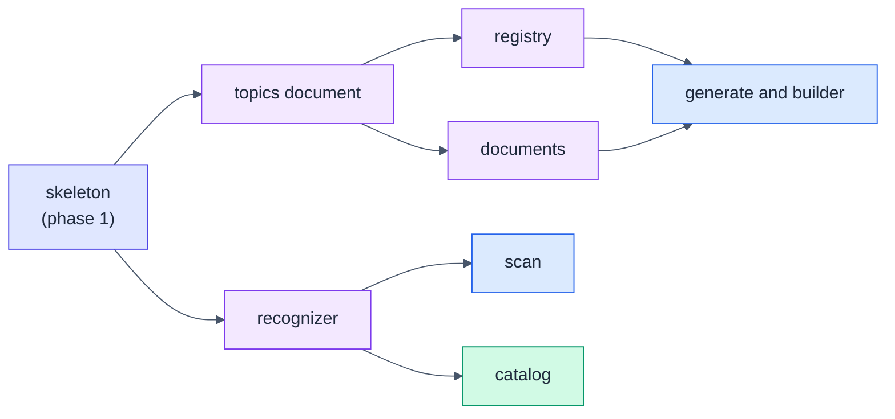
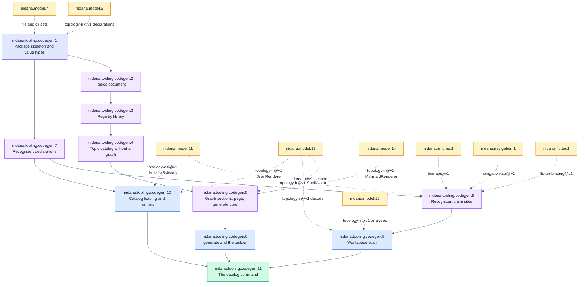

# nidana.tooling.codegen: Codegen, Catalog and Workspace Scan

- **Kind:** leaf-parent
- **Purpose:** everything `nidana_dart_codegen` does: the topics document and the registry library through the builder and `generate`, the topic catalog and the graph page, the topology catalog `catalog` with the registration mechanism it loads, and the workspace scan with the claim recognizer `catalog` shares
- **Owns:**
  - package `nidana_dart_codegen` (ADR-002 items 3 and 8): its `pubspec.yaml`, `build.yaml`, `lib/builder.dart` and the executables `generate`, `catalog` and `scan` under `bin/`
  - every artifact of topic-codegen@v1: decoding and checking `topics.yaml` (its schema and R1 to R4), the registry library, the builder `nidana_dart_codegen:topics`, `generate`, `topics.md`, `topology-graph.html`, `topology-graph.json` and `catalog` (Spec §4.5, §4.6, §6.5; Guide C.2 to C.4)
  - the registration library form `catalog` loads, the entry point it generates and the two runners it uses (D1; Spec §6.5)
  - the claim recognizer and the topic declarations it finds, in one package-internal library both commands call (D2; Spec §3.11)
  - the workspace scan: topic name uniqueness (Spec §4.3), single-writer (Spec §3.11 layer 2), cycles and self-reference (Spec §3.8), scope compatibility (Spec §7.2), as reports of topology-ir@v1's analyses, with its line form and exit codes
  - nidana-checks@v1's scan host: G3 for the scan, G9 to G18 (nidana.tooling D2)
- **Does not own:** the plugin rules (nidana.tooling.lint); the analyses, renderers, decoder and recorder it calls (nidana.model, root D4); the topologies and claims an app declares, and its registration library
- **Consumes:** [topic-model@v1, topology-dsl@v1, topology-ir@v1, bus-api@v1, navigation-api@v1, flutter-binding@v1]
- **Produces:** [topic-codegen@v1, nidana-checks@v1]
- **Governed by:** [ADR-001, ADR-002]
- **Sources:**
  - `ref/nidana-docs/arch/nidana-bus-ref-arch-spec-v0_15_0.md` §3.8, §3.11, §4.3 to §4.6, §6.5, §7.2, §9.2
  - `ref/nidana-docs/arch/nidana-bus-ref-arch-guide-v0_15_0.md` §5.2, Appendix C.1 to C.5
- **Decomposes into:** phases (see hsdd-phase-plan)
- **Isolation strategy:** the pure slices are tested by direct calls over topic-codegen@v1's `valid/`, `invalid/`, `rejected/` and `input/` documents; every producing phase replays topic-codegen@v1 (schema, file replay, recorded invocations) and nidana-checks@v1's `scan-*` recorded invocations, restricted by `--guarantee` to what has been delivered (ADR-001 item 10; nidana.tooling D2); the recognizer is tested over fixture packages; `catalog` runs over fixture packages with registration libraries, its document is decoded and schema-checked and its claims compared with the scan's over the scan cases' packages (topic-codegen@v1 G20, G21; nidana-checks@v1 G18); nothing runs a bus

## Overview

This node is the half of nidana.tooling that runs on the Dart VM: under build_runner, as `fvm dart run nidana_dart_codegen:{executable}` from a workspace or app root, and, for `catalog`, as a parent process of the runner that records an app's topologies. It turns two inputs an app writes, `topics.yaml` and its registration library, plus the app's sources, into the files topic-codegen@v1 fixes and the report nidana-checks@v1 fixes for the scan.

It is a leaf-parent (nidana.tooling D1): one package, owned by one node (ADR-002 item 3), whose two command families meet in the claim recognizer (D2). Its phase plan cuts the slices below.

## Inherited from nidana.tooling and the root

- The builder and `generate` call one pure function for the registry, so build_runner and the command write identical bytes (ADR-002 item 8; topic-codegen@v1 G11).
- The workspace resolves analyzer 13.3.0, build 4.0.11, source_gen 4.2.4, build_runner 2.16.1 and test 1.31.1 until a Flutter pin upgrade (ADR-002 Consequences); `dart_style` 3.1.14 formats at language 3.13 and `yaml` 3.1.4 reads the document (`docs/auto-run/experiments/topic-codegen-fixtures/`).
- The scan reports what topology-ir@v1's analyses find and implements none of them (root D4; nidana-checks@v1 Refinement 1).
- nidana-checks@v1 is produced with nidana.tooling.lint; this node delivers the scan's guarantees and replays the `scan-*` cases, its last producing phase all of them (nidana.tooling D2).
- The scan's cases resolve `nidana_dart_navigation` and `nidana_dart_runtime_flutter` statically, so their replays wait on those nodes' first phases (nidana.tooling D3).

## Contracts

| Contract | Direction | Counterpart | Edge type | What this node does with it |
|----------|-----------|-------------|-----------|-----------------------------|
| topic-model@v1 | consumes | nidana.model | shared-model | generated registries declare `StateTopic`, `EventTopic` and `ReplayTopic` values; `isWellFormedTopicName` checks generated names (G7) |
| topology-dsl@v1 | consumes | nidana.model | contract | the generated entry point calls `buildDefinition()` of each registered topology (D1) |
| topology-ir@v1 | consumes | nidana.model | contract | `generate` decodes the graph and renders it with `MermaidRenderer`; `catalog` builds `TopologyGraph` from definitions and `ShellClaim`s and renders it with `JsonRenderer`; the scan runs `analyzeTopologyGraph` and `findTopicNameCollisions` |
| bus-api@v1 | consumes | nidana.runtime | contract | `Bus.publisher` is a claim site, recognized by package and name (bus-api@v1 For static analysis) |
| navigation-api@v1 | consumes | nidana.navigation | contract | `NavigationExecutor` is a claim site |
| flutter-binding@v1 | consumes | nidana.flutter | contract | `PageScope` and `FlutterNavigationExecutor` are claim sites |
| topic-codegen@v1 | produces | nidana.integration (hard) | hard | every artifact |
| nidana-checks@v1 | produces, with nidana.tooling.lint | nidana.integration (hard) | hard | the scan host: G3 for the scan, G9 to G18 |

## Slices

Each slice is one or more libraries under `lib/src/`, reached by the others through the declarations its libraries expose; the executables under `bin/` and `lib/builder.dart` only parse arguments and call them. The phase plan cuts and orders phases along these slices; a phase may deliver one slice, part of one, or two small ones.

| Slice | Holds | Delivers | Needs |
|-------|-------|----------|-------|
| skeleton | the package and its pubspec within ADR-002 items 3 and 4; `build.yaml`; `lib/builder.dart` and the three executables with argument parsing and usage errors; the value types the other slices pass: the topics document model, positioned diagnostics, sites, report lines, unresolved findings | the usage halves of topic-codegen@v1 G19 and G21 and nidana-checks@v1 G16, once each command is wired | none |
| topics document | decoding `topics.yaml` with source positions; the schema's rules and R1 to R4, as one pure function from bytes to a document or its diagnostics | topic-codegen@v1 G1 (with the schema set) and the accept and reject decisions of G2 | skeleton |
| registry | the identifier rules, the import groups, the member declarations and the `DartFormatter` pass | topic-codegen@v1 G4 to G10 | topics document |
| documents | `topics.md` and `topology-graph.html` from a document and an optional decoded graph | topic-codegen@v1 G12, G13, G15, G16 | topics document; topology-ir@v1's decoder and Mermaid renderer |
| generate and builder | `generate` and the builder over the pure slices: reads, writes, exit codes, the builder's failure mode | topic-codegen@v1 G2, G3, G11, G14, G17 to G19 | registry, documents |
| recognizer | the analysis context over the given packages, application code, recognition by package and element name, topic declarations and the four claim sites with their write-set, scope and source rules, site and VM type-name rendering (D2) | nidana-checks@v1 G3 for the scan, G10 to G12 | skeleton |
| scan | the analysis graph from the document's topologies and the resolved claims, the two analyses over it and the declarations, the report's order, line form and escapes, exit codes | nidana-checks@v1 G9, G13 to G17 | recognizer; topology-ir@v1's analyses and decoder |
| catalog | the registration library (D1), the generated entry point and its two runners, the merge of the recorded definitions with the recognizer's claims, the rendering and exit codes | topic-codegen@v1 G20, G21; nidana-checks@v1 G18 | recognizer; topology-dsl@v1's recorder; topology-ir@v1's renderer and decoder |

topic-codegen@v1 G9, G10, G11 and G19's diagnostic form, and nidana-checks@v1 G9's "writes no file", G17 and G18, are not executable in their contracts and are checked by this node's gates (their Validation sections).

## Development flow

The node starts once nidana.model's first phase has merged (root D10). These constraints follow from the contracts and ADRs; everything else about the cut and order is the phase plan's:

- The skeleton is phase 1 (conventions, `fp-progression`). Neither produced contract declares a Dart library, so phase 1 lands the package, the executables and the internal value types; `structure` and `schema` replay in full from it on (ADR-001 item 10).
- Two lanes after the skeleton. The registry lane (topics document, registry, documents, then `generate` and the builder) needs only the model's first phase, except the replays that pass `--graph`, which need the model's decoder and Mermaid renderer. The workspace lane (recognizer, then scan and `catalog`) needs the model's analyses and recorder, and its `scan-*` replays that import `nidana_dart_navigation` and `nidana_dart_runtime_flutter` need those nodes' first phases.
- The pure parts precede their effects: the document check, the registry and document renderers, the recognizer's resolution rules over resolved AST nodes, the report's ordering and line form, and the entry point's text are pure functions of their inputs (conventions, `fp-progression`).
- `catalog` closes the plan: it composes the recognizer, the recorder, the runners and the renderer, and its gate checks G18 against the scan. The last phase producing each contract replays it unrestricted for this node's guarantees (nidana.tooling D2).

## Decisions

### D1: Topology registration for `catalog` (resolves OQ-T1)

1. **Registration.** A package registers its topologies in one library it writes at `tool/nidana_catalog.dart` under its root, which declares the top-level function `Iterable<Topology> catalogTopologies()`. `catalog` records `buildDefinition()` of every value it returns. A package without the file registers no topology; its claims still enter the document. `tool/` is pub's directory for a package's development scripts: the library is build-time configuration, outside the package's public API, and may import dev dependencies. It is application code for nidana-checks@v1 (not a test directory), so the scan and the plugin read it; it holds no claim site.
2. **Build-time configuration** (Spec §6.5's build-time DI). The function constructs each topology with the arguments it needs, in plain Dart: a class with a zero-argument constructor, a `topology(...)` value, or a factory given its dependencies, such as navigation-api@v1's `navResolver` given the app's pure functions. Transformer names in the definition come from those arguments (`docs/auto-run/experiments/catalog-loading/`, T1: `pricingTopology(flatRate)` records `flatRate`), so the static graph is the one activation checks (Spec §6.5) only when the registration passes what the app's bootstrap passes. The app keeps them equal by calling one factory from both; the amended contract says so.
3. **Loading.** For each package that has the file, `catalog` writes an entry point to `{package}/.dart_tool/nidana_dart_codegen/catalog_entry.dart`. It imports the registration library by relative path, since `tool/` has no `package:` URI, records each topology, and writes the definitions as a graph document to a path `catalog` passes as a define. `catalog` runs it from the package root:
   - with `dart run` of the SDK running `catalog`, when the registration library's transitive imports do not reach `dart:ui`;
   - with `flutter test --no-pub` of the Flutter SDK that holds that Dart SDK otherwise, as ADR-001 item 9 locates `flutter` for the replay tool. The entry's `main()` takes no parameters and declares no test; the Flutter tester runs it, writes the document and exits 79, "No tests ran" (T3), and needs no `flutter_test` dependency (T5).

   Both runners are the Dart VM in JIT mode (topic-codegen@v1 G20), and the Flutter tester records the same document as `dart run`: T4 recorded the domain package's registration under both, byte for byte. `catalog` decodes each document with `decodeTopologyGraph`, merges the definitions of every package with the recognizer's claims (D2), and renders the result with `JsonRenderer`. The entry point is removed after the run and is not part of topic-codegen@v1.
4. **Failures** are topic-codegen@v1's exit 1, "a registered topology cannot be loaded, constructed or recorded" (G21): the registration library does not compile, declares no `catalogTopologies` of that type, or reaches `dart:ui` with no Flutter SDK beside the Dart SDK; the runner exits with a code other than 0 under `dart run`, or other than 0 or 79 under the Flutter tester, or writes no document. A library `dart run` cannot load exits 254 and writes nothing (T2); a registration that throws exits 1 under the Flutter tester and writes nothing (T6). Each cause goes to stderr, and `catalog` writes nothing.
5. **Contract.** This node's phase plan emits `amend topic-codegen@v1`: the Interface bullet "Left to nidana.tooling's decomposition (OQ-T1)" becomes points 1 to 4, and G20's "every topology the packages register" points at them. Compatible: v1 left the form open, and no path, executable, argument, exit code or content rule changes. topology-dsl@v1 does not change.

Evidence: `docs/auto-run/experiments/catalog-loading/` (`run.sh`, `output.txt`), on the pinned SDK with the stand-in `nidana_dart_contracts` of `docs/auto-run/experiments/flutter-binding-fixtures/`: T1 `dart run` of the entry in a pure package, 2.6 s, exit 0; T2 the same in a package whose page library imports `package:flutter/widgets.dart`, exit 254 on `dart:ui`; T3 that package under `flutter test`, 5.6 s, exit 79, document written; T4 byte-identical documents from both runners; T5 a Flutter package without `flutter_test`; T6 a throwing registration, exit 1, nothing written; T7 `dart run --packages` from outside the package, the same document.

Alternatives considered:

- **An annotation, the `@Topology` registration of Spec §6.5.** Dart's `Topology` is topology-dsl@v1's abstract base class, so the annotation needs another name and a declaration in `nidana_dart_contracts` (an `amend topology-dsl@v1`), a builder that writes the entry point (a file layout in topic-codegen@v1), and, for a topology with dependencies, an annotated factory, which is the registration library with two more mechanisms. Marked for upstreaming: Spec §6.5 names a `@Topology` registration mechanism, which Dart cannot declare under that name; "a registration mechanism per platform" would cover this one.
- **A convention scan** that constructs every concrete public `Topology` subclass with a zero-argument constructor and every top-level `Topology` value. It still needs the library for topologies with dependencies, cannot reach private or local declarations from a generated entry point, and has to rule on a topology both found and listed. The signal that would favor it: an adopter whose registration lists drift. An unregistered topology is absent from the static graph, so the scan's checks miss its writes, and only the runtime rejects it at activation.
- **The Flutter tester for every package.** It needs the Flutter SDK for pure-Dart packages and takes about twice as long (T1, T3).
- **Recording inside `catalog`'s own process,** by isolate or import. `catalog` runs on `dart run`, which cannot load `dart:ui` (T2), and its own dependencies would join the app's resolution.

### D2: The claim recognizer is one package-internal library

The recognizer lives in one library under `lib/src/` of `nidana_dart_codegen` (`package:nidana_dart_codegen/src/recognizer.dart`), which `scan` and `catalog` both call, and neither command implements a recognition rule of its own. It holds application-code selection (nidana-checks@v1 Terms both hosts use), recognition by package and element name, topic declarations, the four claim sites with their write-set, scope and source rules and stand-in sources, site rendering and the VM's rendering of `typeName` (nidana-checks@v1 G10 to G12). It returns topology-ir@v1 values, `ShellClaim` and `TopicDeclaration`, and its own sealed family of unresolved findings, which the scan reports as `unresolved_claim` and `unresolved_topic_name` lines and `catalog` as stderr warnings (topic-codegen@v1 G21). It reads resolved syntax and runs nothing, so a library that imports Flutter is read like any other.

nidana-checks@v1 G18 (the document's claims are the scan's) then holds by construction, and this node's gates check it by running both commands over the scan cases' packages.

Alternatives considered: a public library of `nidana_dart_codegen`, which no consumer needs, since neither contract makes this package's libraries part of it and the plugin may not depend on the package (ADR-002 item 7); `nidana_dart_contracts`, whose only dependency is `meta` (ADR-002 item 4); a package of its own, which ADR-002 rejected for the scan.

### D3: The package's dependencies

`packages/nidana_dart_codegen/pubspec.yaml` declares, each at ADR-002 item 4's constraint:

- dependencies: `nidana_dart_contracts: ^0.1.0`, `analyzer: ^13.3.0`, `build: ^4.0.11`, `dart_style: ^3.1.14`, `path: ^1.9.1`, `pub_semver: ^2.2.1`, `yaml: ^3.1.4`;
- dev dependencies: `build_test: ^3.5.20`, `json_schema: ^5.2.2`, `test: ^1.31.1`.

1. **`pub_semver` is outside item 4's table.** dart_style 3.1.14's `DartFormatter` takes a required `languageVersion` of pub_semver's `Version`, and topic-codegen@v1 formats at language 3.13, so the registry renderer imports `package:pub_semver/pub_semver.dart` and the package declares it. Item 4's probe: one resolution of every item 3 row, item 7's pins and rxdart, with pub_semver added to the codegen stand-in, holds pub_semver 2.2.1 and every direct package at the table's version, 88 packages, the same count as without it, because it was already transitive; `^2.2.1` resolves from no lockfile with the codegen landing first, beside the plugin, and in the full set; and the formatter call compiles, formats and analyzes clean (`docs/auto-run/experiments/codegen-plan-facts/`, A1 to A3). A later member that declares pub_semver copies `^2.2.1` (ADR-002 item 4).
2. **`json_schema` is in the table.** nidana.tooling.codegen.11's tests validate `topology-graph.json` against `hsdd/contract/schema/topology-ir.schema.json`, the schema check topic-codegen@v1's Validation asks of this node's gates for G20. The replay tool's `expectMatchesSchema` is out of reach: `nidana_contract_check` is unpublished and carries no version (ADR-002 item 9), so no hosted constraint on it can be written (item 4).
3. **Not declared.** `source_gen`, which item 3's row names only for code that imports it: the builder reads YAML and generates nothing from Dart elements. `args`: each command takes at most one option besides positional arguments, and a pure parser of a few dozen lines states the usage errors the contracts list without a dependency.
4. **One phase writes the list.** nidana.tooling.codegen.1 declares every dependency above, so no later phase edits the pubspec or the root lockfile (ADR-002 Consequences: a member-creating phase copies item 4's table).

Alternatives considered: `args`, which is in the table and would cost only this decision's line (the signal that would favor it: a command gaining options beyond `--graph`); checking G20 by decoding alone and relying on topology-ir@v1 G19, that `JsonRenderer` output validates (no dev dependency, but topic-codegen@v1's Validation names a schema check by this node's gates); adding each dependency in the phase that first imports it (every such phase would edit the pubspec and the lockfile, and meet every other node's member-creating merge on the lockfile).

### D4: catalog's runners in practice (refines D1 point 3)

`docs/auto-run/experiments/codegen-plan-facts/` (part B, `run.sh`, `output.txt`) ran D1's entry point on the pinned SDK from fixture packages inside and outside a workspace.

1. **The Flutter tester needs `flutter_test` or `test` in the package's resolution.** A package resolved alone with neither is refused ("cannot run without a dependency on either package:flutter_test or package:test", B11), and runs once it declares `flutter_test` as a dev dependency: exit 79, document written (B13). D1 point 3's "needs no `flutter_test` dependency (T5)" holds where the resolution already holds `flutter_test`, as `catalog-loading`'s workspace did through another member and as this repository's does through `nidana_dart_runtime_flutter`. `catalog` reports the refusal as it reports any runner failure: exit 1, the tester's output on stderr (D1 point 4). The amendment of topic-codegen@v1 states the requirement.
2. **The Flutter tester needs the package inside a resolution.** Run from a package below a workspace member that pub never resolved, it crashes (B4), and it crashes the same way with a synthesized package configuration (B9). `dart run` runs from such a package through the workspace's package configuration (B1 to B3).
3. **This node's runner tests** build their fixture packages in temporary directories, from sources the tests hold, and resolve each alone with `pub get --offline` of the `dart` running the tests, or of the `flutter` of its SDK for a Flutter package, with `nidana_dart_contracts` overridden by path (ADR-002 Q18) and, for a Flutter package, `flutter_test` as a dev dependency (B12, B13). The workspace's resolution has put every needed package in the pub cache, so no test reaches the network. A registration library may then import its own package by `package:` URI, which an unresolved package cannot do (B6).
4. **catalog over nidana-checks@v1's scan cases runs in place.** Their packages hold no registration library, so no runner starts and nothing is written under `hsdd/`.

Alternatives considered: fixture packages under the member's `test/` (the root analyze reads them, B7, so a registration that does not compile or that throws cannot sit there, ADR-002 Consequences, and the Flutter tester does not run from them, B4); a synthesized package configuration (`dart run` first attempts and fails a resolution, B8, and the Flutter tester still crashes, B9); leaving the Flutter runner to nidana.integration's example app (the runner is this node's D1, and no gate of this node would then start the tester).

### D5: Source layout and seeded sources

1. **Layout.** One directory per slice under `lib/src/`, so phases of the two lanes edit disjoint files: `cli/` (the argument parsers), `topics/` (the document model, the document check, the identifier rules), `registry/`, `documents/` (Markdown, the topic catalog, the graph page), `generate.dart` (the one function the builder and `generate` call, ADR-002 item 8), `recognizer.dart` with its parts under `recognizer/` (one library, D2), `scan/`, `catalog/`. `lib/builder.dart` and `bin/generate.dart`, `bin/scan.dart`, `bin/catalog.dart` only parse arguments, call into `lib/src/` and map results to files, streams and exit codes. `test/support/` holds the workspace-root finder, the nearest ancestor of the working directory that holds `hsdd/contract/` (nidana.model D6's rule), written by nidana.tooling.codegen.1 for both lanes.
2. **Seeded sources never sit in the member's analyzed code** (ADR-002 Consequences). The root analyze reads packages nested under a member's `test/` and resolves their imports through the workspace (`docs/auto-run/experiments/codegen-plan-facts/` B7), so a seeded violation there fails the default gate. Recognizer and scan tests write their fixture packages, from sources the tests hold, into temporary directories with a package configuration that maps the workspace's packages by absolute root plus the fixture package itself; the analyzer resolves such a package against the real packages with no diagnostic (B10). They read nidana-checks@v1's scan cases' packages in place, under `hsdd/`, which the root analyze excludes. catalog's runner fixtures follow D4.
3. **No stand-in declarations.** A fixture that exercises a claim site imports the producer's real package (`nidana_dart_runtime`, `nidana_dart_navigation`, `nidana_dart_runtime_flutter`), never a library of the same name written for the test (root D10; ADR-001 item 11 keeps stand-ins for implementations bound to a conformance suite). The claim-site phase therefore waits on nidana.runtime.1, nidana.navigation.1 and nidana.flutter.1, which land those declarations (their contracts' Delivery paragraphs).
4. **One committed generated library.** `test/golden/topics.g.dart` sits beside the topics document and the types library it is generated from. The root analyze checks it under the root lint set, the strict modes and `--fatal-infos`, the default gate's format check checks it, and a test checks that the renderer still writes its bytes: topic-codegen@v1 G9 and G10 as this node's gates check them.

Alternatives considered: in-memory analyzer overlays (nothing written, but the recognizer would take a resource provider only tests use, and catalog's runners need files anyway); stand-in libraries carrying nidana's package names, as nidana.tooling.lint's rule tests use (the claim-site phase could start before nidana.flutter.1, but its tests would check recognition against declarations no producer wrote; the signal that would favor it: nidana.flutter.1 landing late enough to hold this node's workspace lane); a member options file excluding the fixtures (ADR-002 item 2 allows a member options file only to add rules).

## Carried into the phase plan

- `amend topic-codegen@v1`: the registration mechanism (D1, point 5).
- `amend nidana-checks@v1`, editorial: its Boundary row "How `catalog` obtains the topologies of a package (OQ-T1), and how nidana.tooling's children divide the two hosts" now points at nidana.tooling D1 and D2 and this node's D1.
- `confirm nidana-checks@v1 produced_by` with this node's producing phases, complementary to nidana.tooling.lint's (nidana.tooling D2), and `confirm topic-codegen@v1 produced_by`.

## Phase Plan

**Default gate:** `fvm dart pub get --enforce-lockfile && fvm dart analyze --fatal-infos && fvm dart format --output=none --set-exit-if-changed packages/nidana_dart_codegen && fvm dart test packages/nidana_dart_codegen && fvm dart run nidana_contract_check --all --set structure`

| Phase | Name | Tier | Size | Depends on |
|------:|------|------|------|------------|
| nidana.tooling.codegen.1 | Package skeleton and value types | gate-only | ~380 loc, ≤6 tasks | nidana.model.5, nidana.model.7 |
| nidana.tooling.codegen.2 | Topics document | spot-check | ~420 loc, ≤7 tasks | nidana.tooling.codegen.1 |
| nidana.tooling.codegen.3 | Registry library | spot-check | ~300 loc, ≤6 tasks | nidana.tooling.codegen.2 |
| nidana.tooling.codegen.4 | Topic catalog without a graph | spot-check | ~300 loc, ≤5 tasks | nidana.tooling.codegen.3 |
| nidana.tooling.codegen.5 | Graph sections, graph page and generate core | spot-check | ~300 loc, ≤6 tasks | nidana.tooling.codegen.4, nidana.model.13, nidana.model.14 |
| nidana.tooling.codegen.6 | generate and the builder | full-review | ~380 loc, ≤7 tasks | nidana.tooling.codegen.5 |
| nidana.tooling.codegen.7 | Recognizer: application code and topic declarations | full-review | ~380 loc, ≤6 tasks | nidana.tooling.codegen.1 |
| nidana.tooling.codegen.8 | Recognizer: claim sites | full-review | ~400 loc, ≤7 tasks | nidana.tooling.codegen.7, nidana.model.11, nidana.runtime.1, nidana.navigation.1, nidana.flutter.1 |
| nidana.tooling.codegen.9 | Workspace scan | full-review | ~420 loc, ≤7 tasks | nidana.tooling.codegen.8, nidana.model.12, nidana.model.13 |
| nidana.tooling.codegen.10 | Catalog loading and runners | full-review | ~400 loc, ≤7 tasks | nidana.tooling.codegen.7, nidana.model.11, nidana.model.13 |
| nidana.tooling.codegen.11 | The catalog command | full-review | ~300 loc, ≤6 tasks | nidana.tooling.codegen.6, nidana.tooling.codegen.9, nidana.tooling.codegen.10 |

Ordering policy: `fp-progression` (`hsdd/conventions.md`). Types: nidana.tooling.codegen.1. Pure functions: nidana.tooling.codegen.2 to .5 in the registry lane; nidana.tooling.codegen.7 and .8 in the workspace lane, whose rules are pure functions over resolved units and whose one effect, the read-only analysis context that yields those units, lands with .7 because no rule can be tested without it. Effects: nidana.tooling.codegen.6 (`generate`, the builder), .9 (the scan, a pure report under a shell of about fifty lines, kept in one phase because the two halves fit one review sitting and the report has no other consumer) and .10 (catalog's runners). Composition: nidana.tooling.codegen.11, the imperative shell that composes the recognizer, the runners and the renderer and checks nidana-checks@v1 G18 against the scan. No pure phase depends on an effect phase, and the two lanes share only nidana.tooling.codegen.1.

- **Two lanes.** The registry lane (nidana.tooling.codegen.2 to .6) needs nothing beyond nidana.model.5 and nidana.model.7 up to nidana.tooling.codegen.4; nidana.tooling.codegen.5 waits on nidana.model.13 and nidana.model.14 for the graph forms, so .2 to .4 can merge while the model's behavior phases are still running. The workspace lane (.7 to .11) needs nidana.model.11 and later, and the claim-site phase needs nidana.runtime.1, nidana.navigation.1 and nidana.flutter.1 (D5 point 3); .10 runs beside .8 and .9. The lanes edit disjoint files (D5 point 1).
- **What each gate replays** (ADR-001 items 9 and 10). A guarantee counts as delivered by the phase whose gate first replays it, as the producers' Delivery paragraphs read it, so phases that implement a slice whose cases need a later command restrict to what their dependency closure already replays. For topic-codegen@v1 that is `--guarantee G1` until .6: G1 holds by the schema set from .1, and no file replay or recorded invocation covers G1 alone, so none runs. For nidana-checks@v1 it is `--set structure` at .7 and .8: no scan guarantee is observable before the scan command at .9, and `structure` is the only set that contract runs in full. A lane restricts to its own closure (nidana.model D5's rule), so .10 replays topic-codegen@v1 with G1 whether or not .6 has merged.
- **nidana-checks@v1's share** (nidana.tooling D2; ADR-001 item 10 as amended). Every `scan-*` case covers ids within G3 and G9 to G17, and every `analyze-*` case covers G1 or G8, outside this node's share; so .9's restriction runs every `scan-*` case and no `analyze-*` case, and .11's whole-share restriction runs the same cases with G18, which has none. Checked by reading against the contract's Validation table, as ADR-001's Consequences ask of a planner of such a contract.
- **Sizing floor.** No adjacent same-tier pair is a merge candidate: .2 and .3, .3 and .4, .4 and .5, .6 and .7, .7 and .8, .8 and .9, .9 and .10, and .10 and .11 would each exceed one PE merged (condition iv), and all but .6 and .7 and .8 and .9 also differ in consumed contracts.
- **No textual contention inside the plan.** nidana.tooling.codegen.1 alone edits the root `pubspec.yaml` workspace list and `pubspec.lock`, and it declares every dependency of the package (D3), so no later phase edits the member's pubspec or the lockfile. A phase that extends a file (.3 the document check of .2; .5 the documents of .4; .8 the recognizer of .7; .11 the catalog library of .10; .6, .9 and .11 the bodies .1 left in `lib/builder.dart` and `bin/`) depends on the phase that wrote it. The workspace list is shared with other nodes' member-creating phases (governance note below).
- **Function references.** No phase compares a catalog graph with a runtime graph. catalog's tests check documents against expectations written in the tests for fixture topologies whose transformers are public, because a private transformer renders as `_name@{key}` with the VM's library key, which differs between the JIT recording and an AOT build (topology-ir@v1 G9; `docs/auto-run/experiments/navigation-g13-coverage/` T7); the amendment below says so in topic-codegen@v1.

### Phase dependency graph

Purple: pure phases; blue: effect phases; green: the composing phase; amber: other nodes' phases, joined by dashed edges labeled with what is needed from them.

### nidana.tooling.codegen.1: Package skeleton and value types

- **Consumes:** [topology-ir@v1]
- **Produces:** [topic-codegen@v1]
- **Governed by:** [ADR-001, ADR-002]
- **Scope:** creates `packages/nidana_dart_codegen` (ADR-002 items 3, 5, 8 and 9): `pubspec.yaml` with `version: 0.1.0`, `environment: sdk: ^3.13.0`, `resolution: workspace` and every dependency of D3 at its constraint; `build.yaml` holding exactly the builder entry topic-codegen@v1's The builder shows; `README.md`, `CHANGELOG.md` and a copy of the repository's `LICENSE`, written once. Adds `packages/nidana_dart_codegen` to the root `pubspec.yaml` workspace list (one line, in path order) and commits the root `pubspec.lock` that `fvm dart pub get` resolves (conventions, Shared workspace files). Lays out `lib/src/` by D5 point 1 and lands the immutable value types the slices pass, as sealed families where they are alternatives: the topics document (domains and topics in document order, the variant, the initial value as an expression, an integer, a float, a boolean or null, the optional arguments); a positioned diagnostic and its rendering `{path}:{line}:{column}: {message}`; the document check's result, an accepted document or its diagnostics; a site and its rendering `{path}:{line}:{column}`; a report line; the recognizer's result: topology-ir@v1 `TopicDeclaration` values, each resolved `ShellClaim` with its site, and the unresolved findings (a write set, a scope, a topic name), each at its site. Each slice's entry function gets its final signature and a body that throws `UnimplementedError`. `lib/builder.dart` declares `topicsBuilder`. `bin/generate.dart`, `bin/scan.dart` and `bin/catalog.dart` parse their arguments with pure parsers into parsed arguments or a usage error, and exit 2 with the problem and the usage line on stderr for a wrong count of positional arguments (`generate`: not two; `scan`: none; `catalog`: fewer than two), an unknown option, and `--graph` (of `generate` and `scan`) without a value or given twice; every other path reaches a body that throws. `test/support/` gets the workspace-root finder (D5 point 1). `test/package_properties_test.dart` checks that the dependencies and dev dependencies are exactly D3's at D3's constraints, and that no library under `lib/` imports a workspace member other than `nidana_dart_contracts` (ADR-002 item 4).
- **Size estimate:** ~16 files (~380 lines), <= 6 plan tasks
- **Gate:** node default plus contract replay for topic-codegen: `fvm dart run nidana_contract_check topic-codegen --guarantee G1` (`structure` and `schema` in full; no file replay or recorded invocation covers G1 alone, so none runs)
- **Verification:** the workspace resolves with the new member and `--enforce-lockfile` passes on the committed lockfile; each of the three executables, run from the workspace root with no argument, exits 2 and prints its usage line; `build.yaml` reads as the contract's text.
- **Review tier:** gate-only
- **Dependencies:** nidana.model.5, where topology-ir@v1's declarations complete the main library, the phase a consumer of topology-ir@v1 waits on (topic-model@v1 and topology-ir@v1 Delivery); nidana.model.7, which lands the replay tool's `file` and `cli` sets that every topic-codegen@v1 replay runs (conventions, replay-tool bullet).

### nidana.tooling.codegen.2: Topics document

- **Consumes:** none
- **Produces:** [topic-codegen@v1]
- **Governed by:** [ADR-001, ADR-002]
- **Scope:** `lib/src/topics/`: the document check, one pure function from a topics document's text to the check's result. It reads exactly one YAML document with `package:yaml`, keeping source spans, and applies every rule of topic-codegen@v1's The topics document: the keys allowed and required at each level, each value's form (the domain and topic key patterns, a one-line owner and type, the import URI forms and their distinctness, the variant-dependent `initial`, `dedup` and `buffer-size` rules, the forms of the initial value), the defaults, R1 (one document, no repeated key in any mapping, valid YAML) and R4 (a finite number as `initial`). Each diagnostic carries the 1-based line and column of the offending node: the key of an unknown or repeated key, the value of a malformed one, the mapping that lacks a required key, the position `package:yaml` reports for a syntax error or a second document. Tests read the fixture tree from the workspace root: every `valid/` document and `input/topics.yaml` is accepted (the cases are JSON, which YAML reads as the same document), every `invalid/` document is rejected, so are the six `rejected/` documents of R1 and R4 (the four of R2 and R3 are nidana.tooling.codegen.3's), and the positions of a sample of diagnostics are pinned.
- **Size estimate:** ~5 files (~420 lines), <= 7 plan tasks
- **Gate:** node default plus contract replay for topic-codegen: `fvm dart run nidana_contract_check topic-codegen --guarantee G1`
- **Verification:** a copy of `input/topics.yaml` with a misspelt `sensitve`, a repeated topic key and `initial: .inf` yields one diagnostic for each, at the line and column an editor shows for that node.
- **Review tier:** spot-check
- **Dependencies:** nidana.tooling.codegen.1 (the document model, the diagnostic and the check's result type, the workspace-root finder).

### nidana.tooling.codegen.3: Registry library

- **Consumes:** [topic-model@v1]
- **Produces:** [topic-codegen@v1]
- **Governed by:** [ADR-001, ADR-002]
- **Scope:** the identifier rules in `lib/src/topics/` (the registry class of a domain, the member of a topic key), with R2 (two domains with one class name, two topics of one domain with one member name) and R3 (Dart's 33 reserved words, `hashCode`, `runtimeType`, `toString`, `noSuchMethod`) added to the document check, so all ten `rejected/` documents are rejected. `lib/src/registry/`: the pure registry renderer: the two header lines; the nidana import once and every domain import, grouped (`dart:`, `package:`, relative) and each group sorted by `String.compareTo`; one `abstract final class` per domain with its doc comment; one `static final` member per topic with its description as doc comment lines and its arguments in the contract's order, an argument only where it differs from topic-model@v1's defaults; the angle-bracket escape outside code spans (G16); the whole text through `DartFormatter(languageVersion: Version(3, 13, 0))` (D3). Tests: the renderer's output for `input/topics.yaml` equals `expected/topics.g.dart` byte for byte; identifier, collision, reserved-word and escape cases; `test/golden/` by D5 point 4: a topics document whose types live in a library beside it, covering every variant, every initial form, the three import groups, a description with an angle bracket and each non-default argument, with its generated `topics.g.dart` committed and a test that the renderer still writes those bytes.
- **Size estimate:** ~7 files (~300 lines; the committed golden is generated and not counted), <= 6 plan tasks
- **Gate:** node default plus contract replay for topic-codegen: `fvm dart run nidana_contract_check topic-codegen --guarantee G1`
- **Verification:** the golden registry reads as Spec §4.2 and Guide C.3 show a registry (`AuthTopics.state`, every type written out, no topology identifier, Spec §4.6), and the root analyze passes over it with `--fatal-infos`.
- **Review tier:** spot-check
- **Dependencies:** nidana.tooling.codegen.2 (the document check it extends); topic-model@v1's declarations, which the golden library compiles against, at nidana.model.5 through nidana.tooling.codegen.1.

### nidana.tooling.codegen.4: Topic catalog without a graph

- **Consumes:** none
- **Produces:** [topic-codegen@v1]
- **Governed by:** [ADR-001, ADR-002]
- **Scope:** `lib/src/documents/`: the Markdown primitives (a code span's fence one backtick longer than the text's longest run of backticks, with one space of padding when the text begins or ends with a backtick or begins and ends with a space; table cells with `|` escaped and line breaks as spaces; description lines; nidana.tooling.codegen.3's angle-bracket escape) and `topics.md` for a document without a graph: the two header comments, the title, the summary with its no-graph sentence and singular counts, the domain table, and per domain and per topic the sections and property rows topic-codegen@v1's The topic catalog lists, without `Written by` and `Read by`. Tests: for `input/topics.yaml` the catalog equals `invocation/generate-no-graph/expected/topics.md` byte for byte; code-span, cell and count cases.
- **Size estimate:** ~4 files (~300 lines), <= 5 plan tasks
- **Gate:** node default plus contract replay for topic-codegen: `fvm dart run nidana_contract_check topic-codegen --guarantee G1`
- **Verification:** the catalog of `input/topics.yaml` renders in a Markdown viewer with every table intact, code spans that hold backticks shown whole, and escaped angle brackets shown as text.
- **Review tier:** spot-check
- **Dependencies:** nidana.tooling.codegen.3 (class and member names, the escape).

### nidana.tooling.codegen.5: Graph sections, graph page and generate core

- **Consumes:** [topic-model@v1, topology-ir@v1]
- **Produces:** [topic-codegen@v1]
- **Governed by:** [ADR-001, ADR-002]
- **Scope:** completes `lib/src/documents/` with the graph form of `topics.md`: the graph header comment and summary sentence; `Written by` and `Read by` per topic, matched by name (topologies, then claims, each in graph order, as the source's rendering of topic-model@v1 G17 in a code span followed by its scope); the `## Topologies`, `## Shell claims` and `## Topics outside topics.yaml` sections, or `None.`. And `topology-graph.html`: the page template, the counts with singular forms, and `const MermaidRenderer().render(graph)` with `&`, `<` and `>` escaped. Adds `lib/src/generate.dart`, the pure core: from the topics document's text and path and an optional graph document's text and path, the outputs by file name, or the diagnostics (`{path}:{line}:{column}: {message}` for the topics document; `{path}: {message}` for a graph that is not JSON or that `decodeTopologyGraph` rejects with `FormatException`, topology-ir@v1 G21), and from the same function the registry alone for the builder (ADR-002 item 8; topic-codegen@v1 G11). Tests: the core's outputs for `input/` equal `expected/` byte for byte; without a graph they equal `invocation/generate-no-graph/expected/` and hold no page; the graph of `generate-graph-undecodable` yields one graph diagnostic; the page's `<pre>` text, unescaped, equals topology-ir@v1's `render/checkout.mmd`, the rendering of the same graph (G15).
- **Size estimate:** ~5 files (~300 lines), <= 6 plan tasks
- **Gate:** node default plus contract replay for topic-codegen: `fvm dart run nidana_contract_check topic-codegen --guarantee G1`
- **Verification:** the page generated from `input/` shows the checkout graph when opened in a browser with network, and its Mermaid text without network.
- **Review tier:** spot-check
- **Dependencies:** nidana.tooling.codegen.4 (the catalog it completes); nidana.model.13 (`decodeTopologyGraph`, topology-ir@v1 G19 to G21) and nidana.model.14 (`MermaidRenderer`, G22), per topology-ir@v1 Delivery; the sources' rendering (topic-model@v1 G17, nidana.model.8) precedes both.

### nidana.tooling.codegen.6: generate and the builder

- **Consumes:** [topic-model@v1, topology-ir@v1]
- **Produces:** [topic-codegen@v1]
- **Governed by:** [ADR-001, ADR-002]
- **Scope:** `bin/generate.dart` over nidana.tooling.codegen.5's core: exit 2 for a missing topics or graph file and for an `<output>` that is a file or cannot be written, leaving such a file unchanged; exit 1 with each diagnostic on stderr and nothing written; otherwise `<output>` created with its parents and the outputs written, replacing files of those names and touching nothing else. `lib/builder.dart`: `topicsBuilder` reads `lib/topics.yaml` and writes `lib/topics.g.dart` with the core's registry, and for a rejected document logs each diagnostic at severe level and fails the build, writing nothing. Tests: `generate` and the builder (through `build_test`) accept and reject alike every `valid/`, `invalid/` and `rejected/` document and `input/topics.yaml`, and the builder writes `generate`'s bytes (G2, G11); `build.yaml` holds the builder key, input, output, `auto_apply: dependents` and `build_to: source` (G11); `dart format`, run by the `dart` running the tests, changes no byte of `generate`'s output for any accepted fixture document (G9); two runs from different working directories, with relative and with absolute paths, write the same bytes (G17); diagnostics take the form `{path}:{line}:{column}: {message}`, and a file given as `<output>` is unchanged after the usage error (G19); every generated topic name satisfies `isWellFormedTopicName` (G7). The gate replays the file replay and the seventeen recorded invocations.
- **Size estimate:** ~6 files (~380 lines), <= 7 plan tasks
- **Gate:** node default plus contract replay for topic-codegen: `fvm dart run nidana_contract_check topic-codegen --guarantee G1,G2,G3,G4,G5,G6,G7,G8,G9,G10,G11,G12,G13,G14,G15,G16,G17,G18,G19`
- **Verification:** in a scratch package outside the workspace that depends on `nidana_dart_codegen` by path, with the nidana packages it reaches overridden (ADR-002 Q18), and holds `lib/topics.yaml`, `fvm dart run build_runner build` writes `lib/topics.g.dart` equal to `generate`'s output, and a broken document fails the build with positioned diagnostics.
- **Review tier:** full-review
- **Dependencies:** nidana.tooling.codegen.5 (the core, and through it nidana.model.13, nidana.model.14 and nidana.model.8, whose `isWellFormedTopicName` the G7 test calls).

### nidana.tooling.codegen.7: Recognizer: application code and topic declarations

- **Consumes:** [topic-model@v1, topology-ir@v1]
- **Produces:** [nidana-checks@v1]
- **Governed by:** [ADR-001, ADR-002]
- **Scope:** creates `lib/src/recognizer.dart` (D2): the analysis context over the given package roots (`AnalysisContextCollection` of analyzer 13.3.0, read-only, the only IO); application code (the Dart files the analyzer analyzes under each root, as its analysis options' `exclude` decides, outside `test/`, `integration_test/`, `test_driver/` and `testing/`; a file reached through two roots read once); recognition by package and element name (an element named `X` declared in a library whose URI is `package:P/...`, `lib/src/` included; `Bus` with every subclass); topic creations of `nidana_dart_contracts` and their value types, written or inferred; topic declarations, each top-level variable or static field whose initializer is a topic creation: a `TopicDeclaration` for a string-literal name without interpolation, otherwise an unresolved topic name, both at the site of the variable's name (nidana-checks@v1 G10); `typeName` as the VM renders `'$T'`, the analyzer's display string except for a function type, rendered `({parameters}) => {return}` (nidana-checks@v1 Topic declarations); sites relative to a given working directory with `/` separators, absolute outside it (G17). The rules are pure functions over resolved units. Tests by D5 point 2: temporary fixture packages for each declaration form, a test directory, an excluded file, a same-named declaration of another package and a function type, and `scan-topic-name-collision`'s packages in place. They compare declarations by name, variant, type name and site, because topic-model@v1 and topology-ir@v1 values compare by identity until nidana.model.8 and later phases deliver equality (their Delivery).
- **Size estimate:** ~5 files (~380 lines), <= 6 plan tasks
- **Gate:** node default plus contract replay for nidana-checks: `fvm dart run nidana_contract_check nidana-checks --set structure` (no scan guarantee is replayable before nidana.tooling.codegen.9 runs the scan command)
- **Verification:** over `scan-topic-name-collision`'s two packages, the recognizer finds every declaration that case's stdout names, with the type names it shows, the generated registry's among them, and none from `test/`.
- **Review tier:** full-review
- **Dependencies:** nidana.tooling.codegen.1 (the recognizer's result types, the workspace-root finder); topic-model@v1's and topology-ir@v1's declarations at nidana.model.5, through it (`TopicDeclaration` and `TopicRef` have const constructors).

### nidana.tooling.codegen.8: Recognizer: claim sites

- **Consumes:** [topic-model@v1, topology-ir@v1, bus-api@v1, navigation-api@v1, flutter-binding@v1]
- **Produces:** [nidana-checks@v1]
- **Governed by:** [ADR-001, ADR-002]
- **Scope:** extends `lib/src/recognizer.dart` with nidana-checks@v1's four claim sites: an invocation of `publisher` on `Bus` of `nidana_dart_runtime` or a subclass (bus-api@v1 For static analysis), creations of `PageScope` and `FlutterNavigationExecutor` of `nidana_dart_runtime_flutter`, and creations of `NavigationExecutor` of `nidana_dart_navigation`. For each: the write-set rule (a set literal whose every element names a top-level variable or static field initialized by a `StateTopic` creation with a string-literal name without interpolation, in any library the package resolves), the scope rule, the source rule with its defaults (`application`; `navigation`; `flutter-navigation`) and the stand-in that names the site when a source does not resolve; a site with no write set or an empty set literal claims nothing; an unresolved write set, else an unresolved scope, is an unresolved finding at the site; each resolved claim is a `ShellClaim` with its site. Tests by D5: temporary fixture packages that import the real `nidana_dart_runtime`, `nidana_dart_navigation` and `nidana_dart_runtime_flutter` and cover every form the contract lists as resolving or not, and the scan cases' packages in place, whose claims and unresolved sites are those their recorded stdouts imply.
- **Size estimate:** ~4 files (~400 lines), <= 7 plan tasks
- **Gate:** node default plus contract replay for nidana-checks: `fvm dart run nidana_contract_check nidana-checks --set structure`
- **Verification:** for `scan-unresolved-claim`'s package the recognizer reports the seven sites that case's stdout shows, each as a write set or a scope that does not resolve; for `scan-writer-conflict`'s, the two stand-in sources.
- **Review tier:** full-review
- **Dependencies:** nidana.tooling.codegen.7 (the recognizer it extends); nidana.model.11 (`ShellClaim`'s constructor orders its writes, topology-ir@v1 Delivery); nidana.runtime.1, nidana.navigation.1 and nidana.flutter.1, which land the declarations the fixtures import (bus-api@v1, navigation-api@v1 and flutter-binding@v1 Delivery; D5 point 3).

### nidana.tooling.codegen.9: Workspace scan

- **Consumes:** [topic-model@v1, topology-ir@v1, bus-api@v1, navigation-api@v1, flutter-binding@v1]
- **Produces:** [nidana-checks@v1]
- **Governed by:** [ADR-001, ADR-002]
- **Scope:** `lib/src/scan/`: the analysis graph (the graph document's topologies, none without `--graph`, never its claims; every resolved claim) and, as a pure function of the findings of `analyzeTopologyGraph` over it, of `findTopicNameCollisions` over the declarations, of the claims' sites and of the unresolved findings, the report nidana-checks@v1's Output states: error lines first (the collisions by name, then the graph's findings in that function's order) with the table's codes and messages; writers and owners rendered `topology:{id}`, `{source} at {site}`, or the stand-in source alone, claims with equal sources matched to their sites in site order; then the warning lines by site path, line and column; each field's `\`, `|` and line-break escapes; exit 1 with an error line, else 0. `bin/scan.dart`, the shell: exit 2 for a `<package>` that holds no `pubspec.yaml` and for a graph that cannot be read, is not JSON or does not decode, printing nothing on stdout; otherwise the report on stdout; no file written. Tests: each message form with its singular and list cases, the order and the escapes; runs over every `scan-*` case's `files/`, with that directory as the working directory the scan is given, reproduce its stdout and exit code; a scan writes no file (G9); two runs over one tree under different environment variables and times print the same report (G17).
- **Size estimate:** ~5 files (~420 lines), <= 7 plan tasks
- **Gate:** node default plus contract replay for nidana-checks: `fvm dart run nidana_contract_check nidana-checks --guarantee G3,G9,G10,G11,G12,G13,G14,G15,G16,G17` (every `scan-*` case and no `analyze-*` case)
- **Verification:** over a scratch package with a hand-seeded second writer of a state topic and a page-scoped owner read by an application-scoped topology, the scan prints the `writer_conflict` and `scope_violation` lines with the sites an editor shows, and exits 1.
- **Review tier:** full-review
- **Dependencies:** nidana.tooling.codegen.8 (the claims with their sites, the declarations, and through it the packages of nidana.runtime.1, nidana.navigation.1 and nidana.flutter.1 that the cases import); nidana.model.12 (the analyses, topology-ir@v1 G13 to G18) and nidana.model.13 (`decodeTopologyGraph`), per topology-ir@v1 Delivery.

### nidana.tooling.codegen.10: Catalog loading and runners

- **Consumes:** [topic-model@v1, topology-dsl@v1, topology-ir@v1]
- **Produces:** [topic-codegen@v1]
- **Governed by:** [ADR-001, ADR-002]
- **Scope:** `lib/src/catalog/`, D1 points 1, 3 and 4 with D4: per package, whether `tool/nidana_catalog.dart` exists, and whether its transitive imports reach `dart:ui`, read through nidana.tooling.codegen.7's analysis context; the entry point's text, a pure function (it imports the registration library by relative path, records `buildDefinition()` of every value `catalogTopologies()` returns, and writes `const JsonRenderer().render(TopologyGraph(topologies: definitions))` to the path its `OUT` define names); the runner, a sealed choice between `dart run -DOUT=...` with the `dart` running `catalog` and `flutter test --no-pub --dart-define=OUT=...` with the `flutter` of that SDK, located as ADR-001 item 9 locates it, each command line a pure function; the run from the package root with the entry at `{package}/.dart_tool/nidana_dart_codegen/catalog_entry.dart`, removed afterwards; the reading of the outcome (exit 0 under `dart run`, 0 or 79 under the tester, and a document written) and of the document with `decodeTopologyGraph`; a sealed load result: the definitions, none for a package without the file, or a failure carrying its cause. Tests: the entry text, the command lines and the outcome table as pure cases; temporary packages resolved alone (D4 point 3) for a pure registration under `dart run`, a registration reaching `dart:ui` under the Flutter tester, a Flutter package without `flutter_test` (refused, a failure), a registration that does not compile, one without `catalogTopologies`, one that throws, and a package without the file (no runner, nothing written). Fixture topologies name public transformers (the note on function references above).
- **Size estimate:** ~6 files (~400 lines), <= 7 plan tasks
- **Gate:** node default plus contract replay for topic-codegen: `fvm dart run nidana_contract_check topic-codegen --guarantee G1` (this lane's closure replays nothing more: G20 and G21 have no case)
- **Verification:** a registration reaching `dart:ui` records, under the Flutter tester, the definitions a pure registration of the same topologies records under `dart run` (`catalog-loading` T4), and a throwing registration leaves no entry point behind.
- **Review tier:** full-review
- **Dependencies:** nidana.tooling.codegen.7 (the analysis context, for the `dart:ui` closure); nidana.model.11 (`buildDefinition()` and `TopologyGraph`, topology-dsl@v1 and topology-ir@v1 Delivery) and nidana.model.13 (`JsonRenderer` and `decodeTopologyGraph`).

### nidana.tooling.codegen.11: The catalog command

- **Consumes:** [topic-model@v1, topology-dsl@v1, topology-ir@v1, bus-api@v1, navigation-api@v1, flutter-binding@v1]
- **Produces:** [topic-codegen@v1, nidana-checks@v1]
- **Governed by:** [ADR-001, ADR-002]
- **Scope:** `bin/catalog.dart` and the rest of `lib/src/catalog/`, the imperative shell: exit 2 for a `<package>` that does not exist or holds no `pubspec.yaml` and for an `<output>` that is a file or cannot be written; for each package, nidana.tooling.codegen.10's load and the recognizer's claims (nidana.tooling.codegen.8); exit 1, each cause on stderr and nothing written, for a load failure and for two unequal definitions sharing a `topologyId` (`TopologyGraph`'s `ArgumentError`, topology-ir@v1 G11); otherwise `<output>/topology-graph.json` as `const JsonRenderer().render(TopologyGraph(topologies: definitions, claims: claims))` and one warning on stderr per unresolved claim site, exit 0 (topic-codegen@v1 G20, G21). Tests: the document over two temporary packages (D4 point 3) decodes, validates against `hsdd/contract/schema/topology-ir.schema.json` through `package:json_schema` (D3), and holds the expected definitions and claims; two packages registering unequal topologies with one id exit 1 and write nothing; each usage error exits 2 and writes nothing; and nidana-checks@v1 G18: for each `scan-*` case with packages, `catalog` run with that case's `files/` as its working directory writes a document whose claims are the claims the recognizer resolves there, and warns about exactly the sites the scan, run there, reports `unresolved_claim`. The gate replays topic-codegen@v1 unrestricted, its last producing phase, and nidana-checks@v1 over this node's whole share.
- **Size estimate:** ~5 files (~300 lines), <= 6 plan tasks
- **Gate:** node default plus contract replays for topic-codegen and nidana-checks: `fvm dart run nidana_contract_check topic-codegen && fvm dart run nidana_contract_check nidana-checks --guarantee G3,G9,G10,G11,G12,G13,G14,G15,G16,G17,G18`
- **Verification:** over a scratch app, nidana-checks@v1's In CI sequence runs end to end (`catalog`, then `scan --graph` on its document, then `generate --graph`): the scan reports a seeded writer conflict between a registered topology and a publisher, and the page shows both writers.
- **Review tier:** full-review
- **Dependencies:** nidana.tooling.codegen.6 (`generate`, whose cases the unrestricted topic-codegen@v1 replay runs); nidana.tooling.codegen.9 (the scan, which the G18 check runs); nidana.tooling.codegen.10 (loading).

## Governance updates (pending reconcile)

> Reconciled 2026-10-18 by hsdd-reconcile. Drained entries are in git history.
