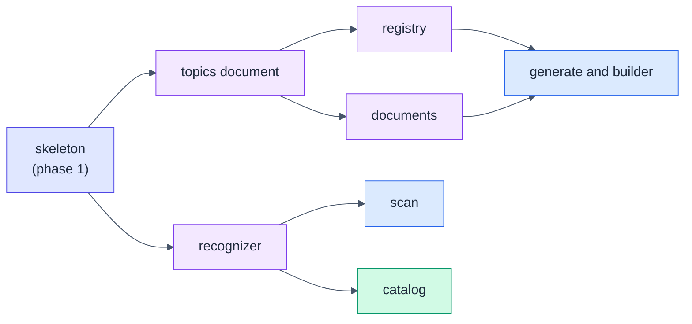

# nidana.tooling.codegen: Codegen, Catalog and Workspace Scan

- **Kind:** leaf-parent
- **Purpose:** everything `nidana_dart_codegen` does: the topics document and the registry library through the builder and `generate`, the topic catalog and the graph page, the topology catalog `catalog` with the registration mechanism it loads, and the workspace scan with the claim recognizer `catalog` shares
- **Owns:**
  - package `nidana_dart_codegen` (ADR-002 items 3 and 8): its `pubspec.yaml`, `build.yaml`, `lib/builder.dart` and the executables `generate`, `catalog` and `scan` under `bin/`
  - every artifact of topic-codegen@v1: decoding and checking `topics.yaml` (its schema and R1 to R4), the registry library, the builder `nidana_dart_codegen:topics`, `generate`, `topics.md`, `topology-graph.html`, `topology-graph.json` and `catalog` (Spec §4.5, §4.6, §6.5; Guide C.2 to C.4)
  - the registration library form `catalog` loads, the entry point it generates and the two runners it uses (D1; Spec §6.5)
  - the claim recognizer and the topic declarations it finds, in one package-internal library both commands call (D2; Spec §3.11)
  - the workspace scan: topic name uniqueness (Spec §4.3), single-writer (Spec §3.11 layer 2), cycles and self-reference (Spec §3.8), scope compatibility (Spec §7.2), as reports of topology-ir@v1's analyses, with its line form and exit codes
  - nidana-checks@v1's scan host: G3 for the scan, G9 to G18 (nidana.tooling D2)
- **Does not own:** the plugin rules (nidana.tooling.lint); the analyses, renderers, decoder and recorder it calls (nidana.model, root D4); the topologies and claims an app declares, and its registration library
- **Consumes:** [topic-model@v1, topology-dsl@v1, topology-ir@v1, bus-api@v1, navigation-api@v1, flutter-binding@v1]
- **Produces:** [topic-codegen@v1, nidana-checks@v1]
- **Governed by:** [ADR-001, ADR-002]
- **Sources:**
  - `ref/nidana-docs/arch/nidana-bus-ref-arch-spec-v0_15_0.md` §3.8, §3.11, §4.3 to §4.6, §6.5, §7.2, §9.2
  - `ref/nidana-docs/arch/nidana-bus-ref-arch-guide-v0_15_0.md` §5.2, Appendix C.1 to C.5
- **Decomposes into:** phases (see hsdd-phase-plan)
- **Isolation strategy:** the pure slices are tested by direct calls over topic-codegen@v1's `valid/`, `invalid/`, `rejected/` and `input/` documents; every producing phase replays topic-codegen@v1 (schema, file replay, recorded invocations) and nidana-checks@v1's `scan-*` recorded invocations, restricted by `--guarantee` to what has been delivered (ADR-001 item 10; nidana.tooling D2); the recognizer is tested over fixture packages; `catalog` runs over fixture packages with registration libraries, its document is decoded and schema-checked and its claims compared with the scan's over the scan cases' packages (topic-codegen@v1 G20, G21; nidana-checks@v1 G18); nothing runs a bus

## Overview

This node is the half of nidana.tooling that runs on the Dart VM: under build_runner, as `fvm dart run nidana_dart_codegen:{executable}` from a workspace or app root, and, for `catalog`, as a parent process of the runner that records an app's topologies. It turns two inputs an app writes, `topics.yaml` and its registration library, plus the app's sources, into the files topic-codegen@v1 fixes and the report nidana-checks@v1 fixes for the scan.

It is a leaf-parent (nidana.tooling D1): one package, owned by one node (ADR-002 item 3), whose two command families meet in the claim recognizer (D2). Its phase plan cuts the slices below.

## Inherited from nidana.tooling and the root

- The builder and `generate` call one pure function for the registry, so build_runner and the command write identical bytes (ADR-002 item 8; topic-codegen@v1 G11).
- The workspace resolves analyzer 13.3.0, build 4.0.11, source_gen 4.2.4, build_runner 2.16.1 and test 1.31.1 until a Flutter pin upgrade (ADR-002 Consequences); `dart_style` 3.1.14 formats at language 3.13 and `yaml` 3.1.4 reads the document (`docs/auto-run/experiments/topic-codegen-fixtures/`).
- The scan reports what topology-ir@v1's analyses find and implements none of them (root D4; nidana-checks@v1 Refinement 1).
- nidana-checks@v1 is produced with nidana.tooling.lint; this node delivers the scan's guarantees and replays the `scan-*` cases, its last producing phase all of them (nidana.tooling D2).
- The scan's cases resolve `nidana_dart_navigation` and `nidana_dart_runtime_flutter` statically, so their replays wait on those nodes' first phases (nidana.tooling D3).

## Contracts

| Contract | Direction | Counterpart | Edge type | What this node does with it |
|----------|-----------|-------------|-----------|-----------------------------|
| topic-model@v1 | consumes | nidana.model | shared-model | generated registries declare `StateTopic`, `EventTopic` and `ReplayTopic` values; `isWellFormedTopicName` checks generated names (G7) |
| topology-dsl@v1 | consumes | nidana.model | contract | the generated entry point calls `buildDefinition()` of each registered topology (D1) |
| topology-ir@v1 | consumes | nidana.model | contract | `generate` decodes the graph and renders it with `MermaidRenderer`; `catalog` builds `TopologyGraph` from definitions and `ShellClaim`s and renders it with `JsonRenderer`; the scan runs `analyzeTopologyGraph` and `findTopicNameCollisions` |
| bus-api@v1 | consumes | nidana.runtime | contract | `Bus.publisher` is a claim site, recognized by package and name (bus-api@v1 For static analysis) |
| navigation-api@v1 | consumes | nidana.navigation | contract | `NavigationExecutor` is a claim site |
| flutter-binding@v1 | consumes | nidana.flutter | contract | `PageScope` and `FlutterNavigationExecutor` are claim sites |
| topic-codegen@v1 | produces | nidana.integration (hard) | hard | every artifact |
| nidana-checks@v1 | produces, with nidana.tooling.lint | nidana.integration (hard) | hard | the scan host: G3 for the scan, G9 to G18 |

## Slices

Each slice is one or more libraries under `lib/src/`, reached by the others through the declarations its libraries expose; the executables under `bin/` and `lib/builder.dart` only parse arguments and call them. The phase plan cuts and orders phases along these slices; a phase may deliver one slice, part of one, or two small ones.

| Slice | Holds | Delivers | Needs |
|-------|-------|----------|-------|
| skeleton | the package and its pubspec within ADR-002 items 3 and 4; `build.yaml`; `lib/builder.dart` and the three executables with argument parsing and usage errors; the value types the other slices pass: the topics document model, positioned diagnostics, sites, report lines, unresolved findings | the usage halves of topic-codegen@v1 G19 and G21 and nidana-checks@v1 G16, once each command is wired | none |
| topics document | decoding `topics.yaml` with source positions; the schema's rules and R1 to R4, as one pure function from bytes to a document or its diagnostics | topic-codegen@v1 G1 (with the schema set) and the accept and reject decisions of G2 | skeleton |
| registry | the identifier rules, the import groups, the member declarations and the `DartFormatter` pass | topic-codegen@v1 G4 to G10 | topics document |
| documents | `topics.md` and `topology-graph.html` from a document and an optional decoded graph | topic-codegen@v1 G12, G13, G15, G16 | topics document; topology-ir@v1's decoder and Mermaid renderer |
| generate and builder | `generate` and the builder over the pure slices: reads, writes, exit codes, the builder's failure mode | topic-codegen@v1 G2, G3, G11, G14, G17 to G19 | registry, documents |
| recognizer | the analysis context over the given packages, application code, recognition by package and element name, topic declarations and the four claim sites with their write-set, scope and source rules, site and VM type-name rendering (D2) | nidana-checks@v1 G3 for the scan, G10 to G12 | skeleton |
| scan | the analysis graph from the document's topologies and the resolved claims, the two analyses over it and the declarations, the report's order, line form and escapes, exit codes | nidana-checks@v1 G9, G13 to G17 | recognizer; topology-ir@v1's analyses and decoder |
| catalog | the registration library (D1), the generated entry point and its two runners, the merge of the recorded definitions with the recognizer's claims, the rendering and exit codes | topic-codegen@v1 G20, G21; nidana-checks@v1 G18 | recognizer; topology-dsl@v1's recorder; topology-ir@v1's renderer and decoder |

topic-codegen@v1 G9, G10, G11 and G19's diagnostic form, and nidana-checks@v1 G9's "writes no file", G17 and G18, are not executable in their contracts and are checked by this node's gates (their Validation sections).

## Development flow

The node starts once nidana.model's first phase has merged (root D10). These constraints follow from the contracts and ADRs; everything else about the cut and order is the phase plan's:

- The skeleton is phase 1 (conventions, `fp-progression`). Neither produced contract declares a Dart library, so phase 1 lands the package, the executables and the internal value types; `structure` and `schema` replay in full from it on (ADR-001 item 10).
- Two lanes after the skeleton. The registry lane (topics document, registry, documents, then `generate` and the builder) needs only the model's first phase, except the replays that pass `--graph`, which need the model's decoder and Mermaid renderer. The workspace lane (recognizer, then scan and `catalog`) needs the model's analyses and recorder, and its `scan-*` replays that import `nidana_dart_navigation` and `nidana_dart_runtime_flutter` need those nodes' first phases.
- The pure parts precede their effects: the document check, the registry and document renderers, the recognizer's resolution rules over resolved AST nodes, the report's ordering and line form, and the entry point's text are pure functions of their inputs (conventions, `fp-progression`).
- `catalog` closes the plan: it composes the recognizer, the recorder, the runners and the renderer, and its gate checks G18 against the scan. The last phase producing each contract replays it unrestricted for this node's guarantees (nidana.tooling D2).

## Decisions

### D1: Topology registration for `catalog` (resolves OQ-T1)

1. **Registration.** A package registers its topologies in one library it writes at `tool/nidana_catalog.dart` under its root, which declares the top-level function `Iterable<Topology> catalogTopologies()`. `catalog` records `buildDefinition()` of every value it returns. A package without the file registers no topology; its claims still enter the document. `tool/` is pub's directory for a package's development scripts: the library is build-time configuration, outside the package's public API, and may import dev dependencies. It is application code for nidana-checks@v1 (not a test directory), so the scan and the plugin read it; it holds no claim site.
2. **Build-time configuration** (Spec §6.5's build-time DI). The function constructs each topology with the arguments it needs, in plain Dart: a class with a zero-argument constructor, a `topology(...)` value, or a factory given its dependencies, such as navigation-api@v1's `navResolver` given the app's pure functions. Transformer names in the definition come from those arguments (`docs/auto-run/experiments/catalog-loading/`, T1: `pricingTopology(flatRate)` records `flatRate`), so the static graph is the one activation checks (Spec §6.5) only when the registration passes what the app's bootstrap passes. The app keeps them equal by calling one factory from both; the amended contract says so.
3. **Loading.** For each package that has the file, `catalog` writes an entry point to `{package}/.dart_tool/nidana_dart_codegen/catalog_entry.dart`. It imports the registration library by relative path, since `tool/` has no `package:` URI, records each topology, and writes the definitions as a graph document to a path `catalog` passes as a define. `catalog` runs it from the package root:
   - with `dart run` of the SDK running `catalog`, when the registration library's transitive imports do not reach `dart:ui`;
   - with `flutter test --no-pub` of the Flutter SDK that holds that Dart SDK otherwise, as ADR-001 item 9 locates `flutter` for the replay tool. The entry's `main()` takes no parameters and declares no test; the Flutter tester runs it, writes the document and exits 79, "No tests ran" (T3), and needs no `flutter_test` dependency (T5).

   Both runners are the Dart VM in JIT mode (topic-codegen@v1 G20), and the Flutter tester records the same document as `dart run`: T4 recorded the domain package's registration under both, byte for byte. `catalog` decodes each document with `decodeTopologyGraph`, merges the definitions of every package with the recognizer's claims (D2), and renders the result with `JsonRenderer`. The entry point is removed after the run and is not part of topic-codegen@v1.
4. **Failures** are topic-codegen@v1's exit 1, "a registered topology cannot be loaded, constructed or recorded" (G21): the registration library does not compile, declares no `catalogTopologies` of that type, or reaches `dart:ui` with no Flutter SDK beside the Dart SDK; the runner exits with a code other than 0 under `dart run`, or other than 0 or 79 under the Flutter tester, or writes no document. A library `dart run` cannot load exits 254 and writes nothing (T2); a registration that throws exits 1 under the Flutter tester and writes nothing (T6). Each cause goes to stderr, and `catalog` writes nothing.
5. **Contract.** This node's phase plan emits `amend topic-codegen@v1`: the Interface bullet "Left to nidana.tooling's decomposition (OQ-T1)" becomes points 1 to 4, and G20's "every topology the packages register" points at them. Compatible: v1 left the form open, and no path, executable, argument, exit code or content rule changes. topology-dsl@v1 does not change.

Evidence: `docs/auto-run/experiments/catalog-loading/` (`run.sh`, `output.txt`), on the pinned SDK with the stand-in `nidana_dart_contracts` of `docs/auto-run/experiments/flutter-binding-fixtures/`: T1 `dart run` of the entry in a pure package, 2.6 s, exit 0; T2 the same in a package whose page library imports `package:flutter/widgets.dart`, exit 254 on `dart:ui`; T3 that package under `flutter test`, 5.6 s, exit 79, document written; T4 byte-identical documents from both runners; T5 a Flutter package without `flutter_test`; T6 a throwing registration, exit 1, nothing written; T7 `dart run --packages` from outside the package, the same document.

Alternatives considered:

- **An annotation, the `@Topology` registration of Spec §6.5.** Dart's `Topology` is topology-dsl@v1's abstract base class, so the annotation needs another name and a declaration in `nidana_dart_contracts` (an `amend topology-dsl@v1`), a builder that writes the entry point (a file layout in topic-codegen@v1), and, for a topology with dependencies, an annotated factory, which is the registration library with two more mechanisms. Marked for upstreaming: Spec §6.5 names a `@Topology` registration mechanism, which Dart cannot declare under that name; "a registration mechanism per platform" would cover this one.
- **A convention scan** that constructs every concrete public `Topology` subclass with a zero-argument constructor and every top-level `Topology` value. It still needs the library for topologies with dependencies, cannot reach private or local declarations from a generated entry point, and has to rule on a topology both found and listed. The signal that would favor it: an adopter whose registration lists drift. An unregistered topology is absent from the static graph, so the scan's checks miss its writes, and only the runtime rejects it at activation.
- **The Flutter tester for every package.** It needs the Flutter SDK for pure-Dart packages and takes about twice as long (T1, T3).
- **Recording inside `catalog`'s own process,** by isolate or import. `catalog` runs on `dart run`, which cannot load `dart:ui` (T2), and its own dependencies would join the app's resolution.

### D2: The claim recognizer is one package-internal library

The recognizer lives in one library under `lib/src/` of `nidana_dart_codegen` (`package:nidana_dart_codegen/src/recognizer.dart`), which `scan` and `catalog` both call, and neither command implements a recognition rule of its own. It holds application-code selection (nidana-checks@v1 Terms both hosts use), recognition by package and element name, topic declarations, the four claim sites with their write-set, scope and source rules and stand-in sources, site rendering and the VM's rendering of `typeName` (nidana-checks@v1 G10 to G12). It returns topology-ir@v1 values, `ShellClaim` and `TopicDeclaration`, and its own sealed family of unresolved findings, which the scan reports as `unresolved_claim` and `unresolved_topic_name` lines and `catalog` as stderr warnings (topic-codegen@v1 G21). It reads resolved syntax and runs nothing, so a library that imports Flutter is read like any other.

nidana-checks@v1 G18 (the document's claims are the scan's) then holds by construction, and this node's gates check it by running both commands over the scan cases' packages.

Alternatives considered: a public library of `nidana_dart_codegen`, which no consumer needs, since neither contract makes this package's libraries part of it and the plugin may not depend on the package (ADR-002 item 7); `nidana_dart_contracts`, whose only dependency is `meta` (ADR-002 item 4); a package of its own, which ADR-002 rejected for the scan.

## Carried into the phase plan

- `amend topic-codegen@v1`: the registration mechanism (D1, point 5).
- `amend nidana-checks@v1`, editorial: its Boundary row "How `catalog` obtains the topologies of a package (OQ-T1), and how nidana.tooling's children divide the two hosts" now points at nidana.tooling D1 and D2 and this node's D1.
- `confirm nidana-checks@v1 produced_by` with this node's producing phases, complementary to nidana.tooling.lint's (nidana.tooling D2), and `confirm topic-codegen@v1 produced_by`.
