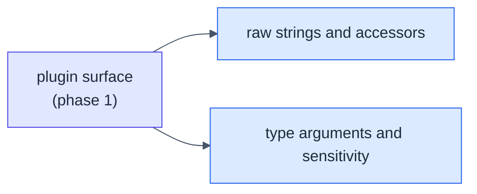

# nidana.tooling.lint: Analyzer Plugin

- **Kind:** leaf-parent
- **Purpose:** the per-library v1 checks as rules of the analysis server plugin `nidana_dart_lint`, reported under `dart analyze` and in the IDE
- **Owns:**
  - package `nidana_dart_lint` (ADR-002 items 3 and 7): its `pubspec.yaml` with `analysis_server_plugin` 0.3.18 and `analyzer` 13.3.0 pinned and no nidana package, and `lib/main.dart` with the top-level `plugin`
  - the rules `raw_string_topic` (Spec §4.4), `global_bus_accessor` (Spec §3.1, Guide C.5), `explicit_topic_type_arguments` (Spec §4.2) and `unflagged_sensitive_topic` (Spec §9.2, Guide C.1), with their codes, default severities, messages and placeholders
  - the plugin's own recognition of nidana API by package and element name, and of application code (nidana-checks@v1 Terms both hosts use)
  - the root analysis options' `plugins:` section that enables the plugin (ADR-002 item 7)
  - nidana-checks@v1's plugin host: G1, G2, G4 to G8, and G3 for the plugin (nidana.tooling D2)
- **Does not own:** every check over more than one library or over the IR, the claim recognizer and the scan (nidana.tooling.codegen); the declarations it recognizes (nidana.model, nidana.runtime); the analysis server's configuration and suppression mechanism, which nidana-checks@v1 G8 relies on
- **Consumes:** [topic-model@v1, topology-dsl@v1, bus-api@v1, bus-testing@v1]
- **Produces:** [nidana-checks@v1]
- **Governed by:** [ADR-001, ADR-002]
- **Sources:**
  - `ref/nidana-docs/arch/nidana-bus-ref-arch-spec-v0_15_0.md` §3.1, §4.2, §4.4, §9.2
  - `ref/nidana-docs/arch/nidana-bus-ref-arch-guide-v0_15_0.md` §5.1, §5.2, Appendix C.1, C.2, C.5
- **Decomposes into:** phases (see hsdd-phase-plan)
- **Isolation strategy:** each rule is unit-tested with analyzer_testing over in-memory sources whose stand-in libraries carry the package names recognition matches, so the tests need no nidana package; every producing phase replays nidana-checks@v1's `analyze-*` recorded invocations, restricted by `--guarantee` to the rules delivered so far, which run `dart analyze` over package trees that resolve the real `nidana_dart_contracts` and `nidana_dart_runtime` declarations through the workspace (ADR-001 items 7 and 10; nidana.tooling D2); nothing runs a bus

## Overview

This node is the half of nidana.tooling that runs inside the analysis server. Its rules decide one library at a time, report beside the analyzer's own diagnostics, and fail `dart analyze` by severity (nidana-checks@v1 Refinement 3). The analysis server loads the plugin from a synthetic package resolved apart from the workspace, which is why the plugin depends on no nidana package and pins its two dependencies (ADR-002 item 7).

It is a leaf-parent (nidana.tooling D1): four rules in one package, about three phases.

## Inherited from nidana.tooling and the root

- ADR-002 item 7: the phase that creates `nidana_dart_lint` adds the plugin to the root analysis options by `path: packages/nidana_dart_lint`. From then on every root `fvm dart analyze`, and so every gate in the workspace that analyzes, loads the plugin; a plugin that does not build fails them all (ADR-002 Consequences).
- The rules run over every member, so each rule must report nothing the members' contracts declare: registries are static fields, buses are held by instances and parameters, and nidana's own sinks are called without explicit type arguments (nidana-checks@v1 The plugin).
- Each code's default severity is set on its diagnostic code: nidana-checks@v1 G1 fixes WARNING for the three blocking rules and INFO for the sensitivity rule, which the stand-in plugin of `docs/auto-run/experiments/nidana-checks-fixtures/` sets with `DiagnosticSeverity` per code (T1). ADR-002's experiment, whose one-rule plugin set none, saw INFO (ADR-002 Context, Q11b).
- `dart analyze` reports the plugin's diagnostics only at the root whose options enable it (`docs/auto-run/experiments/nidana-checks-fixtures/`, probe P2); the recorded invocations run at their `files/` root.
- nidana-checks@v1 is produced with nidana.tooling.codegen; this node delivers the plugin's guarantees and replays the `analyze-*` cases, its last producing phase all of them (nidana.tooling D2).

## Contracts

| Contract | Direction | Counterpart | Edge type | What this node does with it |
|----------|-----------|-------------|-----------|-----------------------------|
| topic-model@v1 | consumes | nidana.model | contract | `StateTopic`, `EventTopic` and `ReplayTopic` creations, their `name` and `sensitive` arguments and their type arguments, recognized by package and name |
| topology-dsl@v1 | consumes | nidana.model | contract | `TopologyBuilder.write` and `reduceInto`, for `explicit_topic_type_arguments` |
| bus-api@v1 | consumes | nidana.runtime | contract | `Bus` and its subclasses for `global_bus_accessor`; `Bus.publish` and `Publisher.publish` for `explicit_topic_type_arguments` (bus-api@v1 For static analysis) |
| bus-testing@v1 | consumes | nidana.runtime | contract | `TestBus`, a `Bus` subclass the accessor rule reports, which the `analyze-*` cases declare in application and test code (nidana.tooling D3) |
| nidana-checks@v1 | produces, with nidana.tooling.codegen | nidana.integration (hard) | hard | the plugin host: G1, G2, G4 to G8, G3 for the plugin |

## Slices

| Slice | Holds | Delivers | Needs |
|-------|-------|----------|-------|
| plugin surface | the package with its pins; `lib/main.dart` and its `plugin`; the four rules registered with their codes, default severities, problem and correction messages; the recognition helper (package and element name, subclasses of `Bus`, application code through `RuleContext.isInTestDirectory`); the root options' `plugins:` section | G1's registration and severities, G2's messages; G8 once a rule reports, since configuration and suppression are the analysis server's | none |
| raw strings and accessors | `raw_string_topic` (registry fields accepted, string literals as written) and `global_bus_accessor` (top-level and static variables and getters, nullable or not) | G3 for the plugin, G4, G5 | plugin surface |
| type arguments and sensitivity | `explicit_topic_type_arguments` and `unflagged_sensitive_topic`, with the known-sensitive search through type arguments, record fields and annotated aliases | G6, G7 | plugin surface |

## Development flow

The node starts once nidana.model's and nidana.runtime's first phases have merged, because its recorded invocations resolve `nidana_dart_contracts`, `nidana_dart_runtime` and `testing.dart` (root D10; nidana.tooling D3).

- The plugin surface is phase 1 (conventions, `fp-progression`): it registers every rule of the contract, so the plugin loads and reports nothing until the later slices add detection, and the root options enable it from that phase on (ADR-002 item 7).
- Each rule's decision is a pure function of the resolved node it visits; the visitor that reports it is the effect (conventions, `fp-progression`).
- The two rule slices can run in parallel once the surface lands.
- A recorded invocation starts an analysis server whose first run sets up the plugin's synthetic package from the pub cache; the eight `analyze-*` cases take minutes (the run's note on nidana-checks@v1's authoring), which the phase gates budget for.

## Decisions

### D1: The plugin's recognition helper is its own

The four rules share one recognition helper inside `nidana_dart_lint`: an element is nidana's when its name matches and its library's URI is in the named package, `lib/src/` included; `Bus` matches the class and every subclass; application code is every library outside the test directories `RuleContext.isInTestDirectory` names. The helper re-implements, from nidana-checks@v1's Terms both hosts use, what nidana.tooling.codegen's recognizer implements for the scan; the two share no code, because the plugin can depend on no nidana package (ADR-002 item 7). G3 holds for each host on its own, and each host's cases check it (nidana.tooling D2).

Alternative considered: one recognition library shared with the scan, which would need the plugin to depend on `nidana_dart_codegen`, which the analysis server cannot resolve from the plugin's synthetic package before publication (ADR-002 Context, Q12).

## Carried into the phase plan

- `amend nidana-checks@v1` on the `global_bus_accessor` rule detail, routed here by the run after bus-api@v1's touch: the sentence "bus-api@v1 For static analysis defines a global accessor as a top-level variable or static field; this rule also reports top-level and static getters, which reach a bus the same way" describes bus-api@v1's earlier wording. bus-api@v1's amendment (f) made For static analysis define a global bus accessor exactly as G5 reports it, getters included, so the sentence becomes a citation of that definition. Editorial and compatible: no rule, code, message or case changes.
- `confirm nidana-checks@v1 produced_by` with this node's producing phases, complementary to nidana.tooling.codegen's (nidana.tooling D2).
