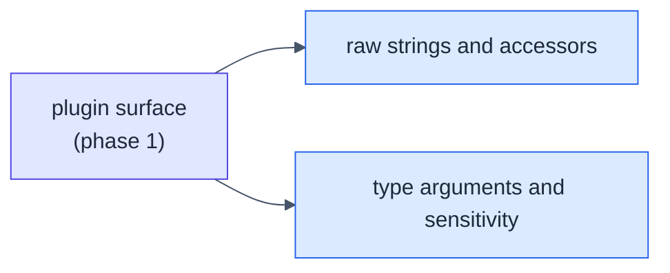
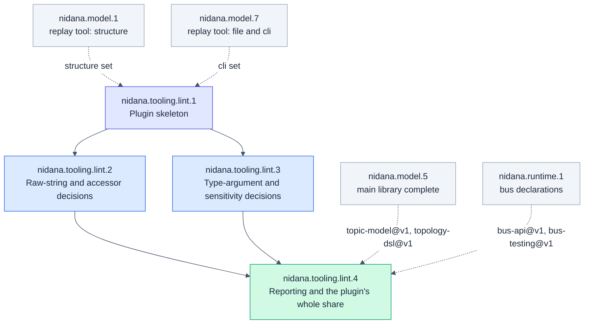

# nidana.tooling.lint: Analyzer Plugin

- **Kind:** leaf-parent
- **Purpose:** the per-library v1 checks as rules of the analysis server plugin `nidana_dart_lint`, reported under `dart analyze` and in the IDE
- **Owns:**
  - package `nidana_dart_lint` (ADR-002 items 3 and 7): its `pubspec.yaml` with `analysis_server_plugin` 0.3.18 and `analyzer` 13.3.0 pinned and no nidana package, and `lib/main.dart` with the top-level `plugin`
  - the rules `raw_string_topic` (Spec §4.4), `global_bus_accessor` (Spec §3.1, Guide C.5), `explicit_topic_type_arguments` (Spec §4.2) and `unflagged_sensitive_topic` (Spec §9.2, Guide C.1), with their codes, default severities, messages and placeholders
  - the plugin's own recognition of nidana API by package and element name, and of application code (nidana-checks@v1 Terms both hosts use)
  - the root analysis options' `plugins:` section that enables the plugin (ADR-002 item 7)
  - nidana-checks@v1's plugin host: G1, G2, G4 to G8, and G3 for the plugin (nidana.tooling D2)
- **Does not own:** every check over more than one library or over the IR, the claim recognizer and the scan (nidana.tooling.codegen); the declarations it recognizes (nidana.model, nidana.runtime); the analysis server's configuration and suppression mechanism, which nidana-checks@v1 G8 relies on
- **Consumes:** [topic-model@v1, topology-dsl@v1, bus-api@v1, bus-testing@v1]
- **Produces:** [nidana-checks@v1]
- **Governed by:** [ADR-001, ADR-002]
- **Sources:**
  - `ref/nidana-docs/arch/nidana-bus-ref-arch-spec-v0_15_0.md` §3.1, §4.2, §4.4, §9.2
  - `ref/nidana-docs/arch/nidana-bus-ref-arch-guide-v0_15_0.md` §5.1, §5.2, Appendix C.1, C.2, C.5
- **Decomposes into:** phases (see hsdd-phase-plan)
- **Isolation strategy:** each rule is unit-tested with analyzer_testing over in-memory sources whose stand-in libraries carry the package names recognition matches, so the tests need no nidana package; every producing phase replays nidana-checks@v1's `analyze-*` recorded invocations, restricted by `--guarantee` to the rules delivered so far, which run `dart analyze` over package trees that resolve the real `nidana_dart_contracts` and `nidana_dart_runtime` declarations through the workspace (ADR-001 items 7 and 10; nidana.tooling D2); nothing runs a bus

## Overview

This node is the half of nidana.tooling that runs inside the analysis server. Its rules decide one library at a time, report beside the analyzer's own diagnostics, and fail `dart analyze` by severity (nidana-checks@v1 Refinement 3). The analysis server loads the plugin from a synthetic package resolved apart from the workspace, which is why the plugin depends on no nidana package and pins its two dependencies (ADR-002 item 7).

It is a leaf-parent (nidana.tooling D1): four rules in one package, about three phases.

## Inherited from nidana.tooling and the root

- ADR-002 item 7: the phase that creates `nidana_dart_lint` adds the plugin to the root analysis options by `path: packages/nidana_dart_lint`. From then on every root `fvm dart analyze`, and so every gate in the workspace that analyzes, loads the plugin; a plugin that does not build fails them all (ADR-002 Consequences).
- The rules run over every member, so each rule must report nothing the members' contracts declare: registries are static fields, buses are held by instances and parameters, and nidana's own sinks are called without explicit type arguments (nidana-checks@v1 The plugin).
- Each code's default severity is set on its diagnostic code: nidana-checks@v1 G1 fixes WARNING for the three blocking rules and INFO for the sensitivity rule, which the stand-in plugin of `docs/auto-run/experiments/nidana-checks-fixtures/` sets with `DiagnosticSeverity` per code (T1). ADR-002's experiment, whose one-rule plugin set none, saw INFO (ADR-002 Context, Q11b).
- `dart analyze` reports the plugin's diagnostics only at the root whose options enable it (`docs/auto-run/experiments/nidana-checks-fixtures/`, probe P2); the recorded invocations run at their `files/` root.
- nidana-checks@v1 is produced with nidana.tooling.codegen; this node delivers the plugin's guarantees and replays the `analyze-*` cases, its last producing phase all of them (nidana.tooling D2).

## Contracts

| Contract | Direction | Counterpart | Edge type | What this node does with it |
|----------|-----------|-------------|-----------|-----------------------------|
| topic-model@v1 | consumes | nidana.model | contract | `StateTopic`, `EventTopic` and `ReplayTopic` creations, their `name` and `sensitive` arguments and their type arguments, recognized by package and name |
| topology-dsl@v1 | consumes | nidana.model | contract | `TopologyBuilder.write` and `reduceInto`, for `explicit_topic_type_arguments` |
| bus-api@v1 | consumes | nidana.runtime | contract | `Bus` and its subclasses for `global_bus_accessor`; `Bus.publish` and `Publisher.publish` for `explicit_topic_type_arguments` (bus-api@v1 For static analysis) |
| bus-testing@v1 | consumes | nidana.runtime | contract | `TestBus`, a `Bus` subclass the accessor rule reports, which the `analyze-*` cases declare in application and test code (nidana.tooling D3) |
| nidana-checks@v1 | produces, with nidana.tooling.codegen | nidana.integration (hard) | hard | the plugin host: G1, G2, G4 to G8, G3 for the plugin |

## Slices

| Slice | Holds | Delivers | Needs |
|-------|-------|----------|-------|
| plugin surface | the package with its pins; `lib/main.dart` and its `plugin`; the four rules registered with their codes, default severities, problem and correction messages; the recognition helper (package and element name, subclasses of `Bus`, application code through `RuleContext.isInTestDirectory`); the root options' `plugins:` section | G1's registration and severities, G2's messages; G8 once a rule reports, since configuration and suppression are the analysis server's | none |
| raw strings and accessors | `raw_string_topic` (registry fields accepted, string literals as written) and `global_bus_accessor` (top-level and static variables and getters, nullable or not) | G3 for the plugin, G4, G5 | plugin surface |
| type arguments and sensitivity | `explicit_topic_type_arguments` and `unflagged_sensitive_topic`, with the known-sensitive search through type arguments, record fields and annotated aliases | G6, G7 | plugin surface |

## Development flow

The node starts once nidana.model's and nidana.runtime's first phases have merged, because its recorded invocations resolve `nidana_dart_contracts`, `nidana_dart_runtime` and `testing.dart` (root D10; nidana.tooling D3).

- The plugin surface is phase 1 (conventions, `fp-progression`): it registers every rule of the contract, so the plugin loads and reports nothing until the later slices add detection, and the root options enable it from that phase on (ADR-002 item 7).
- Each rule's decision is a pure function of the resolved node it visits; the visitor that reports it is the effect (conventions, `fp-progression`).
- The two rule slices can run in parallel once the surface lands.
- A recorded invocation starts an analysis server whose first run sets up the plugin's synthetic package from the pub cache; the eight `analyze-*` cases take minutes (the run's note on nidana-checks@v1's authoring), which the phase gates budget for.

## Decisions

### D1: The plugin's recognition helper is its own

The four rules share one recognition helper inside `nidana_dart_lint`: an element is nidana's when its name matches and its library's URI is in the named package, `lib/src/` included; `Bus` matches the class and every subclass; application code is every library outside the test directories `RuleContext.isInTestDirectory` names. The helper re-implements, from nidana-checks@v1's Terms both hosts use, what nidana.tooling.codegen's recognizer implements for the scan; the two share no code, because the plugin can depend on no nidana package (ADR-002 item 7). G3 holds for each host on its own, and each host's cases check it (nidana.tooling D2).

Alternative considered: one recognition library shared with the scan, which would need the plugin to depend on `nidana_dart_codegen`, which the analysis server cannot resolve from the plugin's synthetic package before publication (ADR-002 Context, Q12).

### D2: Each rule is a pure decision and a reporting visitor

Each rule has two parts. Its **decision** is a pure function from the resolved node its visitor visits to that node's findings, each a `Finding`: an immutable value holding the node or token to report at and the message arguments. Its **visitor** hands each finding to the analysis server and is the rule's only effect. The phases follow `fp-progression` (conventions) along that split:

1. nidana.tooling.lint.1 lands the type level: the four `LintCode`s with nidana-checks@v1's codes, default severities and messages, `Finding`, the four rules registered as warning rules, and D1's recognition helper. It also lands the shell that ADR-002 item 7 puts in the phase creating the package: `lib/main.dart` and the root options' `plugins:` section. The rules register no node processor yet, so the plugin loads and reports nothing.
2. nidana.tooling.lint.2 and nidana.tooling.lint.3 land the decisions, side by side, one per rule slice of this spec. Each writes its two decisions and their tests in files of its own, so neither edits a file of the other.
3. nidana.tooling.lint.4 lands the visitors and the application-code guard, and replays this node's whole share of nidana-checks@v1 (D3).

The recognition helper is a pure function, yet it sits in the first phase, because both decision lanes call it: placed in either lane, it would order the other lane after that one.

Alternatives considered:

- The three slices as three phases, each rule's decision and visitor together, one review cycle fewer. Only one phase can be the last that replays the whole share (nidana.tooling D2), so the two rule phases would run one after the other, and the first would report, an effect, before the second lands its pure decisions, against `fp-progression`.
- The three slices with the rule phases side by side, and a fourth phase that only replays: that phase would change almost no code, below the sizing floor.

The signal that would merge each decision with its visitor: decisions that cannot be tested apart from reporting. `docs/auto-run/experiments/plugin-rule-tests/` (Q2) tests a decision by resolving an in-memory library and calling it on the nodes found.

### D3: What each gate replays

Every gate runs, from the workspace root: `fvm dart pub get --enforce-lockfile`; `fvm dart analyze --fatal-infos`, which loads the plugin from nidana.tooling.lint.1 on; `fvm dart test packages/nidana_dart_lint`; and `fvm dart run nidana_contract_check nidana-checks` restricted by `--guarantee` to the ids this node has delivered (ADR-001 items 9 and 10; nidana.tooling D2).

1. **The restriction is G1 at nidana.tooling.lint.1 to nidana.tooling.lint.3, and G1 to G8 at nidana.tooling.lint.4.** A recorded invocation runs only when every id it covers is in the restriction (ADR-001 item 9). Every `analyze-*` case that covers G1 also covers G2 or G7, and `analyze-human` covers exactly G1 and G2, so a restriction that admits a per-rule case (G1, G2 and that rule's id) also admits `analyze-human`, which needs all four rules reporting; `analyze-configuration` (G8) needs three of them reporting. No phase before the one that makes every rule report can replay an `analyze-*` case, whatever the order of the rule phases. Under D2 that phase is nidana.tooling.lint.4, whose restriction, G1 to G8, is this node's whole share: every `analyze-*` case, and no `scan-*` case, because each of those covers an id from G9 to G17.
2. **A restriction that admits no case passes.** At nidana.tooling.lint.1 to nidana.tooling.lint.3 the replay runs `structure` and a `cli` selection with no case, which passes (nidana.model D2 items 1 and 4).
3. **Every gate runs the `cli` set,** so nidana.tooling.lint.1 depends on nidana.model.7, which lands it, and on nidana.model.1, which lands `structure` (conventions, Phase design); every later phase reaches both through nidana.tooling.lint.1.
4. **The root analyze is the plugin's load check.** From nidana.tooling.lint.1 on, a plugin that does not compile fails `dart analyze` with exit 4, and an edit to the plugin's sources is picked up by the next `dart analyze` at the same path, which recompiles the plugin in about 11 s, against about 4 s with nothing changed (`docs/auto-run/experiments/plugin-rebuild/`, R1 to R7). No gate clears the analysis server's plugin cache.
5. **Gates are written out in full** in each phase, so the phase context carries the whole command.

Alternative considered: an `amend` giving `analyze-human` the Covers G1, G2 and G4 to G7, so that a rule phase could replay its own case. Under D2 no rule reports before nidana.tooling.lint.4, so the per-rule cases would first run there anyway, and the amend would buy nothing.

### D4: Rule tests run over recognition stand-ins

The tests use `analyzer_testing`'s `AnalysisRuleTest` under plain `package:test`, its `setUp` and `tearDown` called from `package:test`'s hooks, so the dev dependencies stay `analyzer_testing` and `test` (ADR-002 item 3), with no `test_reflective_loader`. Stand-in packages are registered with `newPackage` before `AnalysisRuleTest.setUp`, which writes the package configuration. A decision is tested by resolving an in-memory library with `resolveFile` and calling the decision on the nodes found; a rule by `assertDiagnostics`, with offset, length and messages; and a library under the test package's `test/` is skipped through `RuleContext.isInTestDirectory`, in memory too (`docs/auto-run/experiments/plugin-rule-tests/`, Q1 to Q3).

The stand-ins are the declarations the rules recognize, written in the shape the consumed contracts' Interfaces give them: the three topic classes with their constructors and their `name` and `sensitive` parameters, under `lib/src/` of `nidana_dart_contracts` (topic-model@v1); `Bus` with `publish` and `publisher`, `Publisher.publish`, and `TestBus extends Bus`, declared under `lib/src/` of `nidana_dart_runtime`, `TestBus` exported by `testing.dart` (bus-api@v1, bus-testing@v1); `Topology` and `TopologyBuilder` with `write` and `reduceInto` (topology-dsl@v1); each beside a declaration of the same name in another package. They carry no behavior and nothing runs them. ADR-001 item 11 binds a stand-in of a contract's behavior to that contract's conformance suite; the plugin runs nothing of these contracts, so it has no suite to bind, and the real declarations reach the plugin through the `analyze-*` replay at nidana.tooling.lint.4 (D5).

`packages/nidana_dart_lint/test/package_properties_test.dart`, written by nidana.tooling.lint.1 and run by every later gate, checks ADR-002 items 3 and 7 and nidana-checks@v1's Packages line: the dependencies are exactly `analysis_server_plugin` and `analyzer`, each pinned to the version the root `pubspec.lock` resolves; the dev dependencies are exactly `analyzer_testing` and `test`; no library under `lib/` imports a nidana package. It finds the workspace root as the nearest ancestor of the working directory that holds `hsdd/contract/` (nidana.model D6's rule).

Alternative considered: `test_reflective_loader`, which `analysis_server_plugin`'s testing guide uses. It is a third dev dependency, which ADR-002 item 3 would need a decision for, and gives the tests nothing the plain hooks lack.

### D5: Only the replaying phase waits on the producers

nidana.tooling.lint.1 to nidana.tooling.lint.3 recognize the consumed contracts' declarations by name, test over D4's stand-ins and replay no `analyze-*` case (D3), so none of them waits on a producer's phase. nidana.tooling.lint.4 replays the cases, whose `files/` import `nidana_dart_contracts`, `nidana_dart_runtime` and `package:nidana_dart_runtime/testing.dart`, so it waits on nidana.model.5 (topic-model@v1 Delivery: a consumer of topology-dsl@v1 as well waits on nidana.model.5, and the cases use `Topology` and `TopologyBuilder`) and on nidana.runtime.1 (bus-api@v1 and bus-testing@v1 Delivery). No `analyze-*` case imports `nidana_dart_navigation` or `nidana_dart_runtime_flutter`, so no phase waits on nidana.navigation or nidana.flutter.

This states at phase level what the Development flow above states for the node: its start condition holds for nidana.tooling.lint.4. Root D10's reason, that Dart compiles only against real declarations, applies to the recorded invocations and not to the plugin, which imports no nidana package (ADR-002 item 7).

Alternative considered: every phase waits on both producers, as the Development flow reads at node level. That keeps one start condition for the node and changes nothing on the critical path (root Development flow), but adds edges that carry no dependency. The signal that would favor it: a gate of nidana.tooling.lint.1 to nidana.tooling.lint.3 that resolves a nidana package.

## Carried into the phase plan

- `amend nidana-checks@v1` on the `global_bus_accessor` rule detail, routed here by the run after bus-api@v1's touch: the sentence "bus-api@v1 For static analysis defines a global accessor as a top-level variable or static field; this rule also reports top-level and static getters, which reach a bus the same way" describes bus-api@v1's earlier wording. bus-api@v1's amendment (f) made For static analysis define a global bus accessor exactly as G5 reports it, getters included, so the sentence becomes a citation of that definition. Editorial and compatible: no rule, code, message or case changes.
- `confirm nidana-checks@v1 produced_by` with this node's producing phases, complementary to nidana.tooling.codegen's (nidana.tooling D2).

## Phase Plan

**Default gate:** `fvm dart pub get --enforce-lockfile && fvm dart analyze --fatal-infos && fvm dart test packages/nidana_dart_lint`

| Phase | Name | Tier | Size | Depends on | Collides with |
|------:|------|------|------|------------|---------------|
| nidana.tooling.lint.1 | Plugin skeleton | gate-only | ~430 loc, ≤7 tasks | nidana.model.1, nidana.model.7 | nidana.tooling.lint.4 |
| nidana.tooling.lint.2 | Raw-string and accessor decisions | spot-check | ~380 loc, ≤6 tasks | nidana.tooling.lint.1 | none |
| nidana.tooling.lint.3 | Type-argument and sensitivity decisions | full-review | ~410 loc, ≤6 tasks | nidana.tooling.lint.1 | none |
| nidana.tooling.lint.4 | Reporting and the plugin's whole share | full-review | ~300 loc, ≤6 tasks | nidana.tooling.lint.2, nidana.tooling.lint.3, nidana.model.5, nidana.runtime.1 | nidana.tooling.lint.1 |

Ordering policy: `fp-progression` (conventions), along D2's split: the type level and the shell ADR-002 item 7 requires in nidana.tooling.lint.1, the pure decisions in nidana.tooling.lint.2 and nidana.tooling.lint.3, side by side, and the reporting visitors with the whole-share replay in nidana.tooling.lint.4.

Every gate is written out in full below. It is the default gate plus the replay of nidana-checks@v1 restricted to what this node has delivered (D3):

| Phase | `--guarantee` | Delivers | `analyze-*` cases the replay runs |
|-------|---------------|----------|-----------------------------------|
| nidana.tooling.lint.1 | `G1` | G1's registration | none |
| nidana.tooling.lint.2 | `G1` | the decisions of `raw_string_topic` and `global_bus_accessor`, reporting nothing yet | none |
| nidana.tooling.lint.3 | `G1` | the decisions of `explicit_topic_type_arguments` and `unflagged_sensitive_topic`, reporting nothing yet | none |
| nidana.tooling.lint.4 | `G1,G2,G3,G4,G5,G6,G7,G8` | G2, G3 for the plugin, G4 to G8; with G1, this node's whole share | all eight |

Sizing floor: nidana.tooling.lint.1 and nidana.tooling.lint.2 differ in tier, as do nidana.tooling.lint.2 and nidana.tooling.lint.3, which also run side by side. nidana.tooling.lint.3 and nidana.tooling.lint.4 share a tier but not their consumed contracts, and together would come to about 700 lines, past one review sitting. No pair is a merge candidate.

nidana.tooling.lint.2 and nidana.tooling.lint.3 edit disjoint files and run in parallel worktrees once nidana.tooling.lint.1 has merged. nidana.tooling.lint.1 is the only phase of this node that edits the shared root files (conventions, Shared workspace files).

### Phase dependency graph

### nidana.tooling.lint.1: Plugin skeleton

- **Consumes:** [topic-model@v1, bus-api@v1, bus-testing@v1]
- **Produces:** [nidana-checks@v1]
- **Governed by:** [ADR-001, ADR-002]
- **Scope:**
  - Creates the workspace member `packages/nidana_dart_lint` (ADR-002 items 3, 7 and 9): `pubspec.yaml` with `version: 0.1.0`, `environment: sdk: ^3.13.0` and `resolution: workspace`, `analysis_server_plugin: 0.3.18` and `analyzer: 13.3.0` as exact pins and no nidana package, and `analyzer_testing` and `test` as dev dependencies with caret constraints at the versions the lockfile resolves (`test` with the constraint the other members carry); `README.md`, `CHANGELOG.md` and a copy of the repository's `LICENSE`.
  - Edits the shared root files: inserts `packages/nidana_dart_lint` in the root `pubspec.yaml` `workspace:` list in path order; commits the root `pubspec.lock` that `fvm dart pub get` resolves, in which analyzer moves to 13.3.0 if it resolved 14.5.0 before (`docs/auto-run/experiments/lint-pin-resolution/`, L2); adds to the root `analysis_options.yaml` the `plugins:` section that enables `nidana_dart_lint` by `path: packages/nidana_dart_lint` (ADR-002 item 7).
  - Lands nidana-checks@v1's plugin table as types: the four `LintCode`s, each named by its code, with the table's problem and correction messages and an explicit `severity` argument, `DiagnosticSeverity.WARNING` for `raw_string_topic`, `global_bus_accessor` and `explicit_topic_type_arguments` and `DiagnosticSeverity.INFO` for `unflagged_sensitive_topic` (a code without the argument reports INFO, `docs/auto-run/experiments/plugin-severity/`); the four rules, each registered with `registerWarningRule` and registering no node processor yet; `lib/main.dart` with the top-level `plugin`, whose `name` is `nidana_dart_lint`; and D2's `Finding`.
  - Lands D1's recognition helper, after nidana-checks@v1 Terms both hosts use: an element is nidana's `X` of package `P` when its name is `X` and its library's URI is `package:P/...`, `lib/src/` included; `Bus` of `nidana_dart_runtime` matches the class and every subclass; a topic creation is an instance creation of `StateTopic` (either constructor), `EventTopic` or `ReplayTopic` of `nidana_dart_contracts`, and its value type is the created type's type argument, written or inferred; a string literal is a simple, adjacent or interpolated string literal; a named argument is found by name.
  - Tests: the registration (exactly the four rules, each a warning rule whose name, code, severity and two messages read as the contract's table); the recognition helper over D4's stand-ins, which this phase writes in a test support file for the later phases (the topic classes, `Bus`, `Publisher` and `TestBus` in `testing.dart`, each beside a same-named declaration in another package); and D4's `package_properties_test.dart`.
  - Delivers G1's registration. G1's cases replay from nidana.tooling.lint.4, because each also covers G2 or G7 (D3).
- **Size estimate:** ~12 files (~430 lines), <= 7 plan tasks
- **Gate:** `fvm dart pub get --enforce-lockfile && fvm dart analyze --fatal-infos && fvm dart test packages/nidana_dart_lint && fvm dart run nidana_contract_check nidana-checks --guarantee G1`
- **Verification:** the root analyze loads the plugin from `packages/nidana_dart_lint` and still exits 0 over every member, which it would not with a plugin that fails to build (exit 4); the four codes, severities and messages read word for word as nidana-checks@v1's table; the package resolves no nidana package and its two pins equal the lockfile's versions.
- **Review tier:** gate-only
- **Collides with:** [nidana.tooling.lint.4]. Both edit `packages/nidana_dart_lint/lib/src/rules.dart`, which this phase creates.
- **Dependencies:** nidana.model.1 and nidana.model.7, which land the replay tool's `structure` and `cli` sets that the gate runs (D3). No contract edge waits on a producer's phase: the plugin imports no nidana package and the tests use stand-ins (D4, D5).

### nidana.tooling.lint.2: Raw-string and accessor decisions

- **Consumes:** [topic-model@v1, bus-api@v1, bus-testing@v1]
- **Produces:** [nidana-checks@v1]
- **Governed by:** [ADR-001, ADR-002]
- **Scope:**
  - The decision of `raw_string_topic` (Spec §4.2, §4.4), a pure function of an instance creation to its findings (D2): a topic creation whose `name` argument is a string literal and which is not the whole initializer of a static field, found at the literal, `{0}` being the literal as written, quotes included (G4). A static field is any field declared `static`, in a class, mixin, enum, extension or extension type, whether `const`, `final`, `late` or none of these, as G4 states (`amend` below). A name that is not a string literal, a `TopicRef` construction, and a creation of a same-named class of another package give no finding.
  - The decision of `global_bus_accessor` (Spec §3.1, Guide C.5), a pure function of a top-level variable, field, function or method declaration to its findings: each top-level variable, static field, top-level getter or static getter whose type, declared or inferred, is `Bus` of `nidana_dart_runtime` or a subclass, nullable or not, `late` or not, found at its name, `{0}` being the name (G5; bus-api@v1 For static analysis). An instance field or getter, a local variable, a parameter, a function that returns a new bus, and a `Bus` of another package give none.
  - Each decision and its tests in files of its own (D2). The tests resolve in-memory libraries over nidana.tooling.lint.1's stand-ins and call the decisions (D4); they cover every reported and accepted form of the `analyze-raw-string-topic` and `analyze-global-bus-accessor` cases, with the recorded sites and arguments, and the `test/` files of `analyze-clean` that use these forms.
  - Reports nothing: the visitors are nidana.tooling.lint.4's, and G4 and G5 replay from there (D3).
- **Size estimate:** ~4 files (~380 lines), <= 6 plan tasks
- **Gate:** `fvm dart pub get --enforce-lockfile && fvm dart analyze --fatal-infos && fvm dart test packages/nidana_dart_lint && fvm dart run nidana_contract_check nidana-checks --guarantee G1`
- **Verification:** each decision returns one finding, at the recorded site with the recorded argument, for every reported form of its case, and none for every accepted form, the same-named declarations of another package included; a `Bus` subclass declared under `lib/src/` (`TestBus`) is found like `Bus`.
- **Review tier:** spot-check
- **Dependencies:** nidana.tooling.lint.1: `Finding`, the recognition helper and the stand-ins.

### nidana.tooling.lint.3: Type-argument and sensitivity decisions

- **Consumes:** [topic-model@v1, topology-dsl@v1, bus-api@v1]
- **Produces:** [nidana-checks@v1]
- **Governed by:** [ADR-001, ADR-002]
- **Scope:**
  - The decision of `explicit_topic_type_arguments` (Spec §4.2; nidana-checks@v1 Refinement 4), a pure function of a method invocation to its findings (D2): an invocation with explicit type arguments of `publish` on `Bus` (or a subclass) or `Publisher` of `nidana_dart_runtime`, or of `write` or `reduceInto` on `TopologyBuilder` of `nidana_dart_contracts`, found at the type argument list, `{0}` being the method's name (G6). An inferred call, and explicit type arguments on a read (`observe`, `getCurrentValue`, `getBufferedValues`, `read`), give none.
  - The decision of `unflagged_sensitive_topic` (Spec §9.2; Guide C.1), a pure function of an instance creation to its findings: a topic creation whose value type contains a known-sensitive type and whose `sensitive` argument is absent or the literal `false`, found at the constructor name with its type arguments, `{0}` being the value type's `getDisplayString()` and `{1}` the known-sensitive type's name (G7). A type is known-sensitive when its name, or the name of the alias it is written through, ends in `Token`, `Credential`, `Credentials` or `PaymentInfo`, or when its declaration or that alias carries an annotation whose value is an instance of a class named `Sensitive`, of any library. The value type contains one when it is one, or one of its type arguments or record fields contains one, at any depth; nullability is ignored and function types are not searched. A `sensitive` argument that is not a literal gives none. When the value type contains more than one, `{1}` names the first a depth-first search meets: the alias a type is written through, the type itself, then its type arguments in order, or a record's positional fields in order and then its named fields by name (`amend` below).
  - Each decision and its tests in files of its own (D2). This phase adds the `Topology` and `TopologyBuilder` stand-ins (D4) in its own test files. The tests cover every reported and accepted form of the `analyze-explicit-topic-type-arguments`, `analyze-unflagged-sensitive-topic` and `analyze-sensitive-fatal-infos` cases, with the recorded sites and arguments, display strings included: `'ThirdPartyUser'` for a type written through the annotated alias `AccountHolder`, `'(String, RefreshToken?)'` for a record.
  - Reports nothing: G6 and G7 replay from nidana.tooling.lint.4 (D3).
- **Size estimate:** ~5 files (~410 lines), <= 6 plan tasks
- **Gate:** `fvm dart pub get --enforce-lockfile && fvm dart analyze --fatal-infos && fvm dart test packages/nidana_dart_lint && fvm dart run nidana_contract_check nidana-checks --guarantee G1`
- **Verification:** the explicit-type-argument decision finds exactly the four sink invocations of its case and none of its inferred calls or reads; the sensitivity decision finds the seven reported topics of `analyze-unflagged-sensitive-topic` with their recorded `{0}` and `{1}` and neither accepted one, and a value type holding two known-sensitive types names the one the search order gives.
- **Review tier:** full-review. The known-sensitive search (aliases, annotations from any library, record fields at any depth, display strings under an alias) is the plan's most intricate logic and its one data-protection heuristic.
- **Dependencies:** nidana.tooling.lint.1: `Finding`, the recognition helper and the stand-ins.

### nidana.tooling.lint.4: Reporting and the plugin's whole share

- **Consumes:** [topic-model@v1, topology-dsl@v1, bus-api@v1, bus-testing@v1]
- **Produces:** [nidana-checks@v1]
- **Governed by:** [ADR-001, ADR-002]
- **Scope:**
  - Each rule registers its node processors only when `RuleContext.isInTestDirectory` is false, so the rules read application code only (G3 for the plugin): instance creations for `raw_string_topic` and `unflagged_sensitive_topic`; top-level variable, field, function and method declarations for `global_bus_accessor`; method invocations for `explicit_topic_type_arguments`. Each visitor reports every finding its rule's decision returns, at the finding's node or token, with its arguments (G2).
  - Tests per rule with `AnalysisRuleTest.assertDiagnostics` (D4): code, offset, length, problem message and correction message for every reported form, nothing for the accepted forms, and nothing in a library under `test/`.
  - From this phase on the rules report over every member under the root analyze. A member whose application code they report breaks nidana-checks@v1 The plugin in another node's package: the phase writes it under the verification doc's Outstanding and stops, and adds no `ignore` comment to another node's code.
  - Replays this node's whole share of nidana-checks@v1, every `analyze-*` case, against the real `nidana_dart_contracts`, `nidana_dart_runtime` and `testing.dart` (D3, D5). These are the cases' first replays against the real packages, so a case that fails on its own text is a contract gap, renegotiated through hsdd-contract (ADR-001 Consequences).
  - Delivers G2, G3 for the plugin and G4 to G8; with nidana.tooling.lint.1's G1, this node's share of nidana-checks@v1 (nidana.tooling D2).
- **Size estimate:** ~6 files (~300 lines), <= 6 plan tasks
- **Gate:** `fvm dart pub get --enforce-lockfile && fvm dart analyze --fatal-infos && fvm dart test packages/nidana_dart_lint && fvm dart run nidana_contract_check nidana-checks --guarantee G1,G2,G3,G4,G5,G6,G7,G8`
- **Verification:** the eight `analyze-*` cases pass, `analyze-human` word for word with every correction message, `analyze-configuration` with its disabled, lowered, raised and suppressed codes, and `analyze-clean` with the violations in its `test/` unreported; the root analyze with `--fatal-infos` stays clean over every member with the rules reporting; an IDE opened on `analyze-human`'s `files/` shows the same four diagnostics.
- **Review tier:** full-review
- **Collides with:** [nidana.tooling.lint.1]. Both edit `packages/nidana_dart_lint/lib/src/rules.dart`.
- **Dependencies:** nidana.tooling.lint.2 and nidana.tooling.lint.3, whose decisions the visitors call; nidana.model.5 and nidana.runtime.1, which land the declarations of topic-model@v1, topology-dsl@v1, bus-api@v1 and bus-testing@v1 that the `analyze-*` cases resolve (D5).

## Governance updates (pending reconcile)

> Reconciled 2026-10-18 by hsdd-reconcile. Drained entries are in git history.
