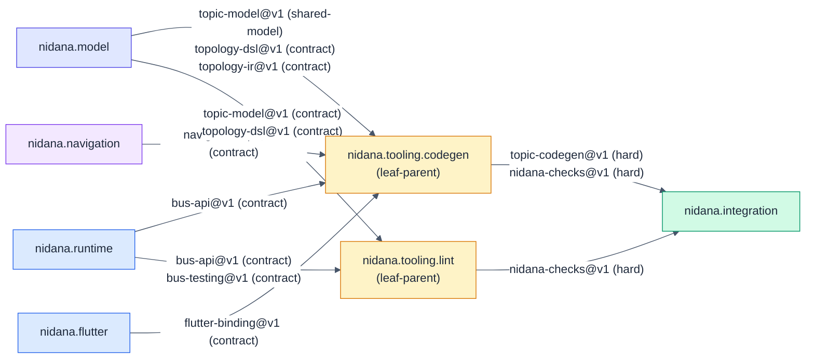

# nidana.tooling: Build and CI Tooling

- **Kind:** internal
- **Purpose:** the static half of the architecture's enforcement and its build-time artifacts (Guide Appendix C, planned v1 for Dart): topic registry generation and catalog, the topology catalog scan and graph emission, and the CI checks that move runtime failures to merge time
- **Owns:**
  - packages `nidana_dart_codegen` and `nidana_dart_lint` (ADR-002), one per child (D1)
  - the `topics.yaml` input format and the registry classes generated from it through build_runner, including sensitivity and owner fields (Spec §4.5, Guide C.3)
  - the topic catalog `topics.md` (Spec §4.5, Guide C.3)
  - `Catalog.scanTopologies` for Dart and `topology-graph.json` (Spec §6.5, Guide C.3), with the registration mechanism the scan needs to instantiate topology classes (Spec §6.5; nidana.tooling.codegen D1)
  - the build-time topology graph as static HTML (Guide C.4)
  - the v1 checks (root D1): topic name uniqueness across registries (Spec §4.3); the single-writer workspace scan over topology `write(...)` calls and publisher `writes` claims, with unresolvable write sets reported as warnings (Spec §3.11 layer 2); inter-topology cycles and intra-topology self-reference (Spec §3.8); scope compatibility over the aggregated IR (Spec §7.2); raw-string topic use (Spec §4.4); a global bus accessor (Spec §3.1, Guide C.5); the sensitive flag on known-sensitive types, as a warning (Spec §9.2, Guide C.1); explicit type arguments on a topic sink, which root D1 lists since its refresh of 2026-10-18 (Spec §4.2; nidana-checks@v1 Refinement 4)
  - the delivery of those checks: per-library rules in the analysis server plugin `nidana_dart_lint` on the Dart 3.10 plugin API, and the workspace scan, which runs every check over more than one library or over the IR, as a command entry of `nidana_dart_codegen` (ADR-002 items 7 and 8)
- **Does not own:** the analyses' algorithms, which are pure functions in nidana.model that tooling runs over what it scans; runtime enforcement of the same rules (nidana.runtime); the checks root D1 defers to v2
- **Consumes:** [topic-model@v1, topology-dsl@v1, topology-ir@v1, bus-api@v1, bus-testing@v1, navigation-api@v1, flutter-binding@v1]
- **Produces:** [topic-codegen@v1, nidana-checks@v1]
- **Governed by:** [ADR-001, ADR-002]
- **Sources:**
  - `ref/nidana-docs/arch/nidana-bus-ref-arch-spec-v0_15_0.md` §3.1, §3.8, §3.11, §4.2 to §4.6, §6.3, §6.4, §6.5, §7.2, §7.6, §9.2
  - `ref/nidana-docs/arch/nidana-bus-ref-arch-guide-v0_15_0.md` §5.1, §5.2, Appendix C.1 to C.5
- **Decomposes into:** nidana.tooling.codegen, nidana.tooling.lint
- **Isolation strategy:** the two children share no code and exchange no contract (D1), so each builds alone against the contracts it consumes; analyzer-based checks run over source fixtures and never execute a bus, recognizing nidana API by package and element name; the codegen is tested against golden `input/` and `expected/` trees (topic-codegen@v1 fixtures); catalog and graph checks run over fixture topologies through the model's recorder; each child replays its share of nidana-checks@v1 (D2)

## Overview

The runtime catches every single-writer, cycle and scope violation at activation, which is loud but late (Spec §3.11). This node moves the same failures to merge: the same pure analyses run over everything the workspace declares, and per-file rules report misuse in the IDE and in `dart analyze`. It also produces the build artifacts the Specification asks for at scale: generated registries, the topic catalog and the static topology graph.

The root marked this node internal because it spans three mechanisms with different hosts and test styles (root D4). With both produced contracts written, the cut follows the two packages: nidana.tooling.codegen holds the builder, `generate`, `catalog` and `scan` in `nidana_dart_codegen`, and nidana.tooling.lint holds the plugin `nidana_dart_lint`. Both are leaf-parents (D1). The packages depend on nothing of each other (ADR-002 item 4), so no internal contract joins the children; the one contract both produce, nidana-checks@v1, already divides its guarantees by host (D2).

## Inherited from the root

- The checks ship on the Dart 3.10 analysis server plugin API; no member depends on custom_lint, because custom_lint 0.8.1 pins a shared resolution to analyzer 8.4.0 (ADR-002, `docs/auto-run/experiments/lint-mechanism/`). A one-rule plugin flagging `Bus.instance` already runs under `fvm dart analyze` on the pinned SDK (`output-plugin.txt`).
- `nidana_dart_lint` depends on no nidana package and pins `analyzer` and `analysis_server_plugin` to the exact versions the full planned resolution holds, which ADR-002 item 4's table lists (13.3.0 and 0.3.18 on the current pin), because the analysis server resolves a plugin outside the workspace; the workspace root's analysis options enable it (ADR-002 item 7). The aggregate checks, which run `nidana_dart_contracts`' analyses, are therefore commands of `nidana_dart_codegen` (ADR-002 item 8).
- Deferred to v2 (root D1): sequencer, unreachable topics, orphan reads, transformer purity, sensitive flag as an error, the Initializing-variant lint, the stream-factory-plus-publish lint of Spec §6.3, binary-module manifests.

## Child nodes

| Node | Kind | Package (ADR-002) | Responsibility | Produces |
|------|------|-------------------|----------------|----------|
| nidana.tooling.codegen | leaf-parent | `nidana_dart_codegen` | the topics document, the registry through the builder and `generate`, `topics.md`, the graph page, the topology catalog `catalog`, and the workspace scan with the claim recognizer both commands share | topic-codegen@v1; nidana-checks@v1 G3 (scan) and G9 to G18 |
| nidana.tooling.lint | leaf-parent | `nidana_dart_lint` | the four per-library rules of the analysis server plugin | nidana-checks@v1 G1 to G8 (G3 for the plugin) |

### nidana.tooling.codegen: Codegen, Catalog and Workspace Scan

- **Kind:** leaf-parent
- **Purpose:** everything `nidana_dart_codegen` does: the topics document and the registry library through the builder and `generate`, the topic catalog and the graph page, the topology catalog `catalog` with the registration mechanism it loads, and the workspace scan with the claim recognizer `catalog` shares
- **Owns:** package `nidana_dart_codegen` (ADR-002 items 3 and 8): its `build.yaml`, `lib/builder.dart` and the executables `generate`, `catalog` and `scan`; every artifact of topic-codegen@v1; the registration library form and the runners that load it (nidana.tooling.codegen D1); the claim recognizer and the topic declarations it finds (nidana.tooling.codegen D2); the workspace scan's report; nidana-checks@v1's scan host (G3 for the scan, G9 to G18)
- **Does not own:** the plugin rules (nidana.tooling.lint); the analyses, renderers, decoder and recorder it calls (nidana.model); the topologies and claims an app declares
- **Consumes:** [topic-model@v1, topology-dsl@v1, topology-ir@v1, bus-api@v1, navigation-api@v1, flutter-binding@v1]
- **Produces:** [topic-codegen@v1, nidana-checks@v1]
- **Governed by:** [ADR-001, ADR-002]
- **Sources:** Spec §3.8, §3.11, §4.3 to §4.6, §6.5, §7.2, §9.2; Guide §5.2, Appendix C.1 to C.5
- **Decomposes into:** phases (see hsdd-phase-plan)
- **Isolation strategy:** pure slices tested by direct calls over topic-codegen@v1's documents; topic-codegen@v1's file replay and recorded invocations and nidana-checks@v1's `scan-*` invocations; the recognizer over fixture packages; `catalog` over fixture packages with registration libraries, its document decoded and schema-checked and its claims compared with the scan's; nothing runs a bus

### nidana.tooling.lint: Analyzer Plugin

- **Kind:** leaf-parent
- **Purpose:** the per-library v1 checks as rules of the analysis server plugin `nidana_dart_lint`, reported under `dart analyze` and in the IDE
- **Owns:** package `nidana_dart_lint` (ADR-002 items 3 and 7): `lib/main.dart` with its top-level `plugin`; the rules `raw_string_topic`, `global_bus_accessor`, `explicit_topic_type_arguments` and `unflagged_sensitive_topic`, with their codes, severities and messages; the plugin's own recognition of nidana API by package and element name; the root analysis options' `plugins:` section (ADR-002 item 7); nidana-checks@v1's plugin host (G1 to G8, G3 for the plugin)
- **Does not own:** every check over more than one library or over the IR (nidana.tooling.codegen); the declarations it recognizes (nidana.model, nidana.runtime)
- **Consumes:** [topic-model@v1, topology-dsl@v1, bus-api@v1, bus-testing@v1]
- **Produces:** [nidana-checks@v1]
- **Governed by:** [ADR-001, ADR-002]
- **Sources:** Spec §3.1, §4.2, §4.4, §9.2; Guide §5.1, §5.2, Appendix C.1, C.2, C.5
- **Decomposes into:** phases (see hsdd-phase-plan)
- **Isolation strategy:** each rule unit-tested over in-memory sources whose stand-in libraries carry the package names recognition matches, so the tests need no nidana package; nidana-checks@v1's eight `analyze-*` recorded invocations, which resolve the real declarations through the workspace; nothing runs a bus

## Dependency DAG

| From | To | Contract | Type | Why this type |
|------|----|----------|------|---------------|
| nidana.model | nidana.tooling.codegen | topic-model@v1 | shared-model | generated registries declare topic-model values; the scan's declarations carry `TopicRef`s |
| nidana.model | nidana.tooling.codegen | topology-dsl@v1 | contract | `catalog` calls `buildDefinition()` of every registered topology |
| nidana.model | nidana.tooling.codegen | topology-ir@v1 | contract | `generate` decodes and renders the graph, `catalog` renders it, the scan runs the analyses over it |
| nidana.runtime | nidana.tooling.codegen | bus-api@v1 | contract | the recognizer matches `Bus.publisher` claim sites by package and name; nothing runs a bus |
| nidana.navigation | nidana.tooling.codegen | navigation-api@v1 | contract | the recognizer matches `NavigationExecutor` claim sites; the scan cases import the package (D3) |
| nidana.flutter | nidana.tooling.codegen | flutter-binding@v1 | contract | the recognizer matches `PageScope` and `FlutterNavigationExecutor` claim sites; the scan cases import the package (D3) |
| nidana.model | nidana.tooling.lint | topic-model@v1 | contract | rules match topic creations and their `sensitive` argument by name; the plugin imports no nidana package |
| nidana.model | nidana.tooling.lint | topology-dsl@v1 | contract | `explicit_topic_type_arguments` matches `TopologyBuilder.write` and `reduceInto` |
| nidana.runtime | nidana.tooling.lint | bus-api@v1 | contract | `global_bus_accessor` and `explicit_topic_type_arguments` match `Bus` and `Publisher` |
| nidana.runtime | nidana.tooling.lint | bus-testing@v1 | contract | the `analyze-*` invocations hold a `TestBus` accessor and test code, which resolve `testing.dart` (D3) |
| nidana.tooling.codegen | nidana.integration | topic-codegen@v1, nidana-checks@v1 | hard | the example app runs the real builder, `catalog` and `scan` (root DAG) |
| nidana.tooling.lint | nidana.integration | nidana-checks@v1 | hard | the example app is analyzed with the real plugin (root DAG) |

No edge joins the two children: neither package imports the other (ADR-002 item 4), and neither child consumes what the other produces.

## Development flow

Root D10 holds: a `contract` or `shared-model` edge lets a child start once the phase that the contract's Delivery paragraph names for a consumer's edge has merged, and a phase whose gate runs a replay set waits on the nidana.model phase that lands that set (conventions, Phase design). The children's Depends on columns hold every phase-level wait. Within that:

- **Two lanes, side by side.** nidana.tooling.lint.1 to nidana.tooling.lint.3 wait on no producer's phase, only on the replay tool's sets at nidana.model.1 and nidana.model.7, because the plugin imports no nidana package and the rule tests run over stand-ins. nidana.tooling.lint.4 replays the `analyze-*` recorded invocations, which resolve `nidana_dart_contracts`, `nidana_dart_runtime` and `testing.dart`, so it alone waits on nidana.model.5 and nidana.runtime.1 (nidana.tooling.lint D5). nidana.tooling.codegen starts once nidana.model.5 and nidana.model.7 have merged, the two phases nidana.tooling.codegen.1 waits on. Neither child waits on the other.
- **The plugin early.** nidana.tooling.lint.1 creates `nidana_dart_lint` and adds the root options' `plugins:` section (ADR-002 item 7). From then on every root `fvm dart analyze` in the workspace loads the plugin, so every phase of that child keeps it building, and from nidana.tooling.lint.4 on, where the rules start to report, they accept every member's code (ADR-002 Consequences; nidana-checks@v1 The plugin).
- **What codegen's later phases wait on.** nidana.tooling.codegen's plan runs two lanes that share only nidana.tooling.codegen.1. In the registry lane, nidana.tooling.codegen.2 to .4 need nothing beyond nidana.model.5 and .7, which nidana.tooling.codegen.1 already waits on; nidana.tooling.codegen.5, which renders the graph forms, waits on nidana.model.13 for the decoder and nidana.model.14 for the Mermaid renderer, and nidana.tooling.codegen.6, whose gate replays `generate --graph`, follows it. In the workspace lane, nidana.tooling.codegen.7 needs only nidana.tooling.codegen.1; nidana.tooling.codegen.8, whose claim-site tests import `nidana_dart_runtime`, `nidana_dart_navigation` and `nidana_dart_runtime_flutter` and read the scan cases' packages in place, waits on nidana.model.11, nidana.runtime.1, nidana.navigation.1 and nidana.flutter.1 (D3; nidana.tooling.codegen D5 point 3); the scan, nidana.tooling.codegen.9, waits on nidana.model.12 for the analyses and nidana.model.13 for the decoder; `catalog`'s loading, nidana.tooling.codegen.10, waits on nidana.model.11 for `buildDefinition()` and `TopologyGraph` and on nidana.model.13 for `JsonRenderer` and the decoder. nidana.tooling.codegen.11 closes both lanes.
- **nidana.integration last.** nidana.integration.1 waits on both children's last phases, nidana.tooling.codegen.11 and nidana.tooling.lint.4 (root Development flow item 4; nidana.integration D2).

## Contract matrix

| Contract | Producer | Guarantees it delivers | Replays at its producing phases (ADR-001 item 10) |
|----------|----------|------------------------|---------------------------------------------------|
| topic-codegen@v1 | nidana.tooling.codegen | G1 to G21 | `structure` and `schema` in full at every producing phase; `file` and `cli` restricted by `--guarantee` to what its phases have delivered, unrestricted at its last producing phase |
| nidana-checks@v1 | nidana.tooling.lint | G1, G2, G4 to G8, and G3 for the plugin | `structure` in full; `cli` restricted to its delivered ids among G1 to G8; its last producing phase runs `--guarantee` G1 to G8, every `analyze-*` case (D2) |
| nidana-checks@v1 | nidana.tooling.codegen | G9 to G18, and G3 for the scan | `structure` in full; `cli` restricted to its delivered ids among G3 and G9 to G18; its last producing phase runs `--guarantee` G3 and G9 to G18, every `scan-*` case (D2) |

Consumed contracts per child are listed in the DAG table above. nidana.integration replays both produced contracts with `--all` (ADR-001 item 10).

## Decisions

### D1: Two leaf-parent children, one per package

nidana.tooling decomposes into nidana.tooling.codegen, which owns `nidana_dart_codegen`, and nidana.tooling.lint, which owns `nidana_dart_lint`. Both are leaf-parents.

1. **The packages are the deploy targets, which root D3 makes the axis.** The plugin runs inside the analysis server from a synthetic package resolved apart from the workspace, with analyzer and analysis_server_plugin pinned (ADR-002 Context and item 7); the codegen runs under build_runner and `dart run`, on build, analyzer, dart_style, yaml and `nidana_dart_contracts` (ADR-002 item 3; nidana.tooling.codegen D3). Their tests use different harnesses: analyzer_testing for rules; golden trees, build_test and fixture packages for the codegen. These are the "different hosts and test styles" root D4 gave as the reason this node is internal.
2. **The boundary needs no internal contract.** `nidana_dart_lint` depends on no nidana package and `nidana_dart_codegen` on `nidana_dart_contracts` alone (ADR-002 item 4), so neither imports the other. The plugin implements nidana-checks@v1's "Terms both hosts use" on its own, from a root contract's text, not from the codegen's code. The test that kept nidana.runtime whole, a child boundary that would need an internal contract no fixture could validate without importing `src/` (nidana.runtime D1 point 3; ADR-001 item 2), therefore does not arise: the children exchange no contract at all.
3. **Neither child splits further.** Every member is owned by exactly one node (ADR-002 item 3), and ADR-002 rejected a separate package for the workspace scan. Inside `nidana_dart_codegen`, `catalog` and `scan` share one claim recognizer (nidana-checks@v1 Refinement 2, G18; topic-codegen@v1 G20), so a child boundary there would cross `lib/src/` exactly as nidana.runtime D1 point 3 describes. The plugin's four rules share one package and one recognition helper.
4. **The leaf-parent rule holds for each child.** One owner holds each scope. nidana.tooling.codegen carries topic-codegen@v1's 21 guarantees and eleven of nidana-checks@v1's, over the eight slices of its spec, estimated at about nine phases and planned as eleven; nidana.tooling.lint carries eight guarantees over three slices, estimated at about three phases and planned as four. As one leaf-parent this node would come to about twelve phases, past the handful at which HSDD says to add a level rather than widen (`~/git/hsdd/docs/users-guide.md`, Tips); the split takes the plugin's phases, its separate resolution and its effect on every member's analyze out of the codegen plan.
5. **The cost is a contract with two producers.** nidana-checks@v1 has a host in each package (ADR-002 Consequences), and its Boundary left "how nidana.tooling's children divide the two hosts" to this decomposition; that row now points at D1 and D2 (nidana-checks@v1 Boundary; Versioning, amendment (f)). D2 states the division and how replays and reconcile treat it.

Alternatives considered:

- **One leaf-parent,** as nidana.runtime D1 chose: each root contract keeps one producing node, so ADR-001 item 10's unrestricted replay "at the last phase that produces the contract" and hsdd-reconcile's `confirm` entries need no reading for two producers, and the contracts' not-executable lines can name nidana.tooling's gates instead of a child's. About twelve phases in two lanes that share no file. The signal that would favor it: the run treating two plans' `confirm nidana-checks@v1 produced_by` entries as a collision under hsdd-reconcile step 3 ("two nodes claiming the same artifact") despite D2, or the owner preferring one plan to two.
- **Three children** (registry generation; `catalog` and `scan`; the plugin): two nodes in one package, or a third package, against ADR-002 item 3 and its rejected separate scan package; the recognizer would sit on the boundary.
- **One child per contract** (topic-codegen@v1; nidana-checks@v1): the scan and `catalog` would land in different children although they share the recognizer and one package.

Consequences: two child spec files, `hsdd/spec/nidana.tooling.codegen.md` and `hsdd/spec/nidana.tooling.lint.md`; no internal contract; no proposed ADR; OQ prefixes `TA` (codegen) and `TB` (lint) declared in `hsdd/conventions.md`. No `nidana.tooling.integration`: the children exchange no contract, and nidana.integration replays both produced contracts with `--all` and runs the CI sequence of nidana-checks@v1 In CI over its example app (root D5).

**Corrected 2026-10-18.** Point 1 listed source_gen among the codegen's dependencies, after ADR-002 item 3's row; nidana.tooling.codegen D3 declares no source_gen, because the builder generates nothing from Dart elements, and declares analyzer, which point 1 now names. Point 4 now gives the planned counts beside its estimates: the children's plans cut eleven phases for nidana.tooling.codegen and four for nidana.tooling.lint, fifteen in all, further past the handful than the estimate of about twelve. Point 5 described nidana-checks@v1's Boundary row before hsdd-reconcile drained nidana.tooling.codegen's plan, which split that row and pointed the hosts' half at D1 and D2. The first alternative said the contracts' "checked by nidana.tooling's gates" lines would stay exact under it; since that drain those lines name nidana.tooling.codegen's gates (D2). The decision did not change.

### D2: nidana-checks@v1 has two producers

nidana-checks@v1 Refinement 1 assigns every check to one host, and every recorded invocation runs one host: `dart analyze` or `nidana_dart_codegen:scan`. The division follows it.

- **Partition.** nidana.tooling.lint delivers G1, G2, G4 to G8 and G3 for the plugin. nidana.tooling.codegen delivers G9 to G18 and G3 for the scan. G3 is a property each host meets on its own (both read application code only and recognize nidana API by package and element name), so each child delivers its host's half and each half has its own cases: `analyze-clean` for the plugin, `scan-clean` and `scan-topic-name-collision` for the scan.
- **Replays.** Every producing phase of either child runs `fvm dart run nidana_contract_check nidana-checks`: `structure` in full, `cli` restricted by `--guarantee` to the ids its node has delivered so far, cumulatively (ADR-001 item 10). A case runs only when every id it covers is in the restriction (ADR-001 item 9), and the contract's Validation table gives the eight `analyze-*` cases ids within G1 to G8 and the nine `scan-*` cases ids within G3 and G9 to G17. So nidana.tooling.lint's last producing phase, nidana.tooling.lint.4, restricted to G1 to G8, runs every `analyze-*` case, and nidana.tooling.codegen's, nidana.tooling.codegen.11, restricted to G3 and G9 to G18, runs every `scan-*` case: together, every case the contract has. For a contract that two leaf-parents produce, this node read ADR-001 item 10's unrestricted replay at "the last phase that produces the contract" as that pair of last replays, and the one unrestricted command stays nidana.integration's `--all`; item 10 has stated this rule for a contract with several producing leaf-parents since its amendment of 2026-10-18. The literal reading of item 10 as first written, where the child whose last phase merges second also runs the other host's cases, would have added an edge between the children that no contract carries; this node did not take it.
- **Gate-checked guarantees.** nidana-checks@v1's not-executable G9, G17 and G18 and topic-codegen@v1's G2, G9, G10, G11, G19 (in part), G20 and G21 are checked by nidana.tooling.codegen's gates, and their not-executable lines say so. No not-executable line of nidana-checks@v1 belongs to the plugin.
- **Reconcile.** Each child's phase plan emitted `confirm nidana-checks@v1 produced_by: [{its producing phases}]`. The two entries are complementary, not contradictory: this decision fixed the partition before either plan existed. hsdd-reconcile applied their union, so `produced_by` names nidana.tooling.lint.1 to .4 and nidana.tooling.codegen.7, .8, .9 and .11, and flipped `phase_ids` to `final` once nidana.integration's consumer entry was confirmed as well. `owner: nidana.tooling` stays, the one node above both producers. topic-codegen@v1's producer side is nidana.tooling.codegen's alone.

**Corrected 2026-10-18.** As first written, this decision described the `confirm` entries and their drain in the future tense, quoted the contracts' not-executable lines as "checked by nidana.tooling's gates", and gave its reading of ADR-001 item 10 as this node's alone. hsdd-reconcile drained both children's plans and nidana.integration's: `produced_by` is the union above and `phase_ids` is `final`. The drain of nidana.tooling.codegen's plan made the not-executable lines name nidana.tooling.codegen's gates. ADR-001 item 10, amended after this decision, states the rule for a contract with several producing leaf-parents and names this decision as the one that sets the shares. The Replays bullet now names the two last replaying phases. The decision did not change.

### D3: Contracts consumed by name

The root lists bus-api@v1 as consumed by this node although nothing here runs a bus, because the checks recognize its declarations in source (root DAG: "the checks recognize `bus.publisher(...)` claims in source"). The same holds for three more contracts, which this node's Consumes now names:

- **bus-testing@v1** (nidana.tooling.lint): `Bus` matches every subclass, `TestBus` included (nidana-checks@v1 Recognition), and the `analyze-global-bus-accessor` and `analyze-clean` cases import `package:nidana_dart_runtime/testing.dart`.
- **navigation-api@v1** and **flutter-binding@v1** (nidana.tooling.codegen): `NavigationExecutor`, `PageScope` and `FlutterNavigationExecutor` are claim sites (nidana-checks@v1 Claim sites), and the `scan-clean`, `scan-writer-conflict`, `scan-scope-violation` and `scan-unresolved-claim` cases import `nidana_dart_runtime_flutter`, the first two also `nidana_dart_navigation`.

Each edge is `contract`: the consumer needs the producer's declarations resolvable in the workspace, never its behavior, so it waits only on the phase the contract's Delivery paragraph names for a consumer's edge, which here is the producer's declaration phase: nidana.runtime.1 for bus-testing@v1, nidana.navigation.1 for navigation-api@v1 and nidana.flutter.1 for flutter-binding@v1 (root D10). Within each child only the phases that resolve those packages wait. In nidana.tooling.codegen that is nidana.tooling.codegen.8, whose claim-site tests import them and read the scan cases' packages in place, and nidana.tooling.codegen.9 and .11 through it (nidana.tooling.codegen D5 point 3). In nidana.tooling.lint it is nidana.tooling.lint.4, which replays the `analyze-*` cases, and no earlier phase (nidana.tooling.lint D5). The root DAG, edge table, contract matrix and this node's embedded Consumes line in `hsdd/spec/nidana.md` took these edges at the root refresh of 2026-10-18.

Alternative considered: treating recognition by name as no consumption, so the edges stay off the DAG. Then nothing would schedule the claim-site phase and the scan's replays after nidana.flutter.1, which itself waits on nidana.runtime.1 and nidana.navigation.1 (root Development flow item 3), and a claim-site or scan phase planned on nidana.model's phases alone would fail its gate on those cases.

**Corrected 2026-10-18.** As first written, this decision had each edge wait for "the producer's first phase", had only nidana.tooling.codegen's replays wait, said the root would take the edges at its refresh, and said nidana.flutter's first phase waits for nidana.runtime to ship. The reconciled plans and the root restated each: the phase a consumer's edge waits on is the one the Delivery paragraph names, here each producer's first phase; in nidana.tooling.codegen the claim-site phase waits, because its fixtures import the real packages, and in nidana.tooling.lint only nidana.tooling.lint.4 waits; the root took the edges on 2026-10-18; and nidana.flutter.1 waits on nidana.runtime.1 and nidana.navigation.1, not on the runtime's last phase. The decision and its edges did not change.

## Carried into the children's phase plans

Each item below went into a child's phase plan as a governance entry, and hsdd-reconcile drained it on 2026-10-18. The items stay as pointers to where each landed; git history holds the entries' text.

- nidana.tooling.lint's `amend nidana-checks@v1` on the `global_bus_accessor` rule detail, which had extended bus-api@v1 For static analysis's earlier definition of a global accessor, a top-level variable or static field, to getters. bus-api@v1's amendment (f) made that paragraph define it exactly as G5 reports it, getters included, and the detail now cites it (nidana-checks@v1 Versioning, amendment (a)). Editorial and compatible: no rule, code or case changed.
- nidana.tooling.codegen's `amend topic-codegen@v1` for the registration mechanism `catalog` loads (nidana.tooling.codegen D1, refined by its D4): topic-codegen@v1 Registration, points 1 to 4, with G20, the `definitions` bullet and the Boundary pointing at them (topic-codegen@v1 Versioning, amendment (a)). Its editorial `amend nidana-checks@v1` on the Boundary row that left OQ-T1 and the division of the hosts to this decomposition: two rows, one pointing at topic-codegen@v1 (nidana.tooling.codegen D1), one at D1 and D2 (nidana-checks@v1 Versioning, amendment (f)).
- Both plans' `confirm nidana-checks@v1 produced_by` entries of D2: `produced_by` is their union, nidana.tooling.lint.1 to .4 and nidana.tooling.codegen.7, .8, .9 and .11, with `phase_ids: final` (D2, Reconcile).

## Open questions

| ID | Question | Status | Waits on | Affects |
|----|----------|--------|----------|---------|
| OQ-T1 | How does `Catalog.scanTopologies` obtain every `TopologyDefinition` in Dart, where Flutter builds have no reflection? | RESOLVED (2026-10-18): topic-codegen@v1 G20 (content) and Registration (the form, amended within v1), nidana.tooling.codegen D1 (registration, configuration, loading) | none | nidana-checks@v1, topic-codegen@v1 |
| OQ-T2 | Where does the single-writer workspace scan run, given that analysis server plugin rules see one library at a time while Spec §3.11 aggregates claims across the workspace? | RESOLVED (2026-10-18): ADR-002 item 8 (host), nidana-checks@v1 Refinement 2 (what it reads), D1 and nidana.tooling.codegen D2 (owning child, recognizer library) | none | nidana-checks@v1 |

### OQ-T1: Catalog scan without reflection

Spec §6.5 has the catalog instantiate every topology class and call `buildDefinition()`, with zero-argument constructors or a build-time registration mechanism. Options: a build_runner builder generates a catalog entry point listing every registered topology class, which a command runs on the VM to emit the IR; or the scan extracts reads and writes statically from the AST without running `declare()`. The first reuses the model's recorder, so the static graph and the runtime graph come from one code path (Spec §6.5); the second needs no registration but re-implements the DSL's meaning in the analyzer.

Partially resolved (2026-10-17) by topic-codegen@v1: `topology-graph.json` holds `buildDefinition()` of every topology the packages register, recorded on the Dart VM in JIT mode without obfuscation, with the claims the scan's recognizer resolves (G20); the static AST option is out. Left open: how a package registers its topologies, how their constructor arguments are configured (Spec §6.5's build-time DI), and how `catalog` loads topology libraries that import Flutter, which `dart run` cannot load.

Resolved (2026-10-18) by nidana.tooling.codegen D1: a package registers its topologies in a library it writes at `tool/nidana_catalog.dart`, whose top-level `catalogTopologies()` returns them constructed with the arguments the app's bootstrap passes, in plain Dart; `catalog` generates an entry point per package that records them and runs it with `dart run`, or with `flutter test` when the registration library reaches `dart:ui`, both on the VM in JIT mode (`docs/auto-run/experiments/catalog-loading/`). No builder writes the entry point and no topology-dsl@v1 change is needed; topic-codegen@v1 took the registration form by a compatible amendment from nidana.tooling.codegen's plan, drained by hsdd-reconcile on 2026-10-18 (its Registration, points 1 to 4).

### OQ-T2: Placement of the single-writer scan

Per-library plugin rules can flag a claim, but only an aggregate sees two claimants on one topic. Options: a workspace scan command over `package:analyzer` that collects topology writes and publisher claims; the catalog's IR for topology writes plus an AST scan for publisher claims, since publishers are not topologies; or both, with the plugin rule surfacing the scan's verdict in the IDE.

Partially resolved (2026-10-17) by ADR-002 item 8: the scan is a command entry of `nidana_dart_codegen`, because `nidana_dart_lint` can depend on no nidana package (`docs/auto-run/experiments/workspace-layout/` Q12) and the scan runs `nidana_dart_contracts`' analyses. What the scan reads, among the options above, remains with this node's decomposition; under the third option the plugin would read the scan's output, not run the analyses.

Resolved (2026-10-17) by nidana-checks@v1 Refinement 2, the second option: the scan takes topology reads and writes from the graph document `catalog` writes, never its claims, and resolves shell claims and topic declarations from source with the one recognizer `catalog` also uses; the third option is not in v1 (nidana-checks@v1 Versioning). The remainder, settled 2026-10-18: the scan, `catalog` and the recognizer belong to nidana.tooling.codegen and the plugin to nidana.tooling.lint (D1); the recognizer is one package-internal library of `nidana_dart_codegen` that both commands call (nidana.tooling.codegen D2).
